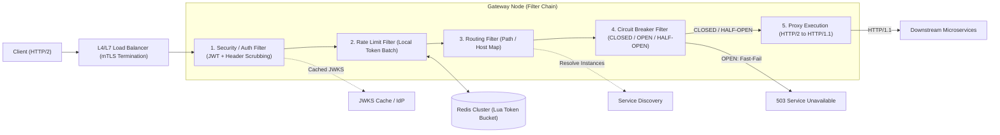

# 📋 API Gateway System Design

> **Evidence Contract Note:** This template adheres to the `curriculum-evidence-contract.md`. 
> Target Layer: [Core / Staff]
> HLD designs remain docs-only unless an explicit policy exception is noted. Unsourced figures are scenario assumptions, not verified external facts.

---

## 1. 📝 Requirements and Constraints

### Problem Statement
- System to design: API Gateway System
- Core user value: Provide a unified, secure, and resilient entry point for distributed microservices.

### Functional Requirements
- [x] FR1: Reverse proxy routing with HTTP/2 to HTTP/1.1 down-conversion.
- [x] FR2: Distributed token-bucket rate limiting via Redis Lua scripts + local caching.
- [x] FR3: JWT validation (via JWKS), mTLS termination, CORS, header scrubbing.
- [x] FR4: Resilience via circuit breakers (Hystrix pattern) and retries with backoff/jitter.

### Non-Functional Requirements
| Requirement | Target |
|---|---|
| Added Latency | < 10 ms P99 |
| Availability | 99.99% |
| Throughput | 100k peak QPS |

### Constraints
- Minimal overhead on the critical path.
- Stateless gateway nodes (relying on Redis for distributed state).

### Out of Scope (Non-Goals)
- Code simulators for the filter chain.
- Billing or deep API analytics ingestion.

---

## 2. 📊 Back-of-Envelope Estimation

### Traffic
| Metric | Value | Formula |
|---|---|---|
| DAU | 10M | input |
| Requests/user/day | 50 | input |
| Daily requests | 500M | DAU × requests/user |
| Avg QPS | ~6,000 | daily / 86400 |
| Peak QPS | ~100,000 | avg × burst factor (15x) |

### Storage & Bandwidth
| Metric | Avg Size | Value |
|---|---|---|
| Payload Size | 2 KB | input |
| Peak Bandwidth | - | 100k QPS * 2 KB = 200 MB/s |
| JWT JWKS Cache | 1 MB | local memory |

### Decision Notes
- High Peak QPS forces the use of local token caching to prevent Redis from becoming a bottleneck during traffic spikes.

---

## 3. 🔌 API / System Interface

### External Contract
- Protocol choice: HTTP/2 at edge, HTTP/1.1 internally.
- Auth model: JWT Bearer tokens in Authorization header.
- Rate limiting policy: Client-tier quotas (e.g., Free=100/min, Pro=1000/min).

### Core Endpoints
(Gateway routes dynamic paths, but these illustrate configuration/health)
```http
GET /health
GET /.well-known/jwks.json (Upstream dependency)
```

### Error Model
- `401` Unauthorized (JWT invalid/expired)
- `429` Too Many Requests (Rate limit exceeded)
- `502` Bad Gateway (Downstream connection refused)
- `503` Service Unavailable (Circuit breaker OPEN)
- `504` Gateway Timeout (Downstream timed out)

---

## 4. 🗄️ Core Entities and Data Model

### Storage Choices
- Primary DB: Redis (for distributed rate limiting state).
- Cache: Local in-memory caching (Caffeine/Guava in Java, LRU in Python) for JWKS keys and token bucket batches.

---

## 5. 🏗️ High-Level Architecture

### Architecture Diagram



Incoming HTTP/2 client requests terminate mTLS at the L4/L7 Load Balancer before entering a stateless Gateway Node that runs a five-stage filter chain. The Security Filter validates JWT signatures against a local JWKS cache and scrubs internal headers, while the Rate Limit Filter consumes pre-fetched local token batches backed by atomic Redis Lua scripts to sustain 100k peak QPS within the 10 ms P99 budget. The Routing Filter resolves target endpoints via Service Discovery, and the Circuit Breaker Filter either sheds load immediately with `503 Service Unavailable` when open or passes requests to Proxy Execution for HTTP/2-to-HTTP/1.1 forwarding.

### Component List
- **L4/L7 Load Balancer**: mTLS termination.
- **Gateway Nodes**: Stateless, auto-scaled application instances executing the Filter Chain.
- **Redis Cluster**: Rate limiting state management.
- **Service Discovery**: Resolves downstream microservice IPs.

### Request Lifecycle (Filter Chain)
1. **Security/Auth Filter**: Validate JWT signature against cached JWKS. Scrub internal headers.
2. **Rate Limit Filter**: Evaluate client quota (local cache -> Redis Lua script).
3. **Routing Filter**: Determine upstream service via Path/Host map.
4. **Circuit Breaker Filter**: Check if upstream is healthy (CLOSED). If OPEN, fast-fail with `503`.
5. **Proxy Execution**: Down-convert HTTP/2 to HTTP/1.1, forward request, await response.

### Explicit Traces

#### Normal Trace
1. Client sends HTTP/2 request -> LB terminates mTLS.
2. Gateway verifies JWT locally -> Decrements token bucket -> Routes request.
3. Receives HTTP/1.1 response from downstream -> Returns to client.

#### Failure Trace (Circuit Breaker)
- Downstream times out repeatedly.
- Circuit Breaker transitions `CLOSED -> OPEN`.
- Subsequent requests fail-fast with `503` (shedding traffic).
- After timeout, transitions to `HALF-OPEN` to test downstream recovery.

---

## 6. 🔍 Deep Dives

### Deep Dive A: Distributed Rate Limiting
- **Bottleneck**: Hitting Redis on every request at 100k QPS adds latency and overloads Redis.
- **Chosen pattern**: Token Bucket via Redis Lua scripts + Local Token Caching. Gateway pre-fetches a batch of tokens (e.g., 50 tokens at once) and consumes them locally.
- **Trade-off accepted**: Slight loss of strict global precision (a node crashing loses cached tokens, or slight over-provisioning across nodes) in exchange for massive latency reduction and Redis survival.

### Deep Dive B: Resilience and Circuit Breaking
- **Pattern**: Netflix Hystrix state machine.
- **Mechanics**: Track success/failure ratios over a rolling time window. If failure rate > threshold (e.g., 50%), trip the breaker to `OPEN`.
- **Alternatives**: Retries alone (causes retry storms). Breakers prevent cascading resource exhaustion.

---

## 8. ⚖️ Trade-offs and Decisions

| Decision | Option Chosen | Alternative | Why Chosen Now |
|---|---|---|---|
| Rate Limit Storage | Redis Lua | Cassandra | Redis offers single-threaded atomic operations crucial for token buckets. |
| Rate Limit Precision | Local caching batching | Strict Redis per-request | Latency strictness (<10ms added) requires avoiding network hops on hot paths. |
| Auth Validation | Decentralized (JWKS) | Centralized Auth Service | Avoids making Auth Service a single point of failure and bottleneck for every request. |

---

## 9. 🔮 Follow-up Questions

1. How do you handle configuration updates without restarting nodes?
2. How do we prevent 'retry storms' across the entire gateway?

---

## 13. ✅ Wrap-up Summary

1. Designed a resilient API Gateway for 100k peak QPS.
2. Core architecture revolves around a stateless Filter Chain intercepting HTTP/2 traffic.
3. Traded strict global rate limiting precision for latency by batching tokens locally.
4. Adopted Hystrix-style circuit breakers to protect downstream services from cascading failures.
