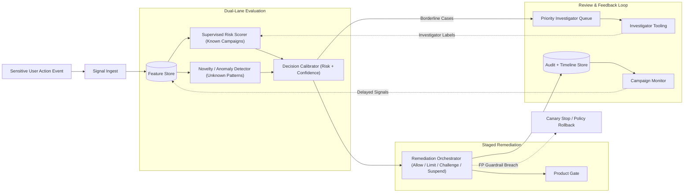

# Bot Detection Platform — High-Level Design

## 1) Requirements and Constraints

- Detect abusive automation quickly.
- Keep false positives low for legitimate high-activity users.
- Adapt rapidly to evolving attack campaigns.
- Preserve explainability for remediation decisions.

## 2) Back-of-Envelope Estimates

- 500M DAU, multiple sensitive actions/session.
- Multi-billion behavioral events/day.
- Online risk gate decisions need sub-200ms.
- Investigator review covers a tiny fraction of traffic.

## 3) API / Interface

```http
POST /api/v1/bot-risk/evaluate
{
  "account_id": "a42",
  "action": "send_message",
  "context": {"ip": "1.2.3.4", "device_id": "d9"}
}
```

Response:

```json
{
  "risk_score": 0.88,
  "confidence": 0.82,
  "action": "challenge",
  "reasons": ["velocity_spike", "graph_anomaly"],
  "policy_version": "r2026.04"
}
```

## 4) Core Data Model

- `RiskSignalEvent(account_id, signal_type, value, ts)`
- `AccountRiskSnapshot(account_id, score, confidence, model_version, ts)`
- `RemediationAction(account_id, action, reasons, policy_version, ts)`
- `InvestigationTask(task_id, account_id, priority, status)`
- `AccountRiskTimeline(account_id, snapshots, actions)`

## 5) Architecture

[Architecture Diagram](./diagrams/architecture.mmd)



Sensitive user actions flow through Signal Ingest into the Feature Store, which feeds two parallel scoring lanes: a Supervised Risk Scorer for known attack campaigns and a Novelty/Anomaly Detector for previously unseen behavioral patterns. The Decision Calibrator merges both risk and confidence scores to drive the Remediation Orchestrator's staged ladder (allow and monitor, limit or challenge, or suspend at the Product Gate) while routing borderline traffic to a priority Investigator Queue. Every decision is logged to the Audit and Timeline Store for the Campaign Monitor, closing the feedback loop with investigator labels and delayed signals while triggering canary stops or policy rollbacks if false-positive guardrails breach.

### Read/Write Paths

1. Sensitive user action emits risk-eval request.
2. Supervised and anomaly branches score account context.
3. Calibrator chooses remediation action by risk/confidence.
4. Orchestrator applies enforcement and logs rationale.
5. Investigator outcomes and delayed signals feed model updates.

## 6) Deep Dives

### A. Known vs Unknown Attack Coverage

- Supervised model catches known campaigns.
- Anomaly lane catches novel behavioral patterns.
- Merged calibration reduces blind spots.

### B. Confidence-Aware Remediation Ladder

- Low: allow + monitor.
- Medium: limit/challenge.
- High and confident: suspend.
- Borderline: investigation queue.

### C. Adaptation and Rollback

- Track bypass rate and post-action recovery rate.
- Canary policy changes by traffic slices.
- Roll back when false-positive guardrails breach.

## 7) Trade-Offs

| Decision | Chosen | Alternative | Why |
|---|---|---|---|
| Detection approach | supervised + anomaly | supervised only | resilience against unknown attacks |
| Remediation | staged ladder | immediate suspension | lower collateral damage |
| Investigator routing | priority queue | FIFO | aligns scarce capacity with risk |

## 8) Variants and Extensions

- Botnet graph clustering for coordinated campaigns.
- Device reputation service integration.
- Shared risk exchange across product surfaces.

