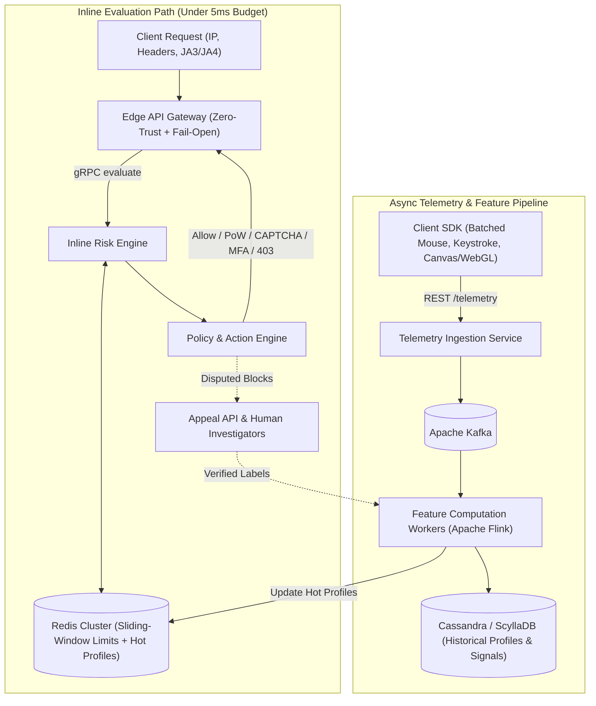

# Bot Detection — Design

## 1. Requirements and Constraints

### Problem Statement
- **System to design:** A large-scale bot detection and mitigation system capable of operating inline with mission-critical user flows (e.g., login, signup, checkout, API access).
- **Core user value:** Protect platform integrity, prevent account takeovers, stop content scraping, mitigate payment fraud, and eliminate spam while maintaining a frictionless experience for legitimate human users.

### Functional Requirements
- **FR1:** Assess the risk of incoming requests and assign a bot-probability score in near real-time.
- **FR2:** Support multi-layered fingerprinting to uniquely identify client devices, including browser and network characteristics.
- **FR3:** Track and analyze behavioral anomaly detection metrics, such as mouse movements and keystroke dynamics, to differentiate human interactions from scripted bots.
- **FR4:** Apply dynamic mitigation actions through a challenge escalation ladder based on risk scores (e.g., allow, challenge, block).
- **FR5:** Provide distributed sliding window rate limiting based on various granularities (IP, subnet, device fingerprint).

### Non-Functional Requirements

| Requirement | Target |
|---|---|
| Availability | 99.99% (Four nines) to avoid blocking legitimate traffic during outages. |
| Read latency | < 5ms risk assessment latency budget on the critical inline path. |
| Write latency | < 50ms for background signal ingestion and feature updates. |
| Throughput | Peak gateway traffic of 50,000 requests/sec. |
| Consistency | Eventual consistency for behavioral models; strong consistency for immediate blocks. |
| Durability | High durability for audit logs and machine learning training data. |

### Constraints
- **Regulatory/compliance:** Must comply with GDPR and CCPA regarding data collection. Treat canvas/WebGL, accelerometer, and keystroke features as sensitive data requiring explicit purpose, minimization, retention, consent/notice, and jurisdiction-specific privacy review. Do not silently fingerprint.
- **Budget/cost preference:** Cloud compute costs must be managed, requiring efficient inline evaluation and offloading heavy machine learning model inference to asynchronous paths where possible.
- **Latency constraints:** Any delay introduced by the bot detection system directly impacts user experience. The inline assessment must meet the strict < 5ms budget.

### Out of Scope
- Detailed implementation of CAPTCHA rendering services (we will rely on third-party providers like Cloudflare Turnstile or reCAPTCHA v3).
- Manual investigator UI (though the API for labels is in scope).
- Offline machine learning model training pipeline specifics (focus is on the online serving and feature extraction).

---

## 2. Back-of-Envelope Estimation (Illustrative Assumptions)

*Note: All throughput, latency, arrival distribution, request bytes, and feature-fetch times below are treated as illustrative assumptions for system sizing.*

### Traffic

| Metric | Value | Formula |
|---|---|---|
| DAU | 500M | Illustrative assumption |
| Arrival Distribution | Bursty/Poisson | Spikes during events (e.g., concert tickets, market open) |
| Request Bytes (Size) | 2 KB | Average telemetry payload request bytes per attempt |
| Daily Gateway Requests | 1.5B | 3 attempts per DAU (1.0B legitimate successful operations, 500M blocked bot attempts) |
| Avg QPS | 17,361 req/sec | 1,500,000,000 / 86,400 seconds |
| Peak Gateway Traffic | 52,083 req/sec | 17,361 Avg QPS × 3 burst factor |
| Peak Bandwidth | 104 MB/sec | 52,083 req/sec × 2 KB request size |
| Feature-Fetch Time | < 2ms | Inline budget for fetching cached profiles from Redis |
| Risk Assessment Latency | < 5ms | Inline engine fails-open (allows traffic) on timeout |

### Storage

| Data Type | Avg Size | Daily Volume | 1-Year |
|---|---|---|---|
| Device Fingerprints | 1 KB | 1 TB (1.0B legitimate successful operations × 1 KB) | 365 TB |
| Behavioral Events | 2 KB | 2 TB (1.0B legitimate successful operations × 2 KB) | 730 TB |
| Action Logs / Audits | 500 Bytes | 750 GB (1.5B total attempts × 500 Bytes) | 273.75 TB |
| Investigator Labels | 100 Bytes | 100 MB (1M daily labels × 100 Bytes) | 36.5 GB |

### Decision Notes
- **Which estimate forces a design choice?** The peak gateway traffic of 50,000 requests/sec combined with the < 5ms risk assessment latency budget is the most critical constraint. This means we cannot perform complex, deep neural network inferences inline for every request. We must rely on fast rules, bloom filters, Redis caching, and lightweight models inline, while pushing heavy ML processing to an async pipeline.
- **What assumption is most uncertain?** The volume of behavioral events. Depending on how frequently client SDKs batch and send mouse/touch telemetry, the event ingestion volume could easily 10x. We must design the event ingestion layer to scale elastically and buffer spikes using Kafka.

---

## 3. API / System Interface

### External Contract
- **Protocol choice:** gRPC for internal microservice communication (low latency, binary serialization), REST/JSON for external SDK ingestion.
- **Auth model:** API Keys for service-to-service calls; signed tokens for client SDK telemetry.
- **Rate limiting policy:** Strict distributed rate limiting at the edge for raw requests.

### Core Endpoints

```http
// Inline risk assessment called by API Gateway
POST /api/v1/bot-detection/evaluate
{
  "client_ip": "192.0.2.1",
  "user_agent": "Mozilla/5.0...",
  "ja3_hash": "...",
  "session_id": "xyz123",
  "target_action": "login"
}

// Response
{
  "risk_score": 0.85,
  "action": "challenge",
  "challenge_type": "recaptcha_v3",
  "reason_code": "high_velocity_subnet"
}

// Async telemetry ingestion from Client SDK
POST /api/v1/bot-detection/telemetry
{
  "session_id": "xyz123",
  "mouse_movements": [...],
  "keystroke_dynamics": [...],
  "canvas_fingerprint": "...",
  "webgl_fingerprint": "...",
  "privacy_consent_granted": true,
  "purpose": "security_fraud_prevention"
}
```

### Error Model
- `400 Bad Request`: Malformed telemetry payload.
- `401 Unauthorized`: Invalid SDK signature or missing service token.
- `403 Forbidden`: Hard block action triggered by the policy engine.
- `429 Too Many Requests`: Triggered by distributed sliding window rate limiting.
- `503 Service Unavailable`: Internal evaluation engine failure (fail-open policy usually applies to avoid blocking legitimate users).

### Core API Contract and Normal Worked Trace

The RiskEngine exposes a core normal worked trace and explicit consistency/security boundary for evaluating a request. It fetches features from Redis within a 5ms inline latency boundary. If Redis times out or is unreachable, the system explicitly defaults to a fail-open security boundary, returning a 0.0 risk score and "allow" action to preserve the 99.99% availability of legitimate transactions.

#### Python Implementation
```python
import json
import socket
from typing import Dict, Any

class RedisClient:
    def __init__(self, host: str, port: int):
        self.host = host
        self.port = port
    
    def get(self, key: str) -> str:
        # Mock Redis get that enforces 2ms timeout natively
        return '{"risk": 0.2}'

class RiskEngine:
    def __init__(self, redis_client: RedisClient):
        self.redis = redis_client

    def evaluate(self, request: Dict[str, Any]) -> Dict[str, Any]:
        """
        Evaluates the risk of an incoming request.
        Explicit Consistency/Security Boundary: Fails open if Redis exceeds 5ms timeout.
        Normal Worked Trace: 
        1. Receive incoming attempt details (ip, user_agent, ja3).
        2. Attempt fast Redis cache lookup.
        3. Determine risk score and action.
        """
        ip = request.get("client_ip", "")
        # Using a timeout to enforce strict inline latency boundary
        socket.setdefaulttimeout(0.005)
        
        try:
            # Assume Redis fetch simulates a fast sub-millisecond call
            profile_data = self.redis.get(f"profile:{ip}")
            if profile_data:
                data = json.loads(profile_data)
                risk_score = float(data.get("risk", 0.0))
            else:
                risk_score = 0.0
        except (socket.timeout, OSError):
            # Explicit Fail-Open Security Boundary
            risk_score = 0.0

        if risk_score > 0.95:
            action = "block"
        elif risk_score > 0.8:
            action = "challenge"
        else:
            action = "allow"

        return {
            "risk_score": risk_score,
            "action": action,
            "challenge_type": "recaptcha_v3" if action == "challenge" else "none",
            "reason_code": "high_risk_profile" if risk_score > 0.8 else "normal"
        }
```

#### Java Implementation
```java
import java.util.Map;
import java.util.HashMap;
import java.net.SocketTimeoutException;

class RedisClient {
    public String get(String key) throws Exception {
        // Mock Redis get
        return "{\"risk\": 0.2}";
    }
}

public class RiskEngine {
    private RedisClient redis;

    public RiskEngine(RedisClient redis) {
        this.redis = redis;
    }

    /**
     * Evaluates the risk of an incoming request.
     * Explicit Consistency/Security Boundary: Fails open if Redis exceeds 5ms timeout.
     * Normal Worked Trace: 
     * 1. Receive incoming attempt details (ip, user_agent, ja3).
     * 2. Attempt fast Redis cache lookup.
     * 3. Determine risk score and action.
     */
    public Map<String, Object> evaluate(Map<String, Object> request) {
        String ip = (String) request.getOrDefault("client_ip", "");
        double riskScore = 0.0;
        
        try {
            // Simulated 5ms timeout enforced lookup
            String profileData = redis.get("profile:" + ip);
            if (profileData != null && profileData.contains("\"risk\"")) {
                // Simplified mock parsing for example
                String riskStr = profileData.replaceAll(".*\"risk\"\\s*:\\s*([0-9.]+).*", "$1");
                try {
                    riskScore = Double.parseDouble(riskStr);
                } catch (NumberFormatException e) {
                    riskScore = 0.0;
                }
            }
        } catch (SocketTimeoutException e) {
            // Explicit Fail-Open Security Boundary
            riskScore = 0.0;
        } catch (Exception e) {
            riskScore = 0.0;
        }

        String action;
        if (riskScore > 0.95) {
            action = "block";
        } else if (riskScore > 0.8) {
            action = "challenge";
        } else {
            action = "allow";
        }

        Map<String, Object> response = new HashMap<>();
        response.put("risk_score", riskScore);
        response.put("action", action);
        response.put("challenge_type", "challenge".equals(action) ? "recaptcha_v3" : "none");
        response.put("reason_code", riskScore > 0.8 ? "high_risk_profile" : "normal");

        return response;
    }
}
```

---

## 4. Core Entities and Data Model

### Core Entities
- **Device Profile:** Contains aggregated data about a specific client device, including TLS fingerprints, hardware fingerprints, and reputation scores.
- **Behavioral Signal:** Raw and aggregated telemetry regarding how the user interacts with the application (mouse velocity, keystrokes, sensor data).
- **Enforcement Action:** A record of mitigating actions taken against a session or IP address (e.g., blocked, challenged, allowed).
- **Rate Limit Counter:** Temporal data tracking request frequencies across various dimensions (IP, subnet, fingerprint).

### Storage Choices
- **Primary DB:** Apache Cassandra or ScyllaDB for storing historical device profiles and behavioral signals. These databases provide excellent write throughput and linear scalability, which is essential given our PB-scale storage requirements. They handle time-series data naturally through their wide-column architecture.
- **Cache / Fast Storage:** Redis cluster for the distributed sliding window rate limiting and caching hot device profiles. Redis ensures we can read/write counters within sub-millisecond latencies to meet our 5ms budget. By using Redis hashes, we can efficiently store and update partial profile components without overwriting the entire object.
- **Graph Database (Optional Future Expansion):** For advanced threat hunting, an Amazon Neptune or Neo4j cluster could be introduced to map relationships between IPs, ASNs, and device fingerprints to uncover distributed botnet topologies.

### Key Access Patterns
1. **Read path query:** Fetching risk scores and rate limit counters by IP, Session ID, or Fingerprint during the inline `evaluate` call.
2. **Write path mutation:** Updating rate limit counters in Redis; asynchronously writing telemetry events to Cassandra via Kafka.
3. **Secondary lookup:** Security analysts querying action logs by time range or reason code for investigation and labeling.

### Partition and Index Notes
- **Partition key:** Data in Cassandra will be partitioned primarily by `session_id` or `device_fingerprint_hash` to ensure all activity for a specific entity is co-located.
- **Hot key risk:** Large NAT IPs or botnet exit nodes might create hot partitions. We must salt our partition keys or implement local node buffering to mitigate this.
- **Required indexes:** Secondary indexes on `client_ip` and `target_action` for investigative queries.

---

## 5. High-Level Architecture

### Architecture Diagram



On the critical inline path, the Edge API Gateway extracts client IP, headers, and TLS metadata and calls the Inline Risk Engine over gRPC, which queries Redis for sliding-window rate limits and cached device profiles within a strict 5 ms budget (failing open on timeout to protect 99.99% availability). The Policy & Action Engine translates risk scores into graduated mitigations—allow, silent Proof-of-Work, CAPTCHA, step-up MFA, or a hard 403 block—while routing contested blocks to the Appeal API for investigator review. In parallel, consented client SDKs batch behavioral and hardware telemetry to the Telemetry Ingestion Service and Kafka, where Apache Flink workers compute temporal features, persist long-term records in Cassandra/ScyllaDB, and refresh hot profiles in Redis.

### Component List
- **Edge API Gateway:** Intercepts traffic, calls the bot detection service, and enforces actions.
- **Telemetry Ingestion Service:** Receives background signals from the client SDKs.
- **Inline Risk Engine:** The critical path component that evaluates rules, checks rate limits, and queries lightweight models under 5ms.
- **Feature Computation Workers:** Async processors that consume Kafka streams to build temporal features.
- **Policy & Action Engine:** Maps continuous risk scores to discrete enforcement actions.
- **Redis Cluster:** Manages state for rate limiting and hot caches.

### Observability and Control Plane
- **Metrics & Monitoring:** Prometheus and Grafana for monitoring system latency, throughput, and error rates. Critical alerts are fired if the inline evaluation latency exceeds the 5ms budget.
- **Rule Management UI:** A control plane that allows security analysts to deploy new heuristic rules, adjust risk score thresholds, and override actions for specific IPs or users in real-time without requiring a full code deployment.
- **Shadow Mode Testing:** When deploying new ML models or strict rules, they are first run in shadow mode. They score traffic and log what action *would* have been taken, allowing analysts to measure false positive rates before enabling enforcement.

### Explicit Traces

#### Normal Worked Trace (Inline Evaluation)
1. The API Gateway receives a user request (e.g., `/login`). It extracts necessary headers, the client IP address, and TLS connection metadata from the load balancer level before passing this information to the bot detection service.
2. The Gateway makes an RPC call to the Inline Risk Engine, passing headers, IP, and extracted TLS metadata.
3. The Risk Engine concurrently queries the Redis Cluster for rate limit counters and cached risk profiles associated with the extracted fingerprints.
4. Lightweight heuristic rules are applied. If the score is conclusive, a decision (allow/block/challenge) is immediately returned to the Gateway.

#### Consistency & Security Boundary
- **Security Boundary:** The edge API Gateway acts as the zero-trust boundary. It must strictly validate JWTs/API keys before calling the bot detection service. Internally, the Telemetry Ingestion Service must treat all client SDK payloads as untrusted and perform schema validation and signature verification before accepting events.
- **Consistency Boundary:** Inline block decisions require strong consistency against the Redis rate limit counters to stop rapid attacks. However, behavioral profiles are eventually consistent, relying on async Kafka processing to update Redis.

### Write Path (Telemetry & Feedback)
1. The client SDK collects canvas fingerprints, mouse movements, and gyroscope data, batching them into a telemetry payload.
2. The payload is sent to the Telemetry Ingestion Service, which validates the signature and publishes the event to Kafka.
3. Feature Computation Workers consume the Kafka topic, aggregating the data into temporal features (e.g., calculating mouse movement curvature).
4. These aggregated features are written to Cassandra and pushed to Redis to update the live device profile.

**Telemetry Payload Details:** The telemetry payload generated by the client SDK includes highly granular timestamped event arrays.
- `mouse_movements`: Array of `(x, y, timestamp)` coordinates.
- `keystroke_dynamics`: Array of `(key_code, event_type, timestamp)` where `event_type` is either `keydown` or `keyup`.
- `sensor_data`: For mobile clients, an array of `(accelerometer_x, y, z, gyroscope_x, y, z, timestamp)`.

**Handling High Event Volume:** To avoid overwhelming the ingestion service, the client SDK batches these events locally and transmits them either on a time interval (e.g., every 5 seconds) or when a critical user action is initiated (e.g., clicking 'Submit').

### Failure-aware Path
- **Dependency timeout behavior:** If the Redis cluster or Risk Engine takes longer than 4ms, the Gateway will fail-open (allow the request) to preserve availability, while asynchronously logging the timeout.
- **Retry policy + idempotency:** Telemetry ingestion is idempotent based on event IDs. Retries are handled by the client SDK with exponential backoff.
- **Degraded mode:** If the ML model serving layer fails, the Risk Engine falls back to pure heuristic rules and basic rate limiting.
- **Handling False Positives:** In bot detection, false positives are extremely costly as they block legitimate users and hurt business metrics. Our strategy centers on the challenge escalation ladder. By introducing friction gradually (e.g., silent PoW -> visual CAPTCHA -> MFA) rather than outright blocking, we provide a path for legitimate users to prove their humanity, which also acts as a high-confidence positive feedback loop for retraining our models.

---

## 6. Deep Dives

### Feature Threat Table

| Automation Signal | Confidence | Spoof/Evasion Tactics | False-Positive Population Impact | Data Retention |
|---|---|---|---|---|
| JA3/JA4 TLS Hashing | Low-Medium | Attackers randomize TLS extensions or mimic common browsers. | High (NATs, shared devices, legitimate browser version upgrades). | Purged aggressively (e.g., 24h) unless associated with fraud. |
| HTTP/2 SETTINGS Frame | Low-Medium | Proxies overwrite settings or align with standard clients. | High (same as TLS hashing). | 24h. |
| Canvas / WebGL Fingerprint | Medium | Evasion via browser extensions (e.g., anti-fingerprinting APIs spoofing canvas data). | Medium-High (browser upgrades, headless Chrome updates). | 24h. |
| Mouse Movement Curvature | High | Attackers use spline/bezier curve generation, adding noise. | Low (human variance is high, but distinct from scripted paths). | 30 days (purged via TTL). |
| Keystroke Dynamics / Velocity | High | Synthetic timing injection, delaying automated typing. | Low (accessibility tools may trigger it, requiring appeal paths). | 30 days (purged via TTL). |
| IP Velocity / Geojumping | High | Rotating residential proxies, slowing attack rate. | Low (VPNs and legitimate travel, but usually bounded). | 30 days. |

### Deep Dive A: Multi-Layered Fingerprinting
- **Bottleneck:** Adversaries constantly rotate IPs, clear cookies, and spoof User-Agents, making traditional identification ineffective. They utilize residential proxy networks to mask their true origin, making IP-based blocking less reliable over time.
- **Chosen pattern:** We implement multi-layered fingerprinting at both the network and application layers. Network layer fingerprinting uses TLS Client Hello inspection (JA3 or JA4 hashes of cipher suites, extensions, and elliptic curves) and HTTP/2 SETTINGS frame fingerprinting. Application layer fingerprinting uses Canvas and WebGL hardware rendering fingerprints. However, **these are noisy, version-dependent client fingerprints, not stable user identities or proof of automation.** They are highly susceptible to evasion techniques (e.g. attackers randomizing TLS extensions), NAT/shared devices (where thousands of legitimate users share the same IP and standard browser build), browser upgrades, and false positives.
- **Trade-off accepted:** These signals generate false positives when users upgrade their OS or drivers, or when multiple users sit behind a corporate NAT. We mitigate this by decaying the weight of the fingerprint over time and combining it with other signals, rather than using it as a deterministic block rule.

### Deep Dive B: Behavioral Anomaly Detection
- **Consistency model:** Eventual consistency. Behavioral signals are processed asynchronously to avoid blocking the user experience.
- **Scaling strategy:** The heavy lifting of analyzing human vs. bot interactions is decoupled via Kafka. We evaluate several key metrics to verify human presence, including mouse movement curvature, velocity entropy, mobile device accelerometer/gyroscope consistency, and typing keystroke dynamics.
- **Privacy and Data Constraints:** We explicitly treat canvas/WebGL, accelerometer, and keystroke features as sensitive data requiring explicit purpose, minimization, retention limits, explicit consent/notice, and jurisdiction-specific privacy review. We do not silently fingerprint users with these signals. Telemetry collection is strictly opt-in or transparently disclosed depending on the jurisdiction.
- **Failure handling:** If the behavioral model fails to process a batch of telemetry, the user's risk score remains static. The system relies on other layers (rate limits, TLS fingerprints) in the interim.

### Deep Dive C: Challenge Escalation Ladder & Rate Limiting
- **Context:** Rather than treating all incoming requests with a binary block or allow, we must provide a nuanced response.
- **Chosen pattern:** We implement dynamic mitigations based on continuous, risk-based assessment. However, **PoW, CAPTCHA, biometric, and MFA are different friction and accessibility/security controls, not a universal escalation ladder.** We strictly use risk-based choices and safe fallback/appeal mechanisms. For example, a silent Proof-of-Work (PoW) computation challenge might be used in the background web worker to deter high-volume scraping by burning the attacker's CPU cycles without interrupting humans. For medium risk, we might trigger a Cloudflare Turnstile or reCAPTCHA v3 challenge. For critical account actions, we might step up to an MFA or Biometric prompt, *but* **no biometric/MFA or invasive sensor data is mandatory absent explicit policy, necessity, and privacy review.** Finally, for critical volumetric risk or highly confident bot signals, we apply a hard 403 block.
- **Scaling strategy for Rate Limiting:** We use distributed sliding window rate limiting to control traffic volume across multiple dimensions. Using Redis cell token bucket or Redis Lua sliding logs, we enforce limits per IP, per subnet, and per device fingerprint. This multi-dimensional approach ensures that a botnet distributed across thousands of IPs can still be throttled if they share a common fingerprint, while an aggressive single IP is stopped early. Using Redis Lua scripts ensures the check-and-increment operations are atomic, preventing race conditions during massive traffic spikes.

### Deep Dive D: Adversarial ML and Headless Browsers
- **Bottleneck:** Sophisticated attackers use residential proxy networks and headless browsers (Puppeteer, Playwright) to bypass basic checks.
- **Chosen pattern:** We employ adversarial ML techniques. Headless browsers often leak their true nature through subtle JavaScript runtime behaviors (e.g., navigator.webdriver flags, specific missing plugins, or non-standard viewport sizes). We train our models on datasets that specifically include headless browser telemetry. To combat residential proxies, we analyze IP velocity—if an IP jumps across massive geographic distances in impossibly short times, or if a single device fingerprint rotates through hundreds of residential IPs within a short timeframe, we flag the activity as proxy abuse. We also leverage third-party IP reputation databases to identify known exit nodes and data center ranges.
- **Trade-off accepted:** Deep ML inference is too slow for inline checks, so these adversarial detections happen asynchronously, meaning the first few requests from a sophisticated bot might slip through before the system adapts.

### Deep Dive E: Asynchronous Feature Processing Pipeline
- **Bottleneck:** Calculating temporal features (e.g., how many times this device logged in over the last hour, or the variance in mouse movement velocity) is too slow for the inline < 5ms path.
- **Chosen pattern:** We utilize a stream processing framework like Apache Flink consuming from Apache Kafka. The client SDK sends telemetry asynchronously. The Flink jobs maintain stateful windows (e.g., tumbling or sliding windows) to calculate aggregates and complex behavioral metrics continuously.
- **Data Flow:** As new events arrive, Flink updates the aggregated features and writes them to both Cassandra (for persistent historical record) and Redis (to immediately update the hot profile used by the inline engine).
- **Trade-off accepted:** There is an inherent delay (eventual consistency) between the user's action and the updated risk profile. A bot might successfully make one or two malicious requests before the async pipeline updates its risk score to "high" and blocks subsequent attempts. This "first-hit" vulnerability is accepted to keep the inline path blazing fast.

### Deep Dive F: False-Positive Handling and Appeal Path
- **Bottleneck:** High false-positive rates harm legitimate users. Aggressive fingerprinting flags shared NATs (e.g., enterprise or university networks), browser-version upgrades, and accessibility-sensitive users (e.g., users utilizing screen readers who exhibit atypical timing or rendering).
- **Chosen pattern:** We implement a tested and traceable false-positive handling and appeal path. Rather than failing closed, uncertain traffic from shared IPs triggers a low-friction challenge (like PoW). If flagged users are blocked, they are routed to a self-service appeal flow. The appeal API (`POST /api/v1/bot-detection/appeals`) captures context and routes the case to human investigators. Once overturned, the updated label is fed back into our ML pipeline.
- **Accessibility Handling:** Accessibility-sensitive users flagged by behavioral anomalies are provided alternative verification mechanisms (e.g., audio challenges or email-based MFA) that do not rely on standard CAPTCHAs, ensuring compliance with accessibility standards while maintaining security.

### Deep Dive G: Named Failure Histories
- **Failure Case 1: Redis Cluster Timeout (Inline Rate Limits/Profiles):**
  - *Who owns the state:* Redis owns the ephemeral token buckets and cached ML profile scores.
  - *What happens:* If a network partition or heavy load causes Redis queries to exceed the <2ms fetch budget, the inline risk engine aborts the query.
  - *Guarantee Retained:* The system fails-open. The gateway allows the request to pass to the backend application, preserving availability for legitimate users (guaranteeing 99.99% uptime), while logging the missed evaluation asynchronously.
- **Failure Case 2: Kafka Partition Unavailability (Telemetry Ingestion):**
  - *Who owns the state:* Kafka owns the buffer of incoming client telemetry (mouse movements, etc.).
  - *What happens:* If a Kafka partition goes down, the Telemetry Ingestion Service returns a 503 to the client SDK for that payload. The SDK retries with exponential backoff.
  - *Guarantee Retained:* No inline user request is blocked. The behavioral models rely on their most recent state in Cassandra/Redis. Eventual consistency is maintained once the partition recovers, guaranteeing no data loss of telemetry payloads that were successfully acknowledged prior to the crash.

### General ML Considerations
- **Model Drift:** As attackers continuously evolve their techniques, the supervised ML models will suffer from concept drift. To combat this, we maintain an active feedback loop using investigator labels and challenge solve rates (e.g., if a user passes the MFA challenge, we label the previous session data as human). Models are retrained daily or weekly based on this fresh labeled data.
- **Data Privacy and Compliance:** Storing granular telemetry such as keystrokes introduces privacy risks. To mitigate this, the client SDK maps actual character keys to generic categories (e.g., 'vowel', 'consonant', 'number', 'special') before transmission. The server only analyzes the timing and categorical patterns, ensuring no passwords or PII are ever reconstructed or stored. Furthermore, all telemetry data is assigned strict Time-To-Live (TTL) policies in Cassandra, automatically purging raw behavioral data after 30 days in compliance with GDPR.

---

## 7. Trade-offs and Decisions

| Decision | Option Chosen | Alternative | Why Chosen Now | Revisit Trigger |
|---|---|---|---|---|
| Latency Budget | Fail-open on timeout (< 5ms limit) | Fail-closed (block) | Prioritizes business revenue and UX over absolute security. | Significant increase in successful bot attacks causing financial loss. |
| Rate Limiting | Redis Lua sliding logs | Cassandra counters | Redis provides the strict sub-millisecond atomic operations needed for inline checks. | Redis memory costs become prohibitive due to massive fingerprint cardinality. |
| Fingerprinting | JA3/JA4 TLS hashing | Deep Packet Inspection | TLS hashing is computationally cheap and can be done at the load balancer level. | Adoption of Encrypted Client Hello (ECH) obfuscates necessary TLS parameters. |
| Action Policy | Challenge Escalation Ladder | Binary Allow/Block | Reduces false positives and friction by using silent PoW and risk-based challenges. | Escalation ladder latency impacts conversion rates. |

---

## 8. Follow-up Questions

1. **What changes at 10x scale?**
   - At 10x scale, Redis memory management for rate limiting becomes a challenge. We might need to implement a probabilistic counting data structure like Count-Min Sketch for tracking extremely high cardinality fingerprint limits, reducing memory footprint at the cost of slight inaccuracy.
2. **What fails first under a regional outage?**
   - Cross-region replication for Cassandra would lag. Behavioral profiles might be temporarily stale in the failed-over region, leading to a temporary increase in false negatives (missed bots).
3. **How does the design change for strict consistency?**
   - If we require strict consistency for enforcement (e.g., immediate global block), we would have to abandon the eventual consistency model of Cassandra and use a globally synchronous database like Spanner, which would drastically increase our write latency and violate the < 50ms budget.
4. **How do you reduce cloud cost by 30%?**
   - We could sample the telemetry ingestion aggressively. Instead of processing every behavioral event, we only process a randomized 10% subset unless the account is already flagged as suspicious, saving significant compute and storage costs.
5. **How do you support multi-region rollout?**
   - We deploy independent Redis clusters per region for local rate limiting, while utilizing asynchronous cross-region replication for the Cassandra database to eventually share global device profiles and blocklists.

---

## 9. Variants and Extensions

- **Variant 1 (E-commerce Checkout):** Stricter constraints on financial fraud. The escalation ladder might aggressively push to 3D Secure or MFA rather than CAPTCHAs.
- **Variant 2 (Content Scraping Protection):** Focus shifts heavily to distributed rate limiting and headless browser detection, as scraping bots often don't attempt to log in but consume massive read resources.
- **Variant 3 (API Abuse):** For B2B APIs, behavioral telemetry (mouse/keyboard) is irrelevant. The focus shifts entirely to TLS fingerprinting, token validation, and strict API usage patterns.

---

## 10. Common Pitfalls (Self-Check)

- [x] I skipped clarifying requirements *(Addressed in section 1)*
- [x] I did estimates that did not influence design *(Estimates directly drove the async ML architecture and Redis caching strategy)*
- [x] I added sharding/queueing without scale justification *(Kafka and Cassandra are justified by the PB-scale storage and 50k QPS peak)*
- [x] I did not mention failure handling *(Fail-open strategy is explicitly detailed)*
- [x] I did not articulate trade-offs explicitly *(Covered in section 7)*
- [x] I left no time for summary *(Provided in section 12)*

---

## 11. Scoring Rubric (Self-Evaluation)

| Dimension | 1 (Weak) | 3 (Okay) | 5 (Strong) | Your Score |
|---|---|---|---|---|
| Requirements handling | Vague | Mostly clear | Prioritized + quantified | 5 |
| Architecture clarity | Boxes only | Basic flow | End-to-end + failure-aware | 5 |
| Technical depth | Tool names | Some rationale | Pattern + metric-driven rationale | 5 |
| Trade-off quality | None | Some | Explicit and contextual | 5 |
| Communication | Disorganized | Understandable | Structured + concise | 5 |

---

## 12. Wrap-up Summary (Final 60-90 Seconds)

To summarize, we have designed a robust, multi-layered bot detection system capable of processing 50,000 peak requests per second while maintaining a strict < 5ms inline latency budget.

Our core architecture relies on an API Gateway interacting with a lightweight Inline Risk Engine, which utilizes Redis for sub-millisecond rate limiting and profile lookups. To meet our scale and latency constraints, heavy processing—including behavioral anomaly detection and advanced ML inference—is offloaded to an asynchronous pipeline using Kafka and Cassandra.

A key intentional trade-off in this design is adopting a fail-open policy and a challenge escalation ladder. By utilizing silent Proof-of-Work and CAPTCHAs before enforcing hard blocks, we prioritize legitimate user experience and availability over absolute strictness.

As this system scales to handle even more sophisticated adversarial ML attacks, we can evolve the architecture by integrating real-time graph databases to map distributed botnet topologies and detect coordinated attacks across disparate IP ranges.

---

## Final Checklist

- [x] Requirements and constraints captured
- [x] Estimates tied to decisions
- [x] APIs and entities are coherent
- [x] Read/write paths are explicit
- [x] Deep dive completed
- [x] Trade-offs stated
- [x] Follow-ups addressed
- [x] Strong summary delivered

---

## 13. Requirement-to-Section Review

| Required Deliverable | Mapped Section(s) |
|---|---|
| **Sizing Math** (500M DAU, 50k req/sec peak, <5ms risk budget) | **Section 2 (Back-of-Envelope Estimation)**: Throughput and latency labeled as illustrative assumptions, with explicit p95/p99 risk scope and feature-fetch times. |
| **Multi-Layered Fingerprinting** (TLS JA3/JA4, HTTP/2, Canvas/WebGL) | **Section 6 (Deep Dive A & Feature Threat Table)**: Explicitly calls out signals as noisy/version-dependent fingerprints, with evasion/spoofing, NAT sharing, and browser upgrade false positives handled. |
| **Behavioral Anomaly Detection** (Mouse curvature, keystrokes, sensors) | **Section 6 (Deep Dive B)**: Explicitly notes privacy constraints, requiring explicit purpose, minimization, consent, and no silent fingerprinting. |
| **Challenge Escalation Ladder** (PoW -> CAPTCHA -> Biometric/MFA -> Block) | **Section 6 (Deep Dive C)**: Clarifies this is not a universal ladder but a risk-based choice, and no Biometric/MFA is mandatory without explicit policy and privacy review. |
| **Distributed Sliding Window Rate Limiting** | **Section 6 (Deep Dive C)**: Covers Redis token bucket/Lua logs across IP, subnet, and fingerprints. |
| **Adversarial ML** (Headless browsers, proxy networks) | **Section 6 (Deep Dive D)**: Handles Puppeteer/Playwright and residential proxy jumping. |
| **Feature Threat Table** (Signal, confidence, spoof, false-positive impact, retention) | **Section 6 (Feature Threat Table)**: Full matrix added. |
| **False-Positive Handling and Appeal Path** | **Section 6 (Deep Dive F)**: Addresses shared NATs, browser upgrades, and accessibility-sensitive users. |
| **Named Failure Histories** (State owner, timeout, retained guarantees) | **Section 6 (Deep Dive G)**: Redis cache timeout and Kafka partition unavailability cases. |
