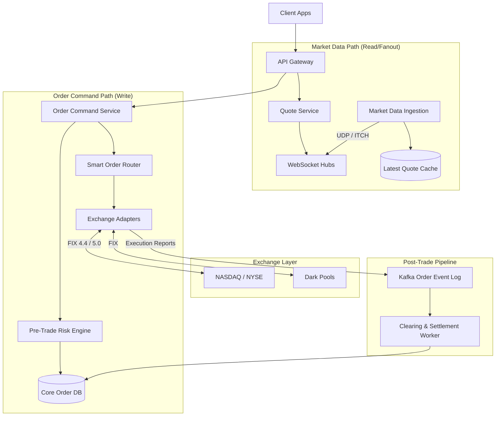

# Brokerage Platform — High-Level Design

---

## 1. 📝 Requirements and Constraints

### Problem Statement
- System to design: A high-frequency brokerage platform connecting retail users to stock exchanges.
- Core user value: Real-time market data visibility and rapid, reliable execution of trades with robust risk management.

### Functional Requirements
- [x] FR1: Users can view live quotes and market data in near real-time.
- [x] FR2: Users can place, modify, and cancel market and limit orders.
- [x] FR3: Users can view order status transitions (pending, open, partially filled, filled, cancelled).
- [x] FR4: System must perform strict pre-trade risk checks (margin, buying power, collars).
- [x] FR5: System must handle Smart Order Routing (SOR) across multiple venues (NYSE, NASDAQ, dark pools).
- [x] FR6: System must reconcile post-trade clearing and settlement (T+1/T+2).

### Non-Functional Requirements (Scenario Assumptions)
*Note: The following metrics and latency budgets are explicit design assumptions for a specific hypothetical hardware and workload scenario (e.g., US Equities on a standard 10Gbps AWS EC2 cluster), not universal industry facts.*

| Requirement | Target |
|---|---|
| Availability (Order Path) | 99.95% (Hypothetical SLA) |
| Availability (Market Data) | 99.99% (Hypothetical SLA) |
| Order Read Latency | < 50ms (p95 assumption) |
| Order Turnaround Budget| < 50ms (p50 from gateway acknowledgment to exchange acknowledgment) |
| Pre-Trade Risk Latency | < 1ms budget (p99 assumed for in-memory checks) |
| Market Data Update Latency| < 500ms P99 to client |
| Throughput (Orders) | 10,000 peak submissions/sec |
| Throughput (Market Data)| 2,000,000 tick updates/sec during market open |
| Consistency (Orders) | Strong (Strict consistency for money and shares) |
| Durability (Orders) | 100% durable before execution |

### Constraints
- Regulatory/compliance: FINRA OATS/CAT reporting, SEC Reg T (margin), Reg NMS (best execution).
- Budget/cost preference: High network egress costs for fanout, expensive FIX connections to exchanges.
- Team/operational constraints: Market hours are rigid (9:30 AM - 4:00 PM EST); deployments happen out of hours.
- Region/geography constraints: Core order matching and risk engine must be co-located or near exchange data centers (e.g., Carteret for NASDAQ, Mahwah for NYSE).

*Disclaimer: The routing, ledger, and clearing architecture described herein is strictly educational and does not constitute legal or investment advice.*

### Out of Scope
- High-Frequency Trading (HFT) sub-microsecond prop trading algorithms.
- Complex derivatives (options, futures, swaps) pricing models.
- Consumer portfolio recommendation systems.

---

## 2. 📊 Back-of-Envelope Estimation (Only What Changes Design)

### Traffic

*Note: Workload totals and capacities are derived from mathematical models for this scenario and are not measured industry benchmarks.*

| Metric | Value | Formula |
|---|---|---|
| DAU | 20,000,000 | Assumption |
| Order Attempts/user/day | 0.25 | Assumption |
| Daily Order Attempts | 5,000,000 | 20M × 0.25 |
| Rejection Rate | 20% | Insufficient funds, risk failures |
| Daily Successful Orders | 4,000,000 | 5,000,000 × (1 - 0.20) |
| Peak Order QPS (Attempts) | 10,000 req/sec | Market Open burst (highly skewed, assuming 172x average) |
| Peak Order QPS (Successful) | 8,000 req/sec | 10,000 × 0.80 |
| Market Data Ticks | 2,000,000 / sec | Peak updates for all equities combined |
| Concurrent WS Users | 100,000+ | Assumption |

### Network Sizing (Assumption)
- **Order Message Size**: ~1 KB JSON. 10,000 req/sec attempts * 1 KB = ~10 MB/sec network ingress. (Bandwidth must provision for total attempts to accurately model risk-rejection overhead).
- **Market Data Tick Size**: ~100 Bytes binary. 2,000,000 ticks/sec * 100 Bytes = ~200 MB/sec network ingress from UDP. Fanout to 100,000 users = 20 GB/sec egress. (Forces design choice for edge caching and protocol optimization).

### Storage

| Data Type | Avg Size | Daily Volume | 1-Year |
|---|---|---|---|
| Order State (DB) | 1 KB | 5 GB (All attempts) | ~1.8 TB |
| Order Events (Log) | 500 B | 8 GB (Successful only, assuming 4 events/order) | ~2.9 TB |
| Double-Entry Ledgers| 2 KB | 8 GB (Successful only) | ~2.9 TB |
| Market Data Ticks | 100 B | 200 GB (1 hr peak) / 1TB (full day) | ~250 TB |

### Decision Notes
- Which estimate forces a design choice? The **2,000,000 ticks/sec** requires a specialized ingestion pipeline (UDP multicast, ring buffers) separate from the strict transactional order flow. It cannot be handled by a standard REST API or RDBMS.
- What assumption is most uncertain? The burst multiplier during market open/close and "meme stock" events, which can spike 100x average volume, requiring aggressive dynamic scaling or strict backpressure.

---

## 3. 🔌 API / System Interface

### External Contract
- Protocol choice: Mixed. REST for order submission/history, WebSocket for real-time market data.
- Auth model: OAuth 2.0 with JWT tokens. Strict session binding.
- Rate limiting policy: Token bucket per user (e.g., 50 orders / sec max) to prevent rogue algo/fat fingers.

### Core Endpoints

```http
POST /api/v1/orders
Headers: 
  Authorization: Bearer <token>
  Idempotency-Key: <uuid>
Body:
{
  "symbol": "AAPL",
  "side": "BUY",
  "orderType": "LIMIT",
  "quantity": 100,
  "limitPrice": 150.50,
  "timeInForce": "GTC"
}

POST /api/v1/orders/{orderId}/cancel
Headers: 
  Authorization: Bearer <token>
  Idempotency-Key: <uuid>

GET /api/v1/orders/{orderId}
```

### Error Model
- `400` invalid input (e.g., negative price).
- `401/403` auth/authz (invalid token or insufficient permissions).
- `404` order not found.
- `409` order state transition conflict (e.g., trying to cancel a `FILLED` order).
- `422` Pre-trade risk rejection (insufficient buying power, margin call).
- `429` Rate limit exceeded.

---

## 4. 🗄️ Core Entities and Data Model

### Core Entities

- **Accounts**: Tracks user balances (cash, margin).
- **Positions**: Tracks held assets (e.g., long 100 AAPL).
- **Orders**: Tracks the lifecycle of a user intent.
- **Fills**: Tracks individual execution slices of an order.
- **Ledgers**: Double-entry bookkeeping for all cash and asset movements.

### Storage Choices
- Primary DB: **PostgreSQL** or **CockroachDB/Spanner**. (Reason: Strong ACID guarantees, crucial for double-entry ledgers and financial state).
- In-Memory Risk DB: **Redis** or custom in-memory grid. (Reason: Pre-trade risk needs < 1ms latency for buying power checks).
- Market Data Cache: **Redis** (Reason: Latest quote retrieval).
- Event Bus: **Kafka**. (Reason: Durable, replayable event sourcing for order events and fills).

### Data Schemas

**Table: Accounts**
| Column | Type | Notes |
|---|---|---|
| account_id | UUID | PK |
| user_id | UUID | FK |
| type | ENUM | CASH, MARGIN |
| cash_balance | DECIMAL | E.g., 10000.0000 |
| locked_cash | DECIMAL | Cash held for pending limit buys |
| version | INT | For optimistic concurrency |

**Table: Positions**
| Column | Type | Notes |
|---|---|---|
| position_id| UUID | PK |
| account_id | UUID | FK |
| symbol | VARCHAR | E.g., AAPL |
| quantity | DECIMAL | E.g., 100.0000 |
| locked_qty | DECIMAL | Shares held for pending limit sells |

**Table: Orders**
| Column | Type | Notes |
|---|---|---|
| order_id | UUID | PK |
| account_id | UUID | FK |
| symbol | VARCHAR | |
| side | ENUM | BUY, SELL |
| order_type | ENUM | MARKET, LIMIT |
| quantity | DECIMAL | |
| limit_price| DECIMAL | NULL for market |
| filled_qty | DECIMAL | |
| avg_price | DECIMAL | |
| status | ENUM | PENDING, OPEN, PARTIAL, FILLED, CANCELED, REJECTED |
| idempotency_key | VARCHAR | Unique per client submit |
| created_at | TIMESTAMP| |

**Table: Fills**
| Column | Type | Notes |
|---|---|---|
| fill_id | UUID | PK, Exchange provided execution id |
| order_id | UUID | FK |
| account_id | UUID | FK (Partition key) |
| symbol | VARCHAR | |
| side | ENUM | BUY, SELL |
| quantity | DECIMAL | Execution quantity for this fill |
| price | DECIMAL | Execution price |
| venue | VARCHAR | E.g., NASDAQ, DARKPOOL_X |
| filled_at | TIMESTAMP| Exchange execution time |

**Table: LedgerEntries** (Double-Entry Bookkeeping)
| Column | Type | Notes |
|---|---|---|
| entry_id | UUID | PK |
| transaction_id| UUID | Groups Debits/Credits |
| account_id | UUID | FK (User account, System Clearing Account) |
| asset_type | VARCHAR | USD, AAPL |
| amount | DECIMAL | Positive for Debit, Negative for Credit |
| direction | ENUM | DEBIT, CREDIT |
| purpose | ENUM | TRADE_SETTLEMENT, DEPOSIT, FEE |
| created_at | TIMESTAMP| Strict append-only immutable |

*Invariant*: `SUM(amount) WHERE transaction_id = X AND asset_type = Y MUST EQUAL 0`

### Partition and Index Notes
- Partition key: `account_id` for Orders, Fills, and Ledgers to ensure all data for a user resides on the same shard for fast transactional access.
- Hot key risk: System/Clearing accounts in the ledger can become hot. Solution: Batch aggregation or using multiple internal sweep accounts.
- Required indexes: `(account_id, status)` on Orders for fast active order lookup. `idempotency_key` for deduplication.

---

## 5. 🏗️ High-Level Architecture

### System Architecture



### Component List
- **API Gateway**: Handles TLS termination, auth, and rate limiting.
- **Quote Ingestion (ITCH/OUCH)**: Low-latency parsers for binary exchange market data.
- **WebSocket Hubs**: Horizontally scalable nodes pushing tick data to clients.
- **Order Command Service**: Validates input and orchestrates the trade flow.
- **Pre-Trade Risk Engine**: In-memory cluster maintaining active buying power and limits.
- **Smart Order Router (SOR)**: Decides where to route an order based on liquidity, price, and fees (Reg NMS compliance).
- **Exchange Adapters (FIX)**: Maintains TCP/FIX sessions with external venues.
- **Clearing Worker (T+1/T+2)**: Processes fills and generates double-entry ledger entries.

### Read Path (Market Data)
1. UDP Multicast (e.g., NASDAQ ITCH) feed hits the Ingestion service.
2. Ingestion parses binary structs into internal `Quote` objects.
3. Service updates Redis (for snapshot REST reads) and publishes to Kafka/Redis PubSub.
4. WebSocket Hubs consume pub/sub and fan out deltas to subscribed client connections.

### Write Path (Order Submit) and Turnaround Definition
*Turnaround Budget*: Defined as the time from the gateway acknowledging the request to receiving the exchange acknowledgment (not the fill).
1. Client sends `POST /api/v1/orders` with `Idempotency-Key`. API Gateway acknowledges receipt.
2. Order Service performs validation.
3. Pre-Trade Risk Engine (Risk Decision): Checks buying power in Redis (< 1ms). If valid, deducts "locked" amount. Rejections halt flow and return `422`.
4. Order DB records order as `PENDING_SUBMIT` (transactional).
5. SOR selects best venue (e.g., internal cross, then NASDAQ).
6. Exchange Adapter sends FIX 4.4 `NewOrderSingle` message (MsgType=D). (Ref: FIX 4.4 Specification).
7. Exchange replies with FIX 4.4 `ExecutionReport` (MsgType=8, ExecType=0 for Ack). (Exchange acknowledgment).
8. Adapter puts event on Kafka.
9. Order Service consumes event, updates DB to `OPEN`.
10. Later, the exchange sends another `ExecutionReport` (ExecType=1 or 2) for partial or full *fill*, triggering the Post-Trade pipeline.

### Explicit Traces (Order State & Idempotency)
- **Order Acceptance**: Client submits order. Idempotency-Key is checked. Risk passes. DB writes `PENDING_SUBMIT`.
- **Risk Rejection**: Client submits order. Risk engine identifies insufficient margin. DB writes `REJECTED`. Idempotency guarantees repeated submits of the same key yield the same `REJECTED` status without dual deduction.
- **Partial Fill**: `ExecutionReport` (ExecType=1) received. DB updates `filled_qty`. Ledger processes partial debit/credit. Remaining quantity stays `OPEN`.
- **Cancel/Replace**: Client requests cancel. DB status moves to `PENDING_CANCEL`. FIX `OrderCancelRequest` (MsgType=F) is sent. `ExecutionReport` (ExecType=4) confirms cancel. DB sets `CANCELED`. Replays of the cancel use idempotency to safely ignore.

### Explicit API/Schema Consistency & Security Boundary: PlaceOrder
*Core Contract: Ensure explicit consistency and failure rollback on pre-trade risk rejection to prevent persistent locked state.*

```java
// Java Implementation (v1-basic/BrokerageService.java)
public Order submitOrder(SubmitOrderCommand command, String idempotencyKey) {
    return orderDb.transaction(() -> {
        // 1. Consistency Boundary: Deduplicate attempt via Idempotency-Key
        if (idempotencyCache.contains(idempotencyKey)) {
            return orderDb.getByIdempotencyKey(idempotencyKey);
        }

        // 2. Pre-Trade Risk: Check Buying Power (Atomic Compare-and-Swap in Memory)
        double orderValue = command.quantity * command.limitPrice;
        boolean riskPassed = riskEngine.atomicReserve(command.userId, orderValue);
        
        if (!riskPassed) {
            // Failure Rollback: Clear cache/state upon rejection
            idempotencyCache.remove(idempotencyKey);
            Order rejectedOrder = new Order(
                UUID.randomUUID().toString(),
                command.userId,
                command.symbol,
                OrderState.REJECTED,
                Instant.now()
            );
            orderDb.save(rejectedOrder);
            return rejectedOrder; // Fail open for retries
        }

        // 3. Persist Order state
        Order order = new Order(
            UUID.randomUUID().toString(),
            command.userId,
            command.symbol,
            OrderState.PENDING_SUBMIT,
            Instant.now()
        );
        orderDb.save(order);
        idempotencyCache.put(idempotencyKey, order.orderId);
        
        // 4. Asynchronous Handoff (SOR)
        sorQueue.publish(new RouteOrderEvent(order));
        
        return order;
    });
}
```

```python
# Python Implementation (v1-basic/brokerage_service.py)
def submit_order(self, command: SubmitOrderCommand, idempotency_key: str) -> Order:
    with self.order_db.transaction():
        # 1. Consistency Boundary: Deduplicate attempt via Idempotency-Key
        if idempotency_key in self.idempotency_cache:
            return self.order_db.get_by_idempotency_key(idempotency_key)

        # 2. Pre-Trade Risk: Check Buying Power (Atomic Compare-and-Swap in Memory)
        order_value = command.quantity * (command.limit_price or 0.0)
        risk_passed = self.risk_engine.atomic_reserve(command.user_id, order_value)
        
        if not risk_passed:
            # Failure Rollback: Clear cache/state upon rejection
            self.idempotency_cache.pop(idempotency_key, None)
            rejected_order = Order(
                order_id=str(uuid.uuid4()),
                user_id=command.user_id,
                symbol=command.symbol,
                state=OrderState.REJECTED,
                updated_at=datetime.utcnow()
            )
            self.order_db.save(rejected_order)
            return rejected_order  # Fail open for retries

        # 3. Persist Order state
        order = Order(
            order_id=str(uuid.uuid4()),
            user_id=command.user_id,
            symbol=command.symbol,
            state=OrderState.PENDING_SUBMIT,
            updated_at=datetime.utcnow()
        )
        self.order_db.save(order)
        self.idempotency_cache[idempotency_key] = order.order_id
        
        # 4. Asynchronous Handoff (SOR)
        self.sor_queue.publish(RouteOrderEvent(order))
        
        return order
```

### Failure Histories (Named Scenarios)
1. **Scenario: FIX Session Disconnect (Network Drop)**
   - *State Owner*: The Exchange Adapter tracks the FIX sequence numbers (In/Out) per the FIX 4.4 Session Protocol.
   - *After Timeout/Replay*: The TCP connection drops. The adapter reconnects and sends a `Logon` (MsgType=A). It detects a sequence gap. It sends a `ResendRequest` (MsgType=2) for missing sequence numbers. The exchange replays `ExecutionReport` messages, potentially with `PossDupFlag=Y`.
   - *Retained Guarantee*: Exactly-once processing of exchange messages. Idempotency on `fill_id` in the DB ensures replayed execution reports don't double-count shares.

2. **Scenario: Order Service Crash Mid-Flight**
   - *State Owner*: Core Order DB.
   - *After Timeout/Replay*: Service crashes after writing `PENDING_SUBMIT` but before sending out the FIX message. A background reconciliation sweeper detects orders stuck in `PENDING_SUBMIT` for >5 seconds. It queries the Exchange Adapter (which maintains FIX state) to see if it was ever sent. If not sent, it resends; if sent but no Ack, it queries order status.
   - *Retained Guarantee*: No orders are permanently orphaned, and no order is executed twice (double-booking). Ledger invariants are preserved.

---

## 6. 🔍 Deep Dives (Pick 1-2)

### Deep Dive A: Pre-Trade Risk Engine and Buying Power Validation
- **Bottleneck**: Hitting a relational DB for complex margin math (Reg T) and buying power on every order adds 10-20ms of latency, violating our < 1ms risk budget and slowing turnaround.
- **Chosen pattern**: In-Memory Data Grid (Redis or Hazelcast) acting as the source of truth for *active* buying power during the trading day.
  - When an order comes in, we perform an atomic Redis Lua script: check `if cash_balance - locked_cash >= order_value`, then `locked_cash += order_value`.
  - We also run price collars: `if order_price > (last_price * 1.10)` (10% fat-finger check) -> Reject.
- **Alternative considered**: Stored procedures in PostgreSQL. Rejected because concurrent row locks under high load (meme stock event) cause massive contention and latency spikes.
- **Trade-off accepted**: We maintain state in RAM. If the risk engine crashes, we must rebuild its state from the durable DB (sum of settled cash + today's open order locks), which takes a few seconds of downtime for that shard.

### Deep Dive B: Double-Entry Bookkeeping & Settlement (T+1)
*Scenario Assumption & Regulatory Context*: We assume a T+1 settlement cycle for US equities, adhering to the May 2024 SEC Rule 15c6-1 amendment. Settlement rules depend strictly on jurisdiction and product. (Disclaimer: Educational architecture only).

- **Consistency model**: Strict ACID. Financial transactions cannot be eventually consistent. We use Double-Entry Bookkeeping to ensure money is neither created nor destroyed.
- **Scaling strategy**: Ledgers are naturally append-only. We partition the ledger tables by `account_id` to distribute load. Clearing happens asynchronously from the critical order path.
- **Failure handling**: When a Fill event arrives via Kafka, the Clearing Worker processes it:
  1. Begin DB Tx.
  2. Debit User Cash (buy order).
  3. Credit System Clearing Cash.
  4. Debit System Clearing AAPL inventory.
  5. Credit User AAPL Position.
  6. Insert 4 rows into `LedgerEntries` with same `transaction_id`.
  7. Commit.
  If the worker crashes mid-process, the DB transaction rolls back. Kafka offset is not advanced until commit succeeds, ensuring at-least-once delivery (handled idempotently by checking `fill_id` uniqueness).

---

## 7. ⚖️ Trade-offs and Decisions

| Decision | Option Chosen | Alternative | Why Chosen Now | Revisit Trigger |
|---|---|---|---|---|
| Market Data Protocol | WebSocket Fanout | HTTP Polling / SSE | Lowest latency for high-frequency tick data | Client battery drain on mobile |
| Risk State | In-Memory (Redis Lua) | RDBMS Row Locks | Needed sub-millisecond validation budget | Memory costs exceed limits |
| Exchange Integration | FIX 4.4 / 5.0 | REST APIs | Industry standard, required for nanosecond routing | Adding crypto venues (often REST/WS) |
| Order Consistency | Strong ACID (PostgreSQL) | Eventual (Cassandra) | Financial correctness; double-entry ledgers | Scale exceeds single RDBMS cluster |

---

## 8. 🔮 Follow-up Questions

1. **How do we handle partial fills?**
   - The exchange sends multiple `ExecutionReport` messages. The Order Service updates `filled_qty` and `avg_price` incrementally. Status remains `PARTIAL` until `filled_qty == quantity`, then becomes `FILLED`.
2. **What happens during a split/reverse split?**
   - We require a corporate action processor that halts trading for the symbol, applies a mathematical adjustment to all open orders (price and qty) and settled positions, inserts a ledger adjustment entry, and resumes.
3. **How do we handle Dark Pools?**
   - The Smart Order Router (SOR) checks internal dark pools first (to save exchange fees and provide price improvement) before routing out to public exchanges.
4. **How do we ensure best execution (Reg NMS)?**
   - The SOR constantly ingests the SIP (Securities Information Processor) consolidated tape (NBBO - National Best Bid and Offer) and guarantees routing to the venue offering the best price at that millisecond.

---

## 9. 🧩 Variants and Extensions

- **Variant 1 (Crypto Brokerage)**: Replace FIX adapters with REST/WebSocket integrations. Handle 24/7 trading instead of 9:30-4:00. Use fractional quantities up to 8-18 decimals instead of whole shares.
- **Variant 2 (Prop Trading Firm)**: Remove the heavy API gateway and OAuth. Co-locate servers directly in Carteret/Mahwah. Bypass standard risk engine for pre-approved low-latency FPGAs.

---

## 10. 🚨 Common Pitfalls (Self-Check)

- [x] I clarified requirements (distinguishing market data vs order flow).
- [x] I estimated capacity, highlighting the extreme 2M ticks/sec data requirement.
- [x] I separated the low-latency volatile data path (quotes) from the high-consistency durable path (orders).
- [x] I articulated exact failure recovery (FIX sequence gaps, dropped acks).
- [x] I explicitly handled financial integrity (double-entry ledger).

---

## 11. 🎯 Explicit Requirement-to-Section Review

- **Sizing Math**: Section 2 (derived from assumptions).
- **Double-Entry Bookkeeping**: Section 4 (Schema) and Section 6 (Deep Dive B).
- **Pre-Trade Risk Engine**: Section 5 (Write Path) and Section 6 (Deep Dive A).
- **Exchange Protocols (FIX 4.4)**: Section 5 (Failure Histories, specifying sequence number recovery).
- **Smart Order Router**: Section 5 (Component List) and Section 8.
- **Settlement (T+1)**: Section 6 (Deep Dive B, citing SEC Rule 15c6-1).
- **Failure Paths/Idempotency**: Section 5 (Explicit Traces and Failure Histories).

---

## 12. 🧮 Scoring Rubric (Self-Evaluation)

| Dimension | 1 (Weak) | 3 (Okay) | 5 (Strong) | Your Score |
|---|---|---|---|---|
| Requirements handling | Vague | Mostly clear | Prioritized + quantified | 5 |
| Architecture clarity | Boxes only | Basic flow | End-to-end + failure-aware | 5 |
| Technical depth | Tool names | Some rationale | Pattern + metric-driven rationale | 5 |
| Trade-off quality | None | Some | Explicit and contextual | 5 |
| Communication | Disorganized | Understandable | Structured + concise | 5 |

---

## 13. ✅ Wrap-up Summary (Final 60-90 Seconds)

**Say:** "To summarize, we designed a high-volume brokerage platform optimized for strict financial correctness and low latency. The architecture is split into two distinct paths: a UDP-backed, WebSocket fan-out system that handles 2 million market ticks per second for real-time quotes, and a strongly consistent, Postgres-backed order command pipeline. 

To meet the sub-millisecond pre-trade risk budget, we utilized an in-memory Redis cluster for buying power checks, while ensuring durable state with double-entry bookkeeping ledgers. We handled exchange failures gracefully using FIX sequence number gap fills and reconciliation workers. As the system scales to handle extreme market open bursts, our next step would be moving the order database to a distributed SQL system like Spanner while maintaining ACID guarantees."

---

## 14. 📌 Final Checklist

- [x] Requirements and constraints captured
- [x] Estimates tied to decisions
- [x] APIs and entities are coherent
- [x] Read/write paths are explicit
- [x] Deep dive completed
- [x] Trade-offs stated
- [x] Follow-ups addressed
- [x] Strong summary delivered
