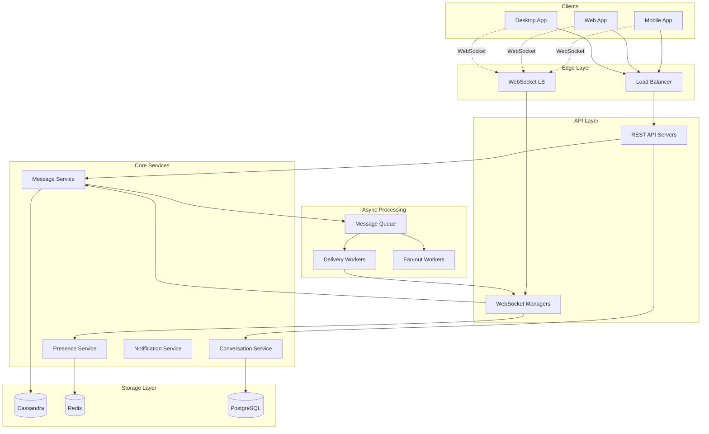
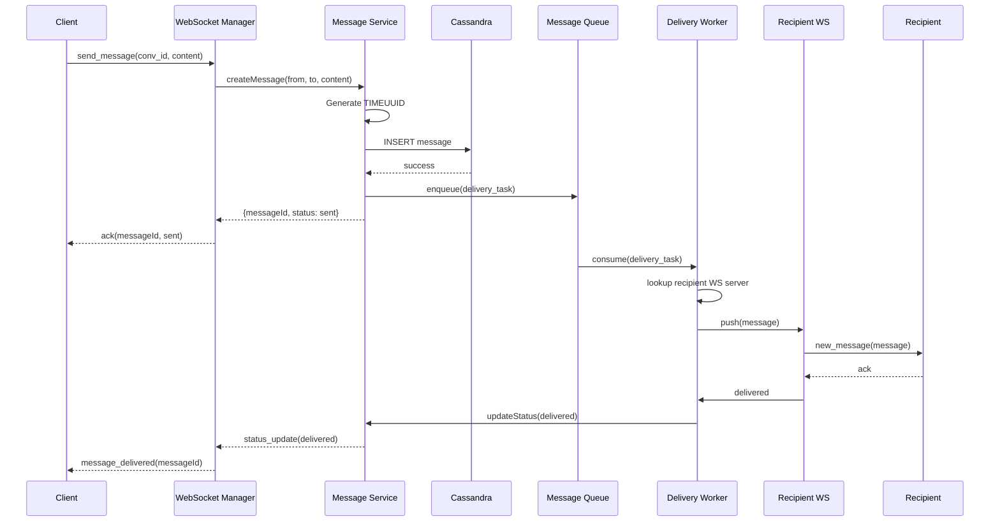
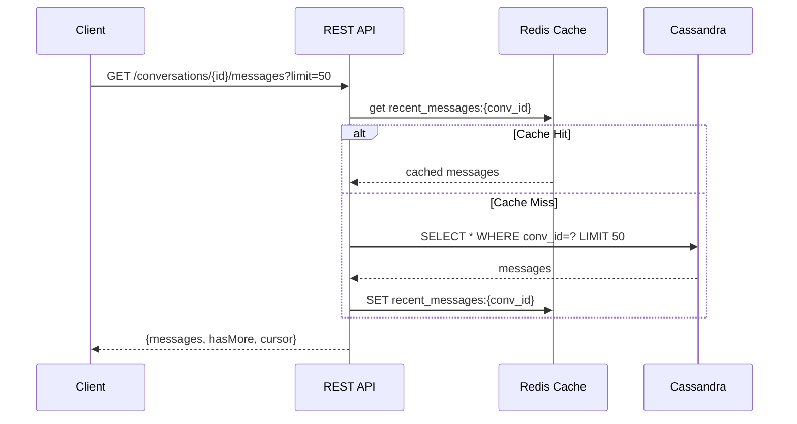
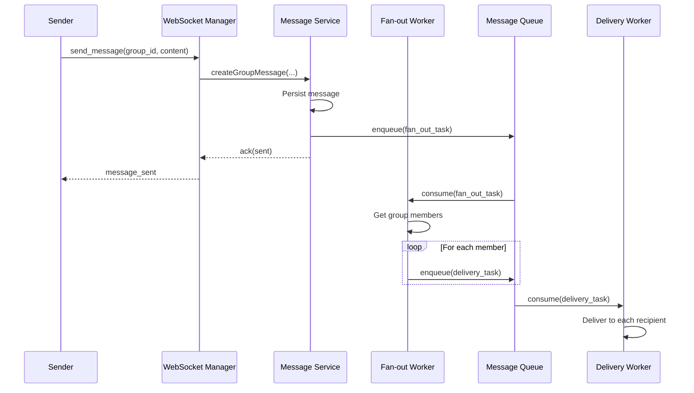

# Chat/Messaging Service - Design


## Requirements

### Functional Requirements
- Core user flow for Chat/Messaging Service.

### Non-Functional Requirements
- High availability, low latency, fault tolerance.

## Back-of-envelope Estimation

### Traffic
| Metric | Calculation | Result |
|---|---|---|
| DAU | Given | 500M |
| Avg QPS | 500M DAU x 40 msg / 86,400 s | 231K avg QPS |
| Peak QPS | 231K avg QPS x 3 peak | 693K peak QPS |

### Storage
| Metric | Calculation | Result |
|---|---|---|
| Daily Storage | 500M DAU x 40 msg x 100 bytes = 2 TB/day |

## API Contracts

### Endpoints
```http
POST /api/v1/messages
GET /api/v1/messages?cursor=...
```

## Data Model

### Schema
- Primary Key: `message_id`
- Partition Key: `conversation_id`


## Overview

This document describes the high-level design for a WhatsApp-style messaging service capable of handling 500M daily active users with real-time message delivery.



---

## Detailed Architecture

### 1. Client Layer

Clients connect via two channels:
- **REST API**: For history, conversation management, and non-real-time operations
- **WebSocket**: For real-time message delivery, typing indicators, and presence

**Connection Strategy**:
- Primary: WebSocket for real-time
- Fallback: Long polling for restricted networks
- Heartbeat every 30 seconds to maintain connection

### 2. API Gateway / Load Balancer

**REST Load Balancer**:
- Round-robin distribution
- Health checks on API servers
- Rate limiting per user (100 req/min)

**WebSocket Load Balancer**:
- Sticky sessions by user_id
- Consistent hashing for connection routing
- Connection draining during deployments

### 3. Application Services

#### Message Service
Core service handling message lifecycle:
```
Responsibilities:
- Validate and persist messages
- Generate message IDs (TIMEUUID)
- Enqueue for delivery
- Handle message status updates
```

#### Conversation Service
Manages conversations and participants:
```
Responsibilities:
- Create 1:1 and group conversations
- Manage group membership
- Track last read positions
- Handle muting/archiving
```

#### Presence Service
Tracks online/offline status:
```
Responsibilities:
- Update status on connect/disconnect
- Publish presence changes
- Aggregate for privacy settings
- Handle "last seen" timestamps
```

### 4. Storage Layer

#### Cassandra (Messages)
```
Optimized for:
- High write throughput
- Time-series data
- Partition by conversation

Schema:
- messages: (conversation_id, message_id) → message data
- user_inbox: (user_id, conversation_id) → last message
```

#### Redis (Session/Presence)
```
Data stored:
- User sessions: user_id → [device_ids, ws_server]
- Presence: user_id → {status, last_seen}
- Message status: msg_id → {sent, delivered, read}
- Pub/Sub channels for real-time routing
```

#### PostgreSQL (Metadata)
```
Relational data:
- Users, Groups, Conversations
- Group membership with roles
- User settings and preferences
```

### 5. Asynchronous Processing

#### Message Queue (Kafka)
- Topic per shard for message delivery
- Partition by recipient user_id
- Ensures ordering per user

#### Delivery Workers
- Consume from Kafka
- Look up recipient's WebSocket server
- Push message via internal RPC
- Handle retries and offline queueing

#### Fan-out Workers (for groups)
- Consume group messages
- Expand to individual recipient queues
- Batch for efficiency

---

## Sequence Diagrams

### Core Write Flow: Sending a Message



### Core Read Flow: Loading Conversation History



### Group Message Fan-out



---

## Component Details

### WebSocket Connection Manager

```
Features:
- Maintain ~100K connections per server
- Connection registry in Redis
- Heartbeat monitoring
- Graceful disconnect handling
- Multi-device support per user

Scaling:
- Horizontal scaling with consistent hashing
- Connection migration on server failure
- Redis pub/sub for cross-server messaging
```

### Message ID Generation

```
TIMEUUID Structure:
┌──────────────────┬───────────────┬──────────────┐
│ Timestamp (48b)  │ Node ID (16b) │ Sequence (8b)│
└──────────────────┴───────────────┴──────────────┘

Benefits:
- Naturally sorted by time
- Unique across distributed nodes
- No coordination required
- Cassandra native support
```

### Read Receipts Implementation

```
Flow:
1. Recipient opens conversation
2. Client sends read_ack for last message
3. Server updates Redis: msg:{id}:read += user
4. Server notifies sender via their WS
5. Sender sees "read" status

Optimization:
- Batch read receipts (1 per conversation)
- Rate limit updates (max 1/second)
- Async processing for group receipts
```

---

## Trade-offs

### Consistency vs Availability
| Decision | Trade-off |
|----------|-----------|
| Message persistence | Strong consistency - messages never lost |
| Read receipts | Eventual consistency - slight delay acceptable |
| Presence status | Eventual consistency - 5-10 second staleness OK |
| Delivery status | Eventual consistency - async updates |

### Latency vs Cost
| Decision | Trade-off |
|----------|-----------|
| Recent messages cache | Higher memory cost for lower latency |
| Message queue | Slight latency increase for reliability |
| Multi-region | Higher infra cost for global low latency |
| Connection pooling | Memory vs connection setup time |

### Simplicity vs Flexibility
| Decision | Trade-off |
|----------|-----------|
| Fixed message schema | Simpler storage, less flexible content |
| Single WebSocket connection | Simpler client, harder multi-device |
| Push-only model | Simpler server, requires client reliability |

---

## Observability

### Key Metrics
```
Business Metrics:
- Messages sent/delivered/read per minute
- Active conversations per hour
- User online count

Technical Metrics:
- WebSocket connection count per server
- Message queue depth and latency
- Cassandra write/read latency
- Redis pub/sub message rate
```

### Alerting Thresholds
```
Critical:
- Message delivery latency > 5s
- Queue depth > 1M
- Connection server down

Warning:
- Delivery latency > 1s
- Cassandra latency > 100ms
- Redis memory > 80%
```

### Distributed Tracing
```
Trace spans:
1. client_send → ws_receive
2. ws_receive → message_service
3. message_service → cassandra_write
4. message_service → queue_publish
5. queue_consume → delivery_worker
6. delivery_worker → recipient_ws
```

---

## Caching Strategy

### Cache Layers
```
L1: Client-side cache (messages, contacts)
L2: Redis (sessions, presence, hot conversations)
L3: Cassandra (persistent storage)

Cache Policies:
- Recent messages: 100 per conversation, 1 hour TTL
- User sessions: No TTL, evict on disconnect
- Presence: 5 minute TTL, refresh on heartbeat
```

### Cache Invalidation
```
Event-based invalidation:
- New message → Invalidate conversation cache
- User update → Invalidate user cache
- Group change → Invalidate group member caches
```

---

## Security Considerations

### Authentication
- JWT tokens for REST API
- Signed tickets for WebSocket connections
- Token refresh without reconnection

### Authorization
- Validate user belongs to conversation
- Group admin permissions for management
- Rate limiting per user

### Data Protection
- TLS for all connections
- Message encryption at rest
- End-to-end encryption (client-side)

---

## Entity-Relationship Diagram

```mermaid
erDiagram
    USER ||--o{ CONVERSATION_PARTICIPANT : participates_in
    CONVERSATION ||--o{ CONVERSATION_PARTICIPANT : has
    CONVERSATION ||--o{ MESSAGE : contains
    USER ||--o{ MESSAGE : sends
    USER ||--o{ DEVICE : owns
    GROUP ||--|| CONVERSATION : is_a
    GROUP ||--o{ GROUP_MEMBER : has
    USER ||--o{ GROUP_MEMBER : member_of
    USER ||--|| USER_PRESENCE : has
    MESSAGE ||--o{ MESSAGE_STATUS : has
    USER ||--o{ CONTACT : has

    USER {
        uuid user_id PK
        string phone_number UK
        string display_name
        string profile_picture_url
        string status_message
        string about
        timestamp last_seen
        string privacy_last_seen "everyone/contacts/nobody"
        string privacy_profile_photo "everyone/contacts/nobody"
        boolean is_verified
        timestamp created_at
    }

    CONVERSATION {
        uuid conversation_id PK
        string type "1:1 or group"
        timestamp created_at
        timestamp last_message_at
        uuid last_message_id FK
    }

    CONVERSATION_PARTICIPANT {
        uuid conversation_id PK "FK"
        uuid user_id PK "FK"
        boolean is_muted
        timestamp muted_until
        boolean is_archived
        boolean is_pinned
        timeuuid last_read_message_id
        timestamp joined_at
    }

    MESSAGE {
        timeuuid message_id PK "TIMEUUID for ordering"
        uuid conversation_id "Partition key"
        uuid sender_id FK
        string content_type "text/image/video/audio/document"
        text content "Encrypted content or media URL"
        uuid reply_to_message_id FK "For quoted replies"
        boolean is_forwarded
        boolean is_deleted
        timestamp created_at
        timestamp edited_at
    }

    MESSAGE_STATUS {
        timeuuid message_id PK "FK"
        uuid recipient_id PK "FK"
        string status "sent/delivered/read"
        timestamp delivered_at
        timestamp read_at
    }

    GROUP {
        uuid group_id PK
        uuid conversation_id FK UK
        string name
        string description
        string group_picture_url
        uuid created_by FK
        boolean only_admins_can_send
        boolean only_admins_can_edit
        string invite_link UK
        timestamp created_at
    }

    GROUP_MEMBER {
        uuid group_id PK "FK"
        uuid user_id PK "FK"
        string role "admin/member"
        uuid added_by FK
        timestamp joined_at
    }

    DEVICE {
        uuid device_id PK
        uuid user_id FK
        string device_token "Push notification token"
        string device_type "ios/android/web"
        string device_name
        string ws_server_id "Current WebSocket server"
        boolean is_active
        timestamp last_active_at
        timestamp registered_at
    }

    USER_PRESENCE {
        uuid user_id PK "FK"
        string status "online/offline/typing"
        uuid typing_in_conversation FK
        timestamp last_seen
        timestamp updated_at
    }

    CONTACT {
        uuid user_id PK "FK"
        uuid contact_user_id PK "FK"
        string contact_name "Custom name"
        boolean is_blocked
        boolean is_favorite
        timestamp added_at
    }

    MEDIA {
        uuid media_id PK
        uuid message_id FK
        string media_type "image/video/audio/document"
        string storage_url "S3 path"
        string thumbnail_url
        bigint file_size_bytes
        string mime_type
        int duration_seconds "For audio/video"
        string encryption_key "For E2E encryption"
        timestamp uploaded_at
    }
```

**Schema Notes:**
- **TIMEUUID (Cassandra)**:
  - `message_id` uses Cassandra's TIMEUUID type for naturally time-ordered unique IDs
  - Enables efficient range queries: `SELECT * WHERE conversation_id = ? AND message_id > ?`
  - No coordination required between nodes for ID generation
- **Cassandra Tables (Messages)**:
  - `messages_by_conversation`: Partitioned by `conversation_id`, clustered by `message_id DESC`
  - `user_inbox`: Partitioned by `user_id`, stores last message per conversation for inbox view
- **PostgreSQL Tables (Metadata)**:
  - `users`, `groups`, `group_members`, `contacts` - ACID required
- **Redis Data**:
  - `presence:{user_id}` - Hash with status, last_seen, typing info
  - `session:{user_id}:{device_id}` - Connection info with TTL
  - `ws_server:{server_id}` - Set of connected user IDs
- **Indexes**:
  - `MESSAGE(conversation_id, message_id DESC)` - Primary query pattern
  - `USER(phone_number)` - Contact lookup
  - `DEVICE(user_id, is_active)` - Push notification targets
  - `GROUP_MEMBER(user_id)` - User's groups list

---

## 🐍 Python Ecosystem Notes

### Possible Python Tech Stack

| Component | Technology | Notes |
|-----------|------------|-------|
| WebSocket Server | **FastAPI** + **websockets** or **Starlette** | Native async WebSocket support |
| Message Broker | **aiokafka** or **aio-pika** (RabbitMQ) | Async producers/consumers for message fan-out |
| Presence Store | **redis-py** (async) | Pub/Sub for real-time presence updates |
| Metadata DB | **asyncpg** (PostgreSQL) | User profiles, contacts, group metadata |
| Message Store | **cassandra-driver** | DataStax driver for high-write message storage; synchronous by default — use `execute_async()` or a thread pool for non-blocking calls |
| Push Notifications | **aioapns** / **firebase-admin** | Async push delivery for offline users |
| Serialization | **msgpack** or **protobuf** | Compact binary encoding for WebSocket frames |
| Deployment | **uvicorn** + **gunicorn** | Multiple async workers per host |

### Key Python Constraints

- **WebSocket Concurrency**: Python's `asyncio` handles thousands of concurrent WebSocket connections per process. Use multiple workers to scale horizontally.
- **GIL & CPU Work**: Encryption (E2E) is CPU-intensive — offload to `cryptography` library (C-backed) or use `multiprocessing` for heavy crypto operations.
- **Connection Management**: Each WebSocket connection holds state in memory. Use Redis Pub/Sub to route messages between workers/servers.
- **Backpressure**: Use `asyncio.Queue` with bounded sizes to apply backpressure on slow consumers.

### See Also

- **HLD Concept**: [`03-hld-concepts/message-queues`](../../03-hld-concepts/message-queues/) — Queue patterns for message delivery
- **HLD Concept**: [`03-hld-concepts/load-balancing`](../../03-hld-concepts/load-balancing/) — Sticky sessions for WebSocket routing
- **HLD Concept**: [`03-hld-concepts/database-replication`](../../03-hld-concepts/database-replication/) — Multi-region data replication

---

## 🤖 GenAI Extension

> How could this system be augmented with LLMs? Below are interview-ready ideas that connect this classical HLD to GenAI patterns. For full GenAI system designs, see [06-genai-systems/](../../06-genai-systems/).

### Potential LLM-Powered Features

| Feature | Description | GenAI Components |
|---------|-------------|-----------------|
| **AI Chat Assistant** | In-conversation bot that answers questions, summarizes threads, and performs tasks (book meetings, look up info) | RAG retriever, conversation memory, prompt builder, safety filter |
| **Message Summarization** | Summarize long group threads or catch-up on missed messages (e.g., "While you were away: 3 decisions were made…") | Chunker, prompt builder, LLM service |
| **Smart Reply Suggestions** | Suggest contextual quick replies based on conversation history | Conversation memory, prompt builder, LLM service |
| **Content Moderation** | Detect toxic messages, spam, and policy violations in real-time using LLM classifiers | Safety filter, LLM classifier |

### Integration Points

```
Existing Chat Pipeline:
  Send Message → Message Service → Queue → Delivery Worker → Recipient

With GenAI Extension:
  Send Message → Message Service → Queue → Delivery Worker → Recipient
       │              │
       │              └→ Content moderation (LLM classifier, async)
       └→ @bot mention → AI Assistant (RAG + LLM) → Reply via same pipeline
       └→ /summarize command → Fetch history → Chunk → Summarize (LLM) → Reply
```

### Trade-offs

- **Latency**: AI assistant responses take 1–3 seconds vs instant message delivery — show typing indicator while LLM generates
- **Privacy**: LLM must not leak cross-conversation data — strict memory isolation per conversation
- **Safety**: Content moderation must balance false positives (blocking legitimate messages) with safety
- **Cost**: Per-message moderation at scale (billions/day) is expensive — use lightweight classifier first, LLM for edge cases

### Learn More

- [GenAI HLD Projects: Conversational AI Chatbot](../../06-genai-systems/02-llm-hld-projects/) — Full AI chatbot system design
- [GenAI LLD: Safety Filter & Policy Engine](../../06-genai-systems/01-llm-lld-projects/safety-filter-policy-engine/) — Content moderation component
- [GenAI LLD: Conversation Memory Store](../../06-genai-systems/01-llm-lld-projects/conversation-memory-store/) — Multi-turn conversation memory


## Bottlenecks and Failure Modes

| Component | Failure Mode | Mitigation | Impact | Detection | Recovery |
|---|---|---|---|---|---|
| WebSocket Server | OOM / Crash | Load shed, drop idle connections | Clients must reconnect | Memory utilization alarm | Auto-restart |
| Message Queue | Partition Offline | Replicate across AZs, retry | Increased publish latency | Consumer lag spikes | Failover to replica |
| Cassandra DB | Node Down | Quorum reads/writes (RF=3) | Minimal, handled transparently | Node heartbeat failure | Gossip protocol sync |
| Redis Cache | Node Failure | Redis Cluster with replicas | Cache misses hit DB | Replication lag alarm | Auto-promote replica |
| Push Notifs | External API Rate Limit | Backoff and retry queues | Delayed offline notifications | 429 response rate | Exponential backoff |
| Delivery Worker | Crash | Dead letter queues, auto-scaling | Delayed message delivery | Queue depth monitor | Spin up new worker |

## Scaling Stages

- **10K Users**: Single monolith, simple DB, basic caching.
- **1M Users**: Microservices, robust cache, read replicas.
- **100M+ Users**: Sharded databases, globally distributed edge nodes, event streaming.


---
**Real-world reference**: See how WhatsApp solved this in the [WhatsApp case study](../../case-studies/whatsapp-messaging/)
