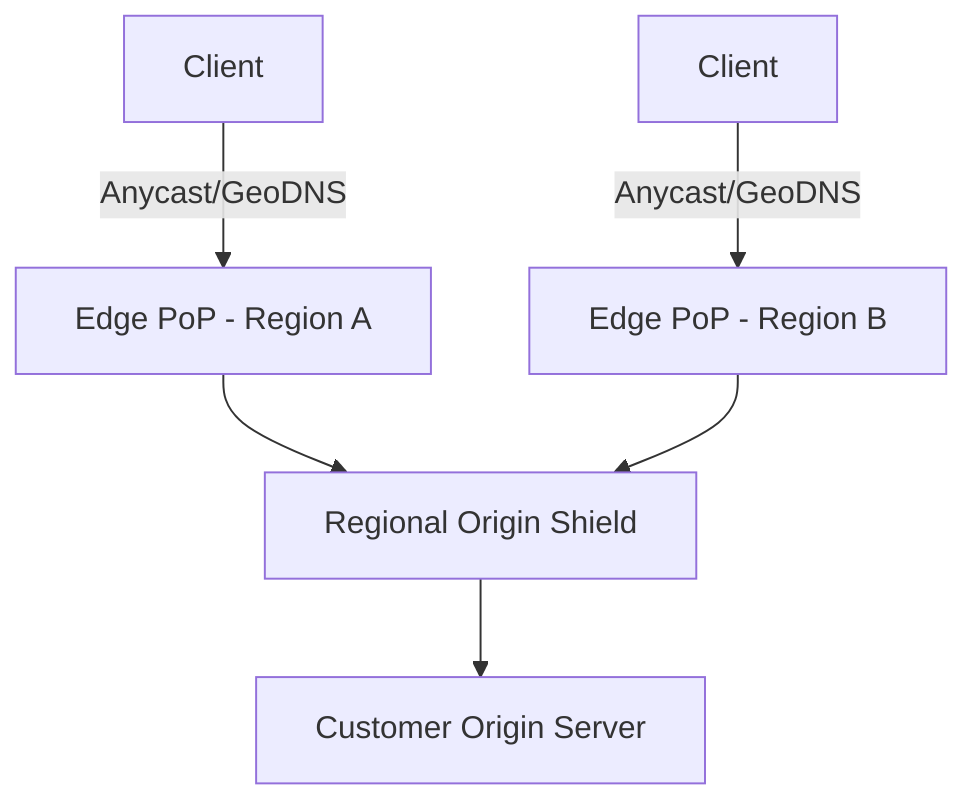

# CDN System Approach

## Core Architecture Overview

Our CDN design leverages a 2-tier caching architecture coupled with Anycast/GeoDNS routing to optimize latency and bandwidth while protecting customer origin servers from thundering herds.



### 1. Request Routing
- **Anycast BGP**: Used for extremely fast, network-level routing. Multiple Edge PoPs advertise the same IP address. The internet's BGP routing infrastructure naturally forwards client requests to the topologically nearest PoP.
- **GeoDNS**: Resolves domain names to specific PoP IP addresses based on the client's geographic location. Provides finer control for load balancing and avoiding congested PoPs compared to Anycast.
- *Approach*: Use Anycast for default ultra-low latency routing, with GeoDNS as an override for load shedding and intelligent traffic management.

### 2. Caching Hierarchy (2-Tier)
1.  **Edge PoP (Tier 1)**: Geographically distributed nodes closest to users. Caches hot assets (e.g., popular videos, images). Uses LRU/TTL eviction.
2.  **Origin Shield (Tier 2)**: A consolidated regional cache layer sitting between Edge PoPs and the Customer Origin. 
    - *Purpose*: If multiple Edge PoPs have a cache miss for the same asset simultaneously, they all fetch from the Origin Shield instead of directly hammering the Customer Origin. The Origin Shield performs **request coalescing** (collapsing multiple concurrent requests into a single fetch to the Customer Origin).

### 3. Caching Mechanics
- **HTTP Cache Headers**: Respects `Cache-Control`, `ETag`, and `Stale-While-Revalidate`.
- **Surrogate-Control**: Allows the Customer Origin to provide caching rules exclusively for the CDN (overriding `Cache-Control` which affects browser caches).
- **Range Requests**: For large videos, the CDN caches assets in chunks. A client requesting bytes `1000-2000` fetches only that chunk. This prevents the Edge from downloading and caching a 500MB video just to serve the first 2MB.

### 4. Fast Cache Purge
- Needs to invalidate specific cached assets across 10,000 edge nodes in < 150ms.
- **Approach**: Redis Pub/Sub tree.
- A centralized Purge API publishes the invalidation message.
- Regional Redis clusters subscribe and fan out the message to PoP-level Redis instances, which fan out to individual Edge node agents.

## Storage and Cache
- **Edge Cache**: In-memory (RAM) for ultra-hot small assets; NVMe SSDs for larger assets and the bulk of the cache.
- **Metadata Store**: Redis for fast purge tracking and node registration.

## API Surface

```http
GET /{asset_path}
Headers: 
Range: bytes=0-1048575

POST /api/v1/purge
{
    "pattern": "/images/logo.png"
}
```

## Key Trade-offs
- **Anycast vs. GeoDNS**: Anycast is faster but harder to steer traffic away from overloaded PoPs. GeoDNS adds DNS lookup latency but provides granular control. We use a hybrid.
- **Origin Shield Latency vs. Protection**: The Origin Shield adds a network hop (latency) on a cache miss, but dramatically improves Customer Origin survivability during traffic spikes.