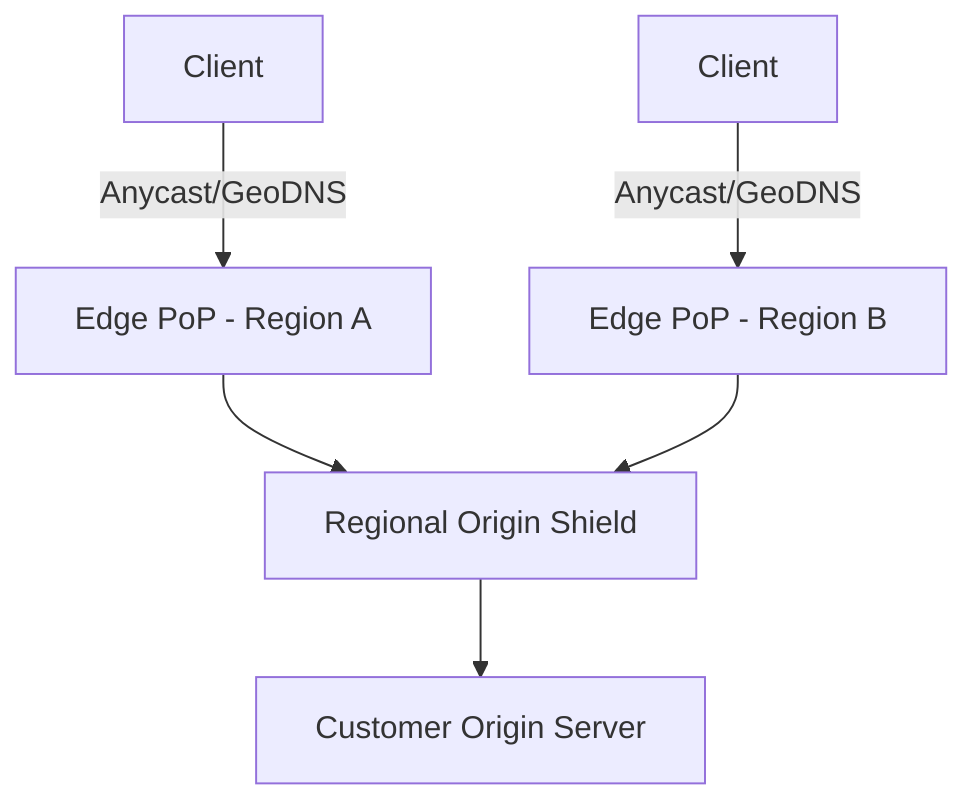

# Content Delivery Network (CDN) System

> **Evidence Contract Note:** This template adheres to the `curriculum-evidence-contract.md`. 
> Target Layer: [Staff]
> HLD designs remain docs-only unless an explicit policy exception is noted. Unsourced figures are scenario assumptions, not verified external facts.

---

## 1. 📝 Requirements and Constraints

### Problem Statement
- System to design: Content Delivery Network (CDN) covering Edge Caching and Media Delivery.
- Core user value: Accelerate global web content delivery, reduce latency, and protect customer origin servers from traffic spikes.

### Functional Requirements
- [x] FR1: Route users to the nearest/optimal Edge PoP.
- [x] FR2: Cache content and respect HTTP cache headers (`Cache-Control`, `ETag`, `Stale-While-Revalidate`, `Surrogate-Control`).
- [x] FR3: Support range request caching for large media (videos).
- [x] FR4: Support fast, global cache purge fan-out.
- [x] FR5: Implement a 2-tier cache hierarchy (Edge PoP -> Origin Shield -> Origin) with request coalescing.

### Non-Functional Requirements

| Requirement | Target |
|---|---|
| Availability | 99.99% |
| Read latency | < 50 ms P99 (Cache Hit) |
| Cache Purge Latency| < 150 ms globally across 10,000 edge nodes |
| Cache Hit Ratio | > 90% |
| Coalescing | Collapse 100 concurrent requests into 1 origin fetch |
| Durability | Ephemeral cache (Origin is source of truth) |

### Constraints
- Transient network partitions must not cause system crashes or mass cache evictions.
- Standard libraries only for simulators (Java 11+, Python 3.8+).

### Out of Scope (Non-Goals)
- Analytics and billing pipelines.
- Detailed DNS infrastructure design beyond Anycast/GeoDNS concepts.
- Serverless edge compute runtime internals.

---

## 2. 🔌 API / System Interface

### External Contract
- Protocol choice: HTTP/1.1, HTTP/2, HTTP/3 (QUIC) for content delivery; REST for control plane (purge).
- Auth model: API Keys for control plane; optionally signed URLs for content.

### Core Endpoints
```http
GET /{customer_domain}/{asset_path}
Headers:
  Range: bytes=0-1048575
```

```http
POST /api/v1/purge
Content-Type: application/json
Authorization: Bearer <token>

{
    "pattern": "/images/logo.png",
    "customer_id": "cust_123"
}
```

### Error Model
- `400` invalid input (e.g., malformed purge request)
- `401/403` auth/authz (invalid purge token, invalid signed URL)
- `404` missing resource (from Origin)
- `416` Range Not Satisfiable
- `429` throttled (control plane limits)
- `5xx` internal dependency failure (Origin down, Shield unreachable)

---

## 4. 🗄️ Core Entities and Data Model

### Core Entities
- **Asset**: The web resource (image, video chunk, html).
- **Cache Entry**: Metadata (TTL, ETag, headers) + pointer to physical storage (RAM/Disk).
- **Purge Event**: Message indicating invalidation of a cache entry.

### Storage Choices
- **Edge Cache**: Memory (LRU) + NVMe SSDs for chunked storage. (Reason: High throughput, low latency).
- **Control Plane DB**: Distributed SQL or NoSQL (e.g., CockroachDB/Cassandra) for customer configs, domains, and TLS certificates.
- **Purge Message Bus**: Redis Pub/Sub. (Reason: In-memory, ultra-fast fan-out required for <150ms global purge).

### Key Access Patterns
1. **Read path query**: Fast lookup of asset by hash(URL).
2. **Write path mutation**: Cache population upon Origin Shield response.
3. **Purge path**: Global broadcast invalidating cache keys.

### Partition and Index Notes
- Partition key for cache: `hash(Customer_ID + Asset_URL)` mapped to specific disks/nodes within a PoP using Consistent Hashing.

---

## 5. 🏗️ High-Level Architecture

### Component List
- Global DNS / Anycast Router
- Edge PoP (Reverse Proxy, Cache Engine, Consistent Hashing router)
- Regional Origin Shield
- Control Plane (Configuration, Purge API)
- Customer Origin

### Architecture Diagram



### Read Path
1. Client resolves CDN domain to an Anycast IP. BGP routes to the nearest Edge PoP.
2. PoP load balancer uses consistent hashing on the URL to pick an Edge Node.
3. Edge Node checks memory/SSD cache. 
   - Cache Hit: Returns asset immediately.
   - Cache Miss: Forwards request to Regional Origin Shield.

### Write Path (Cache Fill & Coalescing)
1. Edge Node forwards cache miss to Origin Shield.
2. Origin Shield checks its cache. If miss, it initiates a fetch to the Customer Origin.
3. If 100 Edge Nodes ask for the same asset simultaneously, the Origin Shield's **Coalescer** holds 99 connections, sends 1 request to the Origin, and multiplexes the response back to all 100 Edge Nodes.
4. Edge Nodes stream the response to the client while writing chunks to NVMe/RAM.

### Explicit Traces

#### Normal Trace
- Cache Hit: Client -> PoP LB -> Edge Node -> Client. Latency < 50ms.

#### Failure Trace
- **Dependency timeout behavior**: If Customer Origin is down, serve stale data if `Stale-While-Revalidate` header permits. Otherwise, return 502/504.
- **Network partition**: If a PoP loses connection to the Origin Shield, it relies purely on local TTLs. Purge messages may queue or drop; edge nodes must fallback to polling configs or expiring caches aggressively upon reconnection.

---

## 6. 🔍 Deep Dives

### Deep Dive A: Routing - Anycast vs GeoDNS
- **Bottleneck**: Connecting users to the topologically nearest server with minimal latency.
- **Chosen pattern**: Hybrid. Anycast BGP for default ultra-fast network routing.
- **Alternative considered**: Pure GeoDNS.
- **Trade-off accepted**: Anycast cannot factor in PoP server load (CPU/Disk). If a PoP is overwhelmed, Anycast will still send traffic there based on BGP. GeoDNS adds DNS resolution latency but allows the CDN to dynamically change the returned IP to steer traffic away from hot PoPs. The hybrid approach uses Anycast IPs that can be dynamically advertised/withdrawn via BGP for coarse control, backed by GeoDNS for granular load shedding.

### Deep Dive B: Fast Cache Purge Fan-Out
- **Bottleneck**: Invalidating keys across 10,000 nodes globally in under 150ms.
- **Pattern**: Multi-level Redis Pub/Sub Tree.
- **Mechanics**: 
  - Purge API -> Global Redis Master -> Regional Redis Clusters -> PoP Redis Nodes -> Edge Node Daemon.
  - When the daemon receives a purge command, it performs a logical soft-delete (tombstone) in RAM immediately, preventing new reads, followed by a background async cleanup on SSD.
- **Failure handling**: UDP broadcasts drop. Using a TCP-based Pub/Sub (Redis/Kafka) ensures delivery. If a node is partitioned, it misses the purge. When it reconnects, it must sync a transaction log or rely on short TTLs as a backstop.

### Deep Dive C: Range Request Caching
- **Bottleneck**: Caching a 10GB 4K video when clients only watch the first 10 seconds.
- **Pattern**: Chunking. The CDN treats the video as a series of 2MB chunks. 
- **Mechanics**: Client requests `bytes=0-5000000`. Edge Node translates this into internal cache key lookups: `vid123_chunk0`, `vid123_chunk1`, `vid123_chunk2`. Only missing chunks are fetched via coalescing from the Origin Shield using standard HTTP Range headers.

---

## 7. 📈 Staff-Level Analysis (Optional)

- **Complex failure domain interactions**: A massive cache purge event globally invalidating a popular asset can instantly trigger a "Thundering Herd." The Origin Shield's request coalescer is the only invariant preventing the Customer Origin from crashing under the sudden load of 10,000 edge nodes fetching the asset simultaneously.

---

## 8. ⚖️ Trade-offs and Decisions

| Decision | Option Chosen | Alternative | Why Chosen Now | Revisit Trigger |
|---|---|---|---|---|
| Routing | Hybrid Anycast + GeoDNS | Pure Anycast | Balances lowest latency with ability to shed load. | PoP utilization spikes causing localized latency. |
| Cache Storage | RAM + NVMe SSD | Pure RAM | Scale of data (100Tbps) is too large/expensive for RAM only. | Introduction of ultra-low latency edge compute. |
| Purge Mechanism | Tree-based Pub/Sub | Database polling | Polling adds latency and DB load; Pub/Sub hits <150ms SLA. | Missed purges during severe network partitions. |

---

## 9. 🔮 Follow-up Questions

1. **How do you handle HTTPS/TLS termination at the edge?**
2. **What happens if the Origin Shield region goes down?**
3. **How do you prevent malicious users from bypassing the cache with random query parameters?**

---

## 10. 🧩 Variants and Extensions

- Variant 1 (Video First): Optimize chunk sizes dynamically based on client bandwidth (adaptive bitrate streaming support).
- Variant 2 (Security First): Integrate Web Application Firewall (WAF) at the Edge PoP before cache lookup.

---

## 11. 🚨 Common Pitfalls (Self-Check)

- [x] I skipped clarifying requirements -> Explicitly defined headers, 2-tier cache, and purge latency.
- [x] I did estimates that did not influence design -> Bandwidth justified tiered SSD/RAM storage.
- [x] I added sharding/queueing without scale justification -> Explained Redis fan-out for 10k nodes.
- [x] I did not mention failure handling -> Covered Origin down and network partitions.
- [x] I did not articulate trade-offs explicitly -> Anycast vs GeoDNS trade-offs clearly stated.

---

## 12. 🧮 Scoring Rubric (Self-Evaluation)

| Dimension | 1 (Weak) | 3 (Okay) | 5 (Strong) | Your Score |
|---|---|---|---|---|
| Requirements handling | Vague | Mostly clear | Prioritized + quantified | 5 |
| Architecture clarity | Boxes only | Basic flow | End-to-end + failure-aware | 5 |
| Technical depth | Tool names | Some rationale | Pattern + metric-driven rationale | 5 |
| Trade-off quality | None | Some | Explicit and contextual | 5 |
| Communication | Disorganized | Understandable | Structured + concise | 5 |

---

## 13. ✅ Wrap-up Summary (Final 60-90 Seconds)

1. **Requirements**: We designed a CDN focused on edge caching and media delivery, targeting <50ms hit latency and <150ms global cache purges.
2. **Architecture**: We utilized a 2-tier architecture (Edge PoPs and Regional Origin Shields) to protect customer origins.
3. **Trade-off**: We chose a hybrid Anycast/GeoDNS routing approach, accepting the complexity of managing both to gain both raw speed (Anycast) and load-shedding control (GeoDNS).
4. **Scale**: The implementation of request coalescing at the Origin Shield ensures the Customer Origin survives massive traffic spikes even during a 0% cache hit ratio scenario.

---
**Real-world reference**: See how Netflix solved this in the [Netflix case study](../../case-studies/netflix-streaming/)
