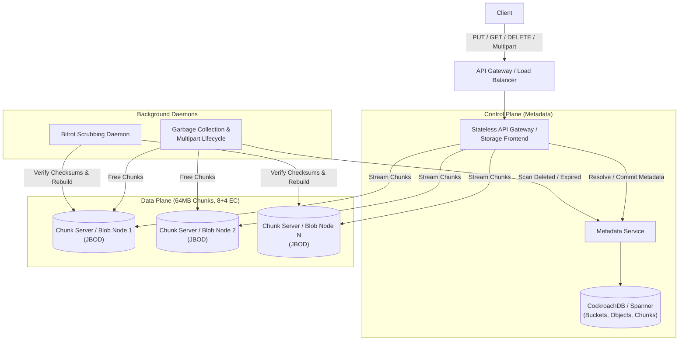

# 📋 HLD Design: Distributed Cloud Storage (S3)

## 1. 📝 Requirements and Constraints

### Problem Statement
- System to design: Distributed Object Storage (S3-like)
- Core user value: Provide highly durable, available, and infinitely scalable storage for unstructured data (objects) accessed via a REST API.

### Functional Requirements
- [x] FR1: **PutObject:** Upload a new object or overwrite an existing object.
- [x] FR2: **GetObject:** Retrieve an object by its key.
- [x] FR3: **DeleteObject:** Delete an object.
- [x] FR4: **ListBucketObjects:** List all object keys in a given bucket.
- [x] FR5: **Multipart Upload:** Support uploading large files in parallel chunks and assembling them.

### Non-Functional Requirements

| Requirement | Target |
|---|---|
| Availability | 99.99% |
| Read latency | < 100ms for TTFB (Time to First Byte) |
| Write latency | < 500ms for typical objects |
| Throughput | High throughput for large files |
| Consistency | Strong read-after-write consistency |
| Durability | 99.999999999% (11 9s) |

### Constraints
- Must handle 100 PB initial capacity gracefully.
- Cost-efficient storage at scale.

---

## 2. 📊 Back-of-Envelope Estimation (Only What Changes Design)

### Traffic

| Metric | Value |
|---|---|
| Read QPS | 50,000 |
| Write QPS | 5,000 |

### Storage

| Data Type | Avg Size | Volume |
|---|---|---|
| Initial Capacity | N/A | 100 PB |

### Decision Notes
- **100 PB storage:** Implies we cannot store all metadata in memory of a single node or a simple SQL DB. We need a horizontally scalable Metadata Database.
- **Strong read-after-write consistency:** For metadata, we need a strongly consistent distributed database like Spanner or CockroachDB.

---

## 3. 🔌 API / System Interface

### Core Endpoints

```http
PUT /{bucket}/{object_key}
GET /{bucket}/{object_key}
DELETE /{bucket}/{object_key}
GET /{bucket}?prefix=...&max-keys=...
POST /{bucket}/{object_key}?uploads (Initiate Multipart Upload)
PUT /{bucket}/{object_key}?partNumber=...&uploadId=... (Upload Part)
POST /{bucket}/{object_key}?uploadId=... (Complete Multipart Upload)
```

---

## 4. 🗄️ Core Entities and Data Model

### Storage Choices
- **Metadata Service Database:** CockroachDB / Spanner. Reason: Needs to provide strong consistency, transactions, and horizontal scalability for storing billion of object records.
- **Data Storage (Blob Nodes):** Dedicated storage servers with JBOD (Just a Bunch Of Disks) running a chunk management daemon.

### Metadata Schema

**Bucket Table**
- `bucket_id` (PK)
- `bucket_name`
- `owner_id`
- `creation_date`

**Object Table**
- `bucket_id` (PK)
- `object_key` (PK)
- `object_id` (UUID)
- `size`
- `version_id`
- `content_type`

**Object Mapping Table** (Maps logical objects to physical chunks)
- `object_id` (PK)
- `chunk_sequence` (PK)
- `chunk_id`

**Chunk Table**
- `chunk_id` (PK)
- `node_ids` (List of nodes storing this chunk / erasure coding shards)
- `status` (pending, active, deleted)

---

## 5. 🏗️ High-Level Architecture

### Component List
- **API Gateway / Load Balancer:** Routes incoming HTTP requests.
- **Stateless API Gateway / Storage Frontend:** Parses requests, handles auth, rate limiting.
- **Metadata Service:** Manages bucket and object metadata using CockroachDB/Spanner.
- **Data Storage (Chunk Servers / Blob Nodes):** Stores the actual payload data in fixed-size chunks (e.g., 64MB).
- **Background Daemons:** Garbage Collection, Bitrot scrubbing.

### Decoupled Architecture
The system decouples the **Metadata Service** from the **Data Storage**. The Stateless API Gateway coordinates between them.




The Stateless API Gateway (Storage Frontend) sits behind a Load Balancer and decouples object metadata from raw payload storage. On writes, it allocates chunk placements through the strongly consistent Metadata Service (CockroachDB/Spanner), streams 64MB chunks across JBOD Blob Nodes using 8+4 Reed-Solomon erasure coding (or 3x replication for small objects), and commits metadata only after durable writes succeed to guarantee read-after-write consistency. Background daemons run independently to reclaim deleted or expired multipart upload chunks and continuously scrub disks for silent bitrot corruption.

### Read Path (GetObject)
1. Client calls `GET /{bucket}/{object_key}`.
2. API Gateway requests Metadata Service to resolve `{bucket}/{object_key}` to `chunk_ids` and their locations (`node_ids`).
3. API Gateway fetches the chunks in parallel from the Data Storage nodes.
4. API Gateway streams the reconstructed object back to the client.

### Write Path (PutObject)
1. Client calls `PUT /{bucket}/{object_key}` with payload.
2. API Gateway asks Metadata Service to allocate new `chunk_ids` and suggests available `node_ids`.
3. API Gateway streams the payload to the allocated Data Storage nodes (replicating or erasure-coding it).
4. Once chunks are durably written, API Gateway commits the metadata to the Metadata Service.

---

## 6. 🔍 Deep Dives

### Deep Dive A: Durability Mechanics (Replication vs Erasure Coding)
- **3x Replication:** 
  - Every chunk is copied to 3 different nodes (across different racks/AZs).
  - Storage overhead: 3.0x.
  - Recovery is fast (just copy a missing chunk).
- **Reed-Solomon (8+4) Erasure Coding:**
  - A chunk is split into 8 data shards and 4 parity shards, distributed across 12 nodes.
  - Can survive up to 4 node failures simultaneously.
  - Storage overhead: 1.5x (12/8).
  - High CPU cost for encoding/decoding, slower recovery.
- **Chosen Pattern:** Erasure coding (e.g., 8+4) is preferred for large objects due to the massive cost savings at exabyte scale (1.5x vs 3x overhead). Small objects might still use 3x replication.

### Deep Dive B: Background Daemons
- **Garbage Collection:** When objects are deleted or overwritten, their chunks are marked "deleted" in the metadata. A background GC process scans for deleted chunks, safely removes them from Blob Nodes, and frees up space.
- **Bitrot Scrubbing Daemon:** Hard drives silently corrupt data over time. A background daemon continuously reads chunks on disk, verifies their checksums, and if corrupted, reconstructs the chunk from replicas or parity shards.
- **Multipart Upload Assembly Lifecycle:** Unfinished multipart uploads consume storage. A lifecycle manager sweeps uploads older than X days and garbage collects their chunks if not completed.

---

## 7. ⚖️ Trade-offs and Decisions

| Decision | Option Chosen | Alternative | Why Chosen Now | Revisit Trigger |
|---|---|---|---|---|
| Metadata Database | CockroachDB / Spanner | Cassandra | Needs strong consistency for PUTs. Cassandra's eventual consistency makes read-after-write hard. | If write throughput bottleneck becomes unsolvable. |
| Durability | Erasure Coding (8+4) | 3x Replication | At 100PB scale, 1.5x overhead (150PB total) vs 3x (300PB total) saves massive hardware costs. | For very small objects where EC overhead is not worth the compute. |
| Object Storage | Chunks (e.g., 64MB) | Entire files | Allows parallel processing, EC distribution, and resuming uploads. | - |

---

## 8. 🔮 Follow-up Questions

1. How do you handle hot partitions in the Metadata DB for sequential object keys? (e.g., `logs/2023-10-24/001`)
2. How does the system ensure strong read-after-write consistency if metadata is committed after data?
3. How do you scale the API Gateway to handle high throughput video streams?

---

## 9. 🧩 Variants and Extensions

- Tiered Storage (Hot, Warm, Cold/Glacier).
- Object Versioning.
- Cross-Region Replication (CRR).

---

## 10. 🚨 Common Pitfalls (Self-Check)

- [x] I skipped clarifying requirements (Covered: Sizing, Durability, Consistency).
- [x] I did estimates that did not influence design (Covered: Used scale to justify Spanner & Erasure Coding).
- [x] I added sharding/queueing without scale justification.
- [x] I did not mention failure handling (Covered: Bitrot scrubbing, 8+4 EC).
- [x] I did not articulate trade-offs explicitly.

---

## 11. 💻 Educational Simulation Contract

A bounded, offline educational simulation of the core object storage concepts (such as versioned metadata, listing bucket objects, multipart upload assembly, and pre-signed URL verification) is documented in [CODE-WALKTHROUGH.md](CODE-WALKTHROUGH.md). Each requested operation is assigned to a bounded stage and states observable success/failure invariants. This simulation explicitly omits production deployment concerns (e.g., real erasure coding, distributed consensus, KMS integration) to focus strictly on local algorithmic guarantees.
