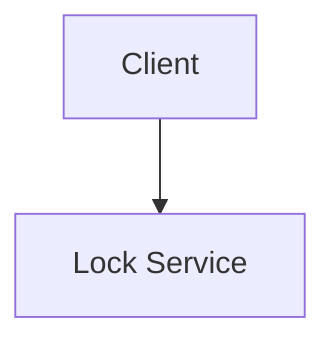
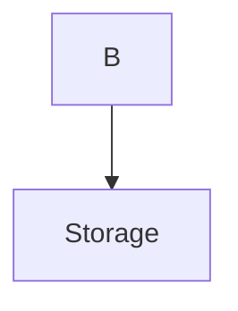
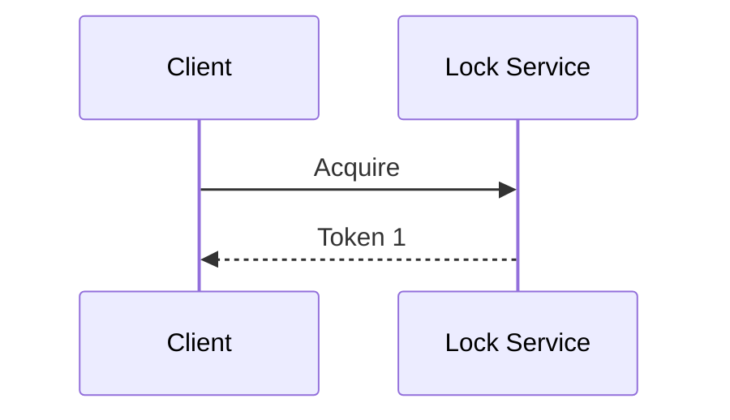

# Distributed Lock — High-Level Design

> **Evidence Contract Note:** Target Layer: Core / Staff. Unsourced figures below are scenario assumptions used for capacity sizing, not external production telemetry.

Use fencing tokens for safety.

---

## 1. 📝 Requirements and Constraints

See [PROBLEM.md](./PROBLEM.md) for the core problem statement and requirements.

### Functional Requirements
- **Mutual exclusion:** At most one client holds a given `lock_key` at any point in time.
- **Deadlock freedom:** Every lock is granted as a bounded time-to-live (TTL) lease so a crashed holder cannot block waiters indefinitely.
- **Lease renewal (heartbeat):** The current holder can extend its active lease before expiry.
- **Safe release:** Only the current holder presenting a matching `lease_id`, `owner_id`, and `fencing_token` can release the lock.
- **Fencing token issuance:** Every successful lock acquisition returns a strictly monotonically increasing 64-bit `fencing_token` that downstream resources validate to reject stale writes from paused holders.

### Non-Functional Requirements

| Requirement | Target (Scenario Assumptions) |
|---|---|
| Availability | `99.99%` within a region (5-node consensus group across 3 AZs, tolerating 2 node failures) |
| Acquire / Renew / Release latency | `p50 <= 6 ms`, `p99 <= 15 ms` (in-region) |
| Throughput | `30,000` avg write QPS, `80,000` peak write QPS |
| Consistency | Linearizable (CP) — consensus quorum required for every lease grant and renewal |
| Durability | Committed lease state and fencing counters persisted to quorum WAL before acknowledgment |

### Out of Scope (Non-Goals)
- Cross-region active-active multi-master locking without global consensus.
- Application-level re-entrant/recursive locking (can be layered inside the client SDK if needed).

---

## 2. 📊 Back-of-Envelope Estimation

### Traffic Assumptions

| Metric | Value | Formula / Rationale |
|---|---|---|
| Concurrent active locks | `100,000` | Input scenario (across `5,000` service instances) |
| Default lease TTL | `30 s` | Input scenario (renewed every `10 s`, i.e., `TTL / 3`) |
| Avg acquire QPS | `10,000` | Input scenario |
| Avg release QPS | `10,000` | ~1:1 with acquires (minus expired leases) |
| Avg renew QPS | `10,000` | `100,000 active locks / 10 s heartbeat interval` |
| **Total avg write QPS** | **`30,000`** | `10,000 + 10,000 + 10,000` |
| Peak acquire / release QPS | `30,000` each | `3x` burst factor on acquire and release |
| Peak renew QPS | `20,000` | `2x` burst factor during reconnect/retry waves |
| **Total peak write QPS** | **`80,000`** | `30,000 + 30,000 + 20,000` |

### Storage and Memory Arithmetic

| Resource | Value | Formula / Breakdown |
|---|---|---|
| Active lease record size | `256 B` | `lock_key` (~64 B) + `owner_id` (36 B) + `lease_id` (36 B) + `fencing_token` (8 B) + `ttl_ms` / deadlines / metadata (~112 B) |
| Active state in RAM | `25.6 MB` | `100,000 active locks × 256 B` (even at 10x = 1M locks, `256 MB` fits easily in RAM) |
| WAL entry size | `300 B` | Serialized Raft command + header + CRC |
| Avg WAL write rate (cluster) | `9.0 MB/s` | `30,000 ops/s × 300 B` (`~778 GB/day` raw before compaction) |
| Peak WAL write rate (cluster) | `24.0 MB/s` | `80,000 ops/s × 300 B` |
| Retained WAL + snapshot / shard | `~20 GB` | `~3.2 MB` snapshot (`25.6 MB / 8`) every 15 min + 4-hour rolling WAL (`1.125 MB/s × 14,400 s = 16.2 GB` + burst headroom) |

### Cluster Sizing (QPS to Shards to Nodes)
- A single 5-node Raft consensus group across 3 AZs with NVMe group-committed `fsync` sustains `10,000–15,000` committed write ops/s at `p99 <= 15 ms` (1–2 ms intra-region quorum RTT + 2–5 ms batched NVMe `fsync`).
- Sizing each Raft shard for `10,000` peak write QPS (leaving ~33–50% headroom):
  - Required Raft shards: `80,000 peak write QPS / 10,000 QPS per shard = 8 Raft shards`.
  - Total Raft replicas: `8 shards × 5 replicas = 40 replicas`.
  - Physical/VM node layout: `15 nodes` (`5 nodes per AZ` across 3 AZs), each hosting `2–3` Raft shard replicas with leaders balanced across nodes.
  - Per-node peak load: `80,000 × 5 replicas / 15 nodes = 26,667` Raft log appends/s/node (`26,667 × 300 B = 8.0 MB/s` peak sequential NVMe WAL per node).

### Latency Budget (In-Region)
- Client -> L7 Router -> Shard Leader: `1–2 ms`
- Leader -> Quorum Followers (`AppendEntries`, 3 of 5 nodes across 3 AZs): `2–4 ms`
- Batched WAL `fsync` on leader and quorum followers: `2–5 ms`
- Response serialization and return: `1–2 ms`
- **Total:** `p50 ~ 6 ms`, `p99 <= 15 ms`.

### Decision Notes
- **What forces sharding:** Not storage size (`25.6 MB` active RAM), but single-leader Raft write serialization (`~10–15k` write QPS/shard). Partitioning by `lock_key` across 8 independent Raft groups scales throughput linearly while keeping every individual lock strictly linearizable.

---

## 3. 🔌 API / System Interface

### External Contract
- **Protocol:** gRPC (primary for internal services and watch streams) with an HTTP/1.1+JSON REST gateway.
- **Authentication:** mTLS client certificates or short-lived service tokens; `owner_id` is verified against the caller identity.
- **Idempotency:** Clients supply an `idempotency_key` on `acquire` so retrying after a transient timeout returns the same lease and `fencing_token` instead of failing with `409 Conflict`.

### Core Endpoints

#### 1. Acquire Lock
```http
POST /api/v1/locks/{lock_key}/acquire
Content-Type: application/json
Idempotency-Key: req-9f8a2c10

{
  "owner_id": "worker-az1-042",
  "ttl_ms": 30000
}
```

**Response — `200 OK` (Acquired):**
```json
{
  "lock_key": "orders:reconcile:2026-11-28",
  "lease_id": "ls_01J9X4K2M8N0P3Q6",
  "owner_id": "worker-az1-042",
  "fencing_token": 1048577,
  "ttl_ms": 30000,
  "expires_at_ms": 1764285030000
}
```

**Response — `409 Conflict` (Already Held):**
```json
{
  "error": "LOCK_HELD",
  "lock_key": "orders:reconcile:2026-11-28",
  "current_owner_id": "worker-az2-019",
  "retry_after_ms": 4200
}
```

#### 2. Renew Lease (Heartbeat)
```http
POST /api/v1/locks/{lock_key}/renew
Content-Type: application/json

{
  "lease_id": "ls_01J9X4K2M8N0P3Q6",
  "owner_id": "worker-az1-042",
  "fencing_token": 1048577,
  "ttl_ms": 30000
}
```

**Response — `200 OK` (Renewed):**
```json
{
  "lock_key": "orders:reconcile:2026-11-28",
  "lease_id": "ls_01J9X4K2M8N0P3Q6",
  "fencing_token": 1048577,
  "expires_at_ms": 1764285040000
}
```

#### 3. Release Lock
```http
POST /api/v1/locks/{lock_key}/release
Content-Type: application/json

{
  "lease_id": "ls_01J9X4K2M8N0P3Q6",
  "owner_id": "worker-az1-042",
  "fencing_token": 1048577
}
```

**Response — `200 OK` (Released):**
```json
{
  "lock_key": "orders:reconcile:2026-11-28",
  "lease_id": "ls_01J9X4K2M8N0P3Q6",
  "released": true
}
```

#### 4. Inspect Lock State (Linearizable Read)
```http
GET /api/v1/locks/{lock_key}
```
Returns the active lease metadata (`owner_id`, `fencing_token`, `expires_at_ms`) or `404 Not Found` if unlocked.

### Downstream Resource Fencing Contract
- Every write from a lock holder to a protected downstream store includes `fencing_token`.
- The downstream store persists `last_fencing_token` per protected resource and atomically enforces:
  - Reject with `409 Conflict` / `412 Precondition Failed` if `request.fencing_token < resource.last_fencing_token`.
  - Accept and update `resource.last_fencing_token = request.fencing_token` if `request.fencing_token >= resource.last_fencing_token` (allowing multiple idempotent writes under the same lease, while strictly rejecting any older holder after a new acquisition increments the token).

### Error Model
- `400 Bad Request` — invalid `lock_key` or `ttl_ms` outside allowed bounds (`1 s` to `300 s`).
- `401 / 403` — failed mTLS/token auth or `owner_id` mismatch with caller identity.
- `404 Not Found` — lease does not exist or has already expired (on `renew` or `GET`).
- `409 Conflict` — lock held by another owner (on `acquire`) or stale `lease_id`/`fencing_token` (on `renew`/`release`).
- `429 Too Many Requests` — client exceeded per-service acquire/renew rate limit.
- `503 Service Unavailable` — shard leader election in progress or quorum unavailable; client backs off with jitter.

---

## 4. 🗄️ Core Entities and Data Model

### State Machine Schema (Replicated via Raft)

```text
LeaseRecord (active lock table — in-memory hash map + periodic Raft snapshots)
  lock_key                 VARCHAR(256)  PRIMARY KEY
  lease_id                 VARCHAR(64)   UNIQUE
  owner_id                 VARCHAR(128)  NOT NULL
  fencing_token            UINT64        NOT NULL   -- strictly monotonic
  ttl_ms                   UINT32        NOT NULL
  expires_at_monotonic_ms  UINT64        NOT NULL   -- leader monotonic deadline
  raft_index               UINT64        NOT NULL   -- commit index that granted/renewed lease
  status                   ENUM(ACTIVE, RELEASED, EXPIRED)

FencingCounter (monotonic token generator per shard)
  shard_id                 UINT16        PRIMARY KEY
  last_fencing_token       UINT64        NOT NULL   -- persisted in Raft state; never decreases

IdempotencyRecord (deduplication window for retried acquires)
  lock_key                 VARCHAR(256)
  idempotency_key          VARCHAR(128)
  lease_id                 VARCHAR(64)
  fencing_token            UINT64
  expires_at_monotonic_ms  UINT64
  PRIMARY KEY (lock_key, idempotency_key)
```

### Indexing, Partitioning, and Retention
- **Partitioning:** Static hash partitioning (`hash(lock_key) % 8`) maps each `lock_key` deterministically to one 5-node Raft consensus group. All `acquire`, `renew`, `release`, and linearizable `GET` calls for a key route to that shard's leader.
- **Indexes:**
  - `O(1)` hash map keyed by `lock_key` for lock state lookups and compare-and-swap transitions.
  - Min-heap (or hashed timing wheel) ordered by `expires_at_monotonic_ms` so the shard leader sweeps expired leases in `O(log N)` without scanning the full table.
- **Fencing counter retention:** Using a **per-shard monotonic counter** (or the shard's committed Raft log index) as `fencing_token` guarantees strict monotonicity across lock releases, expiries, and leader failovers **without** needing to retain per-key tombstone counters forever for short-lived ephemeral keys.
- **Record and WAL retention:**
  - Released or expired `LeaseRecord` entries are removed from active RAM immediately once the release/expiry command commits.
  - `IdempotencyRecord` entries are retained for `5 minutes` (or until lease expiry, whichever is longer) and purged by background sweep.
  - Raft WAL segments are compacted after each 15-minute snapshot, retaining a `4-hour` rolling window (`~16–20 GB` per shard) for slow-follower catch-up and incident audit.

---

## 5. 🏗️ High-Level Architecture







### Component List
- **Client SDK:** Handles `acquire`, background `renew` loop (`TTL / 3`), local lease expiry guard, and attaches `fencing_token` to every downstream storage call.
- **L7 Router / Shard Directory:** Maps `hash(lock_key) % 8` to the active Raft leader for that shard and forwards requests (or returns leader redirect hints).
- **Lock Service (Raft Consensus Shards):** 8 independent 5-node Raft groups spread across 3 AZs. The shard leader serializes mutations, replicates them to a majority (3/5), increments the monotonic `fencing_token`, and manages lease expiry timers.
- **Local Durable Storage (WAL + Snapshots):** Append-only Raft write-ahead log on NVMe with periodic state-machine snapshots.
- **Protected Downstream Storage:** Enforces the fencing token invariant (`request.fencing_token >= resource.last_fencing_token`) before committing any state mutation.

### Explicit Traces

#### Normal Trace (Acquire -> Work -> Release)
1. Client A sends `POST /api/v1/locks/job-42/acquire` with `ttl_ms=30000` and `Idempotency-Key`.
2. Router forwards to Shard `hash("job-42") % 8` Leader.
3. Leader verifies `job-42` is unlocked (or expired), increments `last_fencing_token` to `1048577`, and appends the `Acquire` command to the Raft log.
4. Once 3 of 5 replicas persist the log entry, Leader applies it to the in-memory lease table, schedules expiry at `now_monotonic + 30000 ms`, and returns `lease_id` + `fencing_token = 1048577`.
5. Client A writes to Downstream Storage with `fencing_token = 1048577`. Storage verifies `1048577 >= last_fencing_token`, updates `last_fencing_token = 1048577`, and commits.
6. Client A calls `POST /api/v1/locks/job-42/release` with `lease_id` and `fencing_token = 1048577`; Leader commits the release through Raft.

#### Failure Trace (Client Pause After Acquire)
1. Client A acquires `job-42` with `fencing_token = 1048577` and `ttl_ms = 30000`.
2. Client A experiences a 45-second stop-the-world GC pause before writing to storage; heartbeats stop.
3. At `t = 30 s`, the shard leader expires the lease and commits an `ExpireLease` entry through Raft.
4. Client B acquires `job-42` and receives `fencing_token = 1048578`, then writes to Downstream Storage (`last_fencing_token` becomes `1048578`).
5. Client A resumes and sends its delayed write carrying `fencing_token = 1048577`.
6. Downstream Storage compares `1048577 < 1048578` and rejects Client A's write with `409 Conflict`, preserving data integrity.

---

## 6. 🛑 Failure Modes and Recovery Handling

### 1. Client Pause (GC / CPU Starvation / Network Stall) After Lock Acquire
- **Risk:** A lock lease alone cannot stop a paused client from waking up after expiry and mutating shared state concurrently with the new holder.
- **Mitigation:** Mandatory monotonic `fencing_token` checked atomically by the downstream resource. In addition, the Client SDK tracks a local monotonic deadline (`acquired_at + ttl_ms - safety_margin`) and aborts work early if lease renewal fails.

### 2. Clock Skew and NTP Jumps
- **Risk:** Wall clocks (`CLOCK_REALTIME`) can jump forward or backward during NTP slewing/stepping, causing premature lease expiry or overlapping leases.
- **Mitigation:**
  - Lease expiry on the shard leader uses a **monotonic clock** (`CLOCK_MONOTONIC`), never client-supplied wall timestamps.
  - `expires_at_ms` in API responses is informational; authoritative expiry is driven solely by the Raft leader's monotonic timer and committed as an `ExpireLease` Raft entry.
  - **Failover clock safety:** When a new Raft leader is elected, it does not trust elapsed wall time from the dead leader; it starts fresh monotonic timers for active leases using their remaining `ttl_ms` (or full `ttl_ms` grace bound) so clock skew between leaders never expires a healthy lease early.

### 3. Lease Expiry and Zombie Renewals
- **Risk:** A client sends `renew` after its lease has already expired and been granted to another owner.
- **Mitigation:** `renew` requires exact matching of `(lock_key, lease_id, owner_id, fencing_token)`. If expired or reassigned, the leader returns `404`/`409`. The client SDK treats non-retryable `404`/`409` on renewal as immediate lock loss and halts its critical section.

### 4. Node Failure (Follower vs. Leader)
- **Follower failure:** With 5 replicas (quorum = 3), losing 1 or 2 followers causes zero downtime. When a follower returns, the leader streams missed WAL entries or installs the latest snapshot.
- **Leader failure:** Followers detect missed Raft heartbeats after the election timeout (`~300–500 ms`) and elect a new leader possessing all committed entries. Because every granted lease and `fencing_token` was committed to a majority before returning to the client, the new leader preserves both active ownership and strict token monotonicity. Recovery time: `~0.5–1.5 s` write pause during election; clients retry `acquire` safely via `Idempotency-Key`.

### 5. Network Partition and Split Brain
- **Risk:** A network partition isolates the old leader with 1 follower (minority: 2/5) while the remaining 3 nodes form a majority and elect a new leader.
- **Mitigation:**
  - The isolated old leader cannot commit any Raft log entry (`acquire`, `renew`, `release`) because it cannot reach 3 replicas.
  - Using Raft `CheckQuorum` / leader lease checks, the old leader steps down automatically once it fails to receive heartbeat acks from a majority within an election timeout, preventing stale linearizable reads.
  - Even if a client receives a stale response before step-down, no new fencing token can be committed in the minority partition, and downstream storage rejects any stale token.

### Bottlenecks and Failure Modes Summary

| Component | Failure Mode | Impact | Detection | Mitigation & Recovery |
|---|---|---|---|---|
| Client process | GC pause / freeze > TTL | Lease expires mid-work | Missed heartbeats; renewal `409`/`404` | Downstream fencing token rejects stale writes; SDK aborts work |
| Host clock | NTP step / drift | Premature or delayed expiry | Clock skew telemetry alarm | Leader uses `CLOCK_MONOTONIC`; conservative timer reset on failover |
| Raft Follower | Crash / disk failure | Reduced fault tolerance (4/5) | Leader heartbeat failure | Quorum unaffected; WAL replay or snapshot install on recovery |
| Raft Leader | Crash / AZ outage | `0.5–1.5 s` write pause | Election timeout (`300–500 ms`) | Quorum elects new leader; clients retry with `Idempotency-Key` |
| Network | Partition / split brain | Minority cannot commit | `CheckQuorum` failure | Old leader steps down; majority elects leader; fencing protects storage |
| Hot `lock_key` | Contention storm | High `409` rate / shard CPU | Per-key acquire rate & `409` metrics | Exponential backoff with jitter; server-side watch/notify instead of tight polling |

---

## 7. ⚖️ Trade-offs and Decisions

| Decision | Option Chosen | Alternative | Why Chosen Now | Revisit Trigger |
|---|---|---|---|---|
| Consensus backend | 5-node Raft consensus shards (etcd/ZooKeeper style) | Single-node Redis / Redlock | Guarantees linearizability and monotonic fencing tokens under partitions and clock drift | Only need best-effort efficiency locks where occasional double-execution is harmless |
| Safety mechanism | Server-issued monotonic fencing tokens validated by storage | Lease TTL alone | Eliminates silent data corruption from client pauses and delayed packets | Downstream resource cannot be modified to check tokens (requires proxy/wrapper) |
| Fencing counter scope | Per-shard monotonic `uint64` counter | Per-key persisted counter | Zero unbounded counter storage for ephemeral keys while preserving strict monotonicity per key | Need dense per-key sequence numbers (`1, 2, 3...`) for audit |
| Scaling model | 8 static hash-partitioned Raft shards | Single global Raft cluster | Scales past single-leader ~10–15k write QPS bottleneck to 80k+ peak QPS | Peak write QPS exceeds 100k (migrate to dynamic range splitting / Multi-Raft) |

---

## 8. 🔗 Cross-Links

- [Problem Statement](./PROBLEM.md)
- [Approach](./APPROACH.md)
- [Common Pitfalls](./PITFALLS.md)
- [Strong Answer](./STRONG-ANSWER.md)
- [Distributed Consensus (Raft)](../../03-hld-concepts/distributed-consensus-raft/)
- [Distributed Coordination](../../03-hld-concepts/distributed-coordination/)
- [ZooKeeper](../../03-hld-concepts/zookeeper/)
- [Idempotency](../../03-hld-concepts/idempotency/)
