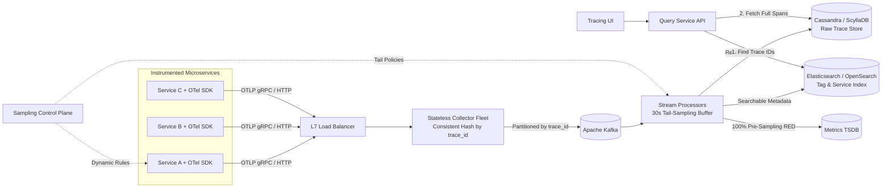

# Distributed Tracing System - High Level Design

## Architecture Overview

A distributed tracing system typically follows a pipeline architecture designed to ingest, process, store, and serve telemetry data with high throughput and low latency. See [CAPACITY.md](./CAPACITY.md) for the 5M spans/sec sizing and 75 GB tail-sampling buffer math, and [COMPARISON.md](./COMPARISON.md) for how this pack differs from [Distributed Tracing](../distributed-tracing/DESIGN.md).

### Core Components

#### 1. Tracing Agents / SDKs
- Embedded within application code (e.g., OpenTelemetry SDK).
- Generates spans, injects/extracts context across process boundaries (W3C TraceContext).
- Performs local buffering, batching, and often **Head-Based Sampling** before sending data over the network via gRPC or UDP.

#### 2. Collector / Ingestion Layer
- Horizontally scalable stateless services.
- Receives batches of spans from various agents.
- Performs basic validation, formatting, and enriches data if necessary.
- Acts as a buffer to handle traffic spikes. 
- For **Tail-Based Sampling**, collectors route spans with the same Trace ID to specific downstream aggregators using consistent hashing.

#### 3. Message Queue (Buffer)
- e.g., Apache Kafka.
- Decouples ingestion from processing and storage.
- Absorbs massive traffic spikes and prevents downstream systems (like databases) from being overwhelmed.

#### 4. Stream Processors / Aggregators
- Reads from the message queue.
- If using Tail-Based Sampling, buffers all spans for a trace in memory for a short window (e.g., 10-30 seconds).
- Evaluates the complete trace against sampling rules (e.g., keep if `error=true` or `duration > 2s`).
- Forwards selected traces to storage and discards the rest.
- Aggregates metrics (e.g., RED metrics - Rate, Errors, Duration) and writes them to a Time Series Database (TSDB).

#### 5. Storage Layer
Tracing requires specific storage patterns:
- **Trace Storage (Blob/Object Storage or NoSQL):** e.g., Cassandra, ScyllaDB, or S3-compatible storage for older traces. Optimized for high-throughput writes and point lookups by Trace ID.
- **Search Index (Inverted Index):** e.g., Elasticsearch, OpenSearch, or ClickHouse. Used to index tags, service names, and operations to quickly find Trace IDs that match user queries.

#### 6. Query Service & UI
- Provides an API for the frontend UI.
- Queries the Search Index to find Trace IDs.
- Retrieves the full span payloads from Trace Storage using the Trace IDs.
- Reconstructs the trace tree (DAG) and visualizes the timeline, relationships, and bottlenecks.

## System Architecture Diagram



## API / System Interface

### Protocol & Auth Model
- **Ingestion:** OTLP over **gRPC** (`opentelemetry.proto.collector.trace.v1.TraceService/Export`) for low-overhead batched uploads, with **OTLP/HTTP** (`POST /v1/traces`) as a fallback. Authenticated via service-to-service mTLS or scoped bearer tokens with `X-Tenant-Id` isolation.
- **Query & Sampling Control Plane:** HTTPS REST/JSON behind an API Gateway with RBAC and per-caller rate limits.

### 1. Span Ingestion API (`POST /v1/traces`)
Accepts batched spans from application SDKs or regional agents and routes them to Kafka partitioned by `traceId`.

```http
POST /v1/traces
Authorization: Bearer <service-token>
Content-Type: application/json

{
  "resourceSpans": [
    {
      "resource": {
        "attributes": [
          { "key": "service.name", "value": { "stringValue": "checkout-service" } }
        ]
      },
      "scopeSpans": [
        {
          "spans": [
            {
              "traceId": "4bf92f3577b34da6a3ce929d0e0e4736",
              "spanId": "00f067aa0ba902b7",
              "parentSpanId": "a2fb4a1d1a96d312",
              "name": "ProcessPayment",
              "startTimeUnixNano": "1678886400000000000",
              "endTimeUnixNano": "1678886400150000000",
              "attributes": [
                { "key": "http.status_code", "value": { "intValue": 500 } },
                { "key": "error", "value": { "boolValue": true } }
              ]
            }
          ]
        }
      ]
    }
  ]
}
```
**Response (`200 OK`):**
```json
{
  "partialSuccess": {
    "rejectedSpans": "0"
  }
}
```

### 2. Trace Query APIs (`GET /api/v1/traces/{traceId}` & Search)

#### Fetch Trace by ID (Cassandra / ScyllaDB Lookup)
```http
GET /api/v1/traces/4bf92f3577b34da6a3ce929d0e0e4736
Authorization: Bearer <user-token>
```
**Response (`200 OK`):**
```json
{
  "trace_id": "4bf92f3577b34da6a3ce929d0e0e4736",
  "span_count": 18,
  "duration_ms": 412,
  "spans": [
    {
      "span_id": "00f067aa0ba902b7",
      "parent_span_id": "a2fb4a1d1a96d312",
      "service_name": "checkout-service",
      "operation_name": "ProcessPayment",
      "start_time_unix_nano": 1678886400000000000,
      "duration_nano": 150000000,
      "tags": { "http.status_code": "500", "error": "true" }
    }
  ]
}
```

#### Search Traces by Service, Tags, and Time Window (Elasticsearch -> Cassandra)
```http
GET /api/v1/traces?service=checkout-service&operation=ProcessPayment&tag=error:true&min_duration_ms=100&start=2026-11-28T10:00:00Z&end=2026-11-28T10:15:00Z&limit=20&cursor=eyJ0cyI6MTY3ODg4NjQwMH0=
Authorization: Bearer <user-token>
```
**Response (`200 OK`):**
```json
{
  "traces": [
    {
      "trace_id": "4bf92f3577b34da6a3ce929d0e0e4736",
      "root_service": "api-gateway",
      "root_operation": "POST /checkout",
      "start_time": "2026-11-28T10:12:04.120Z",
      "duration_ms": 412,
      "error_count": 1,
      "span_count": 18
    }
  ],
  "next_cursor": "eyJ0cyI6MTY3ODg4NjMwMH0="
}
```

### 3. Sampling Configuration API (`GET / PUT /api/v1/sampling/config`)
Lets operators update head-based and tail-based sampling rules dynamically without redeploying services.

```http
GET /api/v1/sampling/config?service=checkout-service
PUT /api/v1/sampling/config
Authorization: Bearer <admin-token>
Content-Type: application/json

{
  "version": 12,
  "head_sampling": {
    "default_rate": 1.0,
    "per_service_overrides": {
      "healthcheck-service": 0.001
    }
  },
  "tail_sampling": {
    "buffer_window_sec": 30,
    "keep_on_error": true,
    "latency_threshold_ms": 2000,
    "baseline_probabilistic_rate": 0.01
  }
}
```
**Response (`200 OK`):** Returns the persisted sampling policy with incremented `version` and `etag` for optimistic concurrency.

### Error Model
- `400 Bad Request`: Malformed `traceId` (must be 32 hex chars), invalid time range (`start >= end`), or sampling rate outside `[0, 1]`.
- `401 / 403`: Invalid token or insufficient RBAC scope for cross-tenant queries or sampling updates.
- `404 Not Found`: Trace ID was dropped by tail sampling or expired past the 7-day retention TTL.
- `413 Payload Too Large`: Span batch exceeds collector payload cap (e.g., 4 MB); SDK splits and retries.
- `429 Too Many Requests`: Tenant exceeded ingestion or query quota; includes `Retry-After`.
- `503 Service Unavailable`: Kafka or query index under backpressure; SDK drops spans once its local ring buffer fills rather than blocking application threads.

## Data Model

### Span Record
```json
{
  "trace_id": "1234abcd",
  "span_id": "5678efgh",
  "parent_span_id": "9012ijkl", // null for root span
  "service_name": "checkout-service",
  "operation_name": "ProcessPayment",
  "start_time_unix_nano": 1678886400000000000,
  "duration_nano": 150000000,
  "tags": {
    "http.status_code": "500",
    "error": "true"
  },
  "events": [ // Logs attached to the span
    { "time": 1678886400050000000, "name": "Payment Gateway Timeout" }
  ]
}
```

## Cross-Links
- [Problem Statement](./PROBLEM.md) | [Approach](./APPROACH.md) | [Capacity Estimation](./CAPACITY.md)
- [Comparison](./COMPARISON.md) | [Common Pitfalls](./PITFALLS.md) | [Strong Answer](./STRONG-ANSWER.md)
- Sibling pack: [Distributed Tracing](../distributed-tracing/DESIGN.md)