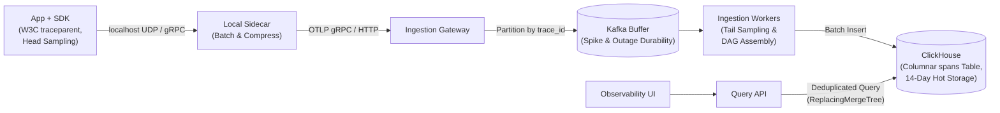

# Design: Distributed Tracing

## 1. Requirements and Constraints

### Problem Statement
- System to design: Distributed Tracing System
- Core user value: Allow developers to debug and monitor request flows across microservices.

### Constraints
- Target 1M spans per second ingestion.
- Retention: 14 days hot storage.
- Max latency overhead for instrumented apps: < 2ms.

## 2. API / System Interface

The ingestion API used by collectors (e.g., OTLP/gRPC or HTTP).

```http
POST /v1/traces
Content-Type: application/x-protobuf

{
  "resourceSpans": [
    {
      "resource": { "attributes": [{"key": "service.name", "value": {"stringValue": "payment-api"}}] },
      "scopeSpans": [
        {
          "spans": [
            {
              "traceId": "5b8aa5a2d2c8646c1414d0a20464654f",
              "spanId": "48b617072a2e4b02",
              "parentSpanId": "e1f13f56ce265f24",
              "name": "/charge",
              "kind": "SPAN_KIND_SERVER",
              "startTimeUnixNano": "1699999999000000000",
              "endTimeUnixNano": "1699999999500000000",
              "attributes": [{"key": "http.status_code", "value": {"intValue": 200}}]
            }
          ]
        }
      ]
    }
  ]
}
```

## 3. Data Model

We use a columnar model. Each span is a row.

**Table: `spans` (ClickHouse schema representation)**
- `trace_id` (FixedString(32)) - Partition Key / Sorting Key
- `span_id` (FixedString(16))
- `parent_span_id` (FixedString(16))
- `service_name` (LowCardinality(String)) - Index
- `operation_name` (LowCardinality(String))
- `start_time` (DateTime64(9)) - Sorting Key
- `duration_ns` (UInt64)
- `tags` (Map(String, String)) - Index

## 4. High-Level Architecture




Instrumented microservices propagate W3C `traceparent` context via the App SDK (with optional head-based sampling) and emit spans over `localhost` to a Local Sidecar that batches and compresses payloads to keep application latency overhead under 2ms. The Ingestion Gateway writes incoming OTLP batches into Kafka partitioned by `trace_id`, providing a durable buffer that absorbs traffic spikes and ClickHouse outages while routing all spans of a trace to the same worker. Stateful Ingestion Workers buffer spans in memory to apply tail-based sampling and assemble valid trace DAGs before writing to ClickHouse, where the Query API serves deduplicated trace lookups to the Observability UI.

### Components
1. **App SDK:** Generates `traceparent` headers. Implements Head-based sampling (e.g., 1% of requests).
2. **Local Sidecar:** Receives spans on `localhost`. Batches and compresses them.
3. **Kafka Buffer:** Absorbs traffic spikes. Prevents data loss during storage degradation. Provides retry/replay mechanisms if storage fails.
4. **Ingestion Workers:** Applies Tail-based sampling. Assembles the DAG to ensure parent/child linkages are valid before writing to storage.
5. **Storage:** ClickHouse for fast, compressed columnar querying.

## 5. Capacity and Estimates

- **Traffic:** 1,000,000 spans/sec.
- **Span Size:** 600 bytes on average.
- **Ingestion Throughput:** 1M * 600B = 600 MB/s = ~51.84 TB / day.
- **Storage:** With 14-day retention and 5x compression (columnar), we need `(51.84 TB * 14) / 5 = ~145.15 TB` of storage.
- **Read/Write Ratio:** Write-heavy (99.9% writes, 0.1% reads).

## 6. Consistency and Availability Contract

- **Availability over Consistency:** Ingestion cannot fail. We prioritize high availability for incoming telemetry over immediate read consistency.
- **Durability:** Once spans are acknowledged by Kafka, they are durable. However, trace DAG reconstruction is eventually consistent as workers process Kafka partitions.
- **Idempotency:** Re-reading from Kafka may cause duplicate spans in ClickHouse. We rely on `(trace_id, span_id)` deduplication at query time (e.g., via `ReplacingMergeTree`) rather than slowing down writes.

## 7. Failure and Recovery Trace

- **Storage Degradation (ClickHouse goes down):**
  1. ClickHouse nodes become unreachable.
  2. Ingestion Workers experience write timeouts and pause consuming from Kafka.
  3. Kafka buffers the spans, absorbing the traffic while retaining durability.
  4. Once ClickHouse recovers, Workers resume consumption, rapidly draining the Kafka backlog without losing spans.
- **Ingestion Worker Crash:**
  1. A worker applying tail-based sampling crashes.
  2. Kafka rebalances the consumer group, assigning the partition to another worker.
  3. Some in-memory span buffers (tail sampling state) may be lost, leading to dropped or fragmented traces during the short crash window.

## 8. Deep Dives

### Sampling Strategies
- **Head-based sampling:** A random decision is made at the edge (e.g., API Gateway). If selected, a `sampled=true` flag is appended to the `traceparent` header. All downstream services honor this. Pros: Simple, low bandwidth. Cons: Might miss rare errors if they aren't part of the 1%.
- **Tail-based sampling:** The edge always samples 100%. Spans flow into the Ingestion Workers. Workers buffer spans for a short time (e.g., 30s). Once the window closes, the worker evaluates the whole trace. If any span has an error or latency > 99th percentile (p99 latency > 1s), the whole trace is kept. Pros: High value data is preserved. Cons: Requires huge memory buffers in workers; stateful routing is needed so all spans for a trace go to the same worker.

## 9. Alternatives and Trade-offs

| Decision | Option Chosen | Alternative | Why Chosen |
|---|---|---|---|
| Buffer | Kafka | Direct to DB | Ingestion cannot block on DB latency; handles massive spikes. |
| Database | Columnar (ClickHouse) | Document (Elasticsearch) | Significantly better compression and aggregation speed for structured telemetry. |
| Tail Sampling | Worker Memory | Redis | Lower latency, avoids network hop. Partitioning Kafka by trace_id enables local state. |
