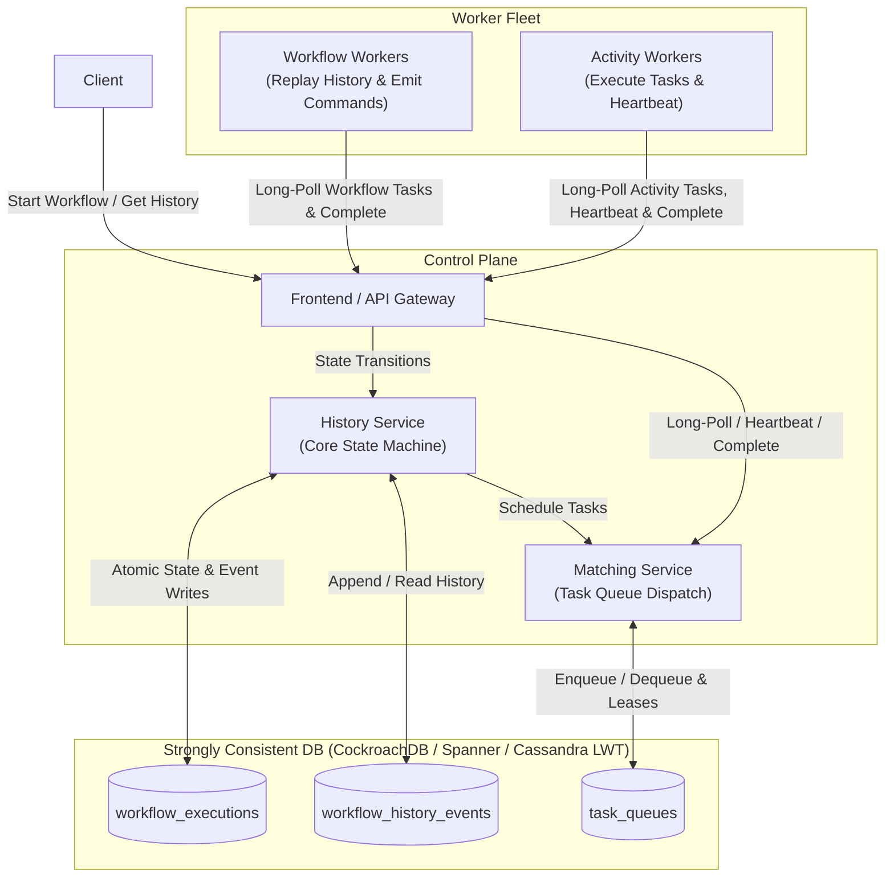

# Distributed Workflow Orchestrator - System Design

## 1. API Contract

The control plane exposes APIs for clients to start/manage workflows and for workers to fetch tasks and report results.

### Client APIs
- `POST /api/v1/namespaces/{namespace}/workflows`
  - Starts a new workflow execution.
  - Returns `run_id`.
- `GET /api/v1/namespaces/{namespace}/workflows/{workflow_id}/history`
  - Fetches paginated event history.

### Worker APIs (Polling & Results)
- `POST /api/v1/namespaces/{namespace}/task-queues/{queue_name}/poll-workflow-task`
  - Long-polling endpoint for workers to fetch the next workflow task.
  - Returns event history required for replay.
- `POST /api/v1/namespaces/{namespace}/task-queues/{queue_name}/poll-activity-task`
  - Long-polling endpoint for workers to fetch the next activity task.
- `POST /api/v1/namespaces/{namespace}/workflows/tasks/{task_id}/complete`
  - Submits the result of a workflow or activity task.
- `POST /api/v1/namespaces/{namespace}/activities/tasks/{task_id}/heartbeat`
  - Renews the lease for a running activity.

## 2. Core Entities & Data Model

The data layer requires strong consistency to ensure workflow transitions and task queue dispatches are atomic. A distributed SQL database (e.g., CockroachDB, Spanner) or specialized NoSQL (e.g., Cassandra with LWT) is appropriate.

### Execution State
```sql
CREATE TABLE workflow_executions (
    namespace_id UUID,
    workflow_id VARCHAR,
    run_id UUID,
    status VARCHAR, -- RUNNING, COMPLETED, FAILED
    next_event_id BIGINT,
    PRIMARY KEY ((namespace_id, workflow_id), run_id)
);
```

### Event History
```sql
CREATE TABLE workflow_history_events (
    namespace_id UUID,
    workflow_id VARCHAR,
    run_id UUID,
    event_id BIGINT,
    event_type VARCHAR, -- WorkflowExecutionStarted, ActivityTaskScheduled...
    payload JSONB,
    PRIMARY KEY ((namespace_id, workflow_id, run_id), event_id)
);
```

### Task Queues
```sql
CREATE TABLE task_queues (
    namespace_id UUID,
    queue_name VARCHAR,
    task_type VARCHAR, -- WORKFLOW, ACTIVITY
    scheduled_time TIMESTAMP,
    task_id UUID,
    payload JSONB,
    PRIMARY KEY ((namespace_id, queue_name), scheduled_time, task_id)
);
```

## 3. High-Level Architecture

The system consists of the following key components:

1.  **Frontend / API Gateway:** Handles ingress, rate limiting, and routing requests from clients and workers to the correct backend services.
2.  **History Service:** The core state machine. It manages workflow state transitions, persists events to the database, and enforces consistency. It decides what to do next based on worker responses (e.g., if a worker completes an activity, the History service writes the event and schedules the next workflow task).
3.  **Matching Service:** Manages the task queues. It matches available tasks with polling workers. It receives task schedules from the History service.
4.  **Worker Fleet:** User-managed processes running the workflow and activity logic.



Clients start executions and query event histories through the Frontend / API Gateway, which routes state transitions to the History Service—the core state machine that atomically persists execution state and append-only events in a strongly consistent distributed database. When workflow code schedules work, the History Service records the event and hands off to the Matching Service, which manages DB-backed `task_queues` and tracks activity lease timeouts. User-managed Workflow and Activity Workers long-poll the Matching Service via the gateway, replaying event history to recover workflow state deterministically and reporting heartbeats or task completions back to the History Service.

### Cross-Links
- [Architecture Diagram](diagrams/architecture.mmd)
- [Problem Context](PROBLEM.md)
- [Approach & Tradeoffs](APPROACH.md)
- [Comparison to State Machines](COMPARISON.md)

## 4. Deep Dives

### Data Flow: Executing an Activity
1.  **Workflow Code Schedules Activity:** The workflow worker code (during replay or normal execution) hits an activity invocation. It returns a command to the Orchestrator: `ScheduleActivityTask`.
2.  **History Service:** Persists `ActivityTaskScheduled` event. Calls Matching Service to enqueue the task.
3.  **Matching Service:** Enqueues the task in the `task_queues` table.
4.  **Activity Worker Polls:** An activity worker long-polls the Matching Service.
5.  **Dispatch:** Matching service dequeues the task and sends it to the worker.
6.  **Heartbeat (Optional):** Worker periodically calls the heartbeat API if the activity is long.
7.  **Completion:** Worker finishes the activity and calls the complete API.
8.  **History Service:** Persists `ActivityTaskCompleted`. Schedules a new *Workflow Task* so the workflow can resume execution with the activity result.

### Event Sourcing Replay Mechanics
When a workflow task is dispatched to a worker, it includes the event history.
1.  The worker initializes a fresh workflow instance.
2.  It intercepts all API calls (e.g., `ScheduleActivity`, `StartTimer`) made by the workflow code.
3.  Instead of executing them, it compares them against the provided history.
4.  If the history shows the activity was already scheduled and completed, the worker injects the historical result back into the workflow code.
5.  This "fast-forwards" the workflow state to where it left off before the crash.
6.  Once replay reaches the end of history, new API calls generate new commands to send back to the orchestrator.

### Handling Worker Failures
- **Activity Timeouts:** The Matching service monitors lease timeouts. If a worker doesn't heartbeat or complete the task within the lease, the Matching service re-enqueues the task.
- **Workflow Task Timeouts:** If a workflow worker crashes while processing a history replay, the orchestrator detects the timeout and simply re-queues the workflow task for another worker.

## 5. Trade-offs and Decisions

| Decision | Chosen | Alternative | Rationale |
| :--- | :--- | :--- | :--- |
| **Worker Comms** | Long-polling | gRPC Push / WebSockets | Simpler load balancing and edge statelessness; easier for user workers behind firewalls. |
| **State Storage** | Event Sourcing | Snapshotting Heap | Language agnostic, exact replay guarantees, easier debugging/audit trails. |
| **Queue Design** | DB-backed queues | In-memory queues (Kafka/RabbitMQ) | Need transactional consistency between history writes and queue enqueues to avoid split-brain or dropped tasks. |

---
**Real-world reference**: See how Amazon solved this in the [Amazon case study](../../case-studies/amazon-orders/)
