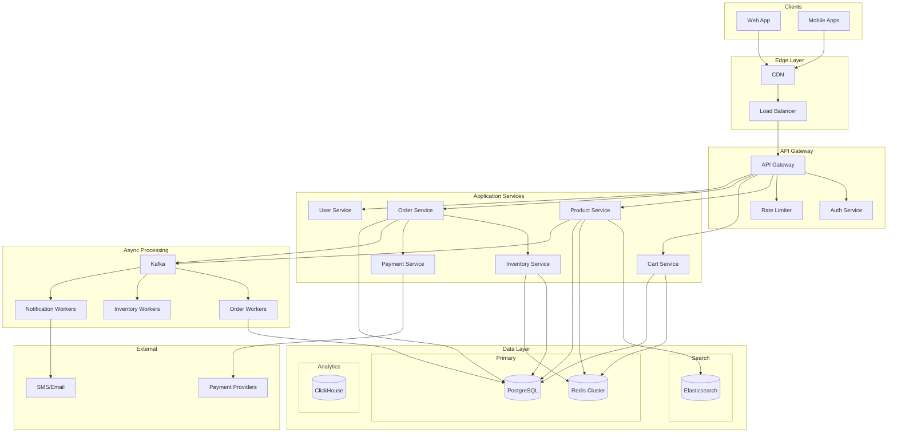
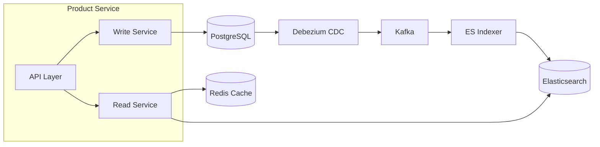
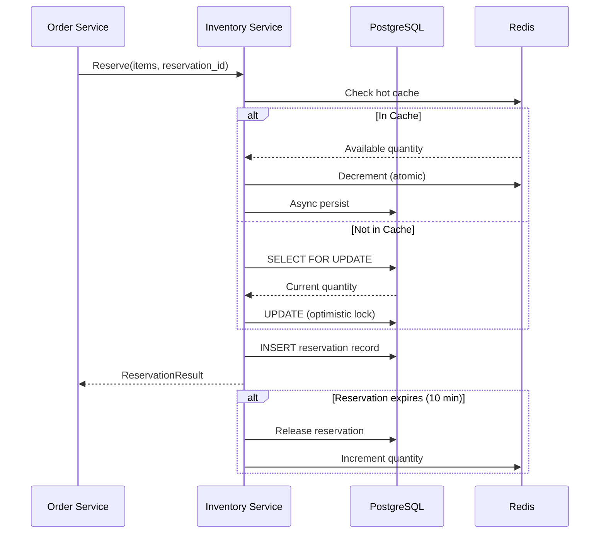
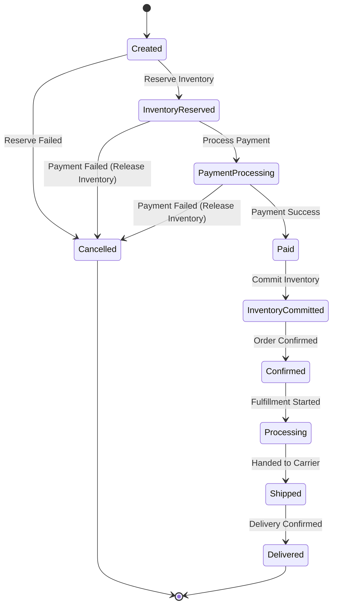
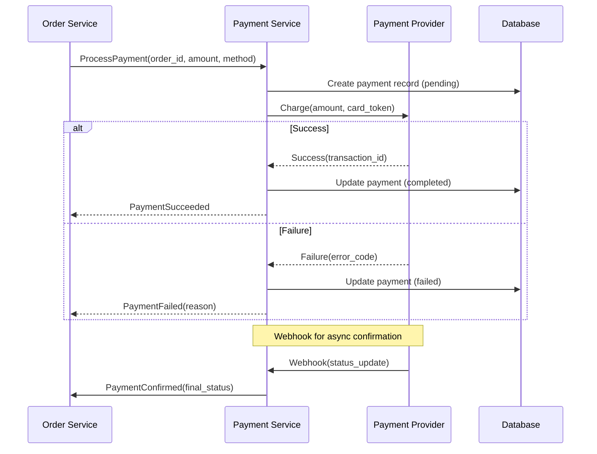
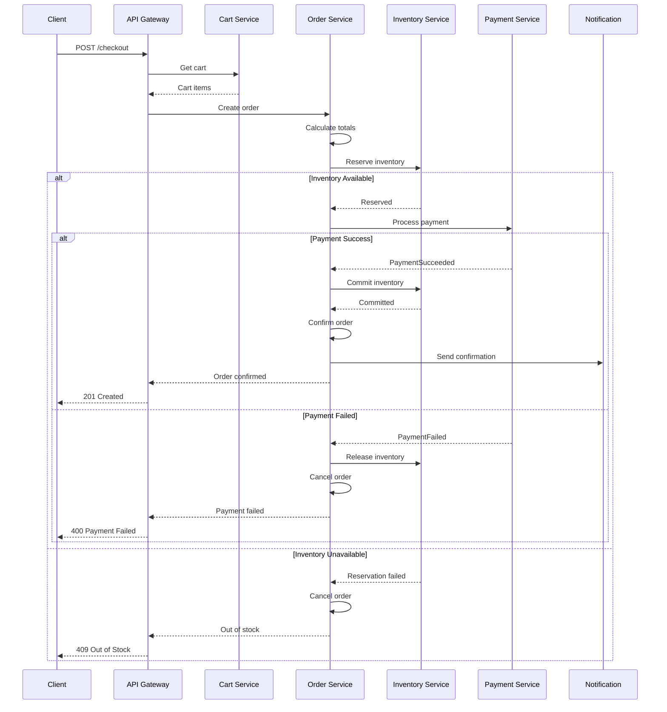
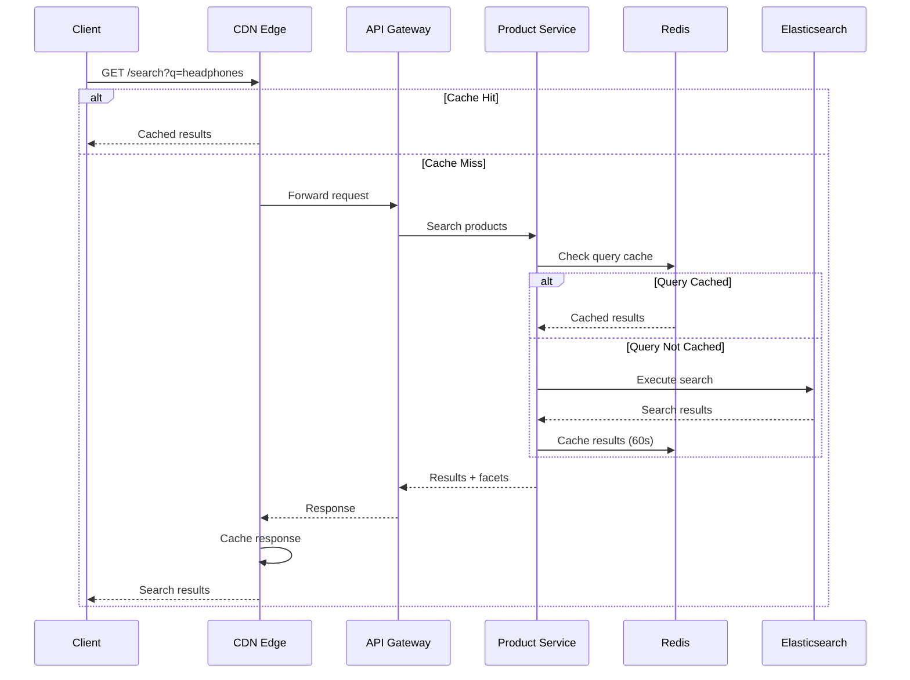
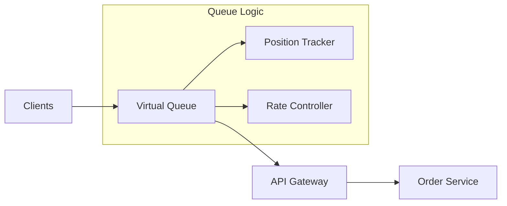

# E-commerce Backend - Design


## Requirements

### Functional Requirements
- Core user flow for E-commerce Backend.

### Non-Functional Requirements
- High availability, low latency, fault tolerance.

## Back-of-envelope Estimation

### Traffic
| Metric | Calculation | Result |
|---|---|---|
| DAU | Given | 50M |
| Avg QPS | 50M DAU x 5 views / 86,400 s | 2.8K avg QPS |
| Peak QPS | 2.8K avg QPS x 3 peak | 8.4K peak QPS |

### Storage
| Metric | Calculation | Result |
|---|---|---|
| Daily Storage | 10M orders x 1 KB = 10 GB/day |

## API Contracts

### Endpoints
```http
POST /api/v1/orders
GET /api/v1/products/{id}
```

## Data Model

### Schema
- Primary Key: `order_id`
- Partition Key: `user_id`


## Overview

This document describes the high-level design for a scalable e-commerce platform capable of handling 50M DAU with 10M daily orders.



---

## Component Details

### 1. API Gateway

**Responsibilities**:
- Request routing
- Authentication/Authorization
- Rate limiting
- Request transformation

**Rate Limiting Configuration**:
```yaml
rate_limits:
  cart_operations:
    per_user: 100/minute
    per_ip: 500/minute
  search:
    per_user: 60/minute
    anonymous: 30/minute
  checkout:
    per_user: 10/minute
    global: 100000/minute  # Flash sale limit
  product_view:
    per_ip: 1000/minute
```

### 2. Product Service

**Responsibilities**:
- Product CRUD operations
- Search and filtering
- Category management
- Price management

**Architecture**:


**Caching Strategy**:
```yaml
cache_config:
  product_details:
    ttl: 300  # 5 minutes
    strategy: cache_aside
    invalidation: event_driven
  search_results:
    ttl: 60  # 1 minute
    strategy: read_through
  category_tree:
    ttl: 3600  # 1 hour
    strategy: refresh_ahead
```

### 3. Cart Service

**Responsibilities**:
- Cart CRUD operations
- Price calculation
- Cart persistence
- Cross-device sync

**Redis Data Structure**:
```
Key: cart:{user_id}
Type: Hash
Fields:
  {product_id}: {"qty": 2, "price": 79.99, "added": "2024-01-01T10:00:00Z"}
TTL: 30 days

Key: cart_meta:{user_id}
Type: String
Value: {"version": 5, "last_modified": "2024-01-01T10:00:00Z"}
```

**Operations**:
```
Add Item:
  HSET cart:{user_id} {product_id} {item_json}
  INCR cart_version:{user_id}
  EXPIRE cart:{user_id} 2592000

Update Quantity:
  HSET cart:{user_id} {product_id} {updated_json}
  INCR cart_version:{user_id}

Remove Item:
  HDEL cart:{user_id} {product_id}
  INCR cart_version:{user_id}

Get Cart:
  HGETALL cart:{user_id}
```

### 4. Inventory Service

**Responsibilities**:
- Stock level management
- Reservation handling
- Low stock alerts
- Inventory sync across warehouses

**Reservation Flow**:


**Optimistic Locking**:
```sql
UPDATE inventory 
SET available_quantity = available_quantity - @quantity,
    reserved_quantity = reserved_quantity + @quantity,
    version = version + 1
WHERE product_id = @product_id 
  AND version = @expected_version
  AND available_quantity >= @quantity;

-- Check affected rows; if 0, retry with fresh version
```

### 5. Order Service

**Responsibilities**:
- Order creation and management
- Saga orchestration
- Order status updates
- Order history

**Saga Orchestration**:


**Event Flow**:
```yaml
order_events:
  - OrderCreated
  - InventoryReserved
  - InventoryReservationFailed
  - PaymentInitiated
  - PaymentSucceeded
  - PaymentFailed
  - InventoryCommitted
  - OrderConfirmed
  - OrderShipped
  - OrderDelivered
  - OrderCancelled
  - RefundInitiated
  - RefundCompleted
```

### 6. Payment Service

**Responsibilities**:
- Payment method management
- Payment processing
- Refund handling
- Payment provider abstraction

**Payment Flow**:


---

## Sequence Diagrams

### Checkout Flow



### Product Search Flow



---

## Trade-offs

### Consistency vs. Availability
| Choice | Trade-off | Rationale |
|--------|-----------|-----------|
| Strong consistency for inventory | Higher latency during contention | Prevent overselling, maintain trust |
| Eventual consistency for catalog | Slightly stale data | High read throughput, cacheable |
| Saga pattern for orders | Complex compensation logic | Distributed transaction reliability |

### Latency vs. Consistency
| Choice | Trade-off | Rationale |
|--------|-----------|-----------|
| Redis cart with async backup | Potential data loss on crash | Sub-ms cart operations |
| Elasticsearch for search | Index lag (seconds) | Fast, relevant search results |
| Cached product prices | Potential price discrepancy | Fast catalog browsing |

### Simplicity vs. Flexibility
| Choice | Trade-off | Rationale |
|--------|-----------|-----------|
| Fixed order states | Less flexible workflows | Predictable, auditable |
| Single payment provider abstraction | Vendor lock-in risk | Faster initial development |
| Saga orchestration | Central coordinator bottleneck | Easier debugging, monitoring |

---

## Observability

### Key Metrics
```yaml
business_metrics:
  - orders_per_minute
  - revenue_per_hour
  - cart_abandonment_rate
  - conversion_rate
  - average_order_value

technical_metrics:
  - checkout_latency_p99
  - inventory_lock_contention
  - payment_success_rate
  - search_latency_p99
  - cache_hit_rate

infrastructure_metrics:
  - database_connections
  - redis_memory_usage
  - kafka_consumer_lag
  - api_error_rate
```

### Alerts
```yaml
critical_alerts:
  - name: checkout_failure_rate
    condition: failure_rate > 5%
    severity: critical
    
  - name: inventory_sync_lag
    condition: lag > 30 seconds
    severity: critical
    
  - name: payment_timeout
    condition: timeout_rate > 2%
    severity: critical

warning_alerts:
  - name: high_cart_abandonment
    condition: abandonment_rate > 80%
    severity: warning
    
  - name: search_slow
    condition: p99_latency > 500ms
    severity: warning
```

### Distributed Tracing
```yaml
trace_spans:
  checkout_flow:
    - api_gateway_receive
    - cart_fetch
    - inventory_reserve
    - payment_process
    - inventory_commit
    - order_confirm
    - notification_send

  search_flow:
    - api_gateway_receive
    - cache_lookup
    - elasticsearch_query
    - result_aggregation
    - response_serialization
```

---

## Flash Sale Handling

### Pre-Sale Preparation
```yaml
flash_sale_config:
  start_time: "2024-01-01T00:00:00Z"
  products:
    - product_id: "prod_flash1"
      allocation: 10000
      max_per_user: 2
  
  infrastructure:
    - scale_api_servers: 10x
    - prewarm_caches: true
    - enable_queue_mode: true
    - disable_search_indexing: true
```

### Queue Mode


**Queue Implementation**:
1. Users get queue position on page load
2. Process orders at controlled rate (1000/s)
3. Real-time position updates via WebSocket
4. Auto-redirect when position reached
5. Timeout and re-queue on failure

---

## Entity-Relationship Diagram

```mermaid
erDiagram
    USER ||--o{ ORDER : places
    USER ||--o{ CART : has
    USER ||--o{ ADDRESS : has
    USER ||--o{ PAYMENT_METHOD : has
    CART ||--o{ CART_ITEM : contains
    ORDER ||--o{ ORDER_ITEM : contains
    ORDER ||--|| PAYMENT : has
    ORDER ||--|| SHIPMENT : has
    PRODUCT ||--o{ CART_ITEM : added_to
    PRODUCT ||--o{ ORDER_ITEM : ordered_as
    PRODUCT ||--o{ PRODUCT_VARIANT : has
    PRODUCT ||--o{ PRODUCT_IMAGE : has
    PRODUCT }o--|| CATEGORY : belongs_to
    CATEGORY ||--o{ CATEGORY : has_subcategory
    PRODUCT ||--o{ INVENTORY : stocked_in
    WAREHOUSE ||--o{ INVENTORY : holds
    PRODUCT ||--o{ REVIEW : has
    USER ||--o{ REVIEW : writes
    ORDER ||--o{ ORDER_EVENT : has
    USER ||--o{ WISHLIST_ITEM : saves
    PRODUCT ||--o{ WISHLIST_ITEM : saved_in
    PROMO_CODE ||--o{ ORDER : applied_to
    SELLER ||--o{ PRODUCT : sells

    USER {
        uuid user_id PK
        string email UK
        string phone UK
        string password_hash
        string first_name
        string last_name
        string profile_image_url
        string status "active/suspended/deleted"
        boolean email_verified
        boolean phone_verified
        timestamp created_at
        timestamp last_login_at
    }

    ADDRESS {
        uuid address_id PK
        uuid user_id FK
        string label "home/work/other"
        string full_name
        string phone
        string address_line1
        string address_line2
        string city
        string state
        string postal_code
        string country
        float lat
        float lng
        boolean is_default
        timestamp created_at
    }

    CATEGORY {
        uuid category_id PK
        uuid parent_category_id FK
        string name
        string slug UK
        string description
        string image_url
        int display_order
        boolean is_active
        int product_count "Denormalized"
        int level "0=root, 1=child, etc"
        string path "Materialized path for tree"
        timestamp created_at
    }

    SELLER {
        uuid seller_id PK
        string business_name UK
        string business_email UK
        string phone
        string logo_url
        string status "pending/approved/suspended"
        float avg_rating
        int total_sales
        float commission_rate
        timestamp created_at
        timestamp approved_at
    }

    PRODUCT {
        uuid product_id PK
        uuid seller_id FK
        uuid category_id FK
        string sku UK
        string name
        string slug UK
        text description
        text specifications "JSON"
        float base_price
        float sale_price
        string currency
        float avg_rating
        int review_count "Denormalized"
        int total_sold "Denormalized"
        string status "draft/active/archived"
        boolean is_featured
        float weight_kg
        string dimensions "LxWxH"
        timestamp created_at
        timestamp updated_at
    }

    PRODUCT_VARIANT {
        uuid variant_id PK
        uuid product_id FK
        string sku UK
        string name "e.g. Blue-XL"
        jsonb attributes "color, size, etc"
        float price_modifier
        string image_url
        boolean is_default
        boolean is_active
        timestamp created_at
    }

    PRODUCT_IMAGE {
        uuid image_id PK
        uuid product_id FK
        string url
        string alt_text
        int display_order
        boolean is_primary
        timestamp created_at
    }

    INVENTORY {
        uuid inventory_id PK
        uuid product_id FK
        uuid variant_id FK
        uuid warehouse_id FK
        int quantity_available
        int quantity_reserved
        int reorder_level
        int reorder_quantity
        string status "in_stock/low_stock/out_of_stock"
        int version "Optimistic locking"
        timestamp updated_at
    }

    WAREHOUSE {
        uuid warehouse_id PK
        string name
        string code UK
        string address
        string city
        string country
        float lat
        float lng
        boolean is_active
        int priority "For fulfillment routing"
        timestamp created_at
    }

    CART {
        uuid cart_id PK
        uuid user_id FK UK
        string status "active/abandoned/converted"
        float subtotal "Denormalized"
        string currency
        int item_count "Denormalized"
        timestamp created_at
        timestamp updated_at
    }

    CART_ITEM {
        uuid cart_item_id PK
        uuid cart_id FK
        uuid product_id FK
        uuid variant_id FK
        int quantity
        float unit_price
        float line_total
        timestamp added_at
        timestamp updated_at
    }

    ORDER {
        uuid order_id PK
        string order_number UK "e.g. ORD-2024-0001234"
        uuid user_id FK
        uuid shipping_address_id FK
        uuid billing_address_id FK
        uuid promo_code_id FK
        string status "pending/confirmed/processing/shipped/delivered/cancelled/refunded"
        float subtotal
        float discount_amount
        float tax_amount
        float shipping_amount
        float total_amount
        string currency
        string payment_status "pending/paid/failed/refunded"
        string notes
        timestamp placed_at
        timestamp confirmed_at
        timestamp shipped_at
        timestamp delivered_at
        timestamp cancelled_at
    }

    ORDER_ITEM {
        uuid order_item_id PK
        uuid order_id FK
        uuid product_id FK
        uuid variant_id FK
        uuid seller_id FK
        string product_name "Snapshot"
        string variant_name "Snapshot"
        int quantity
        float unit_price
        float discount_amount
        float tax_amount
        float line_total
        string status "pending/fulfilled/cancelled/returned"
        timestamp created_at
    }

    ORDER_EVENT {
        uuid event_id PK
        uuid order_id FK
        string event_type "created/confirmed/shipped/delivered/cancelled"
        string description
        string actor "user/system/admin"
        uuid actor_id
        jsonb metadata
        timestamp created_at
    }

    PAYMENT {
        uuid payment_id PK
        uuid order_id FK UK
        uuid payment_method_id FK
        float amount
        string currency
        string status "pending/processing/completed/failed/refunded"
        string provider "stripe/paypal/razorpay"
        string provider_payment_id
        string provider_status
        string failure_reason
        jsonb provider_metadata
        timestamp initiated_at
        timestamp completed_at
    }

    PAYMENT_METHOD {
        uuid payment_method_id PK
        uuid user_id FK
        string type "card/upi/wallet/netbanking"
        string provider
        string last_four
        string card_brand
        string wallet_name
        boolean is_default
        boolean is_active
        timestamp created_at
    }

    SHIPMENT {
        uuid shipment_id PK
        uuid order_id FK
        uuid warehouse_id FK
        string carrier "fedex/ups/dhl"
        string tracking_number UK
        string tracking_url
        string status "preparing/picked_up/in_transit/out_for_delivery/delivered/failed"
        float weight_kg
        string package_dimensions
        jsonb tracking_events
        timestamp estimated_delivery_at
        timestamp shipped_at
        timestamp delivered_at
    }

    REVIEW {
        uuid review_id PK
        uuid product_id FK
        uuid user_id FK
        uuid order_item_id FK "Verified purchase"
        int rating "1-5"
        string title
        text content
        jsonb images "Review images"
        int helpful_count
        boolean is_verified_purchase
        string status "pending/approved/rejected"
        timestamp created_at
        timestamp updated_at
    }

    WISHLIST_ITEM {
        uuid user_id PK "FK"
        uuid product_id PK "FK"
        uuid variant_id FK
        float price_at_add "For price drop alerts"
        timestamp added_at
    }

    PROMO_CODE {
        uuid promo_id PK
        string code UK
        string type "percentage/fixed/free_shipping"
        float value
        float min_order_amount
        float max_discount_amount
        int max_uses
        int uses_per_user
        int current_uses "Denormalized"
        uuid category_id FK "Category restriction"
        uuid seller_id FK "Seller restriction"
        boolean is_active
        timestamp valid_from
        timestamp valid_to
        timestamp created_at
    }
```

**Schema Notes:**
- **Order Partitioning**: `ORDER` partitioned by `placed_at` (monthly) with `user_id` as secondary index
- **Inventory Locking**: Optimistic locking with `version` column for concurrent reservation handling
- **Snapshots**: `ORDER_ITEM.product_name`, `variant_name` snapshot at order time (product may change)
- **Denormalization**: Counts on `PRODUCT`, `CATEGORY`, `CART` updated via async events
- **Search Index (Elasticsearch)**:
  - `PRODUCT` - title, description, category, seller, attributes
  - `CATEGORY` - name, path for faceted navigation
- **Event Sourcing**: `ORDER_EVENT` captures full order lifecycle for audit and replay
- **Indexes**:
  - `ORDER(user_id, placed_at DESC)` - Order history
  - `ORDER(status, placed_at)` - Fulfillment queue
  - `PRODUCT(category_id, status, created_at)` - Category browsing
  - `PRODUCT(seller_id, status)` - Seller products
  - `INVENTORY(product_id, warehouse_id)` - Stock lookup
  - `CART_ITEM(cart_id)` - Cart contents
  - `REVIEW(product_id, status, created_at)` - Product reviews

---

## 🤖 GenAI Extension

> How could this system be augmented with LLMs? Below are interview-ready ideas that connect this classical HLD to GenAI patterns. For full GenAI system designs, see [06-genai-systems/](../../06-genai-systems/).

### Potential LLM-Powered Features

| Feature | Description | GenAI Components |
|---------|-------------|-----------------|
| **AI Product Search** | Semantic search over product catalog — users ask "warm winter jacket under $100" instead of keyword filters | RAG retriever (hybrid), prompt builder, LLM service |
| **Product Recommendations** | LLM-generated personalized explanations for recommendations (e.g., "Based on your recent camping gear purchases…") | Prompt builder, LLM service |
| **Review Summarization** | Generate concise summaries of hundreds of product reviews highlighting pros, cons, and common themes | Chunker, prompt builder, LLM service |
| **AI Shopping Assistant** | Conversational bot that helps users find products, compare options, and answer questions about items | RAG retriever, conversation memory, safety filter |
| **Seller Support Bot** | LLM-powered chatbot for sellers to manage inventory, answer policy questions, and resolve issues | RAG retriever (policy docs), conversation memory |

### Integration Points

```
Existing E-commerce Pipeline:
  Browse/Search → Product Page → Cart → Checkout → Order → Delivery

With GenAI Extension:
  Browse/Search ──→ Product Page ──→ Cart ──→ Checkout
       │                 │
       └→ AI Search      └→ Review summary (LLM, cached)
          (RAG + LLM)    └→ AI product Q&A (RAG over product data)
       └→ AI Assistant (conversational shopping)
```

### Trade-offs

- **Search latency**: Semantic search + LLM adds 0.5–2s — cache popular queries, use hybrid (keyword first, semantic second)
- **Review summaries**: Pre-compute and cache; regenerate periodically or on new reviews
- **Cost**: AI search at scale is expensive — use model routing (small model for simple queries, large for complex)
- **Accuracy**: Product search must be precise — wrong recommendations erode trust

### Learn More

- [GenAI HLD Projects: RAG-Based Enterprise Search](../../06-genai-systems/02-llm-hld-projects/) — RAG search system design
- [GenAI LLD: Retriever & Ranker](../../06-genai-systems/01-llm-lld-projects/retriever-ranker/) — Hybrid retrieval for product search
- [GenAI Cheatsheet: RAG Architecture](../../resources/cheatsheets/rag-architecture-cheatsheet.md) — RAG patterns quick reference

---

## Pattern Addendum: Durable Multi-step Workflow Boundaries

### Workflow decomposition

- Model critical business flows as explicit step transitions instead of a single best-effort request chain.
- Keep side-effecting steps idempotent and keyed by an operation-level idempotency token.
- Persist checkpoint state before advancing to downstream dependencies.

### Compensation policy

- Define compensating actions for steps that can succeed before downstream failure.
- Execute compensation in reverse order for dependent steps.
- Mark terminal workflow outcomes (`SUCCEEDED`, `FAILED`, `COMPENSATED`) for auditability.

### Reliability controls

- Use bounded retries with jitter for transient failures.
- Route terminal failures to dead-letter handling with operator visibility.
- Preserve backward compatibility for in-flight workflows during definition changes.


## Bottlenecks and Failure Modes

| Component | Failure Mode | Mitigation | Impact | Detection | Recovery |
|---|---|---|---|---|---|
| Inventory DB | Write Contention | Sharding by product ID | Failed orders | High transaction latency | Optimize locking / queues |
| Payment Gateway | Timeout | Idempotency keys, retries | Payment processing delay | Gateway timeout errors | Circuit breaker |
| Search Index | Replication Lag | Synchronous indexing | Stale search results | Lag monitoring | Tune indexer |
| Order Service | Queue Backlog | Async processing | Delayed order confirmation | Queue depth alarm | Scale workers |
| Product Cache | Cache Miss | Cache warming, read-through | Slower page loads | Cache hit rate drop | Scale cache nodes |
| API Gateway | Instance Crash | Auto-scaling group | Brief latency spike | 5xx rate spikes | Auto-replace |

## Scaling Stages

- **10K Users**: Single monolith, simple DB, basic caching.
- **1M Users**: Microservices, robust cache, read replicas.
- **100M+ Users**: Sharded databases, globally distributed edge nodes, event streaming.


---
**Real-world reference**: See how Amazon solved this in the [Amazon case study](../../case-studies/amazon-orders/)
