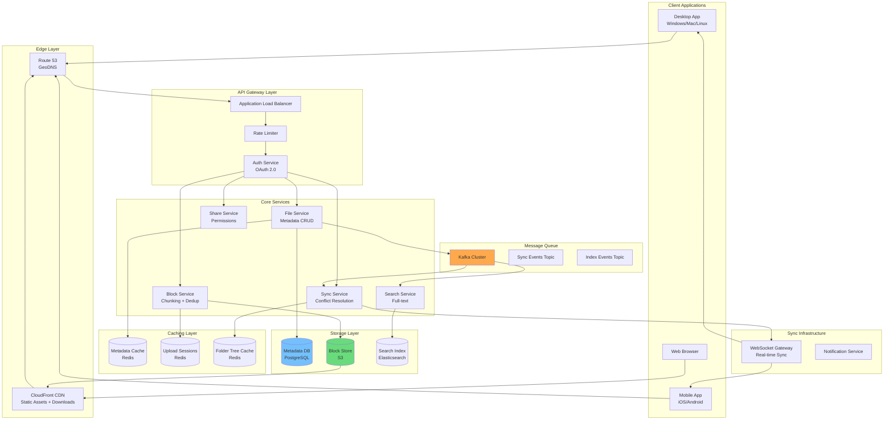
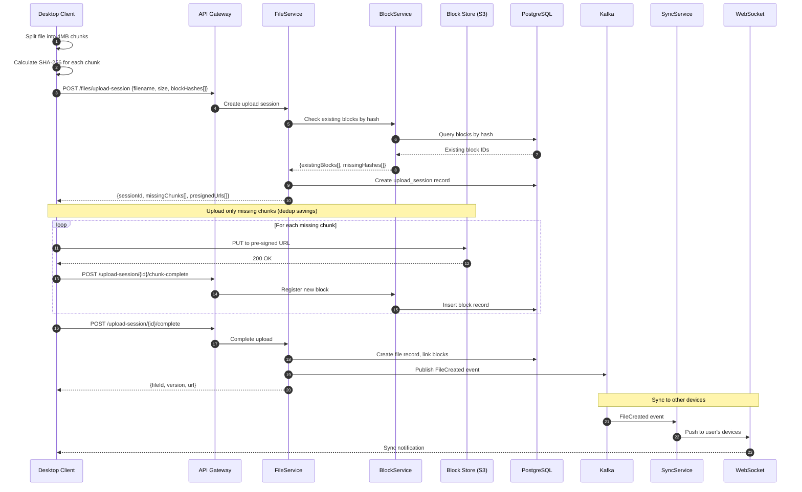
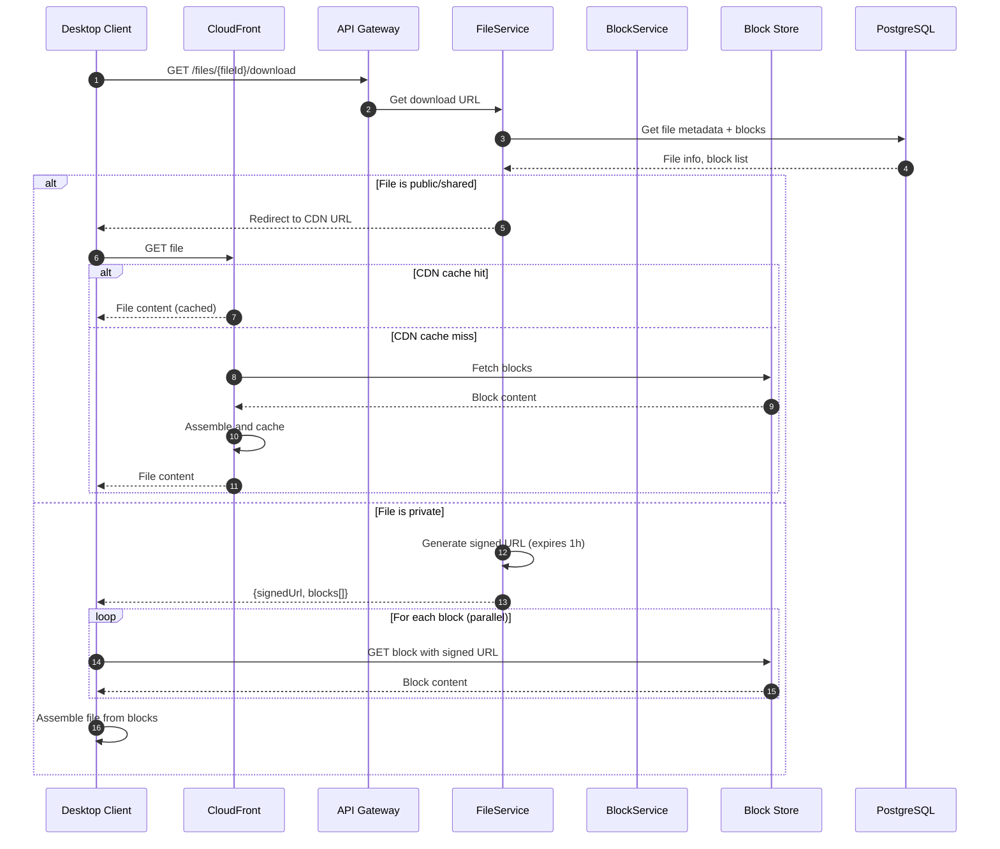
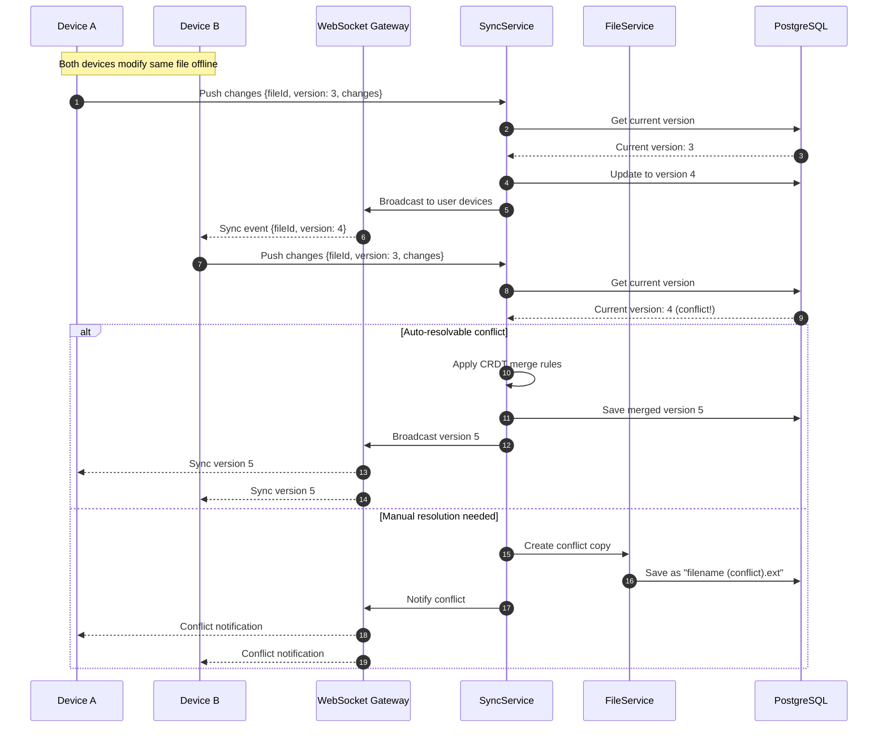
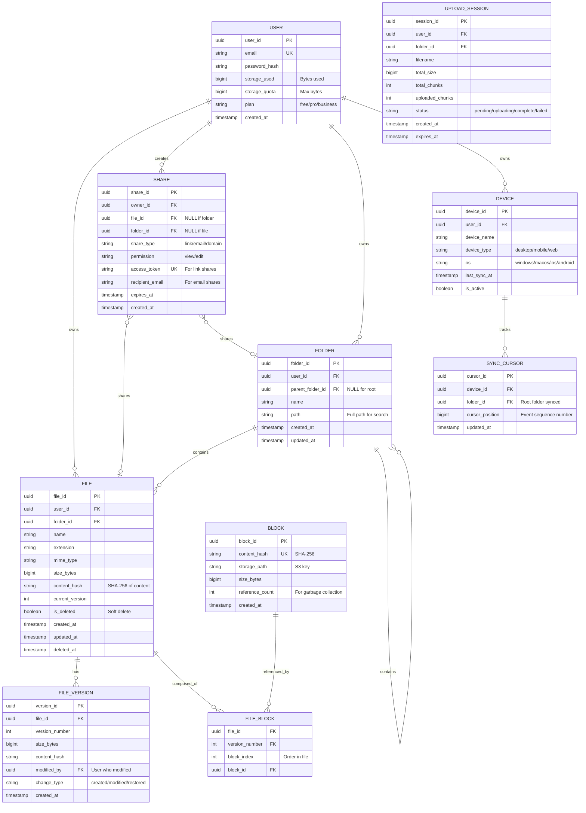

# File Storage Service System Design

Complete high-level design for a cloud file storage and sync service (like Dropbox/Google Drive).

---


## Requirements

### Functional Requirements
- Core user flow for File Storage Service.

### Non-Functional Requirements
- High availability, low latency, fault tolerance.

## Back-of-envelope Estimation

### Traffic
| Metric | Calculation | Result |
|---|---|---|
| DAU | Given | 50M |
| Avg QPS | 50M DAU x 4 files / 86,400 s | 2.3K avg QPS |
| Peak QPS | 2.3K avg QPS x 3 peak | 6.9K peak QPS |

### Storage
| Metric | Calculation | Result |
|---|---|---|
| Daily Storage | 50M DAU x 4 files x 2 MB = 400 TB/day |

## API Contracts

### Endpoints
```http
POST /api/v1/files/upload
GET /api/v1/files/download
```

## Data Model

### Schema
- Primary Key: `file_id`
- Partition Key: `user_id`


## System Architecture



**Architecture Notes:**
- **Block Storage**: Files split into 4MB chunks, stored in S3 with content-addressed naming
- **Deduplication**: SHA-256 hash of blocks enables cross-user dedup (30-40% storage savings)
- **Sync Model**: Event-driven with WebSocket push for real-time updates
- **CDN**: Serves public/shared files and download acceleration
- **Multi-region**: Active-active with CRDTs for conflict resolution

---

## Sequence Diagrams

### Upload Flow: Chunked Upload with Deduplication



### Download Flow with CDN and Range Requests



### Sync Flow with Conflict Resolution



---

## Entity-Relationship Diagram



**Schema Notes:**
- **Partitioning**: 
  - `FILE` partitioned by `user_id` for user-centric queries
  - `BLOCK` partitioned by `content_hash` prefix for distribution
- **Deduplication**: 
  - `BLOCK.content_hash` unique constraint enables cross-user dedup
  - `reference_count` tracks how many files use each block
- **Soft Deletes**: 
  - `FILE.is_deleted` + `deleted_at` for trash/recovery (30 days)
- **Versioning**: 
  - `FILE_VERSION` keeps history, linked to blocks via `FILE_BLOCK`
- **Indexes**:
  - `FILE(user_id, folder_id, name)` for folder listing
  - `FILE(user_id, updated_at DESC)` for recent files
  - `BLOCK(content_hash)` for dedup lookup
  - `SHARE(access_token)` for link validation
  - `SYNC_CURSOR(device_id, folder_id)` for sync state

---

## Key Trade-offs

| Aspect | Choice | Trade-off |
|--------|--------|-----------|
| Chunk size | 4 MB | Smaller = more requests, larger = slower retry |
| Deduplication | Block-level | Storage savings vs. CPU overhead |
| Sync model | Event-based | Real-time feel vs. complexity |

---

## 🤖 GenAI Extension

> How could this system be augmented with LLMs? Below are interview-ready ideas that connect this classical HLD to GenAI patterns. For full GenAI system designs, see [06-genai-systems/](../../06-genai-systems/).

### Potential LLM-Powered Features

| Feature | Description | GenAI Components |
|---------|-------------|-----------------|
| **Intelligent File Search** | Semantic search across stored documents — users ask "find my tax documents from 2024" instead of browsing folders | RAG retriever (hybrid), prompt builder, LLM service |
| **Document Summarization** | Automatically generate summaries of uploaded documents (PDFs, reports) for quick preview | Chunker, prompt builder, LLM service |
| **AI File Organization** | Suggest folder structure and tags based on file content analysis | Chunker, LLM classifier |
| **Content-Based Deduplication** | Use embeddings to detect semantically similar files (not just bit-identical) for smarter dedup | Embedding service, vector DB |

### Integration Points

```
Existing File Storage Pipeline:
  Upload → Chunk → Deduplicate → Store → Sync → Download

With GenAI Extension:
  Upload → Chunk → Deduplicate → Store → Sync
              │
              └→ Async: Extract text → Embed → Index in vector DB
              └→ Async: Summarize (LLM) → Store summary metadata
              └→ On search: Query embedding → Retrieve → LLM answer
```

### Trade-offs

- **Indexing cost**: Embedding all files adds compute cost — index only text-based files, skip binaries and media
- **Privacy**: File contents may be sensitive — run LLMs on-premise or use private endpoints
- **Latency**: Search with LLM adds 1–2s — use semantic caching for repeated queries

### Learn More

- [GenAI HLD Projects: RAG-Based Enterprise Search](../../06-genai-systems/02-llm-hld-projects/) — RAG search applicable to file storage
- [GenAI LLD: Chunker & Metadata Indexer](../../06-genai-systems/01-llm-lld-projects/chunker-metadata-indexer/) — Document chunking for indexing
- [GenAI Concepts: RAG Architecture](../../06-genai-systems/00-concepts/rag-architecture/) — Retrieval-augmented generation patterns


## Bottlenecks and Failure Modes

| Component | Failure Mode | Mitigation | Impact | Detection | Recovery |
|---|---|---|---|---|---|
| Block Service | CPU Bottleneck | Horizontal scaling | Slower uploads/downloads | CPU utilization alarm | Auto-scale |
| Object Storage | AZ Outage | Cross-region replication | Degraded performance or read-only | Error rate spike | Failover to healthy AZ |
| Metadata DB | Primary Failure | Synchronous replica | Brief write unavailability | Connection timeouts | Promote replica |
| API Gateway | Instance Crash | Auto-scaling group, LB health checks | Brief latency spike for some users | 5xx rate spikes | Auto-replace |
| Sync Worker | Network Partition | Retry with exponential backoff | Out of date local files | Sync error logs | Self-healing on reconnect |
| Redis Cache | Node Failure | Redis Cluster with replicas | Cache misses hit DB | Replication lag alarm | Auto-promote replica |

## Scaling Stages

- **10K Users**: Single monolith, simple DB, basic caching.
- **1M Users**: Microservices, robust cache, read replicas.
- **100M+ Users**: Sharded databases, globally distributed edge nodes, event streaming.


---
**Real-world reference**: See how Amazon solved this in the [Amazon case study](../../case-studies/amazon-orders/)
