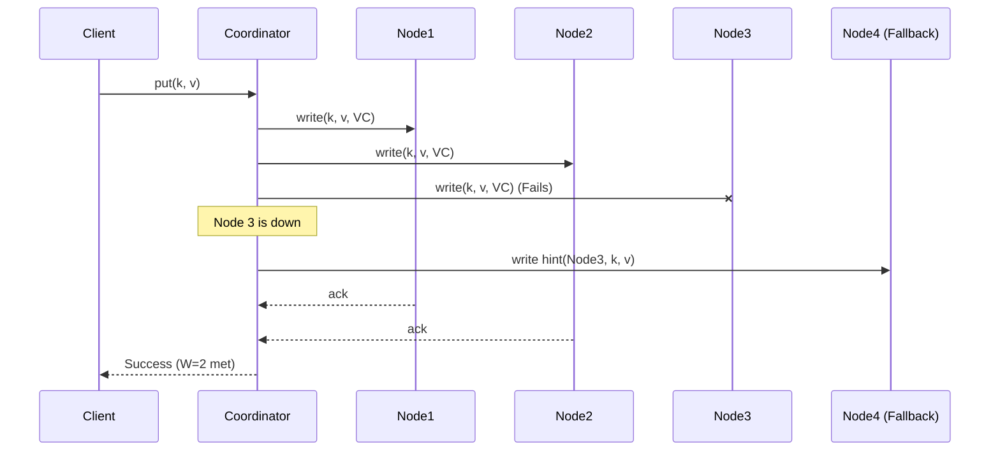
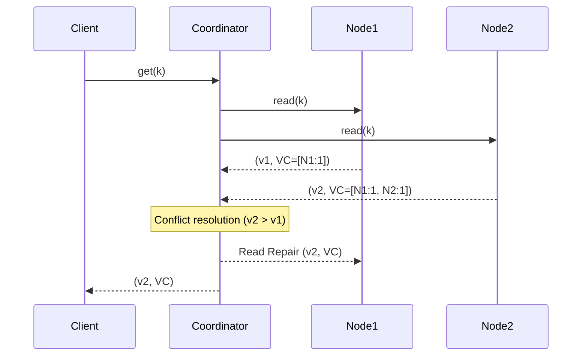

# High-Level Design: Key-Value Store

> **Evidence Contract Note:** Target Layer: Core / Staff. Unsourced figures below are scenario assumptions used for capacity sizing, not external production telemetry.

---

## 1. 📝 Requirements and Constraints

See [PROBLEM.md](./PROBLEM.md) for the full problem statement and scope constraints.

### Functional Requirements
- **`get(key)`:** Retrieve the latest value (or conflicting sibling versions) and causal version context for a key, with configurable read consistency.
- **`put(key, value)`:** Insert or update a key with a value up to `1 MB`, carrying optional causal context (`vector_clock`) and write consistency level.
- **`delete(key)`:** Logically delete a key by writing a versioned tombstone so deletions propagate reliably across replicas.
- **Tunable consistency:** Per-request quorum control (`ONE`, `QUORUM`, `ALL`) over replication factor `N` with read quorum `R` and write quorum `W`.

### Non-Functional Requirements

| Requirement | Target (Scenario Assumptions) |
|---|---|
| Availability | `99.99%` (highly available under single-node or AZ failures via sloppy quorum / tunable `R, W`) |
| Read / Write latency | `p50 <= 5 ms`, `p99 <= 15 ms` (`QUORUM` in-region); `p99 <= 8 ms` (`ONE`) |
| Throughput | `100,000` avg QPS (`80%` reads, `20%` writes), `300,000` peak QPS |
| Consistency | Tunable per request: strong overlap when `R + W > N` (e.g., `N=3, R=2, W=2`), eventual when `R + W <= N` |
| Durability | Replicated across `N = 3` distinct AZs; local WAL + LSM-tree SSTables on NVMe |

### Out of Scope (Non-Goals)
- Multi-key ACID transactions or cross-key joins.
- Secondary index SQL queries and full-text search.
- Large binary blob streaming (`> 1 MB`; route to object storage and store the pointer key here).

---

## 2. 📊 Back-of-Envelope Estimation

### Traffic Assumptions

| Metric | Value | Formula / Rationale |
|---|---|---|
| Daily operations | `8.64 billion` | Input scenario (`80%` reads, `20%` writes/deletes) |
| Avg total QPS | `100,000` | `8.64 × 10^9 / 86,400 s` |
| Avg read / write QPS | `80,000` / `20,000` | `80%` / `20%` split |
| Peak total QPS | `300,000` | `3x` burst factor |
| Peak read / write QPS | `240,000` / `60,000` | `3x` burst on reads and writes |

### Storage and Cluster Sizing Arithmetic

| Metric | Value | Formula / Breakdown |
|---|---|---|
| Total logical keys | `10 billion` (`10^10`) | Input scenario |
| Avg record size | `1 KB` (`1,000 B`) | `64 B` key + `36 B` metadata/vector clock + `900 B` avg value (max `1 MB`) |
| Raw logical dataset | `10 TB` | `10^10 keys × 1 KB` |
| Replicated dataset (`N = 3`) | `30 TB` | `10 TB × 3` |
| Provisioned usable NVMe | `60 TB` | `30 TB × 1.3` (LSM compaction/Bloom overhead) `/ 0.70` (max 70% disk fill) `≈ 55.7 TB`, rounded to `60 TB` |
| **Storage nodes required** | **`30 nodes`** | `60 TB / 2 TB usable NVMe per node` (`10 nodes per AZ` across 3 AZs) |

### Per-Node Peak Load Verification (`30 nodes`, `N = 3`, default `R = 2, W = 2`)
- **Coordinator load:** `300,000 peak QPS / 30 nodes = 10,000` client requests/s/node.
- **Replica write load:** `60,000 client writes/s × 3 replicas / 30 nodes = 6,000` replica writes/s/node (`6,000 × 1 KB = 6.0 MB/s` sequential WAL append/node).
- **Replica read load:** `240,000 client reads/s × 3 replicas / 30 nodes = 24,000` replica reads/s/node. With `64 GB` RAM per node (`1.92 TB` cluster RAM caching hot MemTables and SSTable blocks) plus per-SSTable Bloom filters, NVMe sustains `24,000` reads/s/node within budget.
- **Network throughput per node:** `(24,000 reads + 6,000 writes) × 1 KB ≈ 30 MB/s` (`~240 Mbps`), well below a `10 Gbps` NIC.

### Latency Budget (In-Region, `N = 3, R = 2, W = 2`)
- Client -> Coordinator: `1–2 ms`
- Coordinator -> `N = 3` replicas in parallel (wait for 2nd fastest): `2–4 ms` network RTT
- Replica local LSM op (WAL append + MemTable insert `1–3 ms`; read: block cache `< 1 ms` or SSTable NVMe seek `2–5 ms`)
- Coordinator vector-clock reconciliation + response: `~1 ms`
- **Total:** `p50 ~ 5 ms`, `p99 <= 15 ms`.

---

## 3. 🔌 API / System Interface

### External Contract
- **Protocol:** gRPC (primary for low-latency binary transport) and HTTP/JSON REST to any peer Coordinator node.
- **Auth & Rate Limiting:** mTLS or API key auth; per-tenant token-bucket rate limiting and `1 MB` payload cap (`413 Payload Too Large`).

### Consistency Options (`N = 3`)

| Consistency Level | Quorum Required | Behavior | Trade-off |
|---|---|---|---|
| `ONE` | `R = 1` or `W = 1` | Returns after fastest replica responds | Lowest latency & highest availability; may read stale data |
| `QUORUM` (default) | `R = 2` or `W = 2` | Majority of replicas (`R + W = 4 > 3`) | Tolerates 1 node/AZ failure while ensuring read/write overlap |
| `ALL` | `R = 3` or `W = 3` | All `N` replicas must acknowledge | Strictest freshness; any single replica outage fails the request |

### Core Endpoints

#### 1. Get Key
```http
GET /api/v1/kv/{key}?consistency=QUORUM
```

**Response — `200 OK` (Single Resolved Version):**
```json
{
  "key": "user:4821:prefs",
  "consistency_applied": "QUORUM",
  "context": "eyJub2RlLTEiOjMsIm5vZGUtMiI6MX0=",
  "values": [
    {
      "value": "{\"theme\":\"dark\",\"lang\":\"en\"}",
      "vector_clock": { "node-1": 3, "node-2": 1 },
      "updated_at_ms": 1764285012000
    }
  ]
}
```
*Note:* If concurrent writes produced divergent vector clocks (neither dominates the other), `values` returns all sibling versions so the client can merge them and write back with the merged `context`. Returns `404 Not Found` if the key does not exist or its latest version is a tombstone.

#### 2. Put Key
```http
PUT /api/v1/kv/{key}
Content-Type: application/json
Idempotency-Key: put-7c3e91a0

{
  "value": "{\"theme\":\"dark\",\"lang\":\"en\"}",
  "context": "eyJub2RlLTEiOjMsIm5vZGUtMiI6MX0=",
  "consistency": "QUORUM",
  "ttl_seconds": 86400
}
```

**Response — `200 OK`:**
```json
{
  "key": "user:4821:prefs",
  "version": { "node-1": 4, "node-2": 1 },
  "context": "eyJub2RlLTEiOjQsIm5vZGUtMiI6MX0=",
  "replicas_acked": 2,
  "hinted_replicas": 0
}
```

#### 3. Delete Key (Tombstone Write)
```http
DELETE /api/v1/kv/{key}?consistency=QUORUM
Content-Type: application/json

{
  "context": "eyJub2RlLTEiOjQsIm5vZGUtMiI6MX0="
}
```

**Response — `200 OK`:**
```json
{
  "key": "user:4821:prefs",
  "deleted": true,
  "tombstone_version": { "node-1": 5, "node-2": 1 },
  "replicas_acked": 2
}
```

### Error Model
- `400 Bad Request` — invalid key length (`> 256 B`), malformed `context`, or unsupported consistency level.
- `404 Not Found` — key absent or shadowed by an active tombstone.
- `409 Conflict` — optional conditional write / version precondition mismatch.
- `413 Payload Too Large` — value exceeds `1 MB` limit.
- `429 Too Many Requests` — tenant rate limit exceeded.
- `503 Service Unavailable` — fewer than `R` or `W` replicas responded before timeout (`QUORUM_NOT_MET`).

---

## 4. 🗄️ Core Entities and Data Model

### Record and Version Envelope

```text
KVRecord (stored per replica in WAL + MemTable + SSTables)
  key               BYTES(1..256)    PRIMARY KEY (lexicographically sorted in SSTable)
  value             BYTES(0..1MB)    NULL when is_tombstone = true
  vector_clock      MAP<node_id, uint64>  Causal version metadata
  updated_at_ms     UINT64           Physical timestamp (tie-breaker / TTL / VC pruning)
  is_tombstone      BOOL             True for DELETE markers
  ttl_expires_at_ms UINT64           Optional expiration timestamp (0 = no TTL)
  checksum          UINT32           CRC32 integrity check
```

### Local Storage Engine Layout (LSM-Tree)
Each storage node uses a Log-Structured Merge (LSM) tree optimized for sequential write throughput:
1. **Write-Ahead Log (WAL):** Every incoming `put` or `delete` (tombstone) is appended sequentially to an on-disk WAL for crash durability before acknowledging the coordinator.
2. **MemTable:** The mutation is inserted into an in-memory sorted structure (skip list or red-black tree) indexed by `key`.
3. **SSTable Flush:** Once the MemTable reaches `64 MB`, it is frozen and flushed sequentially to disk as an immutable **Sorted String Table (SSTable)** containing:
   - Sorted data blocks (`4–16 KB` compressed blocks).
   - Sparse primary index (maps first key of each block -> file offset, kept in RAM).
   - **Bloom filter** per SSTable to skip disk reads for keys absent from that file.
4. **Compaction:** Background leveled (or size-tiered) compaction merges overlapping SSTables, drops overwritten older versions, removes TTL-expired entries, and purges tombstones only after `gc_grace_seconds`.

### Partitioning, Placement, and Retention
- **Partitioning:** Consistent hash ring (`128-bit` token space) with `256` virtual nodes (vnodes) per physical node (`30 nodes × 256 = 7,680` ring tokens) to spread key ranges evenly and rebalance smoothly when nodes join or leave.
- **AZ-Aware Preference List:** Walking clockwise from `hash(key)`, the coordinator skips virtual nodes on already-selected physical hosts or AZs so the `N = 3` replicas land on `3` distinct physical nodes across `3` distinct AZs.
- **Tombstone retention (`gc_grace_seconds`):** Tombstones are retained for `7 days` before compaction permanently purges them, preventing a long-offline replica from resurrecting a deleted key upon recovery.
- **Vector clock pruning:** To prevent unbounded vector clock growth (see [PITFALLS.md](./PITFALLS.md)), each vector clock caps its entries (e.g., max `10` `(node_id, counter)` pairs) and prunes the oldest entry by timestamp when the cap is exceeded.
- **TTL retention:** Keys with `ttl_seconds` are filtered out on `GET` once expired and physically reclaimed during subsequent SSTable compactions.

---

## 5. 🏗️ High-Level Architecture

### Data Partitioning and Replication

We use a consistent hash ring with virtual nodes to map keys to nodes.

```mermaid
graph TD
    Client -->|get(key) / put(key, value)| CoordinatorNode
    CoordinatorNode -->|hash(key)| HashRing
    HashRing --> Replica1
    HashRing --> Replica2
    HashRing --> Replica3
```

### Component List
- **Stateless/Peer Coordinator:** Any node can receive a client request, look up the `N = 3` preference list on the consistent hash ring, fan out replica RPCs, and enforce `R`/`W` quorum rules.
- **Gossip Membership Layer:** Peer-to-peer gossip propagates ring topology, vnode ownership, and node liveness (phi-accrual failure detector) with no central single point of failure.
- **Replica Storage Engine:** Local WAL, MemTable, SSTables, Bloom filters, and compaction worker.
- **Hinted Handoff Store:** Temporary local hint log holding writes for temporarily unreachable replicas.
- **Anti-Entropy Service:** Background Merkle-tree synchronizer for key-range repair across replicas.

### Write Path

1.  Client sends `put(k, v)` to a Coordinator Node.
2.  Coordinator determines the `N` replicas for `k` using the Hash Ring.
3.  Coordinator generates a new Vector Clock.
4.  Coordinator sends the write to the `N` replicas.
5.  If at least `W` replicas acknowledge the write, it succeeds. If a node is down, the coordinator may use Hinted Handoff.



### Read Path and Conflict Resolution

1.  Client sends `get(k)` to Coordinator.
2.  Coordinator requests `k` from all `N` replicas.
3.  Coordinator waits for `R` responses.
4.  If versions conflict (based on Vector Clocks), the coordinator returns all conflicting versions to the client for resolution, or applies a default policy (e.g., LWW). Read Repair is performed to update stale nodes.



---

## 6. 🛑 Failure Modes and Recovery Handling

### 1. Temporary Replica Loss and Hinted Handoff
- **Scenario:** `Node 3` is temporarily unreachable (restart, GC stall, transient network flap) during a `PUT`.
- **Handling:** Under sloppy quorum, the coordinator routes the write to the next healthy node clockwise on the ring (`Node 4`) with a hint header (`target = Node 3`). `Node 4` persists the hint in a bounded local hint queue (e.g., max `3 hours` retention or `10 GB` disk cap).
- **Recovery:** Once gossip marks `Node 3` alive, `Node 4` streams queued hints to `Node 3` in batches and deletes each hint only after `Node 3` acknowledges persistence.
- **Note:** For strict-consistency callers that disallow sloppy quorum, `Node 4` does not count toward `W`; the write succeeds only if `W` primary replicas (`Node 1` and `Node 2`) acknowledge, otherwise returning `503 QUORUM_NOT_MET`.

### 2. Stale Replicas and Read Repair
- **Scenario:** `Node 1` missed an earlier write and holds `(v1, VC=[N1:1])` while `Node 2` holds `(v2, VC=[N1:1, N2:1])`.
- **Handling:** On `GET`, the coordinator compares returned vector clocks, sees `v2` causally dominates `v1`, returns `v2` to the client, and sends an asynchronous (or synchronous for strict reads) **Read Repair** write `(v2, VC)` to `Node 1`.

### 3. Permanent Node Failure and Anti-Entropy Repair (Merkle Trees)
- **Scenario:** A node suffers permanent disk failure or remains offline past the `3-hour` hinted handoff window, leaving cold keys out of sync that are rarely read (so read repair never touches them).
- **Handling:** Replicas maintain a **Merkle tree** (hash tree) per virtual-node key range. Periodically in the background, peer replicas compare root hashes; if roots match, zero data is transferred. If roots differ, they traverse only the mismatched child branches and stream the exact divergent keys to converge.
- **Node replacement:** A replacement node joins the ring for the failed node's vnodes and bootstraps SSTables directly from healthy peer replicas before serving reads.

### 4. Tombstones and Deleted-Key Resurrection
- **Scenario:** A key is deleted while `Node 3` is offline; if `Node 1` and `Node 2` purge the tombstone before `Node 3` recovers, `Node 3` would re-propagate the old value during anti-entropy.
- **Mitigation:** Tombstones remain in SSTables for `gc_grace_seconds = 7 days`, and anti-entropy repair runs on a shorter cadence (e.g., every `24 hours`). Any node offline longer than `gc_grace_seconds` is quarantined and rebuilt cleanly from peers instead of rejoining with stale SSTables.

### 5. Network Partitions and Gossip Failure Detection
- **Detection:** Decentralized gossip exchanges per-node heartbeat counters every second; a phi-accrual failure detector transitions unreachable peers from `UP` -> `SUSPECT` -> `DOWN` without a central coordinator.
- **Partition behavior:**
  - With `R = 2, W = 2` (`N = 3`) and strict quorum, the majority side (2 AZs) continues serving reads and writes while the minority side (1 AZ) returns `503 QUORUM_NOT_MET` — avoiding split-brain divergence.
  - With `W = 1` or sloppy quorum, both sides remain writable for availability, generating divergent vector clocks that are reconciled via client merge or LWW plus Merkle-tree anti-entropy once the partition heals.

### Bottlenecks and Failure Modes Summary

| Component | Failure Mode | Impact | Detection | Mitigation & Recovery |
|---|---|---|---|---|
| Storage replica | Transient crash / restart | 1 of 3 replicas unavailable | Gossip heartbeat / RPC timeout | Sloppy quorum + Hinted Handoff (`3 h` window); replay on recovery |
| Storage replica | Permanent disk loss | Under-replicated vnodes | Disk I/O errors + gossip `DOWN` | Bootstrap replacement node from peers; Merkle-tree anti-entropy |
| Stale replica | Missed write on hot key | Version skew across replicas | Vector clock mismatch on `GET` | Read Repair pushes winning version to stale replica |
| Compaction | Premature tombstone purge | Deleted key resurrects | Resurrection audit / node downtime > `gc_grace_seconds` | Enforce `7-day` `gc_grace_seconds`; rebuild long-offline nodes |
| Network | AZ partition | Minority side loses quorum | Gossip partition / `503` spike | Strict `QUORUM` preserves consistency; `ONE`/sloppy quorum preserves availability |
| Hot key | Skewed traffic on single key | Single replica CPU/NIC saturation | Per-node QPS & tail latency alarms | Client-side caching, read-from-any replica (`R=1`), or key salting |

---

## 7. ⚖️ Trade-offs and Decisions

| Decision | Option Chosen | Alternative | Why Chosen Now | Revisit Trigger |
|---|---|---|---|---|
| Conflict resolution | Vector clocks (causal detection + client merge) | Last-Write-Wins (LWW) with wall clocks | Prevents silent lost updates under clock skew and concurrent writes | Workload tolerates LWW simplicity and cannot handle sibling merges in clients |
| Replication protocol | Leaderless `N/R/W` quorum (Dynamo-style) | Single-leader Raft per shard | Higher write availability (no leader election pause) and per-request tunable consistency | Application requires linearizable compare-and-swap or multi-key transactions |
| Storage engine | LSM-Tree (WAL + MemTable + SSTables) | B-Tree (in-place page updates) | Converts random writes into sequential NVMe appends for high write throughput | Read-heavy point lookups suffer from multi-level SSTable read amplification despite Bloom filters |
| Partitioning | Consistent hashing with `256` vnodes/node | Fixed range sharding | Uniform key distribution and low data movement when scaling from 30 to 60+ nodes | Need efficient lexicographical range scans (`SCAN k1..k2`) |

---

## 8. 🔗 Cross-Links

- [Problem Statement](./PROBLEM.md)
- [Approach](./APPROACH.md)
- [Common Pitfalls](./PITFALLS.md)
- [Strong Answer](./STRONG-ANSWER.md)
- [Consistent Hashing](../../03-hld-concepts/consistent-hashing/)
- [DynamoDB](../../03-hld-concepts/dynamodb/)
- [Storage Engine Internals](../../03-hld-concepts/storage-engine-internals/)
- [Database Replication](../../03-hld-concepts/database-replication/)
- [CAP Theorem](../../03-hld-concepts/cap-theorem/)
