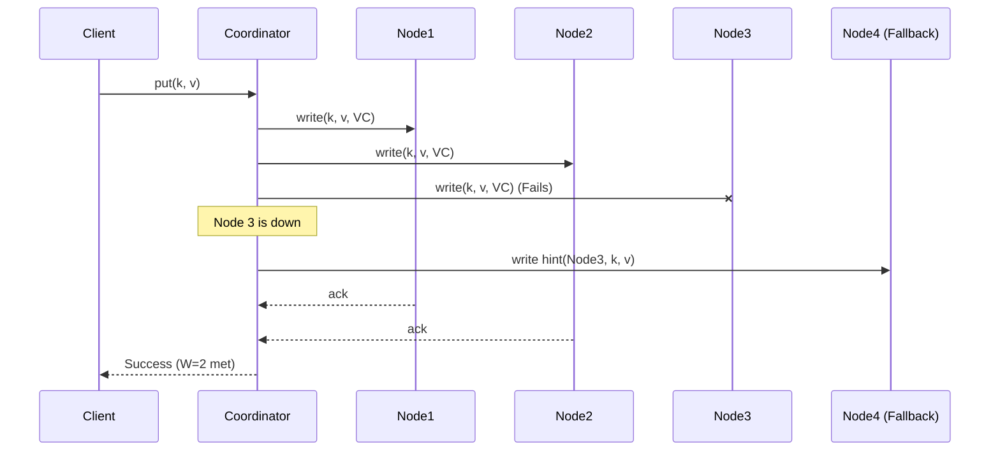
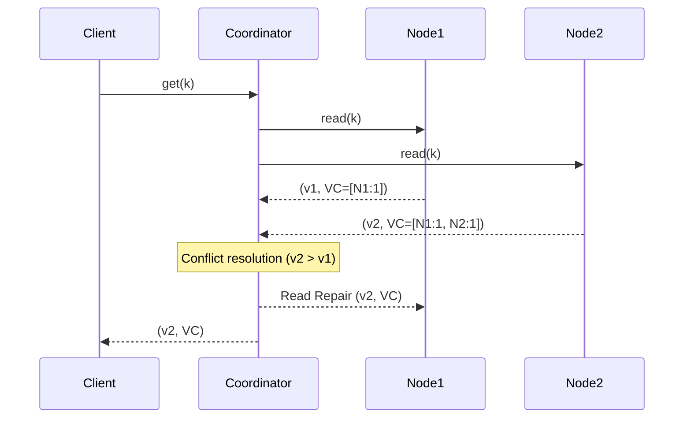

# High-Level Design: Key-Value Store

## Data Partitioning and Replication

We use a consistent hash ring with virtual nodes to map keys to nodes.

```mermaid
graph TD
    Client -->|get(key) / put(key, value)| CoordinatorNode
    CoordinatorNode -->|hash(key)| HashRing
    HashRing --> Replica1
    HashRing --> Replica2
    HashRing --> Replica3
```

## Write Path

1.  Client sends `put(k, v)` to a Coordinator Node.
2.  Coordinator determines the `N` replicas for `k` using the Hash Ring.
3.  Coordinator generates a new Vector Clock.
4.  Coordinator sends the write to the `N` replicas.
5.  If at least `W` replicas acknowledge the write, it succeeds. If a node is down, the coordinator may use Hinted Handoff.



## Read Path and Conflict Resolution

1.  Client sends `get(k)` to Coordinator.
2.  Coordinator requests `k` from all `N` replicas.
3.  Coordinator waits for `R` responses.
4.  If versions conflict (based on Vector Clocks), the coordinator returns all conflicting versions to the client for resolution, or applies a default policy (e.g., LWW). Read Repair is performed to update stale nodes.


