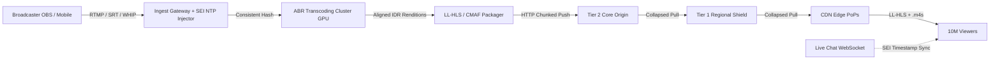

# Live Video Streaming Pipeline - Design

## 1. Requirements & Constraints Recap
- **Scale:** 50,000 concurrent live streamers (~6 Mbps each = 300 Gbps ingest); 10M concurrent live viewers (~3 Mbps average = 30 Tbps egress).
- **Latency:** < 3s glass-to-glass latency via LL-HLS / CMAF partial chunk streaming.
- **Transcoding:** Real-time multi-bitrate ABR ladder (1080p, 720p, 480p, 360p) with synchronized IDR keyframes.
- **Delivery:** Hierarchical 2-tier Origin Shield tree absorbing up to 10M manifest queries/sec.
- **Interactivity:** Timed metadata injection (SEI frames) embedding NTP timestamps for live chat sync.

## 2. API Contracts

### External & Internal Interface Overview
- **Control Plane:** HTTPS REST/JSON for session setup, stream authentication, and viewer join (`TLS 1.3`, JWT/OAuth2 for creators and viewers, HMAC-signed service tokens for internal ingest callbacks).
- **Media Ingest Plane:** `RTMPS` (TCP/1935), `SRT` (UDP/9000), and `WHIP` (`POST` SDP offer over HTTPS + WebRTC/UDP media).
- **Media Delivery Plane:** HTTP/2 and HTTP/3 `GET` requests over global CDN edges for LL-HLS manifests (`.m3u8`) and CMAF media/partial chunks (`.m4s`).
- **Rate Limiting:** Per-creator session creation limits (e.g., 10 req/min), per-IP brute-force throttling on stream key auth, and token-bucket burst protection on viewer join (`POST /api/v1/streams/{stream_id}/join`) during flash crowds.

### 2.1 Ingest Session Create (Control Plane)
Allocates a regional ingest endpoint and session configuration before the broadcaster starts pushing media.

```http
POST /api/v1/streams/sessions
Authorization: Bearer <creator_jwt>
Idempotency-Key: <uuid>
Content-Type: application/json
```

**Request Body:**
```json
{
  "channel_id": "ch_98210",
  "title": "Championship Finals - Live",
  "preferred_protocol": "srt",
  "region_hint": "us-west",
  "latency_mode": "low_latency",
  "abr_profile": "standard_1080p60"
}
```

**Response (`201 Created`):**
```json
{
  "session_id": "sess_01J9X4K2M7",
  "stream_id": "str_77412",
  "ingest_endpoints": {
    "srt": "srt://ingest-usw2.live.example:9000?streamid=publish:str_77412",
    "rtmps": "rtmps://ingest-usw2.live.example:443/app",
    "whip": "https://ingest-usw2.live.example/whip/str_77412"
  },
  "max_ingest_bitrate_kbps": 8000,
  "keyframe_interval_sec": 2,
  "expires_at": "2026-11-28T06:00:00Z"
}
```

### 2.2 Stream Key Authentication (Ingest Gateway → Control Plane)
Invoked synchronously by the Ingest Gateway on RTMP `publish`, SRT handshake, or WHIP `POST` to verify the broadcaster's secret stream key and establish single-publisher fencing.

```http
POST /api/v1/ingest/authenticate
Authorization: Bearer <ingest_service_token>
Content-Type: application/json
```

**Request Body:**
```json
{
  "stream_key_hash": "sha256:9f86d081884c7d65...",
  "protocol": "srt",
  "ingest_node_id": "ing-usw2-14",
  "client_ip": "198.51.100.42"
}
```

**Response (`200 OK`):**
```json
{
  "authorized": true,
  "stream_id": "str_77412",
  "session_id": "sess_01J9X4K2M7",
  "ingest_epoch": 3,
  "transcoder_pool": "us-west-gpu-pool-b",
  "renditions": ["1080p60", "720p60", "480p30", "360p30"],
  "heartbeat_interval_ms": 2000
}
```
- **Fencing (`ingest_epoch`):** Monotonically incremented on every reconnect. Downstream transcoders and packagers reject frames carrying a lower epoch so a zombie TCP/SRT socket cannot corrupt an active broadcast.

### 2.3 Viewer Join (Control Plane)
Returns a signed CDN playback entry point, viewer session metadata, and chat synchronization parameters.

```http
POST /api/v1/streams/{stream_id}/join
Authorization: Bearer <viewer_jwt_or_anon_token>
Content-Type: application/json
```

**Request Body:**
```json
{
  "device_type": "web",
  "supported_codecs": ["avc1.64002a", "hvc1.1.6.L120"],
  "client_region": "ap-south"
}
```

**Response (`200 OK`):**
```json
{
  "viewer_session_id": "vs_88310492",
  "master_manifest_url": "https://cdn-ap.live.example/live/v1/str_77412/master.m3u8?sig=abc123&exp=1764309600",
  "fallback_manifest_url": "https://cdn-b-ap.live.example/live/v1/str_77412/master.m3u8?sig=def456&exp=1764309600",
  "chat_ws_url": "wss://chat-ap.live.example/v1/rooms/str_77412",
  "target_latency_ms": 2400
}
```

### 2.4 Playback Manifest & Partial Chunk Fetch (CDN Edge)
Viewers fetch the multivariant playlist once on join, then issue blocking-reload requests against the chosen rendition playlist as new 200ms partial chunks become available.

```http
GET /live/v1/{stream_id}/master.m3u8?sig=<hmac>&exp=<unix_ts>
GET /live/v1/{stream_id}/{rendition}/index.m3u8?_HLS_msn=1042&_HLS_part=3&_HLS_skip=YES
GET /live/v1/{stream_id}/{rendition}/chunk_1042_part3.m4s
```
- **Headers & Caching:**
  - `master.m3u8`: `Cache-Control: public, max-age=5, s-maxage=30` (rendition ladder is static during a session).
  - `index.m3u8`: `Cache-Control: public, max-age=0, s-maxage=1` with blocking reload held at the CDN edge until `_HLS_msn` + `_HLS_part` is published.
  - `.m4s` partial/full chunks: `Cache-Control: public, max-age=300, immutable` (write-once media segments).

### 2.5 Error Model
| HTTP Status | Meaning | Client / Gateway Action |
|---|---|---|
| `400 Bad Request` | Malformed SDP, unsupported codec/profile, or invalid `_HLS_msn` query | Fail fast; surface configuration error to broadcaster or reset player |
| `401 / 403` | Invalid stream key, expired playback signature, or geo-restricted viewer | Reject ingest handshake; refresh signed URL via viewer join |
| `404 / 410` | Stream does not exist (`404`) or broadcast ended (`410 Gone`) | Stop playlist polling and display offline/ended state |
| `409 Conflict` | Stream key already active on another ingest connection without takeover | Reject duplicate encoder or trigger explicit epoch takeover |
| `429 Too Many Requests` | Rate limit exceeded on session create, auth, or viewer join | Back off with jitter using `Retry-After` header |
| `503 Service Unavailable` | Transcoder pool saturated, origin unreachable, or blocking reload timed out | Fail over to secondary CDN/origin or step back to non-blocking reload |

## 3. System Architecture

The live streaming pipeline is composed of distinct physical stages designed to take a high-quality single-feed ingest, transcode it, package it, and distribute it out to massive edge networks.



_Full diagram source: [diagrams/architecture.mmd](./diagrams/architecture.mmd)_

### 3.1 Ingest Gateways
- **Role:** Terminate the broadcaster's connection (e.g., from OBS or mobile apps).
- **Protocols Supported:** RTMP (legacy standard), SRT (Secure Reliable Transport for lossy networks), and WHIP (WebRTC HTTP Ingestion Protocol for sub-second latency).
- **Functionality:**
  - Connection termination and stream authentication via `POST /api/v1/ingest/authenticate`.
  - Demuxing incoming feeds and validating codec/bitrate compliance.
  - Injecting NTP timestamps into H.264/H.265 SEI (Supplemental Enhancement Information) frames. By stamping absolute time in the video frames themselves, client players can synchronize playback state accurately with external WebSocket events such as Live Chat.

### 3.2 Transcoding Cluster
- **Role:** Convert the high-bitrate source stream into an Adaptive Bitrate (ABR) ladder to serve different client network conditions.
- **Workflow:**
  - A stream router consistently hashes the `stream_id` to a specific transcode node (and a warm standby node for redundancy).
  - The transcoder decodes the source stream and scales it to multiple resolutions (e.g., 1080p, 720p, 480p, 360p).
  - **Synchronized IDR Keyframes:** The encoder is forced to emit an IDR (Instantaneous Decoding Refresh) frame at exact, synchronized intervals (e.g., every 1–2 seconds) across *all* renditions. Without aligned keyframes, players cannot switch bitrates mid-stream without stalling.
- **Hardware:** Utilizes GPU instances (e.g., hardware NVENC encoders) or specialized ASIC encoders for high-density real-time processing.

### 3.3 Packaging (LL-HLS / CMAF)
- **Role:** Wrap raw transcoded elementary streams into HTTP-deliverable containers.
- **CMAF Partial Chunking:** Instead of waiting for a full 2-second or 6-second segment to finish encoding before publishing, the packager writes *partial chunks* (e.g., 200ms duration) using CMAF (Common Media Application Format).
- **LL-HLS:** Generates Low-Latency HLS manifests updated with references to partial chunks as soon as they are available.
- **HTTP Chunked Transfer:** Partial chunks are pushed to the origin using HTTP chunked transfer encoding so bytes flow toward the CDN edge before the parent segment finishes encoding.

### 3.4 Origin & Origin Shield (Hierarchical 2-Tier)
- **Role:** Serve manifests and media chunks to global CDN edge networks without collapsing under thundering herds.
- **The Problem:** 10M viewers refreshing an LL-HLS manifest every second generates up to 10M requests/sec. If edge caches miss directly to the origin, the origin collapses.
- **The Solution:** A 2-Tier Origin Shield:
  - **Tier 1 (Regional Origin Shield):** Positioned close to CDN Edges. Collapses requests from hundreds of edge PoPs in a region into a single upstream fetch.
  - **Tier 2 (Core Origin):** Sits directly in front of the Packager. Collapses requests from Regional Shields across regions.
- **Request Collapsing / Promise Mechanism:** If 10,000 edges request `chunk_100_part1.m4s` simultaneously, the shield holds 9,999 in-flight promises, sends 1 request to the upstream tier, and multiplexes the streamed response to all waiting connections simultaneously.

### 3.5 CDN Edge Network
- **Role:** Terminate viewer TLS connections and serve media bytes from memory/SSD caches close to the user.
- **Delivery:** Modern LL-HLS uses HTTP/2 or HTTP/3 GETs with blocking reloads and chunked transfer encoding. The edge caches partial chunks in RAM as they arrive and streams them immediately to viewer players.

## 4. Data Model

Live video does not rely on traditional relational databases on the hot media path. Control-plane metadata (channels, stream keys, active sessions) lives in a low-latency key-value / SQL store, while the hot streaming data model is represented by LL-HLS manifests and immutable CMAF segments.

### LL-HLS Multivariant Playlist (Master Manifest)
Points to the available renditions in the ABR ladder:
```text
#EXTM3U
#EXT-X-STREAM-INF:BANDWIDTH=6000000,RESOLUTION=1920x1080
1080p.m3u8
#EXT-X-STREAM-INF:BANDWIDTH=3000000,RESOLUTION=1280x720
720p.m3u8
```

### LL-HLS Media Playlist (Level Manifest)
Contains the sliding window of available segments and partial chunks:
```text
#EXTM3U
#EXT-X-TARGETDURATION:2
#EXT-X-SERVER-CONTROL:CAN-BLOCK-RELOAD=YES,PART-HOLD-BACK=0.6
...
#EXT-X-PROGRAM-DATE-TIME:2026-11-28T12:00:00.000Z
#EXT-X-PART:DURATION=0.200,URI="chunk_100_part1.m4s"
#EXT-X-PART:DURATION=0.200,URI="chunk_100_part2.m4s"
#EXT-X-PART:DURATION=0.200,URI="chunk_100_part3.m4s"
#EXTINF:2.0,
chunk_100.m4s
```

### Control-Plane Session Schema (Metadata Store)
- **Partition key:** `stream_id` (even distribution across shards; no cross-stream joins on hot path).
- **Retention:** Active session state held in Redis/etcd with TTL-backed heartbeats; completed session records archived to durable storage for analytics.

## 5. Deep Dives

### 5.1 Achieving < 3s Latency (LL-HLS vs Standard HLS)
Standard HLS requires the encoder to finish a full segment (e.g., 6 seconds) before publishing. A player typically buffers 3 segments before playback begins, resulting in 18+ seconds of latency.

LL-HLS splits segments into partial chunks (e.g., 200ms). The packager announces partial chunks in the manifest before the full segment finishes. The CDN uses HTTP chunked transfer encoding to stream bytes to the player immediately, allowing the player to hold a 0.6s–1.0s partial-chunk buffer and achieve ~2–3 seconds glass-to-glass latency.

### 5.2 Timed Metadata for Live Chat Sync
Live streams and live chats travel over separate paths (video over HTTP/CDN, chat over WebSockets/PubSub). Because last-mile buffering varies per viewer, Viewer A may sit 2.5s behind live while Viewer B sits 4.0s behind. Displaying chat immediately as it arrives spoils on-screen events for Viewer B.

**Solution:**
1. The Ingest Gateway injects the current NTP time as an SEI NAL unit directly into the H.264/H.265 video bitstream.
2. The client video player extracts this timestamp during decode.
3. The chat WebSocket client buffers incoming messages briefly instead of rendering immediately.
4. The chat client queries the player for the absolute NTP timestamp of the frame currently on screen.
5. Messages render only when the player's on-screen timestamp reaches each message's timestamp.

### 5.3 Thundering Herd & Manifest Caching
Every time a partial chunk is created (every 200ms), the manifest updates while 10M viewers poll for it.
- **Blocking Reload (`CAN-BLOCK-RELOAD`):** The client requests the manifest for `_HLS_msn=N&_HLS_part=P`. The CDN edge holds the HTTP request open until that part is ready.
- **Request Collapsing:** When part `P` is published, the Core Origin propagates one copy to each Regional Shield, which fans out one copy to each Edge PoP. Each Edge PoP immediately flushes that cached response to all waiting viewer connections simultaneously, protecting the origin from millions of RPS.

## 6. Failure Modes & Recovery Paths

Because live video is a continuous real-time pipeline, every stage needs bounded timeouts, clean degradation, and automatic recovery without forcing viewers to reload the page.

### 6.1 Encoder Drop and Reconnect
- **Failure Scenario:** The broadcaster's upstream ISP blips, OBS crashes, or a mobile streamer switches from Wi-Fi to 5G.
- **Detection:** Ingest Gateway detects missing RTMP/SRT packets or missed heartbeats within 2–3 seconds.
- **Mitigation & Recovery:**
  - The Ingest Gateway enters a **reconnect grace window** (e.g., 15–30 seconds) instead of immediately terminating the session with `410 Gone`.
  - During the grace window, the packager can either pause sequence advancement briefly or splice a lightweight "Reconnecting…" slate segment so players stay attached.
  - When the encoder reconnects, `POST /api/v1/ingest/authenticate` increments `ingest_epoch`, fencing out any lingering half-open socket from the previous connection.
  - The packager emits an `#EXT-X-DISCONTINUITY` tag in the media playlist so downstream players reset timestamps and decoder buffers cleanly on the first fresh IDR keyframe without crashing.

### 6.2 Transcoder Loss
- **Failure Scenario:** A GPU/ASIC transcoding node crashes, hits thermal throttling, or loses network connectivity mid-stream.
- **Detection:** Ingest Gateway detects write backpressure or missed worker heartbeats (< 1–2 seconds).
- **Mitigation & Recovery:**
  - The Ingest Gateway immediately routes the demuxed source stream to a **warm standby transcoder** (for high-profile events, dual active-active transcoders consume the feed simultaneously for near-zero failover).
  - The replacement worker begins encoding at the next incoming IDR keyframe (typically within 1–2 seconds) and publishes chunks to the packager with `#EXT-X-DISCONTINUITY` to preserve timeline continuity.
  - **Degraded Mode:** If GPU capacity in a region is temporarily exhausted, the pipeline falls back to **source pass-through** (packaging the broadcaster's original rendition without transcoding) for non-tier-1 streams while shedding lower ABR rungs until capacity recovers.

### 6.3 Segment CDN Origin Failure
- **Failure Scenario:** A Tier 2 Core Origin instance crashes, or an entire Tier 1 Regional Origin Shield experiences an AZ outage.
- **Detection:** Health probes and elevated `5xx` / origin timeout rates (> 500ms) at the CDN Edge or Regional Shield.
- **Mitigation & Recovery:**
  - **Core Origin (Tier 2):** Deployed active-active across at least 2 AZs behind an internal load balancer, backed by a replicated in-memory ring buffer / fast object store so the packager pushes segments to both AZs.
  - **Regional Shield (Tier 1):** CDN Edges use consistent hashing over a pool of Regional Shields with automatic failover to a secondary Regional Shield on timeout or `5xx`.
  - **Stampede Protection:** Retries between Edge → Shield → Core use bounded exponential backoff with jitter and strict request collapsing so a failover never unleashes uncollapsed misses onto the packager.

### 6.4 Manifest Staleness
- **Failure Scenario:** The packager stalls, an upstream shield serves a stale cached playlist, or `#EXT-X-MEDIA-SEQUENCE` stops advancing while viewers hold blocking-reload requests open.
- **Detection:** Edge and origin monitors track `manifest_age_ms` (time since last sequence increment); players detect identical sequence numbers across consecutive fetches.
- **Mitigation & Recovery:**
  - **Bounded Blocking Timeout:** CDN Edges cap blocking-reload hold time (e.g., `3 × part_duration` ≈ 600ms–1s). If the next part does not arrive in time, the edge returns `503 Service Unavailable` with a short `Retry-After` rather than hanging millions of sockets indefinitely.
  - **Cache Hygiene:** Media playlists enforce `max-age=0, s-maxage=1` and immutable chunk URIs so stale manifests cannot poison the cache for long.
  - **Client Recovery:** After 2–3 stale or `503` responses, the player switches to `fallback_manifest_url` (secondary CDN/origin path) or falls back from partial-chunk blocking reload to standard full-segment polling until freshness recovers.

### 6.5 Viewer-Side Rebuffering
- **Failure Scenario:** Last-mile congestion, Wi-Fi interference, or cellular handoff drops viewer throughput below the current rendition bitrate.
- **Detection:** Player ABR controller monitors download throughput (EWMA), segment fetch latency, and playback buffer depth (`buffer_level < low_watermark`).
- **Mitigation & Recovery:**
  - **ABR Step-Down:** The player switches down the ABR ladder (e.g., 1080p → 480p → 360p) at the next synchronized IDR keyframe boundary to resume uninterrupted playback quickly.
  - **Dynamic Latency Relaxation:** If repeated stalls occur, the player temporarily increases its target buffer (`PART-HOLD-BACK` from 0.6s to 1.5s–2.0s), trading ~1 second of live latency for smooth playback.
  - **Gradual Catch-Up:** Once throughput stabilizes, the player uses subtle playback-rate acceleration (e.g., `1.03x–1.05x` with pitch correction) to return to the ~2.4s live edge without skipping video frames.

### Failure Summary Matrix
| Component | Failure Mode | Detection | Mitigation & Recovery | Viewer Impact |
|---|---|---|---|---|
| **Broadcaster Encoder** | Network drop / crash | Missing ingest packets (> 2s) | 15–30s grace window, epoch fencing on reconnect, `#EXT-X-DISCONTINUITY` | Brief pause or slate; auto-resumes |
| **Transcoder Node** | GPU/host crash | Heartbeat / backpressure timeout (< 2s) | Warm standby failover (or dual active-active); source pass-through fallback | 1–2s blip on next IDR boundary |
| **Origin / Shield** | Tier 1 or Tier 2 outage | `5xx` spike / probe timeout (> 500ms) | Multi-AZ Core Origin + secondary Regional Shield failover with request collapsing | Near-zero (absorbed by edge cache + buffer) |
| **Manifest Path** | Stale playlist / stalled packager | `manifest_age_ms` alarm / repeated sequence | Bounded blocking timeout (`503` + retry), secondary CDN fallback, full-segment fallback | 1–2s latency increase until recovered |
| **Viewer Network** | Last-mile packet loss / rebuffering | Low buffer watermark + throughput drop | ABR step-down at aligned IDR, temporary buffer expansion, `1.03x` catch-up | Lower video resolution briefly; avoids stall |

## 7. Trade-offs

| Decision | Option Chosen | Alternative | Rationale |
|---|---|---|---|
| **Delivery Protocol** | LL-HLS / CMAF | WebRTC | WebRTC provides < 0.5s latency but scales poorly to 10M viewers (requires stateful UDP connections, bypassing HTTP CDNs). LL-HLS leverages ubiquitous HTTP CDN caching. |
| **Ingest Protocol** | RTMP / SRT / WHIP | RTMP only | RTMP is widely supported but suffers TCP head-of-line blocking on lossy networks. SRT handles packet loss better for mobile broadcasters, and WHIP supports sub-second browser ingest. |
| **Transcoding** | Server-side GPU/ASIC | Client-side ABR | Broadcasters cannot reliably encode and upload 4–5 renditions simultaneously due to CPU and uplink constraints. Centralized transcoding guarantees synchronized IDR boundaries. |
| **Transcoder Redundancy** | Active-passive default, active-active for tier-1 | Active-active for all 50K streams | Running dual GPU pipelines for all 50,000 streams doubles compute cost; reserving active-active for high-concurrency events balances cost and availability. |

## 8. Cross-links
* [Problem Statement](PROBLEM.md)
* [Approach & Alternatives](APPROACH.md)
* [Comparison: Live vs VOD](COMPARISON.md)
* [Strong Interview Answer](STRONG-ANSWER.md)
* [Common Pitfalls](PITFALLS.md)
* [Scoring Rubric](RUBRIC.md)
* [Follow-up Questions](FOLLOW-UPS.md)

---
**Real-world reference**: See how YouTube solved this in the [YouTube case study](../../case-studies/youtube-video/)
