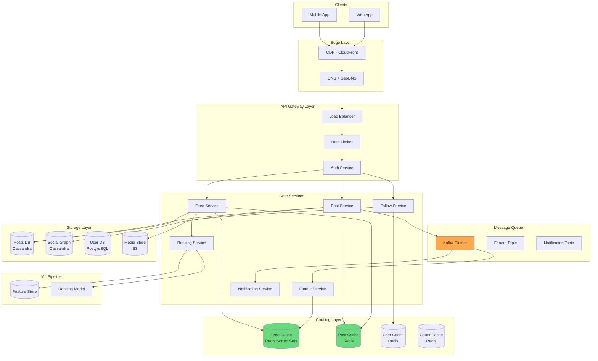
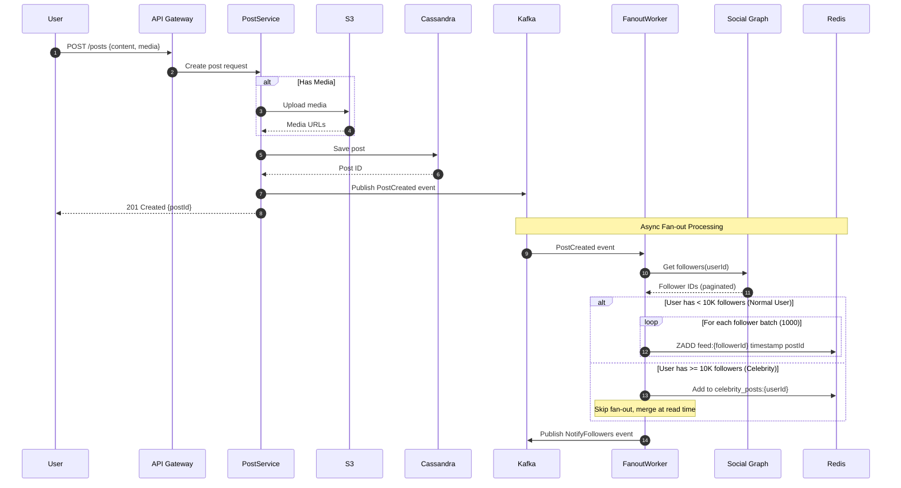
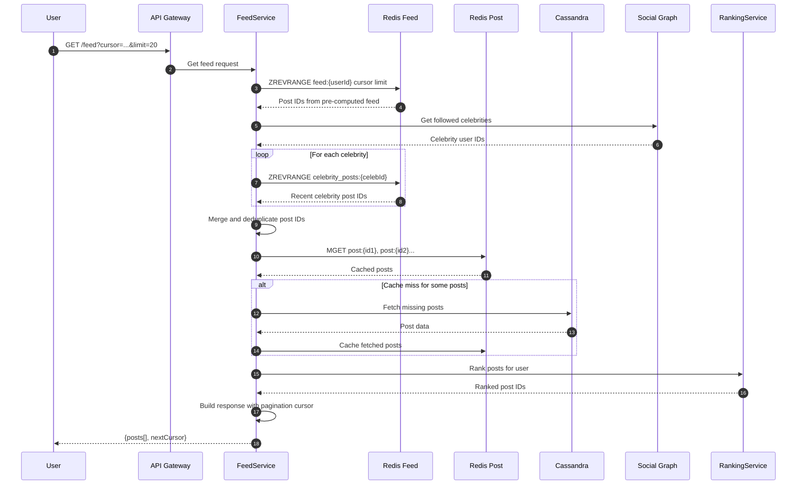
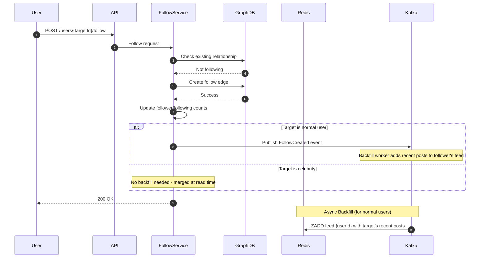
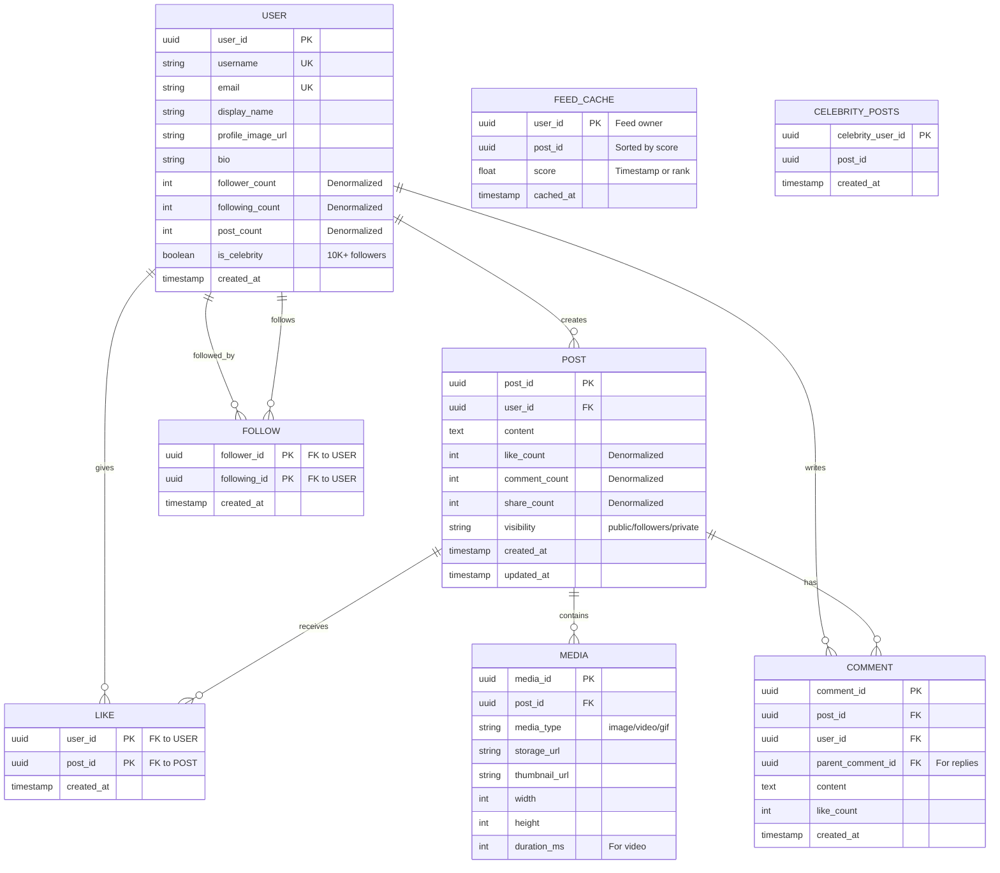

# News Feed System Design

Complete high-level design for a scalable social media news feed system.

---


## Requirements

### Functional Requirements
- Core user flow for News Feed System.

### Non-Functional Requirements
- High availability, low latency, fault tolerance.

## Back-of-envelope Estimation

### Traffic
| Metric | Calculation | Result |
|---|---|---|
| DAU | Given | 300M |
| Avg QPS | 300M DAU x 20 reads / 86,400 s | 69K avg QPS |
| Peak QPS | 69K avg QPS x 3 peak | 207K peak QPS |

### Storage
| Metric | Calculation | Result |
|---|---|---|
| Daily Storage | 300M DAU x 2 posts x 1 KB = 600 GB/day |

## API Contracts

### Endpoints
```http
POST /api/v1/posts
GET /api/v1/feed
```

## Data Model

### Schema
- Primary Key: `post_id`
- Partition Key: `user_id`


## System Architecture



**Architecture Notes:**
- **Fan-out on Write**: Normal users' posts pushed to followers' feed caches
- **Fan-out on Read**: Celebrity posts (>10K followers) pulled at read time
- **Hybrid Approach**: Combines write-heavy for most, read-heavy for celebrities
- **Feed Cache**: Redis Sorted Sets with post IDs sorted by timestamp/rank
- **Social Graph**: Cassandra for high-throughput follower lookups

---

## Sequence Diagrams

### Write Path: Post Creation with Fan-out



### Read Path: Get Feed with Ranking



### Follow/Unfollow Flow



---

## Entity-Relationship Diagram



**Schema Notes:**
- **USER Table**: PostgreSQL for ACID, denormalized counts for performance
- **POST Table**: Cassandra, partitioned by `user_id` for user timeline queries
- **FOLLOW Table**: Cassandra, two tables for bidirectional queries:
  - `followers_by_user(user_id, follower_id)` - who follows me
  - `following_by_user(user_id, following_id)` - who I follow
- **FEED_CACHE**: Redis Sorted Set, not persisted to disk
- **Indexes**:
  - `POST(user_id, created_at DESC)` for user timeline
  - `FOLLOW(following_id)` for fan-out
  - `COMMENT(post_id, created_at)` for comment threads

---

## Trade-offs

### Fan-out on Write vs Read

| Aspect | Fan-out on Write | Fan-out on Read |
|--------|-----------------|-----------------|
| Write latency | Higher | Lower |
| Read latency | Lower | Higher |
| Storage | Higher | Lower |
| Celebrity handling | Poor | Good |
| **Recommendation** | Use for normal users | Use for celebrities |

### Consistency vs Availability

- **Choice**: Eventual consistency
- **Trade-off**: New posts may take seconds to appear in all feeds
- **Benefit**: Higher availability and throughput

---

## Key Components

| Component | Technology | Purpose |
|-----------|------------|---------|
| Feed Cache | Redis Sorted Sets | Pre-computed feeds |
| Post Storage | Cassandra | Scalable post storage |
| Social Graph | Neo4j/Cassandra | Follow relationships |
| Message Queue | Kafka | Async fan-out |
| Ranking | ML Service | Feed personalization |

---

## 🤖 GenAI Extension

> How could this system be augmented with LLMs? Below are interview-ready ideas that connect this classical HLD to GenAI patterns. For full GenAI system designs, see [06-genai-systems/](../../06-genai-systems/).

### Potential LLM-Powered Features

| Feature | Description | GenAI Components |
|---------|-------------|-----------------|
| **Post Summarization** | Summarize long threads or trending topics (e.g., "Trending: AI debate — key viewpoints are…") | Chunker, prompt builder, LLM service |
| **AI-Powered Content Moderation** | Detect harmful, misleading, or policy-violating posts using LLM classifiers | Safety filter, LLM classifier |
| **Smart Feed Explanations** | Explain why a post appears in a user's feed (e.g., "Shown because 5 people you follow engaged with this") | Prompt builder, LLM service |
| **Content Creation Assistant** | Help users draft posts with AI suggestions, hashtag recommendations, and tone adjustments | Prompt builder, conversation memory, LLM service |

### Integration Points

```
Existing News Feed Pipeline:
  Create Post → Fan-out → Feed Cache → Render Feed

With GenAI Extension:
  Create Post → Fan-out → Feed Cache → Render Feed
       │                                    │
       └→ Content moderation (LLM, async)   └→ Feed explanations (LLM, on demand)
       └→ Topic extraction (LLM) → Trending summarization
```

### Trade-offs

- **Moderation latency**: Posts should appear quickly — run moderation async, remove violating posts retroactively
- **Summarization freshness**: Trending summaries become stale quickly — regenerate every few minutes, cache aggressively
- **Cost**: Per-post moderation at billions of posts/day is expensive — use lightweight classifier first, LLM for borderline cases

### Learn More

- [GenAI HLD Projects: Content Moderation Pipeline](../../06-genai-systems/02-llm-hld-projects/) — Full moderation system design
- [GenAI LLD: Safety Filter & Policy Engine](../../06-genai-systems/01-llm-lld-projects/safety-filter-policy-engine/) — Content filtering component
- [GenAI Concepts: Safety & Governance](../../06-genai-systems/00-concepts/safety-governance/) — Safety strategies for user-generated content


## Bottlenecks and Failure Modes

| Component | Failure Mode | Mitigation | Impact | Detection | Recovery |
|---|---|---|---|---|---|
| Feed Cache | Memory Full | Eviction policies (LRU) | Increased latency | Cache hit rate drop | Add cache nodes |
| Fan-out Worker | Queue Backlog | Priority queues (active users) | Delayed feed updates | Queue depth alarm | Scale workers |
| Graph DB | Slow Queries | Read replicas, caching | Slower feed generation | Query latency metrics | Add read replicas |
| Post DB | Node Down | Quorum reads/writes | Minimal, handled transparently | Node heartbeat failure | Gossip protocol sync |
| CDN | Cache Miss Spike | Cache warming strategies | Increased origin load | Origin traffic metrics | Tune cache headers |
| API Gateway | Instance Crash | Auto-scaling group | Brief latency spike | 5xx rate spikes | Auto-replace |

## Scaling Stages

- **10K Users**: Single monolith, simple DB, basic caching.
- **1M Users**: Microservices, robust cache, read replicas.
- **100M+ Users**: Sharded databases, globally distributed edge nodes, event streaming.


---
**Real-world reference**: See how Twitter solved this in the [Twitter case study](../../case-studies/twitter-timeline/)
