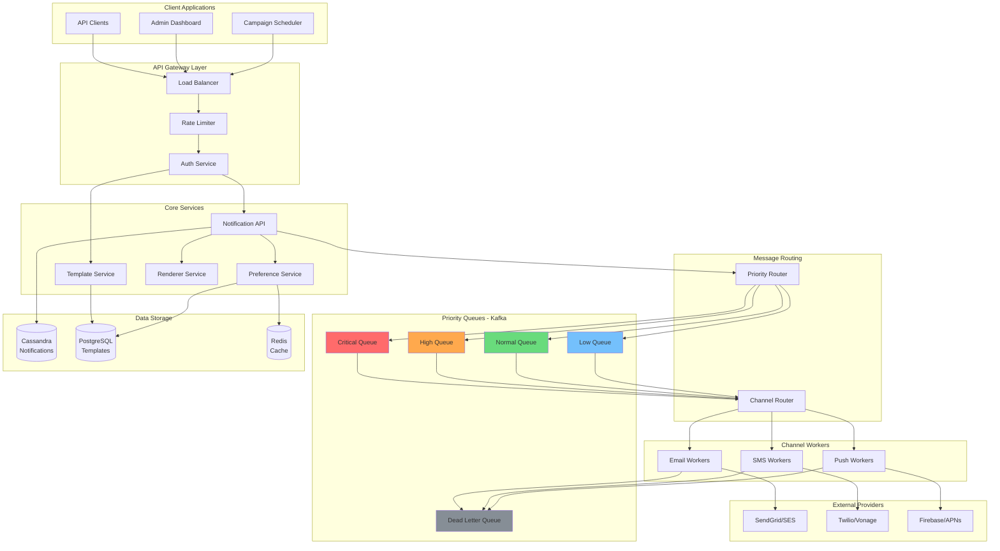
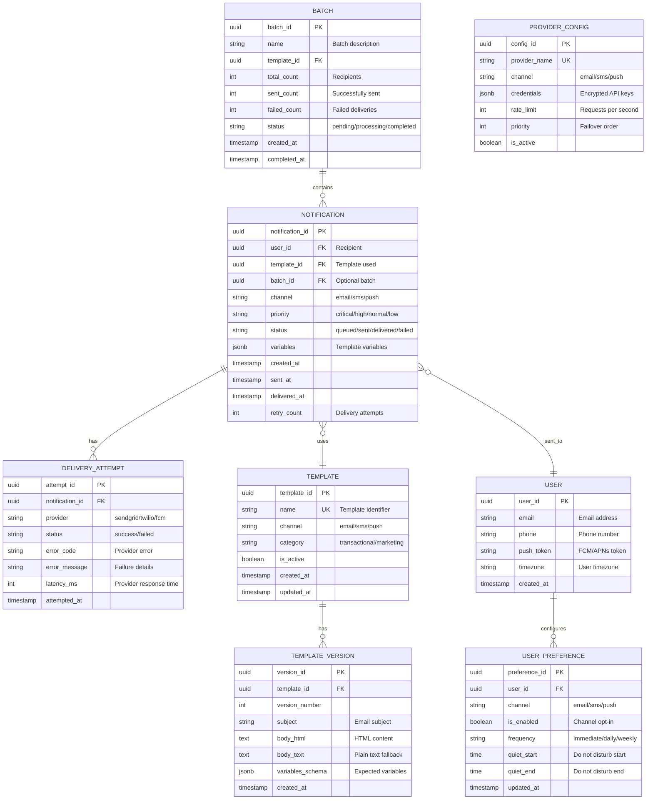
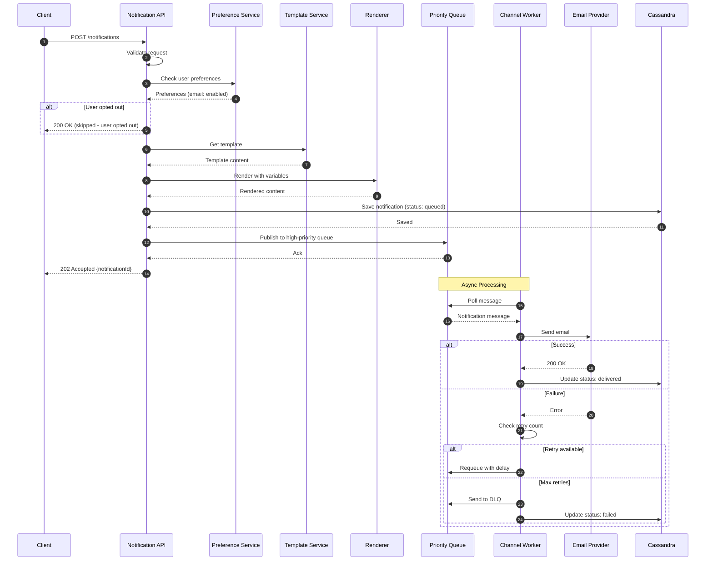
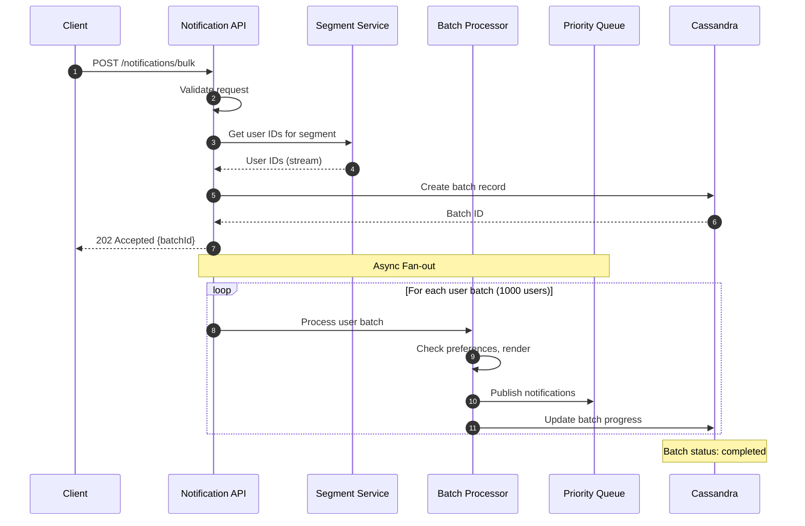

# Notification Service System Design

Complete high-level design for a scalable multi-channel notification service.

---


## Requirements

### Functional Requirements
- Core user flow for Notification Service.

### Non-Functional Requirements
- High availability, low latency, fault tolerance.

## Back-of-envelope Estimation

### Traffic
| Metric | Calculation | Result |
|---|---|---|
| DAU | Given | 100M |
| Avg QPS | 100M DAU x 10 notifs / 86,400 s | 11.5K avg QPS |
| Peak QPS | 11.5K avg QPS x 3 peak | 34.5K peak QPS |

### Storage
| Metric | Calculation | Result |
|---|---|---|
| Daily Storage | 100M DAU x 10 notifs x 500 bytes = 500 GB/day |

## API Contracts

### Endpoints
```http
POST /api/v1/notifications/send
GET /api/v1/notifications/preferences
```

## Data Model

### Schema
- Primary Key: `notification_id`
- Partition Key: `user_id`


## Overview

This document describes the architecture for a notification service capable of sending 100+ million notifications daily across email, SMS, and push channels with high reliability.

### Architecture Diagram



---

## Detailed Architecture Sections

### 1. API Gateway Layer

**Load Balancer:**
- L7 load balancing with health checks
- Sticky sessions not required (stateless services)
- SSL termination

**Rate Limiter:**
- Per-client rate limiting
- Tiered limits based on subscription
- Spike protection for bulk endpoints

**Authentication:**
- API key authentication
- JWT for admin dashboard
- Service-to-service mTLS

### 2. Core Services

**Notification API Service:**
- Accepts notification requests
- Validates inputs
- Checks user preferences
- Routes to priority queues
- Returns notification IDs

**Template Service:**
- CRUD operations for templates
- Template versioning
- Variable validation
- Template caching

**Preference Service:**
- User notification preferences
- Channel opt-in/opt-out
- Quiet hours configuration
- Cached in Redis for fast lookup

**Renderer Service:**
- Template variable substitution
- Pre-compiles templates
- Supports multiple formats (HTML, plain text)

### 3. Message Routing Layer

**Priority Router:**
```
Priority levels and SLAs:
- Critical: < 1 second (OTP, security alerts)
- High: < 30 seconds (order confirmations)
- Normal: < 5 minutes (marketing)
- Low: < 1 hour (newsletters)

Routing logic:
1. Check message priority
2. Route to corresponding queue
3. Apply rate limiting per queue
```

**Channel Router:**
```
Channel selection:
1. Check user's channel preferences
2. Verify channel is enabled for template
3. Route to appropriate worker pool
4. Handle multi-channel sends sequentially
```

### 4. Queue Infrastructure (Kafka)

**Topic Configuration:**
```
Topics:
- notifications.critical (partitions: 16, replication: 3)
- notifications.high (partitions: 32, replication: 3)
- notifications.normal (partitions: 64, replication: 3)
- notifications.low (partitions: 32, replication: 3)
- notifications.dlq (partitions: 8, replication: 3)

Consumer Groups:
- email-workers (one per priority)
- sms-workers (one per priority)
- push-workers (one per priority)
```

**Dead Letter Queue:**
```
DLQ triggers:
- Max retry attempts exceeded (6)
- Permanent failures (invalid email, blocked number)
- Provider rejection

DLQ handling:
- Manual review dashboard
- Automated retry on provider recovery
- Archive after 30 days
```

### 5. Channel Workers

**Email Worker Pool:**
```
Providers:
- Primary: SendGrid (1000/sec limit)
- Secondary: AWS SES (500/sec limit)
- Tertiary: Mailgun (500/sec limit)

Features:
- Connection pooling
- HTML and plain text support
- Attachment handling
- Open/click tracking
```

**SMS Worker Pool:**
```
Providers:
- Primary: Twilio
- Secondary: Vonage (Nexmo)

Features:
- Number formatting
- Unicode detection
- Multi-part message handling
- Delivery receipts
```

**Push Worker Pool:**
```
Providers:
- Android: Firebase Cloud Messaging (FCM)
- iOS: Apple Push Notification Service (APNs)

Features:
- Token management
- Silent vs visible notifications
- Rich notifications (title, body, data)
- Badge count updates
```

### 6. Storage Layer

**Cassandra (Notifications):**
```
Keyspace: notifications
Replication: NetworkTopologyStrategy, RF=3

Primary table for notification records
- Partitioned by user_id + month
- Time-series optimized queries
- Write-heavy workload
```

**PostgreSQL (Templates & Config):**
```
Database: notification_config

Tables:
- templates
- user_preferences  
- provider_config
- rate_limits
```

**Redis (Cache):**
```
Cache layers:
- User preferences: TTL 1 hour
- Templates: TTL 5 minutes
- Rate limit counters: TTL varies
- Idempotency keys: TTL 24 hours
```

### Entity-Relationship Diagram



**Schema Notes:**
- **Partitioning**: `NOTIFICATION` partitioned by `created_at` (monthly) for retention management
- **Sharding**: `user_id` used as shard key for user-centric queries
- **TTL**: Notifications older than 90 days archived to cold storage
- **Indexes**:
  - `NOTIFICATION(user_id, created_at DESC)` for user notification history
  - `NOTIFICATION(status, priority)` for queue processing
  - `DELIVERY_ATTEMPT(notification_id)` for retry logic
  - `USER_PREFERENCE(user_id, channel)` for preference lookup

### 7. Observability

**Metrics (Prometheus):**
```
Key metrics:
- notifications_sent_total{channel, status}
- notification_latency_seconds{priority}
- provider_errors_total{provider, error_type}
- queue_depth{queue}
- dlq_size
```

**Logging (ELK):**
```
Log levels:
- INFO: Notification created, sent, delivered
- WARN: Retry triggered, provider slow
- ERROR: Delivery failed, provider error
```

**Alerting:**
```
Alerts:
- Delivery rate < 95% over 5 minutes
- DLQ size > 10,000
- Provider error rate > 5%
- Queue lag > 5 minutes for critical
```

---

## Sequence Diagrams

### Core Write Flow: Send Notification



### Bulk Send Flow



---

## Trade-offs

### At-Least-Once vs Exactly-Once Delivery

| Choice | Implication |
|--------|-------------|
| **Chose: At-Least-Once** | Simpler, faster, more reliable |
| Trade-off | Possible duplicate notifications |
| Mitigation | Idempotency keys, content-based dedup |
| Why | Missing notifications are worse than duplicates |

### Push vs Pull for Workers

| Choice | Implication |
|--------|-------------|
| **Chose: Pull (Kafka consumers)** | Workers control their pace |
| Trade-off | Slight latency vs push |
| Benefit | Natural backpressure handling |
| Alternative | Push with circuit breakers (more complex) |

### Single Queue vs Priority Queues

| Choice | Implication |
|--------|-------------|
| **Chose: Priority Queues** | Critical messages processed first |
| Trade-off | More operational complexity |
| Benefit | SLA compliance for critical notifications |
| Implementation | Separate Kafka topics per priority |

### Cassandra vs PostgreSQL for Notifications

| Choice | Implication |
|--------|-------------|
| **Chose: Cassandra** | High write throughput, horizontal scale |
| Trade-off | No complex queries, eventual consistency |
| Benefit | Handles 100M+ writes/day easily |
| Alternative | PostgreSQL with partitioning (more limits) |

---

## Component Summary

| Component | Technology | Purpose | Scaling |
|-----------|------------|---------|---------|
| API Gateway | Kong/AWS ALB | Traffic management | Auto-scaling |
| Message Queue | Kafka | Async processing | Partitions |
| Notification Store | Cassandra | High-volume storage | Horizontal |
| Config Store | PostgreSQL | Templates, prefs | Vertical + replicas |
| Cache | Redis Cluster | Fast lookups | Cluster mode |
| Email Provider | SendGrid/SES | Email delivery | Provider limits |
| SMS Provider | Twilio | SMS delivery | Provider limits |
| Push Provider | FCM/APNs | Push delivery | Provider limits |

---

## Failure Scenarios

| Failure | Impact | Mitigation |
|---------|--------|------------|
| Provider down | Channel unavailable | Failover to secondary provider |
| Kafka unavailable | Cannot queue new | In-memory buffer, retry |
| Cassandra down | Cannot update status | Async reconciliation |
| Redis down | Slow preference lookup | Fallback to PostgreSQL |
| High failure rate | DLQ fills up | Alerts, manual intervention |

---

## Security Considerations

1. **Data Protection**: Encrypt PII at rest and in transit
2. **Access Control**: API keys with scope limits
3. **Audit Logging**: Log all send operations
4. **Compliance**: GDPR, CAN-SPAM, TCPA compliance
5. **Rate Limiting**: Prevent abuse and accidental spam

---

*See [APPROACH.md](./APPROACH.md) for detailed thought process and [diagrams/](./diagrams/) for additional diagrams.*

---

## 🤖 GenAI Extension

> How could this system be augmented with LLMs? Below are interview-ready ideas that connect this classical HLD to GenAI patterns. For full GenAI system designs, see [06-genai-systems/](../../06-genai-systems/).

### Potential LLM-Powered Features

| Feature | Description | GenAI Components |
|---------|-------------|-----------------|
| **Smart Notification Content** | Generate personalized notification text using LLMs (e.g., contextual push messages instead of generic templates) | Prompt builder, LLM service |
| **Notification Summarization** | Batch and summarize multiple notifications into a digest (e.g., "You have 12 updates: 3 comments on your post, 5 new followers…") | Chunker, prompt builder, LLM service |
| **Intelligent Channel Selection** | Use LLMs to determine the best channel (push, email, SMS) based on message content and user preferences | LLM classifier, prompt builder |
| **AI-Powered Unsubscribe Handling** | Parse natural-language unsubscribe requests (e.g., "stop sending me marketing emails but keep order updates") | Prompt builder, LLM service |

### Integration Points

```
Existing Notification Pipeline:
  Event → Priority Queue → Template → Channel Router → Delivery (Push/Email/SMS)

With GenAI Extension:
  Event → Priority Queue → Template/LLM → Channel Router → Delivery
              │                   │
              └→ Batch events     └→ LLM-generated personalized content
                 → Summarize (LLM) → Single digest notification
```

### Trade-offs

- **Latency**: LLM content generation adds 0.5–2s — acceptable for email/digest, too slow for urgent push notifications
- **Cost**: Only use LLM generation for high-value notifications (digests, personalized campaigns), not every alert
- **Fallback**: Always have template-based fallback if LLM service is unavailable

### Learn More

- [GenAI LLD: Prompt Builder](../../06-genai-systems/01-llm-lld-projects/prompt-builder/) — Dynamic content generation
- [GenAI LLD: LLM Request Orchestrator](../../06-genai-systems/01-llm-lld-projects/llm-request-orchestrator/) — Retries and fallback handling
- [GenAI Concepts: LLM-Oriented System Design](../../06-genai-systems/00-concepts/llm-system-design/) — Cost and latency trade-offs


## Bottlenecks and Failure Modes

| Component | Failure Mode | Mitigation | Impact | Detection | Recovery |
|---|---|---|---|---|---|
| Third-Party API | Rate Limiting | Backoff and retry queues | Delayed notifications | 429 response rate | Exponential backoff |
| Message Queue | Partition Offline | Replicate across AZs | Increased publish latency | Consumer lag spikes | Failover to replica |
| Preference DB | Read Bottleneck | Aggressive caching | Delayed sending | Read latency metrics | Scale cache / read replicas |
| Template Service| Rendering Error | Fallback templates | Missing content | Error logs | Rollback template |
| Delivery Worker | Crash | Dead letter queues | Delayed delivery | Queue depth monitor | Spin up new worker |
| API Gateway | Instance Crash | Auto-scaling group | Brief latency spike | 5xx rate spikes | Auto-replace |

## Scaling Stages

- **10K Users**: Single monolith, simple DB, basic caching.
- **1M Users**: Microservices, robust cache, read replicas.
- **100M+ Users**: Sharded databases, globally distributed edge nodes, event streaming.


---
**Real-world reference**: See how WhatsApp solved this in the [WhatsApp case study](../../case-studies/whatsapp-messaging/)
