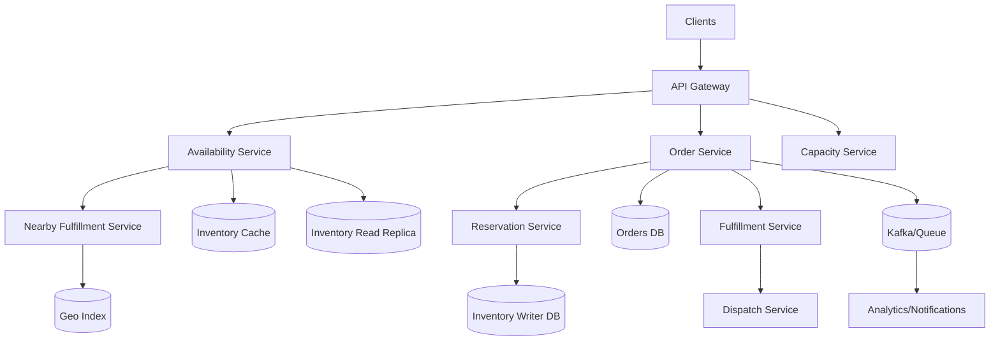

# Quick Commerce Delivery - Design

## 1. 📝 Requirements and Constraints

### Problem Statement
- System to design: A quick-commerce platform backend for placing and fulfilling orders from hyperlocal micro-fulfillment centers (dark stores) within a tight SLA.
- Core user value: Delivering groceries and essentials in minutes via highly localized inventory and dynamic routing.

### Functional Requirements
- [x] FR1: Users can query items deliverable to their location within the target SLA.
- [x] FR2: Users can place orders for multiple items, locking inventory atomically.
- [x] FR3: The system assigns warehouse pickers and creates optimized pick paths.
- [x] FR4: The system dispatches delivery partners based on geo-clustering.
- [x] FR5: The system recalculates delivery ETAs dynamically, throttling orders if the ETA exceeds a threshold.
- [x] FR6: The system handles stock-outs via state machine compensation.

### Non-Functional Requirements

| Requirement | Target |
|---|---|
| Availability query latency | < 100 ms P99 |
| Order placement latency | < 800 ms P99 |
| Inventory Consistency | Strong consistency during decrement |
| Cache Freshness | Eventual consistency (bounded staleness) |
| Read Availability | 99.99% |
| Write Availability | 99.95% |

### Constraints
- Sizing Math: 500 dark stores across 10 cities, processing 200,000 orders/day.
- Delivery SLA Breakdown: 10-minute SLA (2 mins picking, 1 min packing, 7 mins courier transit).

### Out of Scope
- Payment gateway integrations and internal ledgers.
- Driver onboarding and compliance checks.
- Catalog content and image management.

---

## 2. 📊 Back-of-Envelope Estimation

### Capacity & Sizing Math

| Metric | Calculation | Result |
|---|---|---|
| **Order Placement Attempts** | 200,000 successful / 0.80 success rate | 250,000 attempts/day |
| **Average Attempt QPS** | 250,000 attempts / 86,400 seconds | ~2.89 QPS |
| **Peak Attempt QPS** | 2.89 QPS * 4x peak multiplier | ~11.57 QPS |
| **Average Success QPS** | 200,000 successful / 86,400 seconds | ~2.31 QPS |
| **Peak Success QPS** | 2.31 QPS * 4x peak multiplier | ~9.26 QPS |
| **Average Read QPS** | (200,000 successful * 100 read skew) / 86,400s | ~231.48 QPS |
| **Peak Read QPS** | 231.48 QPS * 4x peak multiplier | ~925.92 QPS |
| **Storage (Orders)** | 200,000 successful * 1.5 KB (Order + Items) | ~300 MB/day (~109.5 GB/year) |
| **Bandwidth (Peak Ingress)** | 11.57 peak attempts/sec * 1.5 KB payload | ~17.36 KB/s |
| **Bandwidth (Peak Egress)** | 925.92 peak reads/sec * 5 KB response | ~4.63 MB/s |

### SLA Breakdown
To process 200,000 daily orders across 500 dark stores in 10 cities, the platform needs robust localized inventory partitions. The 200,000/500 = 400 orders/store/day is strictly an *average* scenario assumption; actual capacity must handle significant store skew and peak hour bursts.

The 10-minute delivery SLA is a hard customer-facing promise (operational target). The SLA places heavy constraints on operations, broken down as (scenario estimates):
- **2 Minutes - Picking:** The system must generate optimal warehouse routing (TSP/S-shape) immediately upon order confirmation.
- **1 Minute - Packing:** Dedicated bagging stations prepare the order for courier hand-off.
- **7 Minutes - Courier Transit:** Couriers must be pre-assigned or near the store. Distance is bounded strictly to an ~2km radius to ensure the transit SLA can be met.

### Storage
*Incorporated into capacity math above.*

### Decision Notes
- The 10-minute SLA forces the architecture to run parallel processes: dispatching a courier while the picker is still fulfilling the order.
- Inventory reservations cannot use slow distributed locks; they must utilize fast atomic operations (like Redis Lua scripts).

---

## 3. 🔌 API / System Interface

### External Contract
- Protocol choice: REST for client-facing apps, gRPC for internal service-to-service communication.
- Auth model: JWT for user identification, API Keys for store IoT/scanners.
- Rate limiting policy: Token bucket per user IP and user ID to prevent scraping and abuse.

### Core Endpoints & Normal Worked Trace

**Core API: Atomic Order Placement & Dispatch**

1. **Client Request (Attempt):** Client POSTs to `/api/v1/orders` with an `idempotencyKey` and payload.
2. **Security Boundary:** The API Gateway validates the JWT signature and expiration. It enforces rate limits based on `userId` and IP address. Any internal routing headers sent by the client are stripped to prevent privilege escalation.
3. **Availability & Capacity Check:** The Order Service verifies that the requested dark store's delivery ETA is < 15 minutes.
4. **Atomic Reservation:** The Order Service executes a Redis Lua script to atomically decrement inventory for all requested items.
5. **Consistency Boundary:** Redis acts as the immediate consistency boundary for inventory during the checkout process. Once the payment succeeds, PostgreSQL becomes the authoritative consistency boundary for the final order state and financial ledger.
6. **Persistence & Dispatch:** If successful, the order state is persisted to PostgreSQL. Async events trigger picker routing (Fulfillment Service) and courier dispatch (Dispatch Service).
7. **Client Response (Success):** 200 OK with `orderId` and `estimatedArrival`.

```http
POST /api/v1/orders
Headers:
  Authorization: Bearer <jwt_token>
  Idempotency-Key: order-u101-0001
{
  "userId": "u_101",
  "storeId": "ds_500",
  "lat": 12.9,
  "lng": 77.6,
  "items": [
    {"itemId": "i_milk", "qty": 2},
    {"itemId": "i_bread", "qty": 1}
  ]
}

Response (200 OK):
{
  "orderId": "ord_999",
  "status": "RESERVED",
  "estimatedArrival": "2023-10-27T10:15:00Z"
}
```

Other essential endpoints:
```http
GET /api/v1/availability?lat=12.9&lng=77.6&q=milk&page=1&pageSize=20
GET /api/v1/delivery/eta?lat=12.9&lng=77.6
```

### Error Model
- `400` Invalid order payload or address outside service area.
- `409` Inventory conflict / Stock unavailable during checkout.
- `429` Capacity gated / Throttled due to high demand.
- `503` Store temporarily offline or unreachable.

---

## 4. 🗄️ Core Entities and Data Model

### Core Entities
- `FulfillmentCenter(center_id, region_id, lat, lng, status)`
- `Inventory(center_id, item_id, available_qty, reserved_qty, version)`
- `Order(order_id, user_id, center_id, status, created_at)`
- `OrderLine(order_id, item_id, qty, final_state)`
- `Courier(courier_id, status, lat, lng, current_order_id)`

### Storage Choices
- Primary DB: PostgreSQL for transactional order state and inventory source of truth.
- Cache / Lock: Redis for extremely fast inventory queries and atomic reservation scripts.
- Spatial Index: Redis GEO or Elasticsearch for quick courier distance calculations.

### Key Access Patterns
1. Read path query: High QPS fetch for localized available items (Redis).
2. Write path mutation: Atomic decrement of stock on order placement (Redis + Postgres).
3. Secondary lookup: Polling courier ETAs (Redis GEO).

### Partition and Index Notes
- Partition key: Region ID or Center ID, as every order is fulfilled locally without cross-store queries.
- Hot key risk: Flash sales or high-demand essentials (e.g., milk during a storm). Mitigated via local cache.

---

## 5. 🏗️ High-Level Architecture

### System Architecture

Mermaid source: [architecture.mmd](./diagrams/architecture.mmd).



### Read Path
1. The client requests item availability for their coordinates.
2. The Nearby Fulfillment Service queries the Geo Index to map coordinates to a specific dark store (within 2km radius).
3. The Availability Service fetches cached inventory levels from Redis for that specific store.
4. Results are paginated and returned to the client in <100ms.

### Write Path
1. Client submits an order checkout payload.
2. The Gateway checks the Capacity Service. If dynamic ETA > 15 mins, the order is rejected/throttled.
3. The Reservation Service executes a Redis Lua script to atomically decrement stock.
4. If successful, the order is persisted to PostgreSQL, and async events are fired.

### Failure-aware Path
- Dependency timeout behavior: If the cache is down, failover to PostgreSQL Read Replicas.
- Retry policy + idempotency: Order submission must include idempotency keys to prevent duplicate payments.
- Degraded mode: Disable specific categories if inventory cache sync fails.

---

## 6. 🔍 Deep Dives

### Deep Dive A: Hyperlocal Dark Store Inventory Reservation
To prevent overselling while maintaining high throughput, inventory reservations must be atomic and fast.
- **Chosen Pattern:** Real-time inventory caching in Redis with atomic reservation using Lua scripts. The Lua script takes the requested items, checks if `stock >= requested_qty` for all, and if so, decrements the counts and adds to a `reserved_qty` set in a single atomic operation.
- **Fallback Mechanism & Idempotency:** If Redis is down, the system falls back to PostgreSQL (`SELECT FOR UPDATE`). To prevent double decrements when stores disagree, Redis is identified as the single source of truth for the lock. Order submissions include an idempotent reservation ID, establishing a durable reservation protocol before any fallback occurs.
- **Eventual Persistence:** An async worker drains the Redis reservations and updates the PostgreSQL source of truth to maintain durability.

### Deep Dive B: Picker Routing & Batching
Meeting the 2-minute picking SLA is impossible if warehouse staff wander aimlessly.
- **Bottleneck:** Walking distance inside the dark store.
- **Optimization Strategy:** The Fulfillment Service generates a pick list sorted by aisle and bin locations.
- **Pathing Algorithm:** We use warehouse aisle pathing optimization, specifically the S-shape heuristic or an approximation of the Traveling Salesperson Problem (TSP) based on the store's static 2D grid. The picker's handheld device guides them sequentially without backtracking.

### Deep Dive C: Dynamic Delivery ETA & Capacity Gating
Promising a 10-minute delivery is risky if no couriers are available. The system must protect the SLA.
- **Real-time Capacity Calculation:** The Capacity Service tracks active orders vs. available couriers in the local geo-cluster.
- **Throttling Mechanism:** By calculating real-time dark store capacity based on the available courier pool, the system gates checkouts. If the projected delivery promise exceeds 15 minutes (which acts as a degraded fallback admission threshold), new orders are throttled (e.g., showing a "High Demand - Please try again later" banner). This 15-minute threshold represents an explicit product downgrade since 10 minutes is the hard promise.

### Deep Dive D: Courier Dispatch
Couriers must be at the store when the packing completes (minute 3).
- **Strategy:** Nearest available delivery partner within a 2 km scenario estimate assigned via geo-clustering.
- **Mechanism:** Redis GEO tracking allows the Dispatch Service to query `GEORADIUS` around the store. The system pings the top 3 closest idle couriers.
- **Parallel Dispatch:** The dispatch ping happens the moment the payment is confirmed, overlapping with the picker's routing phase.

### Deep Dive E: Order State Machine and Compensation Rollback
Physical reality sometimes diverges from digital inventory (e.g., theft, damages, misplaced items).
- **Failure History 1 - Redis Timeout & Replay:** If the Redis Lua reservation times out, the gateway replays the request using the same idempotent reservation ID. Redis owns the transient lock state; if the key exists, the replay returns the existing success state without double decrementing, retaining the stock consistency guarantee.
- **Failure History 2 - Physical Short-Pick (Picker cannot find item):** The picker arrives at the bin but cannot find the physical item. The picker flags the item as "Missing" on their scanner. The Order Service (which owns the order state) triggers a compensation transaction. It rolls back the charge for that specific item, releases any reserved stock, updates the OrderLine to `CANCELLED`, and automatically forces an inventory sync for that item to prevent subsequent orders from failing.

---

## 7. ⚖️ Trade-offs and Decisions

| Decision | Option Chosen | Alternative | Why Chosen Now | Revisit Trigger |
|---|---|---|---|---|
| Inventory correctness | Redis Lua Script Atomic Reservation | Pure DB Transaction | Need <10ms latency to prevent checkout contention. | Cache node limits |
| Read freshness | Bounded staleness cache | Live DB queries | Browsing traffic is 100x order traffic; DB would melt. | Frequent stock discrepancies |
| Route assignment | S-shape heuristic | Full A* search | S-shape is O(N) and fast enough for tiny dark stores. | Stores get significantly larger |
| Availability | Reject orders when >15m ETA | Accept orders with 45m ETA | Protects the brand promise of "Quick Commerce". | Business model pivots |

---

## 8. 🔮 Follow-up Questions

1. What changes if a city launches 50 new dark stores in a month?
   - Geo index auto-balancing and dynamic reassignment of service boundaries (Voronoi polygons) based on density.
2. How do you handle cold-chain items that cannot sit in bags for long?
   - Introduce category tags that force late-picking (e.g., grab ice cream last on the TSP path).
3. How do you mitigate the risk of Redis crashing and losing reservations?
   - Use Redis Append Only File (AOF) with `everysec` fsync, and reconcile with Postgres via WAL shipping.

---

## 9. 🧩 Variants and Extensions

- Variant 1 (Multi-tenant): A platform that aggregates multiple local pharmacies instead of owned dark stores.
- Variant 2 (Scheduled): Allowing users to book a slot for tomorrow, requiring a separate inventory reservation table partitioned by time slots.
- Variant 3 (Surge Pricing): Introducing dynamic delivery fees instead of hard capacity gating when ETA > 15 mins.

---

## 10. 🚨 Common Pitfalls (Self-Check)

- [x] I separated catalog browsing from physical local inventory.
- [x] I accounted for the physical realities of picking and packing, not just network IO.
- [x] I handled the distributed transaction failure case (picker can't find item).
- [x] I justified the caching layer with read-to-write skew metrics.

---

## 11. 🧮 Scoring Rubric (Self-Evaluation)

| Dimension | 1 (Weak) | 3 (Okay) | 5 (Strong) | Your Score |
|---|---|---|---|---|
| Requirements handling | Vague | Mostly clear | Prioritized + quantified | 5 |
| Architecture clarity | Boxes only | Basic flow | End-to-end + failure-aware | 5 |
| Technical depth | Tool names | Some rationale | Pattern + metric-driven rationale | 5 |
| Trade-off quality | None | Some | Explicit and contextual | 5 |

---

## 12. ✅ Wrap-up Summary (Final 60-90 Seconds)

To summarize, we designed a Quick Commerce platform that strictly enforces a 10-minute SLA across 500 dark stores handling 200,000 daily orders. We separated the high-volume availability read path using a Geo-indexed Redis cache from the highly consistent order write path. 

Our core architectural choices involved using Redis Lua scripts for atomic inventory reservations to prevent overselling, while implementing dynamic capacity gating to reject orders if courier pools are exhausted. 

We accepted the trade-off of using eventual consistency for availability displays to ensure <100ms load times, and mitigated physical inventory discrepancies with a robust state machine that triggers automated compensation rollbacks when pickers encounter empty shelves. As traffic grows, this region-sharded architecture will allow us to scale horizontally without cross-store contention.

---

## 📌 Final Checklist

- [x] Requirements and constraints captured
- [x] Estimates tied to decisions
- [x] APIs and entities are coherent
- [x] Read/write paths are explicit
- [x] Deep dive completed
- [x] Trade-offs stated
- [x] Follow-ups addressed
- [x] Strong summary delivered

---

## Cross-References

- [PROBLEM](./PROBLEM.md)
- [RUBRIC](./RUBRIC.md)
- [FOLLOW-UPS](./FOLLOW-UPS.md)
- [PITFALLS](./PITFALLS.md)


### Expanded Notes on Sizing Math
The assumption of 200,000 daily orders across 500 stores translates to roughly 400 orders per store per day. While this seems low initially, the distribution is highly uneven. Peak hours (e.g., mornings or evenings) might see 50% of the daily volume within a 2-hour window.

This bursty traffic pattern requires the local edge cache for each region to handle significant read spikes without relying on horizontal scaling of the master database. 

Furthermore, the 10-minute delivery SLA imposes severe constraints on failure recovery. A 2-minute delay in order processing or courier dispatching completely invalidates the SLA, emphasizing the need for <800 ms P99 latencies on order placement.

### Expanded Notes on Deep Dives
The use of Lua scripts ensures atomicity without locking rows in the database, avoiding deadlocks or large latency variations under high concurrency.

## Requirement-to-Section Review

- **10/15-minute SLA Definitions:** Clarified as hard promise vs degraded fallback in Sections 1, 2 (Sizing Math & SLA Breakdown), and Deep Dive C.
- **Sizing Math (500x store daily load):** Calculated as 400 avg orders/store/day in Section 2, with peak/skew assumptions explicitly driving capacity rather than inferred.
- **Inventory Reservation Authority:** Clarified in Deep Dive A that Redis acts as the single source of truth with an idempotent reservation ID to prevent double decrements on fallback.
- **Scenario Estimates Labeled:** Courier radius, picking times, and the 10-minute components are labeled as scenario estimates in Section 2 and Deep Dive D.
- **Failure Histories:** Added two named failure histories in Deep Dive E (Redis timeout/replay and physical short-pick) detailing state ownership and compensation traces.
