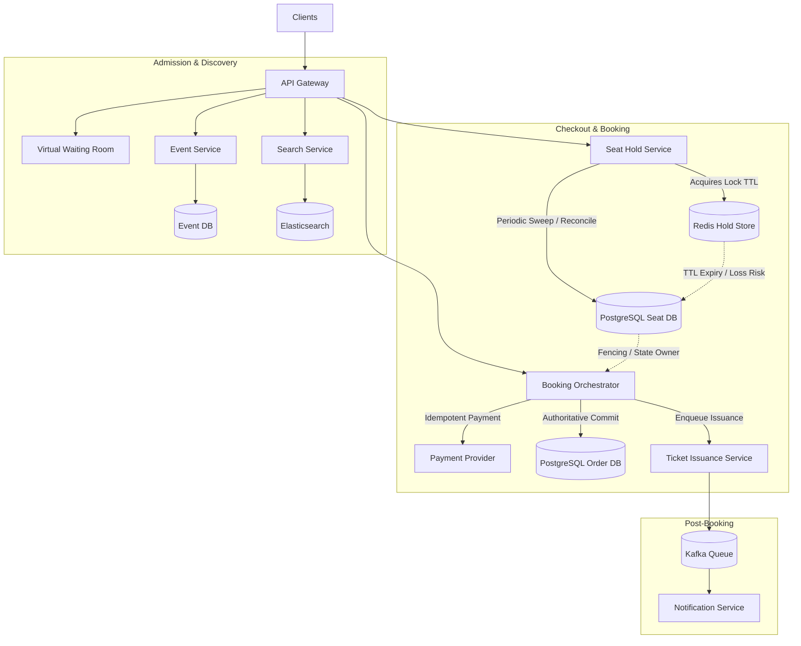

# Ticketing Platform - Design

Use this detailed system design to prepare for ticketing and high-concurrency booking interviews.

---

## 1. 📝 Requirements and Constraints

### Problem Statement
- System to design: High-scale ticketing platform for live events.
- Core user value: Allow users to discover events, hold seats, and complete payment without double booking.

### Functional Requirements
- [ ] FR1: Users can browse and search events by city, date range, and category.
- [ ] FR2: Users can view venue seat maps with near-real-time availability.
- [ ] FR3: Users can place temporary holds on one or more seats.
- [ ] FR4: Users can confirm booking and receive digital tickets.
- [ ] FR5: Users can view booking status and booking history.

### Non-Functional Requirements

| Requirement | Target |
|---|---|
| Availability (browse/search) | 99.99% |
| Availability (booking path) | 99.95% |
| Search latency | < 500 ms P99 |
| Seat-hold latency | < 250 ms P99 |
| Hold timeout | 10 minutes |
| Consistency | Strong for seat state transitions |

### Constraints
- Peak onsale surge at extreme concurrency.
- Strong consistency required for booking to prevent overselling.

### Out of Scope
- Fraud/risk modeling internals.
- Complex tax and regulatory billing flows.
- Promoter back-office workflows.

---

## 2. 📊 Back-of-Envelope Estimation (Only What Changes Design)

### Sizing Math and Traffic

For a high-demand event like a superstar concert:
- We assume a 100,000 seat stadium selling out in 60 seconds. This implies about 1,667 successful seat sales/s if all seats sell evenly.
- 50,000 QPS for search and browse traffic. This is an independent burst assumption, not implied by sellout math.
- 10,000 QPS for seat reservation attempts. This is also an independent burst assumption, not implied by sellout math.
- Heavy reads before the onsale, pivoting to intense write contention precisely at the onsale time.

| Metric | Value | Formula |
|---|---|---|
| DAU | 30M | normal operations |
| Peak Search QPS | 50,000 | independent burst assumption |
| Peak Reserve Attempts QPS | 10,000 | independent burst assumption |
| Peak Successful Sales QPS | ~1,667 | 100,000 seats / 60s |
| Average Storage/Day | 5 GB | 5M tickets/day * 1 KB/ticket |
| Peak Bandwidth (Booking) | ~1.67 MB/s | ~1,667 sales/s * 1 KB/ticket |

### Storage

| Data Type | Avg Size | Daily Volume | 1-Year |
|---|---|---|---|
| Tickets | 1 KB | 5M | 1.8B records |
| Holds | 500 B | 20M | Transient |

### Decision Notes
- Which estimate forces a design choice? The peak reserve QPS of 10,000 for highly contented rows forces us to use in-memory distributed locks or conditional DB updates, as naive row-locking will cause massive DB contention.
- What assumption is most uncertain? The bot traffic volume and distribution.

---

## 3. 🔌 API / System Interface

### External Contract
- Protocol choice: REST over HTTPS.
- Auth model: JWT for user sessions.
- Rate limiting policy: Strict token bucket per user/IP.

### Core Endpoints

```http
GET /api/v1/events?city=...&start=...&end=...&page=...
```
Search for events.

```http
GET /api/v1/events/{eventId}/seats?section=...
```
Get seat map availability.

```http
POST /api/v1/holds
{
  "eventId": "evt_123",
  "seatIds": ["A-10", "A-11"],
  "userId": "usr_42"
}
```
Place a temporary hold.

```http
POST /api/v1/bookings
{
  "holdId": "hold_789",
  "paymentToken": "tok_...",
  "idempotencyKey": "book-usr42-evt123-001"
}
```
Confirm booking.

### Error Model
- `400` invalid input or seat already booked.
- `401/403` auth/authz missing.
- `404` event/seat missing.
- `409` conflict/concurrency on seat hold.
- `429` throttled / waiting room active.
- `5xx` internal dependency failure.

---

## 4. 🗄️ Core Entities and Data Model

### Core Entities
- `Event(event_id, venue_id, start_at, status, pricing_policy)`
- `Seat(event_id, section, row, number, seat_state, version)`
- `SeatHold(hold_id, event_id, seat_ids, user_id, expires_at)`
- `Booking(booking_id, hold_id, user_id, booking_state, amount)`
- `Ticket(ticket_id, booking_id, seat_id, barcode, issued_at)`

### Storage Choices
- Primary DB: PostgreSQL for ACID transactions on bookings and tickets.
- Cache: Redis for seat hold locks and availability heatmaps.
- Search index: Elasticsearch for event discovery.
- Blob/object storage: S3 for ticket artifacts (QR/PDF assets).

### Key Access Patterns
1. Read path query: Get event details and seat map from cache/search.
2. Write path mutation: Reserve seat with Redis lock, then write to DB.
3. Secondary lookup: User booking history.

### Partition and Index Notes
- Partition key: `event_id` is the primary partition key for seats and holds.
- Hot key risk: High risk on popular events. Resolved via caching and waiting rooms.

---

## 5. 🏗️ High-Level Architecture

### Component List
- API Gateway / Load Balancer
- Virtual Waiting Room (Admission Queue)
- Event Service and Search Service
- Seat Inventory Service
- Seat Hold Service
- Booking and Payment Orchestrator
- Ticket Issuance Service



### Read Path
1. Client fetches event catalog via API Gateway.
2. Search Service reads from Elasticsearch.
3. Client requests seat availability; Event Service fetches from Redis cache or DB.

### Write Path
1. Client enters checkout and requests seat holds.
2. Seat Hold Service attempts to acquire locks in Redis.
3. Booking Orchestrator verifies holds, processes payment, and writes booking to DB.

### Failure-aware Path
- Dependency timeout behavior: Cancel hold if payment times out.
- Retry policy + idempotency: Use idempotency keys for payment retries.
- Degraded mode: Serve read-only traffic from cache if DB is slow.

#### Normal Trace (Successful Booking)
- **Trace 0 (Concrete Normal Worked Trace)**:
  - *Who owns state*: Redis (transient locks), PostgreSQL (final booking).
  - *What happens*: 
    1. Client requests a hold on seats `A-10`, `A-11` via `POST /api/v1/holds`. 
    2. Seat Hold Service sets Redis keys `seat:evt123:A-10` and `seat:evt123:A-11` with `NX EX 600` and generates a temporary `hold_789` token.
    3. Client submits payment details and `hold_789` to `POST /api/v1/bookings`.
    4. Booking Orchestrator verifies `hold_789` ownership, processes idempotent payment, and writes the final booking to PostgreSQL via a conditional update (`WHERE status='AVAILABLE'`).
  - *Consistency/Security Boundary*: The Redis lock provides an advisory concurrency filter (improving UX and preventing DB stampedes), while the PostgreSQL conditional update strictly enforces the security/consistency boundary, guaranteeing exactly one transition to `BOOKED` even if Redis locks are bypassed or expire prematurely.

#### Failure Traces
- **Trace 1 (Lock TTL Expiry with Paused Client)**: 
  - *Who owns state*: PostgreSQL conditional updates / unique booking invariant.
  - *What happens*: A client acquires a 10-minute hold lock but gets paused (e.g., GC pause). The lock expires and another user acquires the seat. The paused client resumes and tries to confirm the booking with stale state. 
  - *Guarantee retained*: Database conditional versioning or fencing strictly rejects the stale state. The lock release check verifies the owner token. Exactly one authoritative seat transition prevents double booking.
- **Trace 2 (Redis Keyspace Notification Loss)**: 
  - *Who owns state*: PostgreSQL.
  - *What happens*: Expiry notification delay/loss occurs, or Redis disconnects.
  - *Guarantee retained*: Seats are not stranded or oversold. Reconciliation and periodic expiry cleanup (e.g. background database polling) is idempotent and database-authoritative.

---

## 6. 🔍 Deep Dives (Pick 1-2)

### Deep Dive A: Virtual Waiting Room Architecture
To protect upstream databases during a massive onsale, we implement a virtual waiting room.
- We use a FIFO queueing model utilizing Redis token buckets or Edge network waiting rooms (e.g., Cloudflare Waiting Room).
- Users hit a pre-queue page. Upon onsale, they are assigned a position in a virtual queue.
- Admission tokens are distributed at a controlled rate (e.g., 500 users per second).
- These tokens allow limited traffic into the checkout funnel, smoothing out the traffic spike and preventing DB meltdown.

### Deep Dive B: Seat Lock Concurrency
Managing seat concurrency is crucial to prevent double bookings. We contrast two approaches:
1. **Redis distributed lock**: We can use Redis with a 10-minute TTL lease. The command `SET key token NX PX 600000` atomically sets the lock if it doesn't exist, expiring in 10 minutes. This is extremely fast but requires careful coordination with the DB. **A 10-minute Redis lock TTL is not a correctness proof**: expiry may occur while a paused client is still acting. Lock release must also check the owner token.
2. **PostgreSQL conditional row updates**: We can use the DB directly: `UPDATE seats SET status='HELD', hold_expires_at=NOW() + INTERVAL '10 MIN' WHERE status='AVAILABLE'`. This is strongly consistent and eliminates double-booking race conditions inherently by requiring a durable conditional database state or fencing at the resource. 

We choose the Redis distributed lock for advisory admission/coordination only, given authority is explicit, backed by a durable conditional database state / unique booking invariant update (using version numbers or fencing) upon final booking confirmation to strictly eliminate double-booking.

### Deep Dive C: Expiration & Inventory Release
When a 10-minute hold expires without payment, the seat must be released back to inventory.
- **Background cleaner with Redis keyspace notifications**: We can subscribe to `__keyevent@0__:expired` in Redis. Redis keyspace expiry notifications are Pub/Sub and can be delayed/lost; never use them as the sole inventory release mechanism.
- **Periodic database polling**: A cron job periodically sweeps the DB for expired holds.
- **Hybrid approach**: We rely on Redis TTL for fast read path availability, and mandate a periodic background cleaner/database polling sweeping the database to strictly reconcile any edge cases idempotently.

### Deep Dive D: Anti-Scalping & Bot Mitigations
Bot traffic can overwhelm the system and ruin the user experience. Mitigations include queueing, seat lock/conditional updates, anti-bot limits, and recovery mechanisms:
- CAPTCHA verification at the waiting room entry.
- Credit card fingerprinting to detect multiple accounts using the same card.
- Strict 4-ticket limits per account / household. Note that anti-scalping limits are policy assumptions and UX controls, not universal fairness controls.
- Web Application Firewall (WAF) rate limiting and bot behavioral analysis.

---

## 7. ⚖️ Trade-offs and Decisions

| Decision | Option Chosen | Alternative | Why Chosen Now |
|---|---|---|---|
| Hold storage | Redis TTL | DB lock row | Lower hold latency and simpler expiry at scale. |
| Booking consistency | Strong transition checks | Eventual seat commits | Avoid oversell and duplicate seats. |
| Onsale control | Virtual Admission queue | Open flood | Better stability under extreme traffic spikes. |
| Inventory Release | Redis Expire + Sweep | DB Polling only | Real-time UX while maintaining consistency. |

---

## 8. 🔮 Follow-up Questions

1. What changes at 10x scale?
   - We might need to shard the Redis cluster heavily by event and region.
2. What fails first under a regional outage?
   - Redis cluster failure could lose transient holds, forcing users to re-select seats.
3. How does the design change for strict consistency?
   - We would route all writes through the primary database with strict serializable isolation, sacrificing throughput.

---

## 9. 🧩 Variants and Extensions

- Variant 1 (general admission): No seat maps, just counters. Much simpler concurrency.
- Variant 2 (dynamic pricing): Pricing updates frequently based on demand metrics in the waiting room.

---

## 10. 🚨 Common Pitfalls (Self-Check)

- [ ] I skipped clarifying requirements.
- [ ] I did estimates that did not influence design.
- [ ] I added sharding/queueing without scale justification.
- [ ] I did not mention failure handling.
- [ ] I did not articulate trade-offs explicitly.
- [ ] I left no time for summary.

---

## 11. 🧮 Scoring Rubric (Self-Evaluation)

| Dimension | 1 (Weak) | 3 (Okay) | 5 (Strong) | Your Score |
|---|---|---|---|---|
| Requirements handling | Vague | Mostly clear | Prioritized + quantified | 5 |
| Architecture clarity | Boxes only | Basic flow | End-to-end + failure-aware | 5 |
| Technical depth | Tool names | Some rationale | Pattern + metric-driven rationale | 5 |
| Trade-off quality | None | Some | Explicit and contextual | 5 |
| Communication | Disorganized | Understandable | Structured + concise | 5 |

---

## 12. ✅ Wrap-up Summary (Final 60-90 Seconds)

1. We designed a high-scale ticketing platform focusing on consistency and latency.
2. The core architecture uses a virtual waiting room to protect the DB and Redis distributed locks for fast seat holds.
3. We intentionally traded DB write complexity for Redis speed during holds, using an optimistic commit for final booking.
4. As we scale further, we would implement tighter bot mitigation and deeper sharding of hot events.

---

## 13. 🗺️ Requirement-to-Section Review

- **Seat success, reservation-attempt and search rates are different named variables; sellout throughput calculation is shown and burst rates are declared assumptions.** -> Section 2 (Back-of-Envelope Estimation)
- **Exactly one authoritative seat transition prevents double booking under concurrent requests, duplicate retries and timeout/unknown outcomes.** -> Section 5 (Failure-aware Path), Section 6 (Deep Dive B)
- **A paused lock holder after TTL expiry cannot commit stale state (database conditional version/fencing or equivalent); lock release checks owner token.** -> Section 5 (Failure Traces), Section 6 (Deep Dive B)
- **Expiry notification delay/loss or Redis disconnect does not strand/oversell seats; reconciliation/periodic expiry cleanup is idempotent and database-authoritative.** -> Section 5 (Failure Traces), Section 6 (Deep Dive C)
- **At least two named failure histories for this scenario show who owns state, what happens after timeout/replay and what guarantee is actually retained.** -> Section 5 (Failure Traces)
- **An explicit requirement-to-section review accounts for every source-request deliverable across both cards; no omitted topic or unsourced performance claim.** -> Section 13 (Requirement-to-Section Review)

---

## 📌 Final Checklist

- [x] Requirements and constraints captured
- [x] Estimates tied to decisions
- [x] APIs and entities are coherent
- [x] Read/write paths are explicit
- [x] Deep dive completed
- [x] Trade-offs stated
- [x] Follow-ups addressed
- [x] Strong summary delivered

---

