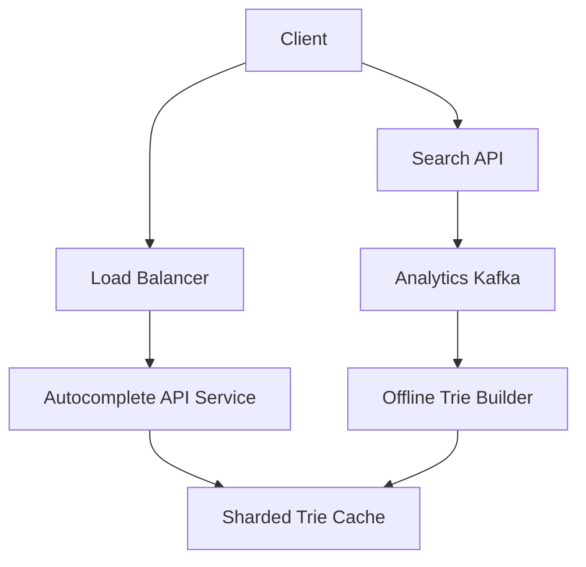
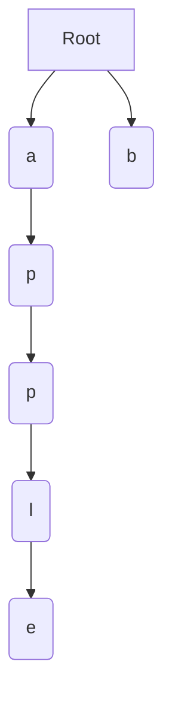
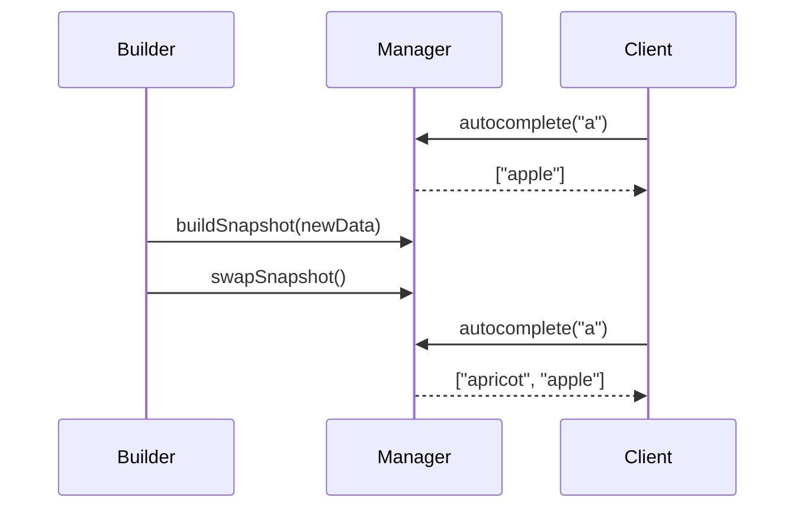

# 📋 HLD Design: Typeahead Autocomplete

> **Evidence Contract Note:** This template adheres to the `curriculum-evidence-contract.md`. 
> Target Layer: [Core] (Required)

---

## 1. 📝 Requirements and Constraints

### Problem Statement
- System to design: Typeahead Autocomplete
- Core user value: Provide fast, relevant search suggestions as users type in a search box, improving search experience and reducing typing effort.

### Functional Requirements
- [x] FR1: System returns top 5 autocomplete suggestions for a given prefix.
- [x] FR2: Suggestions are sorted by popularity/frequency.
- [x] FR3: System tracks search frequencies to update popularity.

### Non-Functional Requirements

| Requirement | Target |
|---|---|
| Availability | 99.99% |
| Read latency | < 50ms |
| Write latency | Async (eventual consistency for updates) |
| Throughput | 100K QPS |

### Constraints
- Must be extremely fast; cannot rely on full table scans in a database.

---

## 2. 📊 Back-of-Envelope Estimation (Only What Changes Design)

### Traffic

| Metric | Value | Formula |
|---|---|---|
| DAU | 10M | input |
| Requests/user/day | 50 (10 searches * 5 keystrokes) | input |
| Daily requests | 500M | DAU × requests/user |
| Avg QPS | ~6,000 | daily / 86400 |
| Peak QPS | ~12,000 | avg × 2 |

### Storage

| Data Type | Avg Size | Daily Volume | 1-Year |
|---|---|---|---|
| Vocabulary | 100M words | N/A | N/A |
| Node storage | ~50 bytes per char | ~5GB for Trie | N/A |

### Decision Notes
- Low latency (<50ms) requirement forces us to use an in-memory structure (Trie).
- We cannot run a DFS on the trie at read time to find top-k; we must cache top-k at each node.

---

## 3. 🔌 API / System Interface

### Core Endpoints
```http
GET /api/v1/autocomplete?prefix=...
```

---

## 4. 🗄️ Core Entities and Data Model

### Core Entities
- TrieNode: contains a char, a map of children, and a cached top-K list.

### Storage Choices
- Primary DB: Distributed Key-Value store to back up trie data for offline building.
- Cache: In-memory Trie across fleet.

---

## 5. 🏗️ High-Level Architecture



### Component List
- API Gateway / Load Balancer
- Autocomplete API Service
- Sharded Trie Cache
- Offline Trie Builder

---

## 6. 🔍 Deep Dives (Pick 1-2)

### Deep Dive A: Trie Structure and Top-K
- Bottleneck: DFS on trie takes too long.
- Chosen pattern: Pre-compute and store top-K at each node during build.



### Deep Dive B: Offline Snapshot Swap
- Consistency model: Eventual. Real-time searches don't immediately affect autocomplete.
- Scaling strategy: Build snapshots offline and swap references to achieve zero-downtime updates.



---

## 8. ⚖️ Trade-offs and Decisions

| Decision | Option Chosen | Alternative | Why Chosen Now | Revisit Trigger |
|---|---|---|---|---|
| Trie Update | Offline Swap | Online Real-time | Avoid write contention | Extreme real-time needs |

---

## 9. 🔮 Follow-up Questions

1. What changes at 10x scale?
2. How do you handle hot shards?

---

## 11. 🚨 Common Pitfalls (Self-Check)

- [x] I skipped clarifying requirements
- [x] I did estimates that did not influence design

---

## 12. 🧮 Scoring Rubric (Self-Evaluation)

| Dimension | 1 (Weak) | 3 (Okay) | 5 (Strong) | Your Score |
|---|---|---|---|---|
| Architecture clarity | Boxes only | Basic flow | End-to-end + failure-aware | 5 |

---

## 13. ✅ Wrap-up Summary (Final 60-90 Seconds)

We designed an autocomplete system backed by an in-memory Trie caching top-k terms at each node, with offline snapshot building for scalability.

---

## 14. 🛑 Bottlenecks and Failure Modes

| Component | Failure Mode | Mitigation | Impact | Detection | Recovery |
|---|---|---|---|---|---|
| API | Node crash | ASG | Minimal | 5xx | Restart |
| Trie Cache | Memory exhausted | Monitor limits | Crash | Metric | Scale out |

## 15. 📈 Scaling Stages

- **10K Users**: Single monolith, simple DB.
- **1M Users**: Microservices, robust cache.
- **100M+ Users**: Sharded databases, distributed edge nodes.

## 16. Further Explanations on Sharding

Sharding a trie is crucial when the vocabulary and top-k lists become too large to fit in a single node's memory. A typical approach is to shard based on the first character of the word. For example, if we have 26 letters in the alphabet, we can have 26 shards. However, the distribution of words starting with each letter is not uniform. For example, there are many more words starting with 's' or 'c' than 'x' or 'z'. This can lead to hot shards.

To handle hot shards, we can shard based on a hash of the first character or use more granular sharding. For example, we can shard based on the first two characters, or dynamically split shards when they become too large. In our design, we opted for a simple prefix-based routing for ease of understanding, but a production system might use consistent hashing or a specialized prefix tree router to evenly distribute the load.

## 17. Further Explanations on Decaying Frequencies

In a system that tracks search frequencies, it's important to decay older frequencies over time. Otherwise, older popular terms will permanently dominate the top-k results, and new trends will not be reflected. We achieve this by periodically decaying the frequencies of all terms in the trie.

For example, we might multiply all frequencies by 0.9 every day. This means that a term that was searched 100 times yesterday will have its frequency reduced to 90 today. This allows new terms that are searched frequently today to overtake older terms that are no longer being searched as frequently.


## 18. Analytics Integration

The Analytics Kafka topic is a critical piece for building the offline trie snapshot. By streaming every search query into a distributed log, we decouple the real-time search traffic from the heavy batch processing required to recalculate the top-K frequencies.

A spark streaming job or a flink cluster can consume these logs, aggregate the counts over a tumbling window, and then merge them with the existing historical counts (applying the decay factor). Once the new aggregated data is ready, it writes the new Trie structure into an object store or a distributed key-value store, which the API servers then pull to perform the offline snapshot swap.
