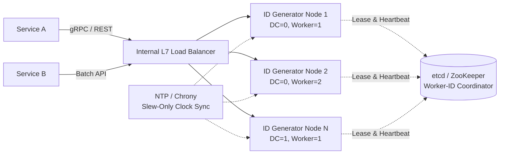

# 📋 HLD Design: Unique ID Generator

> **Evidence Contract Note:** This document adheres to the `curriculum-evidence-contract.md`.
> Target Layer: Core
> Scale figures below are scenario assumptions for interview sizing. Runnable prototypes live in [`java/`](./java/) (`TicketServer.java`, `UUIDGen.java`, `Snowflake.java`) and [`python/`](./python/) (`v1_ticket.py`, `v2_uuid.py`, `v3_snowflake.py`).

> **How this pack differs from [`distributed-unique-id-snowflake`](../distributed-unique-id-snowflake/DESIGN.md):** This pack covers the full evolutionary progression across ID generation strategies — comparing database ticket servers, UUIDv4/UUIDv7, ULID, and 64-bit Snowflake-style generators, including both single and batch allocation APIs and matching v1–v3 reference implementations. The sibling [`distributed-unique-id-snowflake`](../distributed-unique-id-snowflake/DESIGN.md) pack zooms in exclusively on a single-ID Snowflake deployment backed by ZooKeeper ephemeral sequential nodes.

---

## 1. 📝 Requirements and Constraints

### Problem Statement
- **System to design:** A distributed unique ID generator service for high-throughput microservices and sharded databases ([`PROBLEM.md`](./PROBLEM.md), [`APPROACH.md`](./APPROACH.md)).
- **Core user value:** Issue globally unique, roughly time-ordered 64-bit numeric identifiers with sub-millisecond local generation and zero cross-node coordination on the hot path.

### Functional Requirements
- [x] **FR1 (Single ID Generation):** Return a globally unique, positive 64-bit integer ID on demand.
- [x] **FR2 (Batch ID Generation):** Return a contiguous or time-ordered batch of `N` unique IDs in a single call to amortize network overhead for bulk writers.
- [x] **FR3 (Time Sortability):** IDs generated later sort numerically greater than IDs generated earlier (strictly monotonic per node, roughly monotonic across nodes within clock-skew bounds).
- [x] **FR4 (Multi-Datacenter Operation):** Support independent ID generation across multiple availability zones and regions without cross-region round trips.

### Non-Functional Requirements

| Requirement | Target |
|---|---|
| Availability | 99.999% (no single point of failure; survives node or AZ loss) |
| Latency | < 2 ms P99 over internal RPC (< 10 µs local bit assembly) |
| Throughput | 100,000 avg IDs/sec; 500,000+ peak IDs/sec globally (4.096M/sec/node ceiling) |
| Uniqueness | 100% collision-free across all nodes and restarts |
| Format | Fits in signed 64-bit integer (`BIGINT`) for compact B-tree primary keys |
| Lifespan | 69+ years from custom epoch before timestamp wraparound |

### Constraints & Out of Scope
- **Constraints:** Numeric 64-bit output; must tolerate NTP clock adjustments and container restarts without issuing duplicate IDs.
- **Out of Scope:** Cryptographic unpredictability (IDs are not security tokens), strict global linearizability across datacenters, and storing entity payloads alongside IDs.

---

## 2. 📊 Back-of-Envelope Estimation (Only What Changes Design)

### Traffic & Throughput

| Metric | Value | Formula / Basis |
|---|---|---|
| Average global demand | 100,000 IDs/sec | Scenario baseline across microservices |
| Peak global demand (5× burst) | 500,000 IDs/sec | 100K × 5 |
| Per-node ceiling (12-bit sequence) | 4,096 IDs/ms (4,096,000 IDs/sec) | $2^{12} \times 1,000\text{ ms/sec}$ |
| Max concurrent nodes (10-bit node ID) | 1,024 nodes | $2^{5}\text{ DCs} \times 2^{5}\text{ workers/DC}$ |
| Theoretical cluster ceiling | ~4.19B IDs/sec | $1,024 \times 4.096\text{M IDs/sec}$ |
| Outbound bandwidth at peak (500K/s) | ~4 MB/s raw (~40 MB/s JSON) | $500\text{K} \times 8\text{ B}$ raw; ~80 B/ID in JSON |

### Storage & Lifespan

| Resource | Estimate | Notes |
|---|---|---|
| Timestamp range (41 bits, ms) | $2^{41} \approx 2.199 \times 10^{12}\text{ ms} \approx 69.7\text{ years}$ | Measured from custom epoch (e.g., `2025-01-01T00:00:00Z`) |
| Coordination metadata (etcd/ZK) | < 1 MB total | 1,024 lease records × ~256 bytes each |
| Per-node local state | < 1 KB RAM + 64-byte watermark file | `datacenterId`, `workerId`, `lastTimestamp`, `sequence` |

### Decision Notes
- **One node can theoretically saturate 4M IDs/sec**, so fleet size is driven by **high availability and regional proximity** (e.g., 3+ nodes per AZ) rather than raw CPU capacity.
- **500K+ peak IDs/sec rules out a single database auto-increment table** (write lock contention) and favors lock-free in-memory bit composition with an out-of-band lease coordinator.
- **Batch endpoints cut RPC overhead by 10–100×** for bulk ingestion pipelines that would otherwise spend most of their budget on network round trips.

---

## 3. 🔌 API / System Interface

### External Contract
- **Protocol:** gRPC (Protobuf) for internal service-to-service calls (minimal serialization overhead) and REST/JSON over HTTPS behind an internal L7 load balancer for polyglot clients.
- **Auth & Rate Limiting:** Mutual TLS (mTLS) or signed service tokens; per-caller token-bucket rate limits to prevent a runaway client from exhausting a node's 4,096/ms sequence budget.
- **Serialization Rule:** Always return 64-bit IDs as decimal **strings** in JSON (e.g., `"718294051293847552"`) because JavaScript `Number` loses integer precision above $2^{53} - 1$.

### Core Endpoints

#### 1. Generate Single ID
```http
POST /api/v1/ids
Authorization: Bearer <service-token>
```
**Response (`200 OK`):**
```json
{
  "id": "718294051293847552",
  "timestamp_ms": 1764288000123,
  "datacenter_id": 2,
  "worker_id": 14
}
```

#### 2. Generate Batch IDs
```http
POST /api/v1/ids/batch
Authorization: Bearer <service-token>
Content-Type: application/json

{
  "count": 100
}
```
**Response (`200 OK`):**
```json
{
  "count": 100,
  "ids": [
    "718294051293847553",
    "718294051293847554",
    "..."
  ],
  "node_id": 78
}
```
- `count` is capped (e.g., `1 <= count <= 1000`) so a single request cannot starve other callers within the same millisecond.

### Error Model
- `400 Bad Request`: `count` missing, non-integer, or outside `[1, 1000]`.
- `401 / 403`: Missing or unauthorized service identity.
- `429 Too Many Requests`: Caller exceeded per-service QPS quota; includes `Retry-After`.
- `503 Service Unavailable`: Node detected a backward clock jump beyond the wait threshold, lost its worker-ID lease, or is draining; load balancer retries transparently on a healthy peer.

---

## 4. 🗄️ Core Entities and Data Model

### 64-Bit Snowflake-Style Layout

```text
 0 | 00000000000000000000000000000000000000000 | 00000 | 00000 | 000000000000
 ^ |<-------------- 41 bits ---------------->|<-5b-->|<-5b-->|<--12 bits-->
 |                    |                         |       |          |
Sign        Timestamp offset (ms)             DC ID  Worker ID  Sequence
(0)         from custom epoch                (0-31)   (0-31)    (0-4095)
```

| Field | Bits | Range | Purpose |
|---|---|---|---|
| Sign bit | 1 | `0` | Guarantees non-negative signed 64-bit `BIGINT` values |
| Timestamp offset | 41 | `0 .. 2,199,023,255,551` ms | Milliseconds since custom epoch (~69.7 years); provides time ordering |
| Datacenter ID | 5 | `0 .. 31` | Isolates up to 32 datacenters/regions without cross-region coordination |
| Worker ID | 5 | `0 .. 31` | Identifies up to 32 active generator nodes per datacenter (1,024 total) |
| Sequence | 12 | `0 .. 4,095` | Disambiguates up to 4,096 IDs generated on the same node within 1 ms |

Bit composition:
```text
id = ((now_ms - CUSTOM_EPOCH) << 22) | (datacenter_id << 17) | (worker_id << 12) | sequence
```

### Storage & State Model
- **Hot Path (In-Memory Only):** Each generator node holds `(datacenter_id, worker_id, last_timestamp_ms, sequence)` protected by a lightweight lock or atomic CAS loop. Zero database or disk I/O occurs per ID.
- **Coordination Store (etcd / ZooKeeper):** Stores leased worker slots keyed by `/idgen/dc/{dc_id}/worker/{worker_id}` with fields `{ host_id, lease_id, ttl_sec, last_watermark_ms }`.
- **Local High-Water Mark:** Periodically (e.g., every 1–5 seconds) flushes `last_timestamp_ms` to local disk or the coordination lease metadata so a restarted host never initializes its clock behind IDs it already emitted.

---

## 5. 🏗️ High-Level Architecture



### Generation Flow (Single & Batch)
1. Client sends `POST /api/v1/ids` (or `/batch`) to the internal load balancer, which routes to any healthy generator node in the local AZ.
2. Generator verifies its worker-ID lease is still valid (local deadline check, no network call).
3. Generator reads `now_ms`. If `now_ms < last_timestamp_ms`, it enters the clock-rollback handler (Section 6).
4. If `now_ms == last_timestamp_ms`, it increments `sequence = (sequence + 1) & 4095`. If `sequence` wraps to `0` (or remaining slots in the current millisecond cannot satisfy a batch), it spins/waits until `now_ms > last_timestamp_ms` and resets `sequence = 0`.
5. It composes the 64-bit integer(s), updates `last_timestamp_ms`, and returns stringified ID(s) to the caller.

---

## 6. 🔍 Deep Dives: Failure Paths & Recovery

### Deep Dive A: Clock Rollback Handling (NTP Backward Steps)
Wall clocks drift and NTP daemons can step system time backward, risking duplicate `(timestamp, node_id, sequence)` tuples ([`PITFALLS.md`](./PITFALLS.md)).
- **Prevention:** Configure Chrony/NTP in **slew-only mode** (gradually adjust clock frequency instead of jumping backward) and enforce a **monotonic clock offset** anchored at boot (`boot_wall_ms + (monotonic_ms - boot_monotonic_ms)`).
- **Tiered Runtime Recovery:**
  - **Small rollback (≤ 5 ms):** Sleep for the drift window until `now_ms >= last_timestamp_ms`, then continue generating.
  - **Moderate rollback (5–50 ms):** Either reject with `503` so the load balancer immediately retries on a healthy peer, or advance a logical timestamp watermark if slight future-time skew is acceptable.
  - **Severe rollback (> 50 ms):** Fail fast (`503 Service Unavailable`), fail the readiness health check so the load balancer ejects the node, and page operators to inspect NTP health.
- **Restart Protection:** On startup, compare system clock against the persisted `last_watermark_ms` stored in the node's lease record (or local disk). Refuse to serve until `now_ms > last_watermark_ms`.

### Deep Dive B: Node-ID Assignment & Lease Failures
Because only 1,024 `(datacenter_id, worker_id)` pairs exist, two nodes holding the same `worker_id` simultaneously will produce colliding IDs.
- **Lease Acquisition:** On startup, a node atomically claims an unused slot in etcd/ZooKeeper with a short TTL (e.g., 30 s) and renews it every 10 s.
- **Network Partition / GC Pause (Split-Brain Fencing):** Each node tracks `lease_expiry_monotonic_ms` locally. If renewal fails and remaining lease margin drops below a safety buffer (e.g., 5 s), the node **immediately stops issuing IDs** (`503`) before etcd/ZooKeeper can expire and hand the slot to another host.
- **Reassignment Cool-Down:** Released worker slots enter a short cool-down period (e.g., 60 s) or carry the previous `last_watermark_ms` so a newly booted node with slight clock skew cannot overlap timestamps issued by the previous holder.
- **Coordinator Outage:** Existing nodes continue serving until their local lease buffer expires; for sustained coordinator outages, operators can fall back to static StatefulSet ordinal / host-range mappings.

---

## 7. ⚖️ Comparison of ID Generation Approaches

| Strategy | Size & Type | Time-Sortable | Coordination Required | B-Tree Index Locality | Failure / Trade-off Profile | Best Fit |
|---|---|---|---|---|---|---|
| **UUIDv4 (Random)** | 128-bit hex string / binary | No | None (fully local) | Poor (random page splits, cache thrashing) | Zero ops overhead; doubles index size vs 64-bit | Opaque tokens, trace IDs, non-clustered keys |
| **UUIDv7 (RFC 9562)** | 128-bit (48-bit ms ts + random) | Yes (ms precision) | None (fully local) | Good (append-only right edge) | 128-bit footprint exceeds 64-bit `BIGINT` | Systems needing coordination-free sortable IDs without 64-bit cap |
| **ULID** | 128-bit (48-bit ms ts + 80-bit random, Base32) | Yes (lexicographical) | None (fully local) | Good (monotonic mode supported) | 26-char string / 128-bit binary; non-numeric | URL-friendly sortable IDs in document/KV stores |
| **DB Ticket Server (Stepped Auto-Increment)** | 64-bit `BIGINT` | Strictly per server; approximate across shards | Central DB pair (e.g., odd/even step) | Excellent (sequential) | Write bottleneck & failover complexity; hard to add shards dynamically | Low-to-moderate write apps already running relational DBs |
| **Snowflake-Style (Chosen)** | 64-bit `BIGINT` | Yes (41-bit ms ts + seq) | Lightweight startup lease (etcd/ZK) | Excellent (append-only, compact 8 B) | Requires NTP skew guard, worker-ID lease fencing, 69-year epoch plan | High-throughput distributed systems needing compact 64-bit sortable keys |

---

## 8. 🛑 Bottlenecks and Failure Modes

| Component | Failure Mode | Detection | Impact | Mitigation & Recovery |
|---|---|---|---|---|
| Host Clock (NTP) | Backward clock step | `now_ms < last_timestamp_ms` counter | Risk of duplicate IDs if unchecked | Slew-only NTP; sleep ≤ 5 ms; fail fast (`503`) and eject node > 5 ms |
| Sequence Counter | > 4,096 IDs/ms on one node | Sequence wrap / wait-loop latency metric | Brief (< 1 ms) tail latency bump | Cap batch sizes (≤ 1,000), scale out generator replicas, or use client-side batch prefetch |
| etcd / ZooKeeper | Partition or quorum loss | Failed lease renewal heartbeats | New nodes cannot join; active nodes pause when lease safety margin expires | Multi-AZ 5-node quorum; fencing stops generation before expiry; static ordinal fallback |
| Generator Node | Crash / OOM / abrupt reboot | L7 health-check failure | Brief connection reset; zero lost state | Load balancer reroutes retries; new node waits out slot cool-down / watermark |
| Custom Epoch | 41-bit timestamp exhaustion (~69.7 yrs) | Long-term epoch-age monitor | Bit overflow into sign bit | Plan v2 epoch migration or 128-bit transition years before exhaustion |

---

## 9. ✅ Wrap-up Summary & Cross-Links

To deliver 500K+ peak IDs/sec with 64-bit time-sortable keys, we use a stateless fleet of Snowflake-style generator nodes serving single and batch RPCs, backed by etcd/ZooKeeper for 10-bit worker-ID leases and protected by slew-only NTP plus lease-expiry fencing. The core trade-off is accepting lightweight startup coordination and clock-skew safeguards (compared to coordination-free 128-bit UUIDv7/ULID) to keep primary keys compact at 64 bits.

- [Problem Statement](./PROBLEM.md) | [Approach](./APPROACH.md) | [Comparison](./COMPARISON.md)
- [Common Pitfalls](./PITFALLS.md) | [Rubric](./RUBRIC.md) | [Follow-ups](./FOLLOW-UPS.md) | [Strong Answer](./STRONG-ANSWER.md)
- Related deep dive: [Distributed Unique ID Generator (Snowflake)](../distributed-unique-id-snowflake/DESIGN.md)
