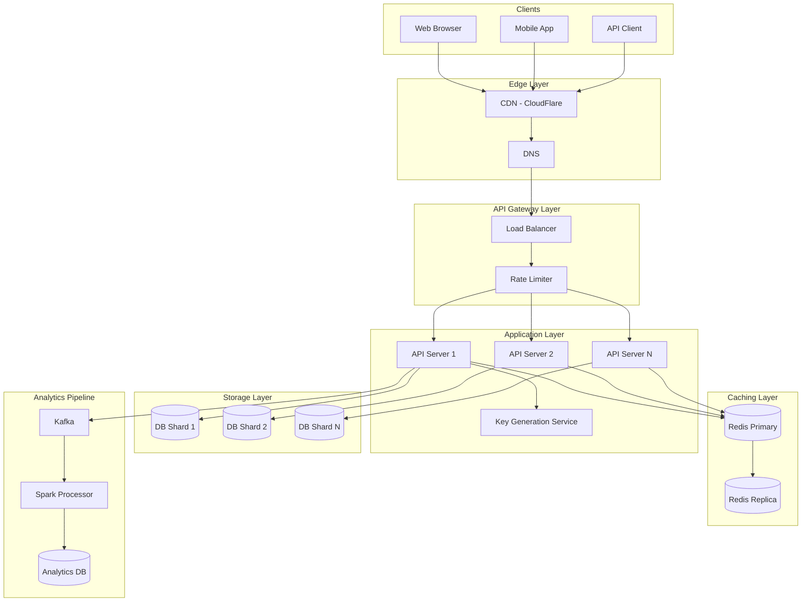
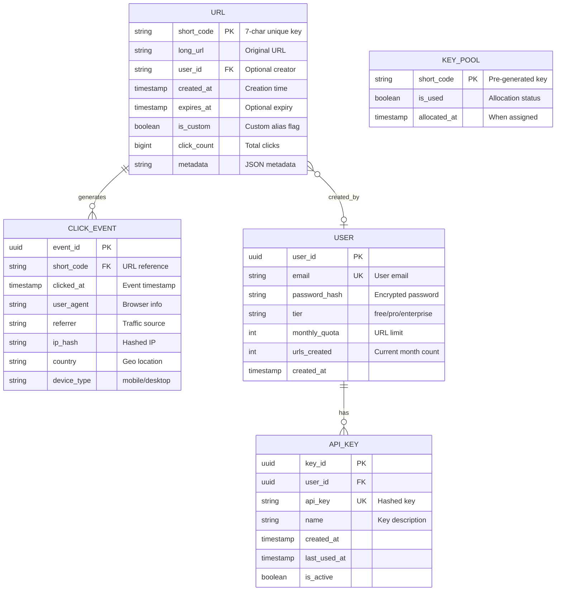
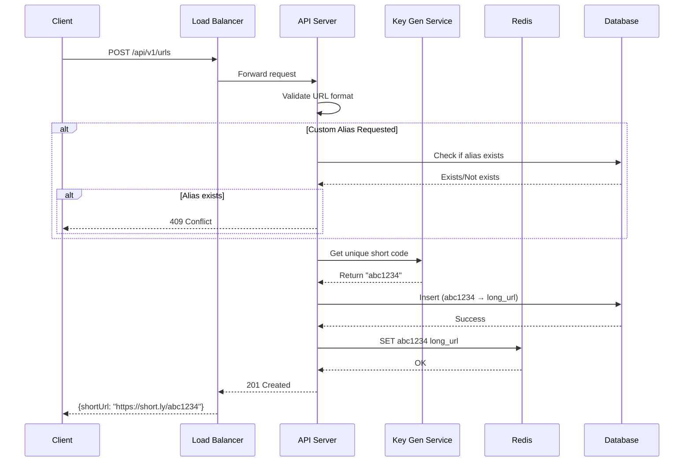
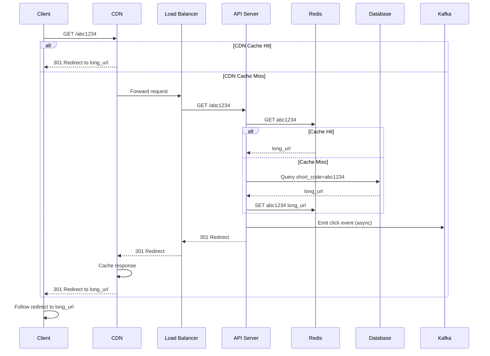

# URL Shortener System Design

Complete high-level design for a URL shortening service.

---

## Overview

This document describes the architecture for a highly available, low-latency URL shortening service capable of handling 10 billion redirects per month.

### Architecture Diagram



---

## Detailed Architecture Sections

### 1. Client Layer

**Supported Clients:**
- Web browsers (redirect flow)
- Mobile applications (SDK integration)
- Third-party API consumers (programmatic access)

**Client Responsibilities:**
- Make HTTP requests to shorten URLs
- Handle 3xx redirects automatically
- Implement retry logic with exponential backoff

### 2. Edge Layer (CDN + DNS)

**CDN (CloudFlare/CloudFront):**
- Cache redirect responses at edge locations
- Reduce latency for global users
- DDoS protection
- SSL termination

**DNS Configuration:**
- Low TTL for flexibility
- Multiple A records for redundancy
- GeoDNS for multi-region routing

**Caching Strategy at Edge:**
```
Cache-Control: public, max-age=86400
Vary: Accept-Encoding

Cache key: short_code only
Cache duration: 24 hours for 301 redirects
No cache: 302 redirects, errors
```

### 3. API Gateway Layer

**Load Balancer (ALB/NLB):**
- L7 load balancing for HTTP traffic
- Health checks every 10 seconds
- Sticky sessions NOT needed (stateless)
- Algorithms: Round-robin or least-connections

**Rate Limiter:**
- Token bucket algorithm
- Limits per IP: 100 requests/minute for creation
- Limits per IP: 1000 requests/minute for redirects
- Return 429 when exceeded

### 4. Application Layer

**API Servers (Stateless):**
- Handle URL shortening requests
- Handle redirect requests
- Validate input URLs
- Coordinate with cache and database

**Key Generation Service (KGS):**
```
Responsibilities:
- Pre-generate unique 7-character codes
- Maintain pool of unused codes
- Distribute codes to API servers in batches

Implementation:
- Separate service/database for key management
- API servers request batch of 1000 keys
- Mark keys as "in-use" atomically
- Replenish pool in background
```

### 5. Caching Layer

**Redis Cluster Configuration:**
```
Topology:
- 3 master nodes + 3 replica nodes
- Hash slot distribution: 0-5460, 5461-10922, 10923-16383

Data Structure:
- Key: short_code
- Value: long_url
- TTL: 86400 seconds (24 hours)

Commands:
GET abc1234              → "https://example.com/..."
SET abc1234 "..." EX 86400
```

**Cache Patterns:**
- **Read-through**: Populate cache on miss
- **Write-behind**: Async cache update on create
- **LRU eviction**: When memory limit reached

### 6. Storage Layer

**Database Choice: DynamoDB/Cassandra**

**Table Schema:**
```
Table: urls
├── short_code      (Partition Key)  String
├── long_url                         String
├── created_at                       Timestamp
├── expires_at                       Timestamp (nullable)
├── user_id                          String (nullable)
├── click_count                      Number
├── is_custom                        Boolean
└── metadata                         Map
```

### Entity-Relationship Diagram



**Schema Notes:**
- **Partitioning**: URLs table sharded by `short_code` hash for even distribution
- **Hot Keys**: Popular URLs cached in Redis, not queried from DB
- **Click Events**: Stored in time-series optimized table (Cassandra/ClickHouse)
- **Key Pool**: Separate table for pre-generated keys, managed by KGS
- **Indexes**: 
  - `URL(user_id)` for user's URL listing
  - `CLICK_EVENT(short_code, clicked_at)` for analytics
  - `KEY_POOL(is_used)` for key allocation

**Sharding Strategy:**
```
Partition Key: short_code
Number of Shards: 10 (scales with traffic)
Shard Selection: hash(short_code) % num_shards

Benefits:
- Even data distribution
- No hot partitions (random codes)
- Simple single-key lookups
```

**Replication:**
```
Replication Factor: 3
Consistency Level: 
  - Writes: Quorum (2/3)
  - Reads: One (fast, eventually consistent)
```

### 7. Analytics Pipeline

**Click Tracking Flow:**
```
1. Redirect request arrives
2. API server sends event to Kafka
3. Spark streaming aggregates clicks
4. Write aggregates to Analytics DB
5. API reads from Analytics DB for stats
```

**Event Schema:**
```json
{
    "event_type": "redirect",
    "short_code": "abc1234",
    "timestamp": "2024-01-15T10:30:00Z",
    "user_agent": "Mozilla/5.0...",
    "referrer": "https://twitter.com",
    "ip_hash": "a1b2c3...",
    "country": "US"
}
```

### 8. Observability

**Metrics (Prometheus/CloudWatch):**
```
- url_creations_total (counter)
- redirects_total (counter)
- redirect_latency_ms (histogram)
- cache_hit_ratio (gauge)
- database_query_latency_ms (histogram)
- error_rate_5xx (counter)
```

**Logging (ELK/CloudWatch Logs):**
```
- Request/response logs (sampled 10%)
- Error logs (100%)
- Audit logs for URL creation
```

**Tracing (Jaeger/X-Ray):**
```
- Trace ID propagation
- Span for: API → Cache → Database
- Latency breakdown analysis
```

---

## Sequence Diagrams

### Core Write Flow: Create Short URL



### Core Read Flow: Redirect



---

## Trade-offs

### Consistency vs Availability

| Choice | Implication |
|--------|-------------|
| **Chose: Availability** | System stays up even if some nodes fail |
| Trade-off | Newly created URLs might not be immediately accessible everywhere |
| Mitigation | Cache-aside pattern ensures eventual consistency |
| When it matters | Multi-region deployments with replication lag |

### Latency vs Cost

| Choice | Implication |
|--------|-------------|
| **Chose: Low Latency** | Redis caching, CDN at edge |
| Trade-off | Higher infrastructure costs |
| Numbers | Cache costs ~$500/month, saves 80% DB load |
| Alternative | Accept higher latency, reduce cache size |

### Simplicity vs Flexibility

| Choice | Implication |
|--------|-------------|
| **Chose: Simplicity** | Single key lookup, no complex queries |
| Trade-off | Limited analytics, no complex URL management |
| Benefit | Easy to scale, maintain, debug |
| When to reconsider | Advanced features like A/B testing on URLs |

### 301 vs 302 Redirects

| Choice | Implication |
|--------|-------------|
| **Chose: 301 (Permanent)** | Better for SEO, browser caches |
| Trade-off | Analytics might miss repeat visits |
| Alternative | 302 for marketing campaigns needing accurate counts |
| Recommendation | Make configurable per URL |

### Pre-generated vs On-demand Keys

| Choice | Implication |
|--------|-------------|
| **Chose: Pre-generated (KGS)** | Fast, no collision handling |
| Trade-off | Need to manage key pool, slightly complex |
| Benefit | Eliminates coordination overhead |
| Alternative | Counter-based (simpler but SPOF) |

---

## Component Summary

| Component | Technology | Purpose | Scaling |
|-----------|------------|---------|---------|
| CDN | CloudFlare | Edge caching | Global PoPs |
| Load Balancer | AWS ALB | Traffic distribution | Auto-scaling |
| API Servers | Java/Python | Business logic | Horizontal (10-100) |
| Cache | Redis Cluster | Hot data | 6 nodes |
| Database | DynamoDB | Persistent storage | Auto-sharding |
| Key Generator | Custom service | Unique IDs | 3 instances |
| Analytics | Kafka + Spark | Click tracking | Partitioned topics |

---

## Capacity Planning

### Current Design Handles

| Metric | Capacity | Headroom |
|--------|----------|----------|
| Redirects/sec | 12,000 peak | 3x design |
| URL creations/sec | 120 peak | 3x design |
| Storage | 5 TB | 5 years |
| Cache | 10M URLs | Top 0.2% |

### Storage Calculation Breakdown

- **Raw Payload Data**: ~1 TB for 5 years (6 billion URLs * 160 bytes)
- **Indexing Overhead**: 1.5x B-Tree secondary indexing overhead on `(user_id, created_at, domain)` = ~1.5 TB
- **Replication**: 3x database replication across availability zones (1.5 TB * 3 = 4.5 TB)
- **Cache Headroom**: Redis hot-key cache headroom
- **Total**: ~5 TB total cluster disk footprint

### Scaling Triggers

| Metric | Threshold | Action |
|--------|-----------|--------|
| CPU > 70% | API servers | Add more instances |
| Cache hit < 80% | Redis | Increase cache size |
| DB latency > 20ms | Database | Add read replicas |
| Error rate > 0.1% | All | Investigate, scale affected component |

---

## Security Considerations

1. **Input Validation**: Sanitize and validate all URLs
2. **Rate Limiting**: Prevent abuse and DDoS
3. **HTTPS Only**: All traffic encrypted
4. **URL Scanning**: Integrate with safe browsing APIs
5. **No PII in URLs**: Avoid logging sensitive data
6. **Short Code Unpredictability**: Random codes prevent enumeration

---

## Failure Scenarios

| Failure | Impact | Mitigation |
|---------|--------|------------|
| Cache down | DB overload | Circuit breaker, cache redundancy |
| DB primary down | No writes | Automatic failover to replica |
| KGS down | No new URLs | Key pools on API servers, multiple KGS |
| CDN down | Higher latency | Fallback to origin, multi-CDN |
| Region down | Partial outage | Multi-region active-active |

---

*See [APPROACH.md](./APPROACH.md) for detailed thought process and [diagrams/](./diagrams/) for additional diagrams.*

---

## 🐍 Python Ecosystem Notes

### Possible Python Tech Stack

| Component | Technology | Notes |
|-----------|------------|-------|
| API Framework | **FastAPI** | Async, auto-docs (OpenAPI), high throughput for redirect handling |
| Cache | **redis-py** (async) | `aioredis` or `redis[hiredis]` for fast URL lookups |
| Database | **asyncpg** (PostgreSQL) or **motor** (MongoDB) | Async drivers for non-blocking DB access |
| Key Generation | `secrets.token_urlsafe()` or `uuid.uuid4()` + Base62 encoding | Standard library; use `secrets` for unpredictable codes, `hashlib` (SHA-256) + collision handling as an alternative |
| Rate Limiting | **FastAPI middleware** or **slowapi** | Token bucket / sliding window at the API gateway |
| Task Queue | **Celery** + Redis/RabbitMQ | For analytics aggregation and URL expiration cleanup |
| Deployment | **uvicorn** + **gunicorn** (workers) | Process-based scaling to bypass the GIL |

### Key Python Constraints

- **GIL & Concurrency**: Redirect lookups are I/O-bound (cache/DB reads), so `async/await` with FastAPI + uvicorn handles high concurrency well. CPU-bound hashing is negligible.
- **Base62 Encoding**: Easily implemented with `string.ascii_letters + string.digits` and modular arithmetic — no external library needed.
- **Connection Pooling**: Use `asyncpg.create_pool()` or SQLAlchemy async sessions to manage DB connections efficiently under load.
- **Deployment**: Run multiple uvicorn workers behind gunicorn (`gunicorn -k uvicorn.workers.UvicornWorker`) for multi-core utilization.

### See Also

- **LLD**: [`02-lld-projects/lru-cache`](../../02-lld-projects/lru-cache/) — Cache eviction mechanics used in URL caching
- **HLD Concept**: [`03-hld-concepts/caching`](../../03-hld-concepts/caching/) — Write-through and TTL-based caching patterns
- **HLD Concept**: [`03-hld-concepts/rate-limiting`](../../03-hld-concepts/rate-limiting/) — Rate limiter implementations

---

## 🤖 GenAI Extension

> How could this system be augmented with LLMs? Below are interview-ready ideas that connect this classical HLD to GenAI patterns. For full GenAI system designs, see [06-genai-systems/](../../06-genai-systems/).

### Potential LLM-Powered Features

| Feature | Description | GenAI Components |
|---------|-------------|-----------------|
| **Link Summarization** | When a short URL is created, generate a one-line summary of the destination page to display in analytics dashboards or preview cards | Chunker, prompt builder, LLM service |
| **Smart Analytics Descriptions** | Use an LLM to generate natural-language summaries of click analytics (e.g., "Traffic spiked 3× on Tuesday, mostly from Twitter") | Prompt builder, LLM service |
| **URL Safety Classification** | Classify destination URLs for phishing, malware, or inappropriate content using an LLM alongside traditional safe-browsing APIs | Safety filter, LLM classifier |

### Integration Points

```
Existing URL Shortener Pipeline:
  Create URL → KGS → Store → Cache → Redirect

With GenAI Extension:
  Create URL → KGS → Store → Cache → Redirect
                 │
                 └→ Async: Fetch page → Chunk → Summarize (LLM) → Store summary
                 └→ Async: Classify safety (LLM) → Flag if suspicious
```

### Trade-offs

- **Cost**: LLM calls add ~$0.002–0.01 per URL for summarization — use async processing and cache results
- **Latency**: Run summarization asynchronously via message queue; never block URL creation
- **Accuracy**: LLM summaries may be imperfect — use as supplementary info, not primary data

### Learn More

- [GenAI Concepts: RAG Architecture](../../06-genai-systems/00-concepts/rag-architecture/) — Retrieval patterns applicable to page summarization
- [GenAI Concepts: Safety & Governance](../../06-genai-systems/00-concepts/safety-governance/) — Content classification with LLMs
- [GenAI Study Plans](../../resources/study-plans/genai-crash-track.md) — Prepare for GenAI interview questions
