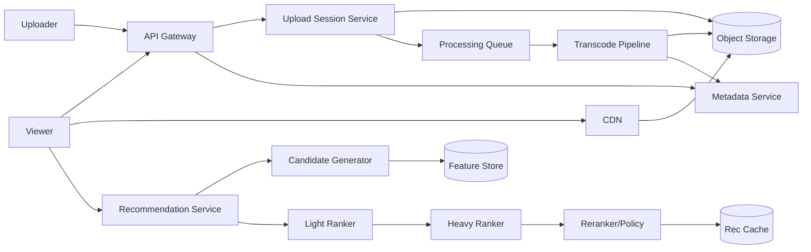

# Video Streaming — High-Level Design

## 1) Requirements and Constraints

- Reliable large-blob upload and processing lifecycle.
- Low startup latency, low rebuffer playback.
- Recommendation quality improvements within tight read-path latency.
- Cost-aware origin and ranking compute usage.
- Safe recommendation behavior under cold-start and feedback-loop risk.

## 2) Back-of-Envelope Estimates

- **Uploads:** 1M/day -> ~11.6 uploads/s average, burst much higher.
- **Watches:** 100M/day -> ~1.1K watch starts/s average.
- **Recommendation calls:** often exceed watch starts (home refresh + watch-next).
- **Raw Video Ingest Storage:** 1M uploads/day * 500 MB avg raw video = 500 TB/day = 182.5 PB/year.
- **Transcoding Storage Expansion:** Each video encoded into 5 ABR (Adaptive Bitrate) profiles (1080p, 720p, 480p, 360p, 240p) with H.264/AV1. The transcoded profiles total ~1.25x the raw size (625 TB/day transcoded = 228 PB/year); total storage = 1.125 PB/day.
- **CDN Egress Bandwidth:** 100M daily views * 15 minutes avg watch * 5 Mbps average bitrate = 45 Petabits/day = ~520 Gbps average egress bandwidth, with 2x peak = 1.04 Terabits/sec egress bandwidth.
- **CDN Edge Cache:** Cache storage at CDN edge PoPs (top 10% popular videos = 90% traffic).
- Egress and transcoding dominate cost; ranking dominates tail latency budget.

## 3) API Contracts

```http
POST /api/v1/uploads/sessions
PUT  /api/v1/uploads/sessions/{sessionId}/parts/{partNumber}
POST /api/v1/uploads/sessions/{sessionId}/complete
GET  /api/v1/videos/{videoId}/manifest
GET  /api/v1/recommendations?userId={userId}&contextVideoId={videoId}&limit={k}
```

## 4) Data Model

- `UploadSession(session_id, video_id, expected_parts, received_parts, status)`
- `VideoAsset(video_id, owner_id, state, source_path, variants)`
- `Manifest(video_id, variant_set, duration, status)`
- `UserEmbedding(user_id, vector, updated_at)`
- `CandidateSet(user_id, context_video_id, candidate_ids, generated_at)`
- `RankedRecommendation(user_id, request_id, video_ids, scores, policy_version)`

## 5) Architecture



### Playback Path

1. Client fetches metadata + manifest.
2. Segment reads go to CDN first; miss goes to origin.
3. Playback metrics stream into observability.

### Recommendation Path

1. Candidate generation from user/context features.
2. Light ranker quickly prunes large candidate set.
3. Heavy ranker applies richer models/features on narrowed set.
4. Reranker enforces policy/diversity/freshness constraints.
5. Response cached briefly for repeated page refreshes.

### Recommendation Latency Budget (p95)

| Stage | Budget |
|---|---|
| Candidate generation | <= 50 ms |
| Light ranker | <= 30 ms |
| Heavy ranker | <= 80 ms |
| Reranker + policy checks | <= 20 ms |
| Network + marshaling headroom | <= 20 ms |
| **Total** | **<= 200 ms** |

## 6) Deep Dives

### A. Resumable Upload Safety

- Idempotent part upload and completion tokens.
- Recovery from interrupted multipart uploads.
- Automatic stale session cleanup.

### B. Multi-Stage Ranking

- Candidate generation for recall.
- Light ranker for latency control.
- Heavy ranker for precision.
- Reranker for explore/exploit balance and content policy constraints.

### C. Feedback Loops and Drift

- Track short-term clicks/watch-time plus long-term retention proxies.
- Guard against self-reinforcing popularity loops.
- Apply exploration budgets and freshness quotas.

### D. Cold Start Strategy

- New users: blend trending, locale, and onboarding intent signals.
- New videos: boost controlled exposure in candidate generation before score stabilization.
- Use exploration slots to gather labels without destabilizing overall quality.

## 7) Trade-Offs

| Decision | Chosen | Alternative | Why |
|---|---|---|---|
| Media processing | async pipeline | inline processing | isolates ingest from heavy compute |
| Delivery | CDN + segmented playback | origin direct streaming | lower latency and origin load |
| Ranking | multi-stage ranking | single heavy model | latency-quality balance |
| Freshness | nearline feature updates | batch-only daily updates | better reactivity to behavior shifts |

## 8) Variants and Extensions

- Live streaming mode with low-latency segments.
- Region-aware recommendation policies.
- Premium content access filters and DRM-aware ranking rules.

See [STRONG-ANSWER.md](./STRONG-ANSWER.md) for a time-boxed strong answer that ties upload safety, playback reliability, and recommendation latency together.

---
**Real-world reference**: See how Netflix solved this in the [Netflix case study](../../case-studies/netflix-streaming/)
