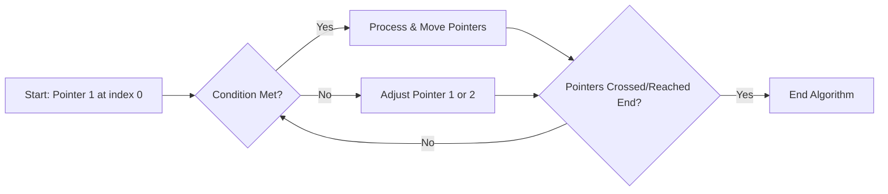

# Two Pointers Theory

## Overview

The Two Pointers technique involves using two distinct variables (pointers) to traverse a linear data structure, typically an array or string. By intelligently moving these pointers based on certain conditions, we can efficiently solve problems involving searching, pairing, or partitioning, often reducing time complexity from $O(N^2)$ to $O(N)$ and requiring $O(1)$ space.

### When to Use Two Pointers
- The input array is sorted (or can be sorted).
- You need to find pairs or triplets satisfying a condition.
- You want to partition an array or remove duplicates in-place.
- You need to find a subarray or interval (often combined with a sliding window).

## Visualizing the Pattern

## System Design Relevance

| Problem Concept | System Design Application | Example |
| :--- | :--- | :--- |
| **Finding Pairs (Two Sum)** | Resource Matching & Load Balancing | Finding two available servers that sum up to a specific capacity requirement. |
| **Partitioning (Sort Colors)** | Data Triage & Categorization | Separating incoming data streams into high, medium, and low priority queues in-place. |
| **In-place compaction (Move Zeroes)** | Log Compaction & Garbage Collection | Reclaiming space in a storage segment by shifting valid records forward. |
| **Boundary Maximization (Container With Most Water)** | Capacity Planning | Finding the optimal time windows for batch processing jobs to maximize resource utilization. |
| **Water Trapping (Trapping Rain Water)** | Flow Control & Buffering | Calculating buffer capacities in rate limiters to handle bursty traffic. |

