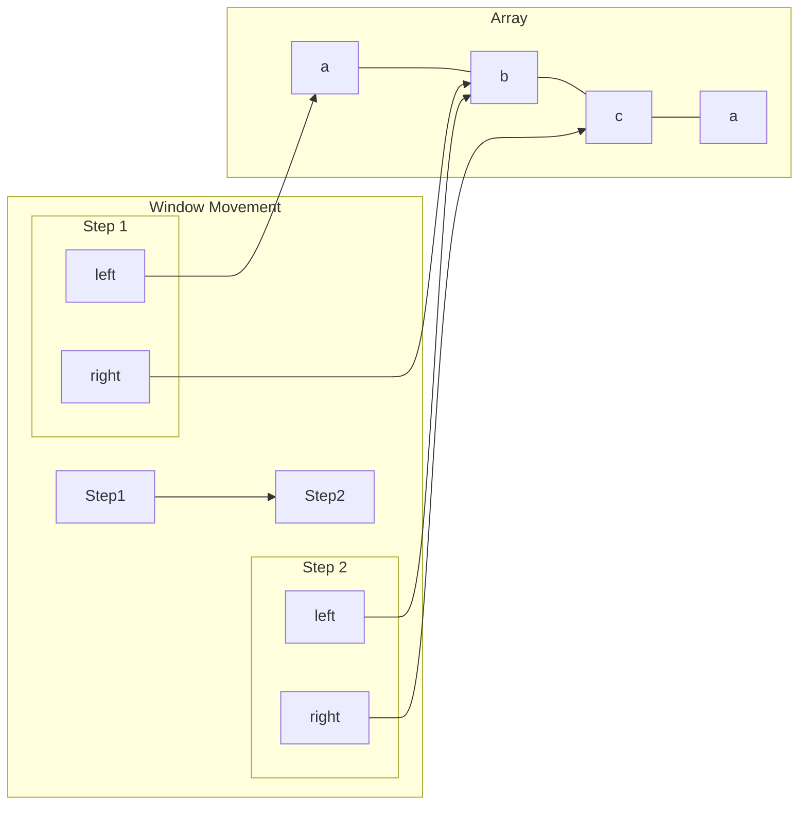

# 🪟 Sliding Window Pattern Pack

A focused coding pattern pack for contiguous ranges, rolling metrics, and interview problems where state can be updated as the range moves.

---

## 📖 Overview

Sliding window maintains a contiguous range over an array, string, stream, or timeline. Instead of recomputing each candidate range from scratch, you update a small state object when the right boundary expands and when the left boundary contracts.

Mental model: a window is a promise about state. If you can say what `[left, right]` contains, what makes it valid, and how to repair it by moving `left`, the code becomes a controlled loop instead of memorized syntax.

Typical forms:

- Fixed-size window for exactly `k` items.
- Variable-size window with a validity predicate.
- Frequency-map window for distinct characters, counts, or multiset matching.
- Monotonic deque window when the best element inside the window must be queried quickly.

---

## ✅ When to Use

Use sliding window when all of these are true:

1. The answer depends on a contiguous subarray, substring, or time range.
2. Window state can be updated when one item enters and one item leaves.
3. Boundaries move monotonically; the algorithm never needs to move `right` backward.
4. For variable windows, shrinking from the left can restore validity once the window becomes invalid.

Strong recognition cues:

- "longest substring with..."
- "minimum length subarray..."
- "count subarrays with at most/exactly..."
- "within the last N seconds/minutes"
- "rolling maximum/average/sum"
- "contains all required characters"

---

## 🚫 When Not to Use

Avoid the basic sliding-window template when:

1. The choice is non-contiguous, such as a subsequence or arbitrary pair.
2. Reordering the data is allowed or required.
3. The state cannot be decremented when the left boundary moves.
4. Negative numbers break monotonic sum reasoning. For many sum constraints with negatives, use prefix sums, hash maps, or dynamic programming instead.
5. The problem needs graph reachability, global optimization, or choices that branch backward.

---

## 🧪 One-Minute Dry Run

Problem: longest substring without repeating characters for `abca`.

| Step | Right char | Window after repair | State | Best |
|---|---|---|---|---|
| 0 | `a` | `a` | `{a}` | 1 |
| 1 | `b` | `ab` | `{a,b}` | 2 |
| 2 | `c` | `abc` | `{a,b,c}` | 3 |
| 3 | `a` | `bca` | remove old `a`, keep latest `a` | 3 |

The key interview move is to repair the invariant before recording the next best answer. For this problem, the invariant is "the window contains no duplicate character."

---

## ⚠️ Common Failure Modes

1. Treating fixed-size and variable-size templates as interchangeable.
2. Recording the answer before restoring validity in minimum-window problems.
3. Shrinking too early in maximum-window problems.
4. Forgetting to delete frequency-map entries when counts drop to zero.
5. Claiming `O(1)` space when the frequency map is really `O(alphabet)`, `O(k)`, or `O(distinct)`.
6. Recomputing max/min inside every window instead of using a monotonic deque.
7. Losing track of inclusive vs half-open window length.

---

## 🧠 Interview Scoring Focus

| Dimension | Strong signal |
|---|---|
| Window invariant | Defines exactly what `[left, right]` contains and what state summarizes |
| Validity predicate | Explains why the window is valid, invalid, too large, or missing requirements |
| Boundary movement | Proves each pointer moves monotonically and at most `n` times |
| State maintenance | Updates sums, counts, distinct values, or deque entries on both add and remove |
| Complexity reasoning | Separates `O(n)` pointer movement from map/deque space costs |
| Follow-up adaptation | Can switch between fixed, variable, counting, frequency-match, and deque variants |

---

## 🗣️ 60-90 Second Answer

Say: "I use sliding window when the answer is a contiguous range and the maintained state can be updated as the range expands or shrinks. I define the invariant first: for at-most or longest-valid problems, I move `left` to repair invalid windows; for at-least or minimum-valid problems, I move `left` while valid to harvest shorter candidates. `right` still moves forward once per element, and `left` also moves at most `n` times, so the loop is linear. Extra space comes from the map, deque, or timestamp queue."

---

## 🏗️ System Design Relevance

| Pattern | System Design Use Case |
|---|---|
| Fixed Window | Rate Limiter, Rolling Metrics |
| Variable Window | Dynamic buffering |

## 🔗 Cross-links

- [Big-O Notation](../../00-theory/complexity-analysis/big-o-notation.md)
- [Common Complexities](../../00-theory/complexity-analysis/common-complexities.md)
- [LLD Rate Limiter](../../02-lld-projects/rate-limiter/)
- [HLD Rate Limiting](../../03-hld-concepts/rate-limiting/THEORY.md)
- [HLD Stream Processing](../../03-hld-concepts/stream-processing/THEORY.md)
- [Ad Click Aggregator HLD](../../04-hld-projects/ad-click-aggregator/)
- [Realtime Metrics Platform HLD](../../04-hld-projects/realtime-metrics-platform/)
- [Sliding Window Quiz](../../quizzes/sliding-window-quiz.md)
- [Sliding Window Flashcards](../../flashcards/sliding-window.md)
- [Coach Answer: Coding Sliding Window](../../solutions/coding-sliding-window.md)
