# Pattern 03: Intervals

## Theory
Interval problems typically involve a set of time durations or coordinate ranges, requiring tasks like merging overlapping segments, checking for intersections, finding unions, or identifying gaps. The canonical approach is to **sort the intervals**—usually by their start times, but occasionally by their end times (e.g., for greedy scheduling). Once sorted, you can iterate through the intervals linearly, maintaining the current segment's bounds and comparing them to the incoming interval to make decisions.

```mermaid
gantt
    title Intervals Overlapping Examples
    dateFormat  X
    axisFormat  %s

    section Merge Example
    Interval 1 [1, 3]  : 1, 3
    Interval 2 [2, 6]  : 2, 6
    Merged [1, 6]      : 1, 6

    section Non-Overlapping
    Interval 3 [8, 10] : 8, 10
    Interval 4 [15, 18]: 15, 18
```

## System Design Relevance
| Concept | Use Case |
|---------|----------|
| Calendar | Merging user availability to find free meeting slots across different schedules. |
| Booking | Determining if a new booking conflicts with existing reservations for a resource. |
| Range Locks | Managing database row range locking and preventing deadlocks in distributed transactions. |

