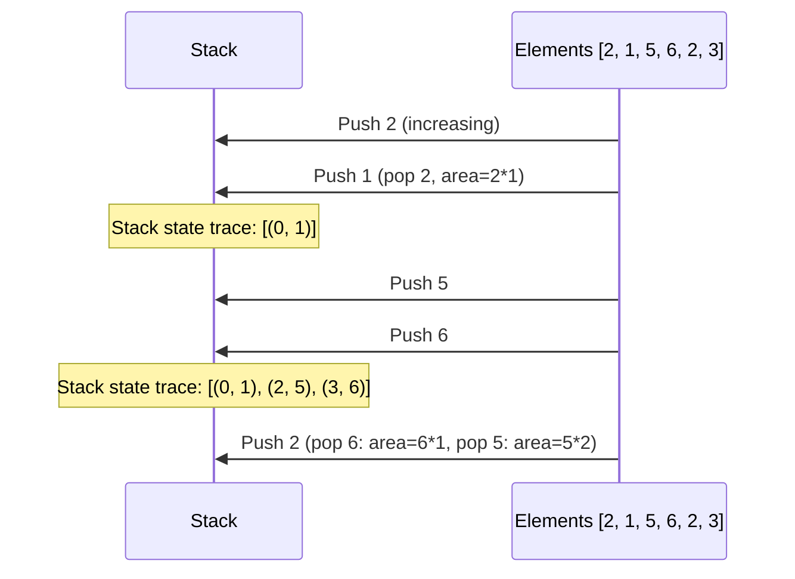

# 🥞 Stacks & Monotonic Stack

A focus on Last-In-First-Out (LIFO) order and Monotonic stacks for bounding range queries.

---

## 📖 Overview

Stacks naturally enforce order. Monotonic Stacks specifically keep elements entirely sorted, shedding data to find the "Next Greater Element."

---

## 🧭 System Design Relevance

| Problem Pattern | LLD Concept | System Design Transfer |
|---|---|---|
| Monotonic Stack | Max sliding window limiters | In-memory time series aggregations |
| Reverse Polish Notation | AST execution engines | Database query planning order |
| Parenthesis Matching | Recursive descent parsers | XML/HTML validator streams |

---
