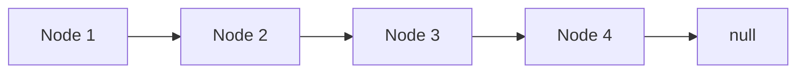

# Pattern 05: Linked List

## Theory
A linked list is a linear data structure where elements are not stored at contiguous memory locations. The elements are linked using pointers.

## System Design Relevance
| Concept | Relevance |
| --- | --- |
| LRU Cache | A combination of a hash map and a doubly linked list is commonly used to implement LRU caches. See [Caching](../../03-hld-concepts/caching) for more details. |
