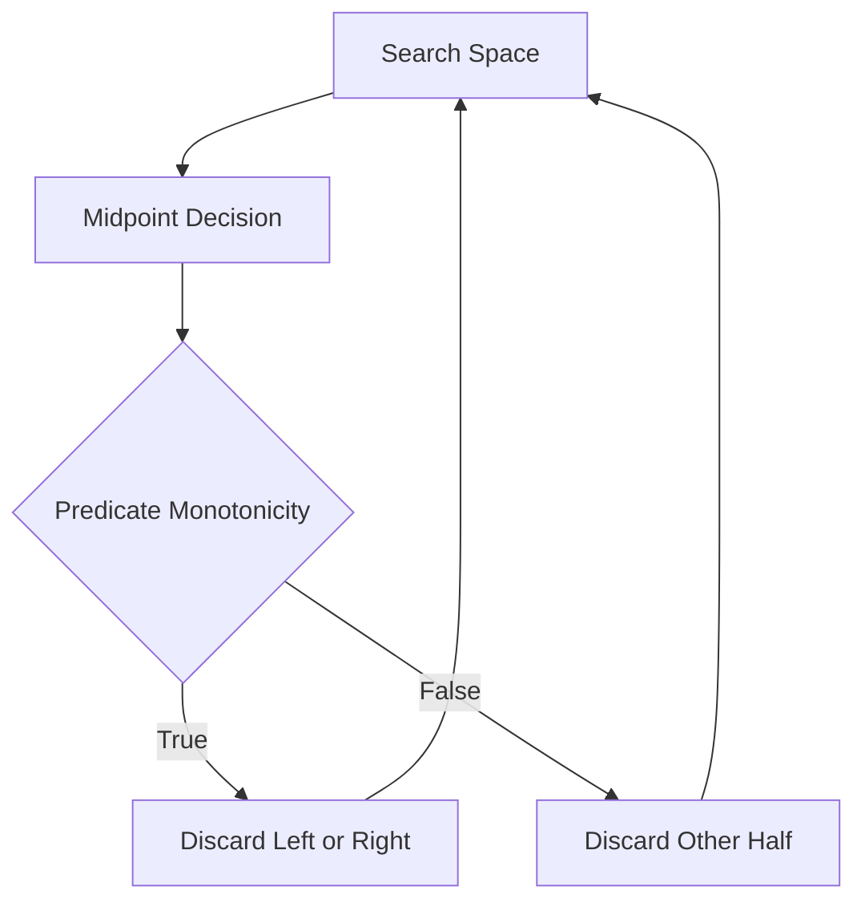

# 🔎 Binary Search Pattern Pack

A focused coding pattern pack for sorted data, monotonic predicates, boundary discovery, and interview problems where the hard part is proving which half of the search space can be discarded.

---

## 📖 Theory

Binary search is not just "look in the middle of a sorted array." It is a proof technique: maintain a search space, choose a midpoint, use a monotonic fact to discard one side, and stop with an exact answer or the first boundary where a predicate becomes true.

## System Design Relevance

| Concept | Relevance |
|---|---|
| Binary Search | Essential for log n lookups |

