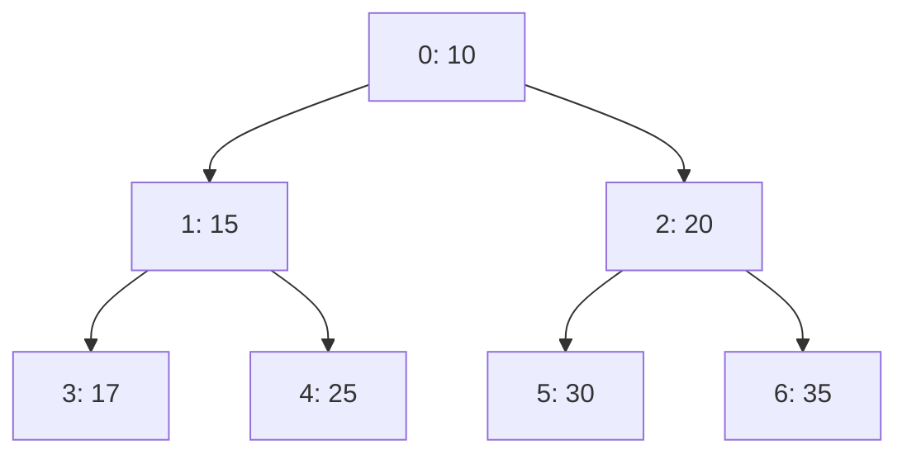

# Pattern: Heap / Priority Queue

## Theory
A heap is a specialized tree-based data structure that satisfies the heap property: in a max-heap, for any given node C, if P is a parent node of C, then the key (the value) of P is greater than or equal to the key of C. In a min-heap, the key of P is less than or equal to the key of C.
Heaps are commonly implemented as arrays, where the children of node at index `i` are at indices `2i + 1` and `2i + 2`.

Key concepts:
- **Heapify:** Building a heap from an array in O(N) time.
- **Two-Heaps:** Maintaining two heaps (a max-heap for the lower half and a min-heap for the upper half) to find the median of a data stream in O(1) time.

### Heap Array/Tree Diagram

## System Design Relevance
| Concept | Relevance |
|---------|-----------|
| Top-K Elements | Used in heavy hitters, trending topics, and recommendation systems to quickly retrieve the most relevant items without full sorting. |
| K-way Merge | Used in external sorting and distributed queries (e.g., search engines) to merge sorted data from multiple shards. |
