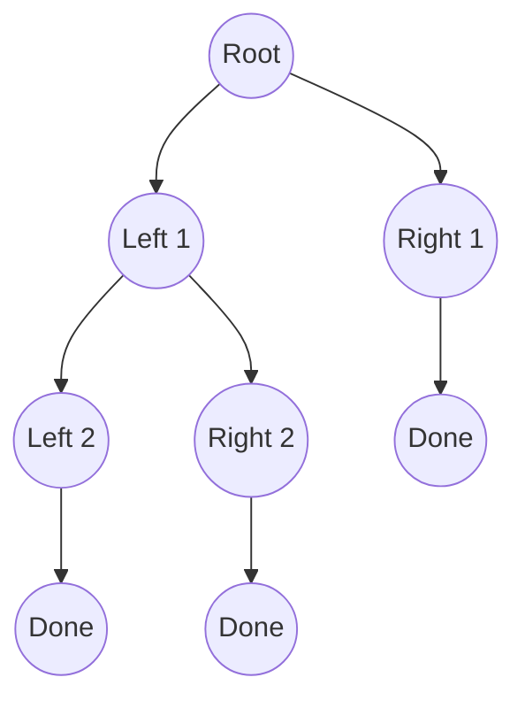

# Pattern 08: Depth-First Search (DFS)

## Theory
Depth-First Search (DFS) is a core traversal algorithm used to explore nodes and edges of a graph, tree, or grid. It goes as deep as possible along each branch before backtracking. DFS is typically implemented using recursion (which implicitly uses the call stack) or iteratively using an explicit stack. 

### Recursion-Tree Mermaid

## System Design Relevance
| Coding Pattern | System Design Application | Example |
|----------------|---------------------------|---------|
| Tree Traversal | DOM parsing, hierarchical data | Rendering an HTML document |
| Graph DFS | Dependency resolution, Cycle detection | Workflow orchestrator (DAG execution) |
| Grid DFS | Spatial analysis, Connected components | Image processing (Flood fill) |
