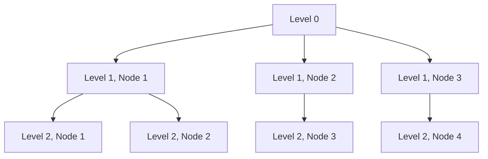

# Pattern 09: Breadth-First Search

## Overview

Breadth-First Search (BFS) explores a graph, tree, or grid layer by layer. Starting from an initial set of source nodes, it visits all immediate neighbors before moving deeper. This ensures that the first time a node is reached, the path taken is the shortest in terms of unweighted edge count. 

In system design, BFS maps directly to exploring dependencies, discovering connected components, or distributing messages over a network radially. 

### Multi-Source BFS

A standard BFS starts from a single node. In many scenarios, such as modeling a spreading infection or finding the distance to the nearest point of interest from multiple locations, it is optimal to enqueue all sources at distance $d=0$ initially. The queue naturally multiplexes the expansion, processing all distance $d=1$ nodes together, regardless of their source.

## Visualizing the Pattern

## System Design Relevance

| Problem Concept | System Design Application | Example |
| :--- | :--- | :--- |
| **Layered Exploration (Word Ladder)** | Crawler Frontier | Discovering and prioritizing web links based on depth from a seed URL to bound crawl scope. |
| **Reachability & Distance (Shortest Path)** | Social Graph | Recommending connections on LinkedIn/Facebook by finding users at exactly 2 or 3 degrees of separation. |
| **Grid Flood Fill (Islands)** | Image Processing & Mapping | Identifying distinct geographic boundaries in mapping systems or bucket fills in image processing. |
| **Simultaneous Spreading (Rotting Oranges)** | Message Propagation & Infection Models | Simulating the spread of configuration updates across a cluster via gossip protocol. |
| **Dependency Resolution (Course Schedule)** | Workflow Orchestration | Ensuring DAG-based job schedulers execute tasks only when prerequisites are satisfied. |

