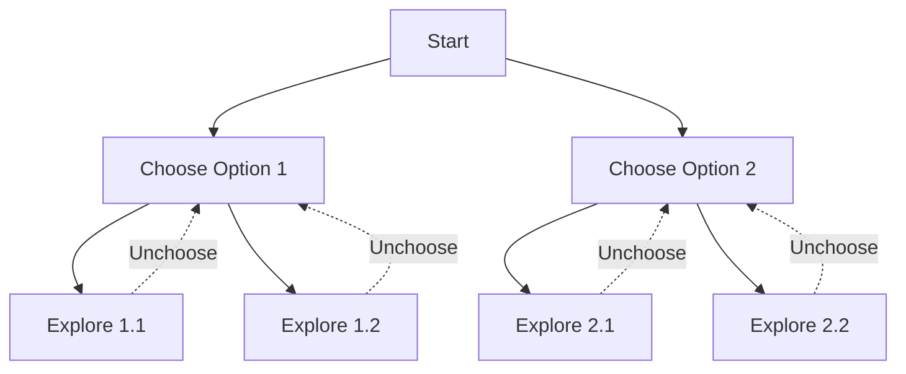

# Backtracking

## 📖 Theory
Backtracking is a general algorithmic technique for solving problems recursively by trying to build a solution incrementally, one piece at a time, and removing those solutions that fail to satisfy the constraints of the problem at any point of time (by time, here, is referred to the time elapsed till reaching any level of the search tree). 

### Choose, Explore, Unchoose
The core of backtracking is the template:
1. **Choose**: Make a choice (add to path).
2. **Explore**: Recurse using the choice.
3. **Unchoose**: Undo the choice (remove from path) to try other possibilities.

### Mermaid Diagram

## 🧭 System Design Relevance
| Concept | Relevance |
|---------|-----------|
| Dependency Resolution | Build systems and package managers use similar tree-search techniques to resolve graph dependencies. |
| Query Optimization | Database engines search the query plan space to find the optimal execution strategy. |
| Game Trees | AI engines explore move trees using minimax, pruning branches with alpha-beta pruning (similar to backtracking). |
