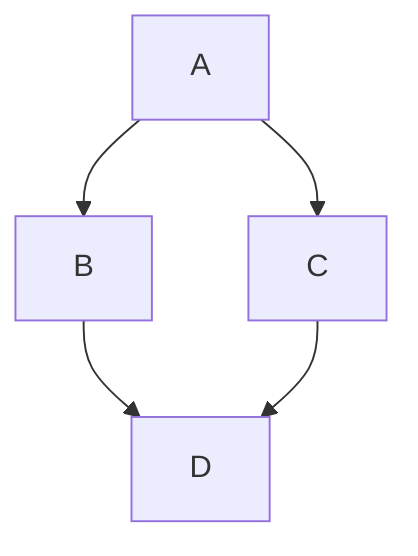
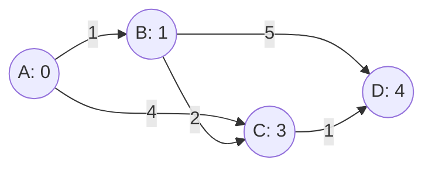

# Pattern: Graphs

## Theory
Graphs are versatile structures for modeling relationships. Graph algorithms such as BFS, DFS, Topological Sort (Kahn's), and Shortest Paths (Dijkstra's, Bellman-Ford) are fundamental to solving dependency, traversal, and routing problems.

### DAG (Directed Acyclic Graph)
A DAG has no cycles and is commonly used for dependencies (like course prerequisites).

### Dijkstra Step
Dijkstra's algorithm finds the shortest path from a source to all other nodes in a graph with non-negative edge weights.

## System Design Relevance
| Concept | Relevance |
|---------|-----------|
| Dependency Resolution | Agentic workflow orchestrator components like task dependencies and topological ordering. |
| Shortest Path | Network routing, delivery systems. |

## 🔗 Cross-links
- [Agentic Workflow Orchestrator](../../06-genai-systems/02-llm-hld-projects/agentic-workflow-orchestrator/)
