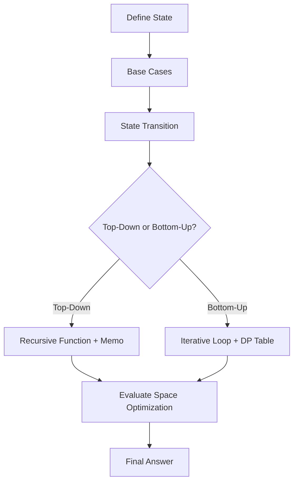

# Dynamic Programming Theory

## Overview

Dynamic Programming (DP) is a method for solving complex problems by breaking them down into simpler subproblems. It is applicable when the subproblems overlap and have optimal substructure. We use state to represent subproblems, transition to find answers from smaller subproblems, and either memoization (top-down) or tabulation (bottom-up) to store results.

### When to Use Dynamic Programming
- The problem asks for an optimal value (maximum, minimum) or the number of ways to do something.
- The future decisions depend on the current state.
- Subproblems overlap (the same subproblems are solved multiple times).

### Memoization vs. Tabulation
- **Memoization (Top-Down)**: Start from the target state and recursively solve subproblems, caching their results to avoid redundant work. Good when not all subproblems need to be evaluated.
- **Tabulation (Bottom-Up)**: Solve smaller subproblems first, storing their results in a table, and use them to compute larger subproblems until reaching the target state. Usually better for constant factor performance and space optimization.

### Space Optimization
Often, the transition only depends on a few previous states (e.g., $dp[i]$ depends only on $dp[i-1]$ and $dp[i-2]$). In such cases, we can optimize space complexity from $O(N)$ or $O(N^2)$ to $O(1)$ or $O(N)$ by keeping track of only the necessary previous states instead of the whole DP table.

## Visualizing the Pattern

## System Design Relevance

| Problem Concept | System Design Application | Example |
| :--- | :--- | :--- |
| **State & Transition (Edit Distance)** | Version Control & Diff Calculation | Computing the minimum edits required to sync a local file with a remote server, minimizing payload size. |
| **Resource Allocation (Knapsack)** | Budgeting & Bin Packing | Optimally packing tasks onto virtual machines with CPU and RAM constraints to minimize cost. |
| **Path Finding (Minimum Path Sum)** | Routing Algorithms | Calculating the optimal routing path across a network topology based on latency or throughput metrics. |
| **Subsequence Matching (LCS)** | Data Deduplication | Finding similar blocks of data in backup systems to save storage space. |
| **State Machines (Buy & Sell Stock)** | Transaction Processing | Modeling multi-step distributed transactions where rollbacks or commits depend on current phase and external events. |

### DP Table-fill Trace Example (Knapsack/Coin Change)
For Coin Change with `coins = [1, 2, 5]` and `amount = 5`:

| Amount | 0 | 1 | 2 | 3 | 4 | 5 |
| :--- | :--- | :--- | :--- | :--- | :--- | :--- |
| **Initial** | 0 | $\infty$ | $\infty$ | $\infty$ | $\infty$ | $\infty$ |
| **Coin 1** | 0 | 1 | 2 | 3 | 4 | 5 |
| **Coin 2** | 0 | 1 | 1 | 2 | 2 | 3 |
| **Coin 5** | 0 | 1 | 1 | 2 | 2 | 1 |

The bottom-right cell (Amount 5, considering up to Coin 5) yields the optimal answer: `1` coin.
