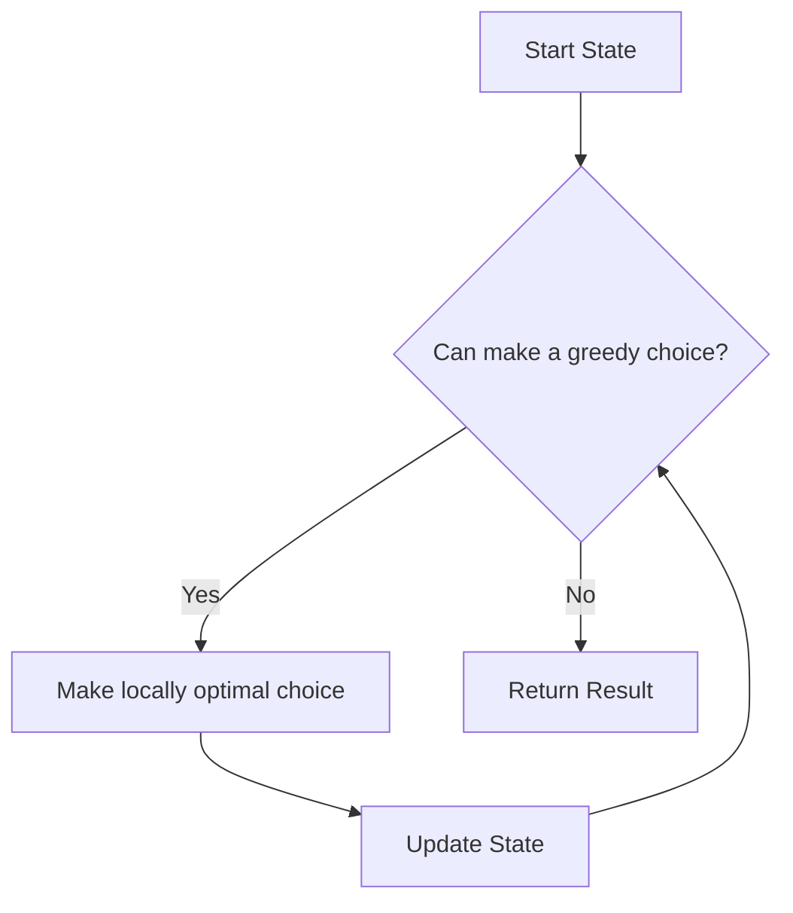

# Pattern 13: Greedy

## Theory
The Greedy approach builds a solution piece by piece, always choosing the next piece that offers the most obvious and immediate benefit. In greedy algorithms, we make the locally optimal choice at each stage with the hope of finding a global optimum. A key aspect is the **exchange argument**, where we can formally prove that any optimal solution can be transformed into our greedy solution without degrading its cost.

### Greedy vs Dynamic Programming
| Feature | Greedy | Dynamic Programming |
|---|---|---|
| Approach | Top-down, makes a single choice and proceeds. | Bottom-up (usually), explores all possible choices. |
| Optimality | Requires the greedy-choice property (local optimal leads to global). | Relies on overlapping subproblems and optimal substructure. |
| Speed | Generally faster, $O(N)$ or $O(N \log N)$. | Generally slower, often $O(N^2)$ or worse. |
| State Revisit | Never reconsiders its choices. | Combines solutions of subproblems to solve larger ones. |

## Visualizing the Pattern

## System Design Relevance
| Problem Concept | System Design Application | Example |
|---|---|---|
| **Activity Selection** | Job Scheduling | Scheduling jobs on a server to maximize throughput. |
| **Minimum Coins** | Resource Allocation | Allocating blocks to a file system. |
| **Interval Merging** | Calendar Applications | Finding free time blocks across multiple users. |
