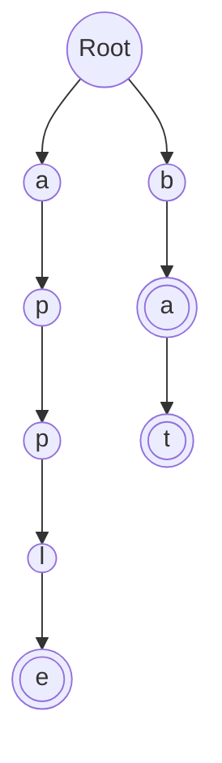

# Trie Pattern Pack

A focused coding pattern pack for prefix indexing problems: prefix lookup, wildcard search, dictionary replacement, prefix sums, board search, autocomplete, and lexicographic construction.

## Overview

A trie is a tree-shaped index over characters or tokens. Each edge consumes one symbol, and each node represents a prefix.

Use a trie when the problem repeatedly asks for prefix operations, dictionary membership, prefix-scoped traversal, or incremental search. The interview signal is knowing what each node stores, where words terminate, how traversal fails fast, and how memory grows with total characters rather than number of words alone.

### Radix Trees & Array vs Map Nodes

**Radix Notes**: A standard trie uses one node per character. A Radix Tree (or Patricia Trie) compresses paths by merging nodes with a single child, reducing memory overhead when storing sparse strings or long unbranched prefixes.

**Array vs Map Nodes**:
- **Array Nodes**: For small fixed alphabets (e.g., 26 lowercase letters), `Node[] children = new Node[26];` is extremely fast and avoids hashing overhead, but uses more memory for sparse children.
- **Map Nodes**: For Unicode, large alphabets, or sparse branching, `Map<Character, Node> children` is preferred to save memory at the cost of slight hashing overhead.

## Diagram

*Nodes with double borders denote terminal states (e.g., `apple`, `bat`).*

## When to Use

Use a trie when the prompt gives you:
1. Many prefix queries over a stable or slowly changing dictionary.
2. Autocomplete, typeahead, command lookup, or route-prefix matching.
3. Wildcard search over dictionary words.
4. A board/grid search that must prune against known word prefixes.
5. Prefix aggregate queries such as "sum values of keys with this prefix."

## Pattern Taxonomy

| Variant | Best fit | Key invariant |
|---|---|---|
| Basic trie | insert/search/startsWith | each path from root represents one prefix |
| Wildcard trie DFS | `.` or one-character wildcard | fixed characters follow one child; wildcard tries all children |
| Shortest-root trie | Replace Words | first terminal node on a path is the shortest replacement |
| Prefix aggregate trie | MapSum | each node stores aggregate value for its prefix |
| Board-search trie | Word Search II | DFS stops when board path is not a dictionary prefix |
| Autocomplete trie | top suggestions per prefix | each prefix node exposes ranked candidates |
| Lexicographic trie | longest buildable word | every prefix on the answer path is terminal |

## Memory Comparison Table

| Approach | Memory Cost | Speed | Use Case |
|---|---|---|---|
| Fixed Array (Size 26) | `O(Total Nodes * 26)` | Fastest | Fixed lowercase English |
| Hash Map (Sparse) | `O(Total Edges)` | Slower | Unicode / Large alphabets |
| Radix Tree | `O(Compressed Edges)` | Complex | Memory is bottleneck |

## System Design Relevance

| Topic | Description | Link |
|---|---|---|
| Typeahead / Autocomplete | Tries efficiently store prefix queries and can cache top results at prefix nodes | [Search Autocomplete](../../04-hld-projects/search-autocomplete/) |
| IP Routing | Longest prefix matching for routing tables using Radix Trees | - |
