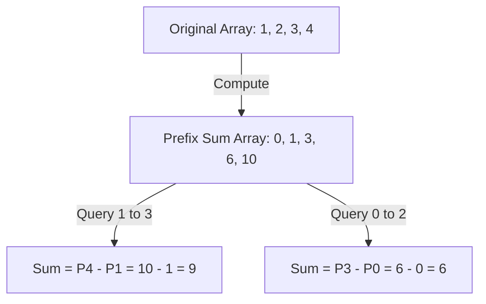

# Pattern 15: Prefix Sum

## Theory

The Prefix Sum pattern is a powerful technique for quickly answering range queries on an array. By precomputing a cumulative sum array, where each element at index `i` stores the sum of all elements from the start of the array up to `i`, we can calculate the sum of any continuous subarray in O(1) time instead of O(N) time.

This pattern is often combined with Hash Maps to solve problems like finding a subarray that sums to a specific target value. In 2D grids, it can be extended to compute the sum of rectangular submatrices efficiently.

## Worked Prefix-Array Trace Table

Given an array `arr = [1, 2, 3, 4, 5]`
Prefix array `P` where `P[i] = P[i-1] + arr[i]` (with `P[-1] = 0` conceptually, often implemented with `P[0] = 0` and size N+1)

| Index `i` | Element `arr[i]` | Prefix Sum `P[i+1]` (sum of `arr[0...i]`) | Calculation |
|-----------|------------------|---------------------------------------------|-------------|
| 0         | 1                | 1                                           | 0 + 1 = 1   |
| 1         | 2                | 3                                           | 1 + 2 = 3   |
| 2         | 3                | 6                                           | 3 + 3 = 6   |
| 3         | 4                | 10                                          | 6 + 4 = 10  |
| 4         | 5                | 15                                          | 10 + 5 = 15 |

To find the sum of elements from index 1 to 3 (`[2, 3, 4]`), we do `P[4] - P[1] = 10 - 1 = 9`.

## Architecture Diagram (Mermaid)

## System Design Relevance

| Topic | Relevance |
|-------|-----------|
| Metrics Rollups | Prefix sums are highly relevant for computing aggregate metrics over time. For example, if you want to know the total number of requests in a given time window, maintaining a cumulative sum of requests can make this O(1). Difference arrays (another flavor of prefix sums) are great for recording interval updates. |
