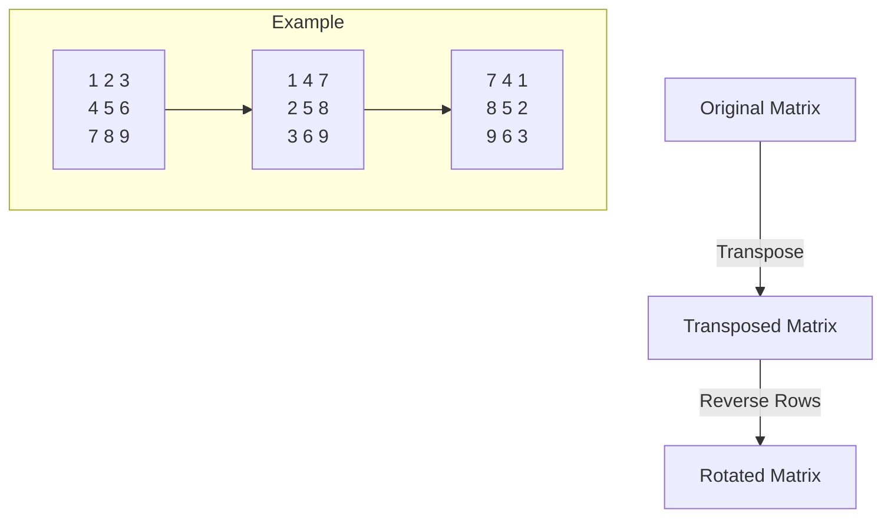

# Pattern 16: Matrices

Matrices are 2D arrays that require specific traversal patterns (spiral, diagonal, row/col-wise) or in-place transformations.

## Theory
- **Index Math:** Given an `M x N` matrix, mapping between 1D array indices and 2D coordinates uses `row = index // N` and `col = index % N`.
- **In-Place Modification:** Matrix problems often restrict auxiliary space usage. State can be encoded in existing elements by tracking multiple states in a single integer using bitwise operations, math properties (mod), or out-of-bounds sentinel values (e.g., in Game of Life, using 2 to denote `0 -> 1` and 3 to denote `1 -> 0`).
- **Rotation:** Rotating a square matrix by 90 degrees can be done elegantly by first transposing the matrix (swapping `matrix[i][j]` with `matrix[j][i]`), then reversing each row.

### Rotate-in-place Diagram

## System Design Relevance

| Aspect | Relevance | Example |
|---|---|---|
| Grid Systems | Spatial data partitioning. | Quadtrees, Geohashing maps. |
| Graph Adjacency | Representing dense graphs. | Routing tables, shortest path caches. |
| In-place Updates | Minimizing memory footprint. | In-memory database batch updates. |
| Convolution | Processing grid data (images). | Image filters, deep learning. |
