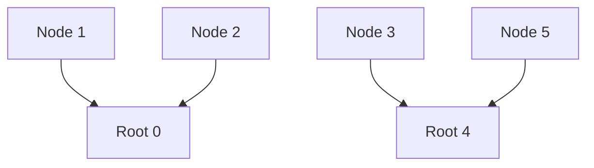

# Pattern 17: Union-Find (Disjoint Set)

## Theory
Union-Find is a data structure that keeps track of a set of elements partitioned into a number of disjoint (non-overlapping) subsets. It provides near-constant-time operations to:
1. Find the root/representative of the set containing a given element.
2. Union (merge) two sets into a single set.

Key optimizations:
- **Path Compression**: Flattens the structure of the tree whenever `find` is called, making future operations faster.
- **Union by Rank**: Always attaches the smaller tree to the root of the larger tree to keep the overall tree flat.

## System Design Relevance

| Aspect | Relevance | Example |
|---|---|---|
| Network Partitions | Detecting disconnected components | Determining if a cluster of microservices is fully connected or split. |
| Dedup Clustering | Merging identical entities | Identifying and merging duplicate user accounts (e.g., Accounts Merge). |
| Image Processing | Finding connected pixels | Labeling connected components in an image. |
