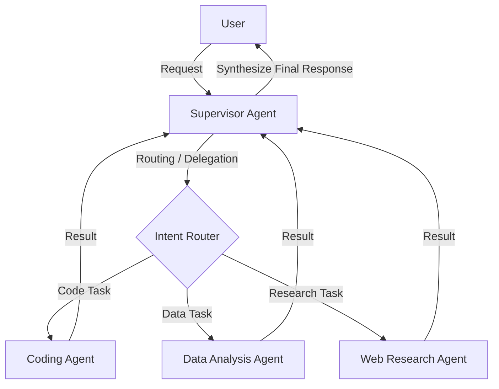

# Agent Architectures, MCP, and Memory: Interview Q&A

This document provides a comprehensive set of interview questions and detailed answers covering the intricacies of agent loops, tool calling, the Model Context Protocol (MCP), Agent-to-Agent (A2A) communication, memory architectures, and system evaluation.

## 1. Agent Loops and Orchestration

**Q1: Explain the standard agent loop (e.g., ReAct) and how it differs from a simple multi-turn conversational AI.**
A: A simple conversational AI takes user input, appends it to context, and generates a final text response. A ReAct (Reason + Act) agent loop introduces an internal iteration cycle before responding to the user. The agent receives input, explicitly reasons about it (Thought), decides on an action to take (Action/Tool Call), executes the tool, and observes the result (Observation). It evaluates if the goal is met; if not, it loops back to reasoning. This closed-loop system allows for autonomous problem-solving over multiple steps, utilizing tools to gather information or mutate state.

**Q2: What is "durable execution" in the context of agent workflows, and why is it necessary?**
A: Durable execution (often implemented via frameworks like Temporal or a robust [agentic-workflow-orchestrator](../../02-llm-hld-projects/agentic-workflow-orchestrator/)) means the state of the agent's workflow is persisted at every step. If the system crashes, encounters a network timeout, or hits a rate limit during a multi-step execution, the process can resume from the exact point of failure. This is necessary because agent loops can run for minutes or hours, calling multiple external APIs. Without durable execution, transient errors would require restarting the entire expensive and time-consuming process.

**Q3: How do you design Human-in-the-Loop (HITL) checkpoints in an asynchronous agent architecture?**
A: HITL is crucial for high-risk actions. In an asynchronous architecture, when the agent decides to execute a restricted tool, the orchestrator pauses the agent's execution thread and persists its state. It then emits an event or notification to a human operator. The system exposes an endpoint for the operator to approve, reject, or modify the action. Once the human input is received, the orchestrator resumes the agent loop, passing the human's decision back as the observation for that tool call.

## 2. Tool Calling and MCP (Model Context Protocol)

**Q4: Describe the core roles within the Model Context Protocol (MCP) architecture.**
A: MCP defines three primary roles:
1. **Host (Client)**: The application or orchestration layer that manages the user session, holds the API keys for the model, and orchestrates the connection to servers.
2. **Server (Provider)**: A standardized endpoint that exposes capabilities—such as tools, prompts, or resources (data)—to the host over the MCP protocol.
3. **Model**: The LLM reasoning engine that receives the aggregated context and schemas from the host and determines the actions.

**Q5: What are the primary transport layers supported by MCP, and when would you use each?**
A: 
- **Standard I/O (stdio)**: Used for local, tightly coupled integrations where the MCP server is spawned as a child process of the host. Ideal for local desktop AI assistants interacting with local files.
- **HTTP with Server-Sent Events (SSE)**: Used for remote, decoupled architectures where the host and server are on different networks. SSE allows the server to stream context updates to the host.
- **WebSockets**: Used for persistent, bi-directional, low-latency connections, often necessary when the tool requires rapid back-and-forth streaming or real-time event pushing.

**Q6: How do you handle authentication, security, and authorization when exposing sensitive internal tools via MCP?**
A: Security in MCP requires defense-in-depth:
- **Transport Security**: Enforce mTLS between the MCP Host and remote MCP Servers to guarantee identity.
- **Auth Tokens**: The Host must pass short-lived, scoped OAuth/JWT tokens to the Server.
- **Capability-Based Access**: The Server must validate the token claims to ensure the specific user (and agent) has authorization to execute the requested tool (e.g., read vs. write privileges).
- **Network Isolation**: MCP Servers should run in isolated VPCs, with strict egress rules preventing lateral movement if compromised via prompt injection.

**Q7: Explain the purpose of a Tool Router in an agent system.**
A: In enterprise systems, there may be hundreds of available tools. Injecting all schemas into every LLM prompt exhausts the token limit and confuses the model. A [tool-router](../../01-llm-lld-projects/tool-router/) acts as a dynamic filter. It uses lightweight semantic search or a small classification model to map the user's intent to a small subset of relevant tools. Only these filtered schemas are injected into the context window for the heavy reasoning LLM, optimizing latency, cost, and accuracy.

## 3. Multi-Agent Systems and A2A

**Q8: What are common Multi-Agent design patterns, and how do they communicate?**
A:
- **Supervisor/Hierarchical**: A central routing agent delegates tasks to specialized worker agents and synthesizes their results.
- **Network/Swarm**: Agents act as peers, broadcasting messages or passing tasks directly to one another based on specialized capabilities.
- **Debate**: Two or more agents generate competing answers and critique each other to arrive at a consensus.
Communication (A2A) typically happens via a message broker (e.g., Kafka) or a shared state blackboard, where agents publish structured JSON payloads adhering to a common ontology.

**Q9: When should you explicitly NOT use a multi-agent or agentic architecture?**
A: You should avoid complex agent architectures when:
- The task is highly deterministic, single-step, and can be solved with a standard prompt or traditional code.
- There are strict latency constraints (e.g., sub-second responses), as agent loops require multiple sequential LLM calls.
- Cost constraints are extremely tight (token usage multiplies with each loop).
- Predictability and strict adherence to a static workflow are more important than adaptive problem solving.

## 4. Memory Architectures

**Q10: Explain the concept of tiered memory in AI systems.**
A: Tiered memory mirrors human cognition:
- **Working Memory**: The LLM's active context window (short-term). Fast but strictly limited by max tokens.
- **Episodic Memory**: A chronological log of past conversations and actions, typically stored in a transactional database or a [conversation-memory-store](../../01-llm-lld-projects/conversation-memory-store/).
- **Semantic Memory**: Generalized knowledge and facts extracted over time, typically stored in a vector database for similarity search via RAG.

**Q11: Why are Write and Forget policies critical in memory architectures?**
A: Context windows are finite. If you continuously append state, you will eventually hit the token limit or degrade model performance ("Lost in the Middle").
- **Write Policies** define when to persist active context into long-term storage (e.g., summarizing a completed task and saving the summary to semantic memory).
- **Forget Policies (Eviction)** define how to prune the working memory. This could be simple FIFO truncation, summarizing older messages, or calculating relevance scores to drop irrelevant tokens and make room for new ones.

**Q12: What is Context Engineering, and how does it relate to memory?**
A: Context Engineering is the systematic process of dynamically retrieving, ranking, and assembling the most relevant information from various memory tiers into the LLM's working memory for a specific turn. It ensures the model has exactly the context it needs—no more, no less—optimizing for accuracy and token efficiency.

## 5. Agent Evaluations and Failure Modes

**Q13: How do you perform "Agent Evals" compared to standard LLM evals?**
A: Standard evals focus on the final text output (e.g., Rouge, BLEU, or LLM-as-a-judge for accuracy). Agent evals must measure the *trajectory*. You evaluate:
- **Planning**: Did it choose the right sequence of steps?
- **Tool Selection**: Did it select the correct tool for the task?
- **Schema Adherence**: Were the tool arguments syntactically valid?
- **Efficiency**: Did it achieve the goal in the minimum number of steps?
- **Recovery**: How well did it handle a simulated tool failure?

**Q14: Describe a concrete failure mode for an agent involving a "token budget" and how to mitigate it.**
A: **Failure Mode**: An agent executes a `search_database` tool without a limit parameter. The database returns 50,000 records. This massive JSON payload is appended to the observation, instantly exceeding the context window (token budget exhaustion). The agent crashes and cannot recover.
**Mitigation**: Implement strict pagination and truncation at the tool execution layer. The tool should return a summarized response (e.g., "Found 50,000 records. Returning top 10...") and expose a `next_page` capability. Additionally, the orchestrator should monitor the token budget and forcibly compress or truncate observations before appending them to the context.

**Q15: Explain the "Infinite Loop" failure mode in agent systems.**
A: An infinite loop occurs when an agent repeatedly executes the same tool with the same arguments, receiving an error or unhelpful observation, but fails to adjust its strategy. It gets stuck in a cycle of `Action -> Error -> Same Action`. Mitigation requires implementing a max-iteration guard in the orchestrator, tracking historical actions to detect repetition, and explicitly instructing the model in the system prompt to try alternative strategies if an action fails twice.

---

## Architectural Diagrams

### 1. Agent Loop with Durable Execution

```mermaid
sequenceDiagram
    participant User
    participant Orchestrator
    participant LLM
    participant Tool
    participant StateDB
    
    User->>Orchestrator: Submit Task
    Orchestrator->>StateDB: Persist Task Init
    loop ReAct Loop
        Orchestrator->>LLM: Send Context (Prompt)
        LLM-->>Orchestrator: Plan + Tool Call
        Orchestrator->>StateDB: Persist Tool Intention
        Orchestrator->>Tool: Execute Tool
        Tool-->>Orchestrator: Return Observation
        Orchestrator->>StateDB: Persist Observation
        alt Task Complete
            Orchestrator->>User: Final Result
            break
        end
    end
```

### 2. Tiered Memory Architecture

```mermaid
graph TD;
  subgraph Working Memory (Context Window)
    A[Current Prompt]
    B[Recent Turn History]
    C[Immediate Tool Outputs]
  end
  
  subgraph Long-Term Storage
    D[(Episodic DB)]
    E[(Semantic Vector DB)]
  end
  
  F[Orchestrator / Context Manager] -->|Evict & Summarize| D;
  F -->|Extract Knowledge| E;
  D -->|Fetch Past Sessions| F;
  E -->|Semantic Search| F;
  F -->|Inject Relevant Context| Working Memory;
```

### 3. Multi-Agent Supervisor Pattern



