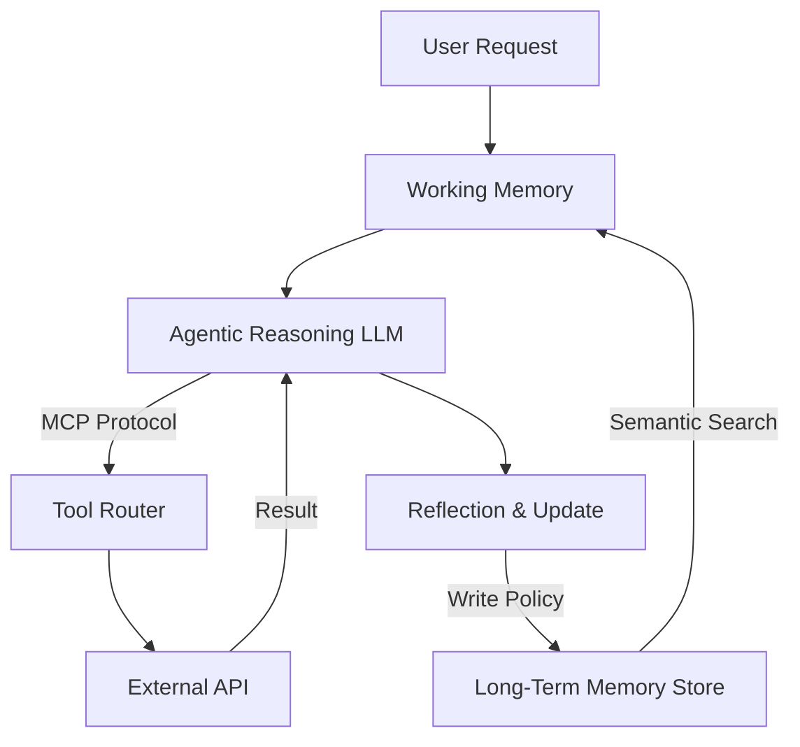
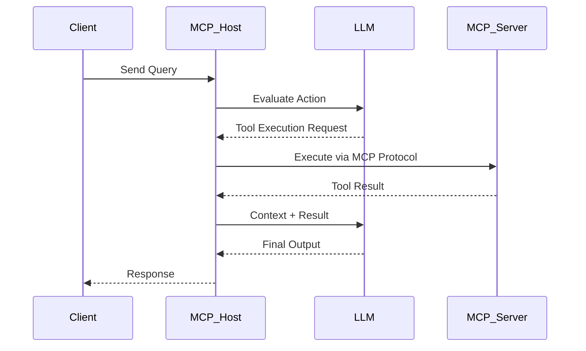
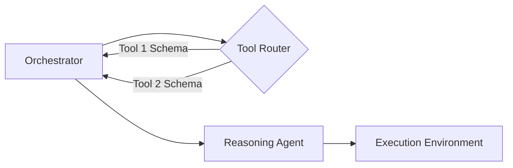

# Agents, MCP, and Memory Architectures

## Overview

In the rapidly evolving landscape of Generative AI, the shift from stateless prompt-response interactions to stateful, autonomous, and tool-augmented agents represents a major paradigm shift. This document provides a comprehensive exploration of Agents, the Model Context Protocol (MCP), and advanced Memory Architectures. 

These paradigms are instrumental in designing intelligent systems that can plan, execute, remember, and reflect. They move LLMs (Large Language Models) from passive text generators to active participants in complex workflows. This concept guide bridges the theoretical foundations with practical system design implementations, providing you with the knowledge required to architect enterprise-grade AI agents.

### Core Definitions

- **Agent**: An AI system that uses an LLM as its central reasoning engine to decide which actions to take, often invoking external tools, observing the results, and dynamically adjusting its plan to achieve a defined goal.
- **MCP (Model Context Protocol)**: An emerging standard and architectural pattern designed to standardize how models communicate with tools, memory stores, and context providers, abstracting away the specifics of transport layers and message formatting.
- **Memory Architectures**: Systems designed to give agents persistence. Unlike stateless API calls, memory architectures provide short-term working memory (context), long-term semantic memory (knowledge), and episodic memory (past experiences), often utilizing tiered storage strategies.

---

## 1. Agent Architectures

An agent is fundamentally a closed-loop system where an LLM's outputs are fed back as inputs after interacting with the environment. The core loop typically follows a variation of the ReAct (Reason + Act) pattern.

### 1.1 The Core Agent Loop

The agent loop is the heartbeat of any autonomous AI system. It governs how the agent perceives its environment, reasons about its current state, and selects the next appropriate action.

1. **Perception/Input**: The agent receives a task, environmental observation, or user query.
2. **Reasoning/Planning**: The agent uses its LLM reasoning capabilities to break down the task, evaluate the current context, and decide on a course of action.
3. **Action/Tool Calling**: The agent outputs a structured command to execute a specific tool or API.
4. **Observation**: The system executes the tool and feeds the result back to the agent.
5. **Reflection**: The agent evaluates the observation against its goal. If the goal is met, it synthesizes a final response; otherwise, the loop iterates.

This loop relies heavily on the orchestration capabilities described in [agentic-workflow-orchestrator](../../02-llm-hld-projects/agentic-workflow-orchestrator/).

### 1.2 Multi-Agent Systems

While single-agent systems are powerful, many complex enterprise problems are better solved by multi-agent architectures. In these systems, multiple specialized agents collaborate, negotiate, or delegate tasks.

- **Hierarchical/Supervisor Pattern**: A top-level routing agent analyzes the request and delegates sub-tasks to worker agents.
- **Swarm Pattern**: A collection of peer agents communicate asynchronously to solve a problem collectively, often without a central coordinator.
- **Debate/Reflection Pattern**: Multiple agents critique each other's outputs to arrive at a more robust and hallucination-free final answer.

Multi-agent interactions require robust inter-agent communication protocols, often leveraging A2A (Agent-to-Agent) networking concepts.

---

## 2. Model Context Protocol (MCP)

The Model Context Protocol (MCP) aims to standardize the interface between LLMs and their surrounding ecosystem. Historically, every AI application had to build custom integration layers to connect specific models with specific tools or databases. MCP standardizes this.

### 2.1 MCP Roles

The protocol defines distinct roles to decouple the reasoning engine from the execution environment:
- **Host/Client**: The application or orchestration layer that manages the lifecycle of the request.
- **Server/Provider**: The entity that exposes tools, prompts, or resources over MCP.
- **Model**: The LLM that interprets the context and generates actions.

### 2.2 Transports and Message Formatting

MCP supports various transport mechanisms to accommodate different latency and deployment requirements:
- **Standard I/O (stdio)**: Used for local, tightly coupled integrations where the MCP server runs as a subprocess.
- **HTTP/SSE (Server-Sent Events)**: Used for remote integrations, allowing bidirectional streaming of context and tool calls.
- **WebSockets**: Ideal for persistent, low-latency, full-duplex communication between agents and tools.

Message payloads are typically JSON-RPC based, ensuring a standardized schema for discovering tools (`tools/list`), executing tools (`tools/call`), and managing context.

### 2.3 Authentication and Security in MCP

Exposing tools to autonomous agents introduces significant security risks. MCP architectures must implement robust security controls:
- **Mutual TLS (mTLS)**: Ensuring that only authorized hosts can connect to MCP servers.
- **Capability-based Access Control**: Agents are granted tokens that strictly limit which tools they can execute and which data they can access (e.g., read-only vs. write permissions).
- **Human-in-the-Loop (HITL)**: For high-risk operations (e.g., modifying production databases or transferring funds), MCP servers can require an asynchronous human approval step before completing a `tools/call`.

---

## 3. Memory Architectures

To build agents that learn and adapt over time, developers must implement tiered memory architectures. Memory in AI is not just storing strings; it involves managing the limited context window of LLMs while providing relevant historical data.

### 3.1 Tiered Memory Models

A robust memory system typically implements multiple tiers, mirroring human cognitive processes:

- **Working Memory (Short-Term)**: This is the active context window. It contains the immediate conversation history, current task instructions, and recent tool outputs. It is highly volatile and constrained by the LLM's maximum token limit.
- **Episodic Memory (Medium-Term)**: Logs of past conversations, actions taken, and outcomes. This is often stored in a transactional database or a dedicated [conversation-memory-store](../../01-llm-lld-projects/conversation-memory-store/).
- **Semantic Memory (Long-Term)**: Generalized knowledge abstracted from past experiences. This is typically implemented using vector databases, where factual knowledge is embedded and retrieved via semantic search (RAG).

### 3.2 Write and Forget Policies

Memory architectures must actively manage their state to prevent context bloat and ensure relevance.
- **Write Policies**: Dictate when and how information is committed to long-term storage. For example, a background summarization agent might periodically distill working memory into semantic memory.
- **Forget Policies (Eviction)**: Dictate how old or irrelevant information is removed from working memory. Techniques include sliding window truncation, token-based eviction, and relevance-based filtering.

### 3.3 Context Engineering

Context engineering is the art and science of dynamically assembling the most relevant information into the LLM's working memory for any given turn. This involves:
- **Dynamic Retrieval**: Fetching only the memories strictly necessary for the current task.
- **Context Compression**: Summarizing older conversational turns to save tokens while retaining the core narrative.
- **Relevance Scoring**: Using embeddings or cross-encoders to rank the importance of past episodes before injecting them into the prompt.

---

## 4. Integration with Tool Routers

Effective agentic systems rely heavily on efficient tool routing. As the number of available tools grows, providing all tool schemas in the context window becomes prohibitively expensive and can degrade the LLM's reasoning quality.

### 4.1 The Role of the Tool Router

A [tool-router](../../01-llm-lld-projects/tool-router/) dynamically selects a subset of relevant tools based on the user's intent. 
1. **Intent Classification**: A fast, lightweight model classifies the request.
2. **Schema Retrieval**: The router fetches only the schemas for the required tools.
3. **Dynamic Injection**: The selected schemas are injected into the agent's prompt via MCP.

This pattern minimizes token usage and reduces the risk of the model hallucinating tool calls.

### 4.2 Durable Execution and Fault Tolerance

Agents operating in the real world will encounter failures: APIs time out, network connections drop, and models generate invalid JSON. 

Durable execution frameworks ensure that agent workflows can survive these transient failures. State is persisted at every step of the agent loop. If the process crashes, the workflow can be resumed from the last successful observation, rather than restarting from scratch. This is particularly crucial for long-running multi-agent processes.

---

## 5. Evals and Failure Modes

Evaluating autonomous agents is significantly more complex than evaluating stateless text generation. You must evaluate the trajectory, the tool usage, and the final outcome.

### 5.1 Agent Evals

- **Trajectory Evaluation**: Did the agent take the optimal path to solve the problem? Did it use the right tools in the right order?
- **Tool Accuracy**: Did the agent generate syntactically correct tool calls? Did it handle tool errors gracefully?
- **Goal Completion Rate**: What percentage of tasks did the agent successfully complete without human intervention?

### 5.2 Common Failure Modes

1. **Infinite Loops**: The agent repeatedly calls a tool with the same arguments, failing to recognize that the strategy is not working.
2. **Context Window Exhaustion**: The agent accumulates too much tool output (e.g., a massive JSON response from an API) and exceeds the model's token limit.
3. **Premature Termination**: The agent halts and provides an answer before it has gathered all the necessary information.
4. **Tool Hallucination**: The model attempts to call a tool that does not exist or provides arguments that violate the schema.

---

## Extended Topic Dive: The Evolution of Autonomous Systems

The journey from simple reactive bots to proactive, autonomous agents is marked by significant architectural shifts. Understanding these transitions is key to designing robust systems.

### Stateless to Stateful

Early LLM applications were completely stateless. Each API call to the model required sending the entire conversation history. While simple, this approach scales poorly. 
As applications grow, the context window fills up, leading to increased latency and costs. Stateful architectures, supported by a [conversation-memory-store](../../01-llm-lld-projects/conversation-memory-store/), externalize this state. The orchestration layer manages the state, deciding what to load into context and what to archive.

### Reactive to Proactive

Reactive systems wait for user input before acting. Proactive agents can initiate actions based on triggers, schedules, or background monitoring. For example, a proactive agent might monitor an email inbox, categorize incoming messages, and automatically draft replies or create Jira tickets without waiting for a user prompt.
Proactive systems require robust background scheduling and durable execution to ensure reliability.

### Implicit to Explicit Reasoning

Standard prompting often relies on the LLM's implicit ability to leap from prompt to answer. Agentic workflows enforce explicit reasoning, often through frameworks like Chain-of-Thought (CoT) or ReAct. By forcing the model to explicitly state its reasoning ("Thought: I need to search for..."), the system becomes more interpretable, debuggable, and accurate.

---

## Designing for Scale

When scaling agentic systems to support thousands of concurrent users, several architectural bottlenecks emerge.

1. **State Management Overhead**: Constantly reading from and writing to the memory store can introduce significant latency. Implementing caching layers (e.g., Redis) for active sessions is critical.
2. **LLM Rate Limits**: Enterprise deployments quickly hit API rate limits. Systems must implement intelligent backoff strategies, request queuing, and potentially load balancing across multiple model endpoints or providers.
3. **Observability**: Debugging a multi-step agent trajectory is notoriously difficult. Systems must emit detailed, structured logs for every step: the prompt, the model response, the tool invocation, and the tool result. Distributed tracing (e.g., OpenTelemetry) is essential.

---

## Advanced A2A (Agent-to-Agent) Patterns

In sophisticated multi-agent ecosystems, agents do not just interact with tools; they interact with each other. This requires standardized communication protocols.

- **Request/Response**: Agent A asks Agent B a question and blocks waiting for the answer.
- **Publish/Subscribe**: Agent A broadcasts an event (e.g., "New customer ticket created"). Agents B and C, who are subscribed to this topic, react independently.
- **Shared Memory/Blackboard**: Multiple agents read from and write to a shared memory space (the "blackboard"). This is useful for collaborative problem-solving, where different agents contribute their specialized knowledge to a common workspace.

---

## Deep Dive: Handling Large Contexts

Even with tiered memory and tool routers, agents often need to process large amounts of data. Modern LLMs support massive context windows (e.g., 128k to 2M tokens), but relying solely on large contexts is problematic:
1. **Cost**: Pricing is often per-token. Sending massive contexts repeatedly is prohibitively expensive.
2. **Latency**: Time-to-first-token increases significantly with context size.
3. **The "Lost in the Middle" Phenomenon**: Models often struggle to recall information located in the middle of a very large context.

To mitigate these issues, architectures must employ advanced context engineering.
- **RAG Integration**: Instead of dumping an entire document into context, use RAG to retrieve only the relevant chunks.
- **Map-Reduce Workflows**: Break a large task into smaller chunks, process each chunk with a separate LLM call (Map), and then synthesize the results (Reduce). This is highly effective for tasks like summarizing massive codebases or analyzing large datasets.

---

## The Intersection of MCP and Memory

MCP doesn't just apply to tools; it can also standardize how agents interact with memory stores.
- An MCP Server can expose a `memory/read` and `memory/write` interface.
- This allows the agent to explicitly query its own long-term memory as a tool call, giving the model agency over what it remembers and what it recalls.
- By standardizing this interface, developers can swap out the underlying memory implementation (e.g., moving from a simple relational database to a complex graph database) without changing the agent's logic.

## Architecting for Security and Compliance

When agents have the ability to execute tools and access memory, security is paramount.
- **Data Segregation**: Ensure that Agent A, acting on behalf of User A, cannot access User B's episodic memory or execute tools with User B's credentials.
- **Audit Trails**: Every tool call, memory read, and memory write must be logged with a timestamp and attribution. This is critical for compliance in regulated industries.
- **Sandboxing**: Execute tool code in strictly isolated environments (e.g., Docker containers or gVisor) to prevent malicious tool output from compromising the host system.

By mastering these concepts—the ReAct loop, the Model Context Protocol, tiered memory architectures, and durable execution—you can design Generative AI systems that are not only intelligent but also robust, scalable, and secure.

---

## Deep Dive: Orchestration Edge Cases

In sophisticated multi-agent swarms, edge cases surrounding distributed orchestration become critical. When multiple agents operate asynchronously, you may encounter split-brain scenarios where two supervisor agents attempt to manage the same worker. To mitigate this, orchestration frameworks must implement distributed locking mechanisms or consensus protocols (like Paxos or Raft) to elect a single leader for a given task execution context.

Furthermore, temporal desynchronization can occur if an agent relies on a tool that experiences a massive latency spike. If the observation arrives after the agent has timed out and initiated a retry, the system state can become corrupted. Durable execution frameworks handle this by maintaining a strict, append-only event ledger. Every tool execution is recorded with a unique, monotonically increasing sequence ID, allowing the system to discard stale observations and maintain a coherent timeline.

## Advanced Tool Schema Design

When building scalable agentic systems, static tool schemas quickly become a bottleneck. An advanced approach involves dynamic schema injection using JSON Schema draft-2020-12. This allows tools to define polymorphic arguments, where a single parameter might accept either a string (for a simple search) or a complex object (for advanced filtering).

In a production environment leveraging MCP, the Tool Router can dynamically mutate the JSON schema before injecting it into the prompt based on the user's intent classification. For instance, if the user asks a simple question, the router prunes the advanced, complex arguments from the tool schema, saving tokens and reducing the LLM's cognitive load. Conversely, for power users, the full schema is exposed, allowing the LLM to leverage the tool's maximum capabilities.

## Vector Database Optimizations for Semantic Memory

Semantic memory relies heavily on vector databases, but naive implementations suffer at scale. For agentic recall, optimizing the indexing strategy is paramount. Hierarchical Navigable Small World (HNSW) graphs offer excellent recall but consume significant memory. In constrained environments, Inverted File Index with Product Quantization (IVF-PQ) is often preferred to reduce the memory footprint, albeit at a slight cost to search accuracy.

More importantly, pure vector search is often insufficient for agents. Metadata filtering must be combined with vector search (hybrid search). For example, an agent recalling a past conversation needs to filter by `user_id` and `session_timestamp` before performing the KNN search to ensure it doesn't cross-pollinate memories from different users or drastically different timeframes.

## Episodic Memory Pruning Strategies

If an agent runs continuously, its episodic memory store will grow indefinitely, eventually exceeding storage limits and increasing retrieval latency. To counter this, systems implement advanced pruning strategies based on utility scoring rather than simple chronological truncation.

An exponential decay function can be applied to the relevance score of past memories. However, important memories (e.g., the user stating their explicit preferences) should have their decay rates artificially slowed or halted entirely. This is often achieved by running a separate, background "Consolidation Agent" that periodically reviews the episodic memory log, identifies high-utility facts, and promotes them to long-term semantic memory while aggressively pruning the low-utility transactional logs.

## Agent-to-Agent (A2A) Negotiation Protocols

In a multi-agent ecosystem, agents often need to negotiate to allocate tasks or share resources. Implementing formal negotiation protocols is crucial. The Contract Net Protocol is a common approach: a Manager Agent broadcasts a "Call for Proposals" (CFP) for a specific task. Worker Agents evaluate their current load and capabilities, then submit bids. The Manager evaluates the bids and awards the contract to the most suitable worker.

This pattern is essential in environments where computing resources are constrained or where different agents have access to specialized, rate-limited APIs. By forcing agents to negotiate, the system can dynamically load-balance tasks and ensure optimal utilization without relying on a rigid, centralized scheduler.

## Security: Capability-Based Access Detailed

Traditional Role-Based Access Control (RBAC) is often too coarse for autonomous agents. Instead, Capability-Based Access is preferred. When an agent is initialized, it is granted a "Macaroon" or a chained authorization token that explicitly lists the exact operations it is permitted to perform (e.g., `execute_tool:read_db`, but NOT `execute_tool:write_db`).

This token is passed along with every tool execution request via the MCP protocol. The MCP Server validates the token before executing the tool. Crucially, these tokens can be delegated and attenuated. A supervisor agent can create a new, restricted token for a sub-agent, granting it a subset of its own permissions, adhering perfectly to the principle of least privilege.

## Prompt Injection Defenses Detailed

When agents process untrusted input (e.g., reading a webpage or summarizing an external email), they are vulnerable to prompt injection, where malicious instructions overwrite the system prompt. Defending against this requires a multi-layered approach.

First, employ an Instruction Hierarchy where the base system prompt is structurally separated from user data, often utilizing specialized API endpoints that enforce this separation. Second, use a dedicated "Sanitizer Agent" or a deterministic parser to analyze untrusted input for malicious patterns before feeding it to the primary reasoning agent. Finally, restrict the capabilities of the primary agent so that even if it is compromised, the blast radius is contained by the capability-based access controls.

## Latency Optimization in ReAct Detailed

The sequential nature of the ReAct loop (Thought -> Action -> Observation) introduces significant latency. To optimize this, modern architectures employ speculative execution and parallel tool calling. If an agent identifies that it needs to fetch data from three independent sources, it should output a structured command that invokes all three tools concurrently, rather than sequentially.

Furthermore, streaming token parsers can be used to overlap I/O with computation. As the LLM streams its "Thought" output, the orchestrator can begin parsing the JSON structure for the tool call. The moment the tool call arguments are fully formed, the orchestrator triggers the API request while the LLM is still finishing its sentence, drastically reducing the time-to-first-observation.

## Testing and Evals Architecture Detailed

Evaluating non-deterministic agents requires a shift from unit testing to property-based testing and simulation. You cannot assert that an agent will generate a specific string. Instead, you build deterministic simulators that mock the external environment and tool responses.

You then run the agent through thousands of simulated trajectories and assert on the properties of those trajectories. For example, you assert that "the agent never executes a write operation before a read operation" or that "the agent always calls the `calculate_cost` tool before finalizing the transaction." This requires building robust CI/CD pipelines dedicated solely to running these expensive, long-running agent evaluations before deploying prompt changes.

## Knowledge Graph Memory Detailed

While vector databases are excellent for semantic similarity, they struggle with multi-hop reasoning (e.g., "Who manages the person who approved the budget for project X?"). For these tasks, Knowledge Graphs (like Neo4j) are a superior memory architecture.

In a graph-based memory system, entities (users, projects, documents) are nodes, and relationships are edges. The agent uses a tool to execute graph queries (like Cypher) to navigate these relationships. By integrating a knowledge graph with MCP, the agent can explicitly traverse complex organizational hierarchies or dependency trees, enabling a level of reasoning that is impossible with flat semantic search alone.

## Fault Tolerance in Distributed Agents Detailed

When a multi-agent system executes a complex workflow that mutates state across multiple distinct external systems (e.g., booking a flight, reserving a hotel, and charging a credit card), you must implement fault tolerance to handle partial failures.

Traditional distributed transactions (two-phase commit) are generally unworkable for independent agents. Instead, employ the Saga pattern. For every action an agent takes, there must be a defined compensating action (a rollback tool). If the flight booking succeeds but the hotel reservation fails, the orchestrator forces the agent to execute the flight cancellation tool to ensure the system returns to a consistent state, preventing partial, orphaned transactions.

## Cost Management Strategies Detailed

Operating autonomous agents at scale is extremely expensive due to continuous API calls and large context windows. Cost management is a foundational architectural concern.

A primary strategy is Model Routing. Not every step in a ReAct loop requires a massive, state-of-the-art model. A lightweight, cheaper model can often handle simple intent classification, schema selection, or basic data extraction. The orchestrator dynamically routes requests: using the expensive model only for complex planning and reasoning phases, and delegating the rote execution and parsing phases to the cheaper model, drastically reducing the overall cost per transaction.

## Multi-modal Agents Detailed

The next frontier of agent architecture involves extending the Model Context Protocol to seamlessly handle multi-modal inputs, specifically images, video frames, and audio waveforms.

This requires significant changes to the memory architecture. Storing raw video in a working memory context window is impossible. Instead, systems must process the multi-modal input through a dedicated embedding layer or a specialized Vision Language Model (VLM) to extract a semantic summary or a high-dimensional vector representation. This compressed representation is then passed to the reasoning agent via MCP, allowing it to "see" and "hear" the environment without overwhelming the token budget.

## Context Window Exhaustion and Summarization Fallbacks

One of the most persistent issues in agentic systems is context window exhaustion, often referred to as the "Token Limit Wall." When an agent loop runs for an extended period, or when a tool returns an unexpectedly large payload (e.g., a massive JSON response from a legacy API), the working memory quickly exceeds the LLM's maximum token capacity.

To mitigate this, robust systems implement dynamic summarization fallbacks. Before appending any tool observation to the context, a lightweight, fast LLM (or even a deterministic parser) evaluates the payload size. If it exceeds a predefined threshold (e.g., 20% of the remaining context window), the payload is routed to a summarization pipeline. This pipeline extracts the most salient points relevant to the agent's current goal and returns a condensed version. Only this summarized version is injected into the primary agent's working memory, preserving the token budget while retaining crucial information.

## Observability and Tracing in Non-Deterministic Workflows

Traditional debugging techniques fall short when applied to autonomous agents. Because the execution path is not strictly defined in code but dynamically determined by the LLM, tracking down the root cause of a failure requires specialized observability tools.

Implementing distributed tracing using standards like OpenTelemetry is essential. Every cycle of the agent loop must be wrapped in a distinct span. Crucially, these spans must capture the exact prompt sent to the model, the raw completion received, the exact JSON arguments parsed for the tool call, and the raw output of the tool execution. By correlating these spans across the network, engineers can visualize the agent's exact thought process and pinpoint where it hallucinated a tool argument or misread an observation, enabling rapid iteration on system prompts and tool schemas.

## Human-in-the-Loop (HITL) Fallback Strategies

While full autonomy is the goal, many enterprise applications require human oversight, especially for destructive operations (e.g., deleting a database record or authorizing a large financial transaction). The Model Context Protocol (MCP) can be extended to support asynchronous HITL workflows.

When the agent decides to execute a high-risk tool, the MCP Server intercepts the request. Instead of executing the action, it pauses the workflow, persists the agent's state to a durable database, and emits an event to a human review queue. The human operator reviews the proposed action, the agent's reasoning, and the context. The operator can approve, reject, or modify the tool arguments. Once a decision is made, the MCP Server resumes the workflow, feeding the human's decision back to the agent as the tool observation, allowing the loop to continue seamlessly.

## Contextual Bandits for Tool Selection

In scenarios where multiple tools can achieve a similar outcome (e.g., different search APIs or different data extraction methods), selecting the optimal tool is challenging. Advanced architectures employ Contextual Bandits, a reinforcement learning technique, to optimize tool selection over time.

Instead of relying solely on the LLM's static reasoning or a hardcoded heuristic, the system tracks the success rate, latency, and cost of each tool invocation across different contexts. Over time, the Contextual Bandit learns which tool performs best for specific types of queries or specific users. It then dynamically adjusts the tool schemas presented to the agent, prioritizing the most effective tools and deprecating those that consistently fail or return irrelevant data, creating a self-optimizing agentic ecosystem.

## Prompt Injection and Jailbreak Mitigation

As agents interact with untrusted external data (e.g., reading emails, scraping websites), they become vulnerable to prompt injection attacks. A malicious payload embedded in the external data can override the agent's system instructions, causing it to exfiltrate data or execute unauthorized actions.

Mitigation requires a defense-in-depth strategy. First, implement a strict "Instruction Hierarchy," where the underlying LLM natively distinguishes between system commands and untrusted user data. Second, utilize a specialized "Guardian Model"—a small, fast classification model that scans all incoming external data for known injection patterns before it is fed to the primary reasoning agent. Finally, enforce strict Capability-Based Access controls (as discussed earlier) so that even if the agent is compromised, its ability to cause harm is severely restricted by the environment.

## Advanced Retry Policies for Flaky APIs

Agents frequently interact with third-party APIs that can be unreliable. A simple fixed-delay retry policy is insufficient for production agent architectures. Instead, systems should implement a **jittered exponential backoff** strategy.

In an agentic workflow, the orchestrator detects HTTP 5xx errors or connection timeouts from tool executions. It then calculates a backoff delay, multiplying a base delay by an exponential factor, and adding a random "jitter" to prevent the "thundering herd" problem when multiple agents retry simultaneously. If the maximum number of retries is exceeded, the orchestrator returns a standardized `<tool_error>` observation to the agent. Crucially, the agent must be explicitly prompted on how to handle these terminal tool errors—either by attempting an alternative tool, gracefully degrading the user experience, or escalating to a human operator.

## RAG Refinement with Cross-Encoders

When agents query long-term semantic memory (vector databases), the initial retrieval phase often yields low-precision results. To enhance the accuracy of the context injected into the agent's working memory, architects implement a two-stage retrieval pipeline.

The first stage uses a fast, bi-encoder (e.g., standard cosine similarity) to retrieve a wide net of candidate documents. The second stage uses a much slower, but highly accurate **cross-encoder**. The cross-encoder evaluates the user's current intent alongside each candidate document simultaneously, scoring their semantic relevance. Only the top-K documents from this rigorous re-ranking phase are appended to the tool observation, significantly reducing the noise in the agent's context window and decreasing hallucination rates.

## Handling Asynchronous Events in Stateful Agents

Traditional REST APIs follow a strict request-response paradigm. However, many enterprise workflows involve long-running asynchronous processes (e.g., triggering a data warehouse ETL job). Agents must be designed to handle these event-driven architectures.

When an agent calls an asynchronous tool, the tool immediately returns a `job_id` or `correlation_id` rather than the final result. The agent loop is then "suspended" by the orchestrator. The orchestrator listens on a message broker (like RabbitMQ or Kafka) for a webhook or event indicating the job's completion. Once the event is received, the orchestrator "wakes up" the agent, injecting the final event payload as the tool's observation, allowing the agent to resume its reasoning process seamlessly without busy-waiting and consuming unnecessary tokens.

## Continuous Evaluation via LLM-as-a-Judge

Static evaluations are inadequate for the non-deterministic nature of agents. Production systems increasingly rely on automated, continuous evaluation using an "LLM-as-a-Judge" framework.

In this architecture, a separate, highly capable LLM (often distinct from the agent's reasoning model) is tasked with reviewing the agent's execution traces. After an agent completes a task, the trace (prompt, chain-of-thought, tool calls, final response) is forwarded to the Judge LLM. The Judge evaluates the trace against specific rubrics: Did the agent hallucinate tool parameters? Was the tone appropriate? Did it follow safety guidelines? The Judge assigns a quantitative score and generates qualitative feedback. These metrics are fed into observability dashboards, alerting engineers when the agent's baseline performance degrades over time.

## Memory Tier Lifecycle Management

Managing the lifecycle of data across tiered memory architectures is crucial for cost and compliance. Working memory is intrinsically ephemeral, tied to the immediate execution context. However, episodic and semantic memory require deliberate lifecycle policies.

Data in episodic memory (the transaction logs) should be governed by Time-To-Live (TTL) policies. For instance, detailed tool execution logs might be purged after 30 days to save storage costs. Conversely, the semantic memory (vector embeddings of summarized knowledge) must undergo periodic deduplication and conflict resolution. If an agent learns a new fact that contradicts an older embedding, a background process (often another specialized agent) must identify this conflict, deprecate the obsolete embedding, and insert the updated knowledge, ensuring the semantic memory remains a reliable source of truth.

## Contextual Caching Strategies

To mitigate latency and reduce API costs, advanced agent systems implement contextual caching layers. When an LLM evaluates a prompt, a significant portion of that prompt (the system instructions, the tool schemas, and older episodic memories) remains static across multiple turns.

By leveraging prefix caching (supported by several modern model providers), the orchestrator can cache the KV (Key-Value) states of these static prefix tokens. When the agent loop iterates, only the new tokens (the latest thought and tool observation) need to be processed by the full attention mechanism. This drastically reduces the time-to-first-token (TTFT) for subsequent reasoning steps, allowing complex agent loops to execute much faster while consuming significantly fewer computational resources.

### Conclusion

The evolution from simple chatbots to sophisticated, agentic systems requires a deep understanding of state, orchestration, and interface standardization. By leveraging MCP for tool abstraction, tiered memory for state management, and robust orchestration frameworks for durable execution, architects can build systems that reliably solve complex, multi-step problems in enterprise environments.

See the accompanying `INTERVIEW-QA.md` for a deep dive into specific technical questions and edge cases related to these architectures.

*Tiered Memory and MCP Tool Integration*

*MCP Communication Protocol*

*Tool Routing Mechanics*

