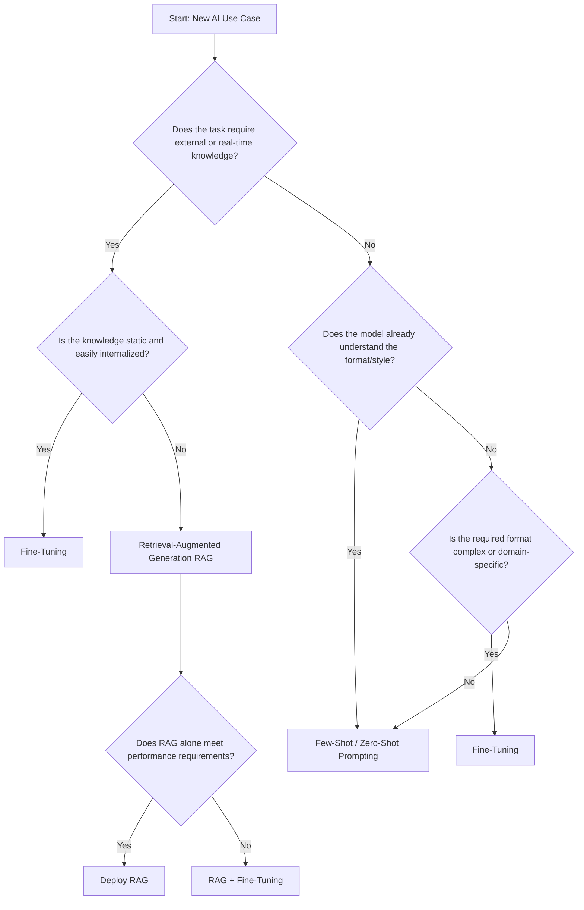

<!-- Register in concepts README. -->
# Fine-Tuning and Adaptation

## Table of Contents
1. [Introduction](#introduction)
2. [Decision Flowchart: RAG vs Prompting vs Fine-Tuning](#decision-flowchart-rag-vs-prompting-vs-fine-tuning)
3. [When Not to Fine-Tune](#when-not-to-fine-tune)
4. [Memory Math: SFT, LoRA, and QLoRA](#memory-math-sft-lora-and-qlora)
5. [Reinforcement Learning from Human Feedback (RLHF) and Direct Preference Optimization (DPO)](#reinforcement-learning-from-human-feedback-rlhf-and-direct-preference-optimization-dpo)
6. [Knowledge Distillation](#knowledge-distillation)
7. [Data Curation](#data-curation)
8. [Catastrophic Forgetting](#catastrophic-forgetting)
9. [Adapter Serving and Multi-Tenant LoRA](#adapter-serving-and-multi-tenant-lora)
10. [Cost Examples and Trade-offs](#cost-examples-and-trade-offs)
11. [Conclusion](#conclusion)

---

## Introduction
Fine-tuning and adaptation refer to the processes and techniques of adapting a pre-trained generative AI model (such as a Large Language Model) to a specific domain, task, or set of preferences. While prompt engineering and Retrieval-Augmented Generation (RAG) provide mechanisms to guide a model at inference time, fine-tuning modifies the model's internal weights to internalize specific knowledge, styles, or behaviors. Understanding the trade-offs between prompting, RAG, and fine-tuning is crucial for designing scalable and cost-effective GenAI systems.

## Decision Flowchart: RAG vs Prompting vs Fine-Tuning
When designing an LLM application, choosing the right technique is paramount. The following Mermaid flowchart provides a systematic approach for making this decision.



## When Not to Fine-Tune
Fine-tuning is a powerful tool, but it is not a silver bullet. You should avoid fine-tuning in the following scenarios:
- **Dynamic Data:** If the information changes frequently (e.g., news, stock prices), fine-tuning is inefficient because models cannot update their weights in real-time. Use RAG instead.
- **Cost Constraints:** Full fine-tuning requires significant compute (GPUs). If your budget is strictly constrained and inference optimization is not a priority, prompt engineering is preferred.
- **Lack of High-Quality Data:** Fine-tuning on noisy or low-quality data can degrade the model's performance. "Garbage in, garbage out" heavily applies to LLM fine-tuning.
- **Simple Tasks:** For standard summarization, translation, or sentiment analysis, few-shot prompting on a strong base model often suffices.

## Memory Math: SFT, LoRA, and QLoRA
Understanding the memory requirements for Supervised Fine-Tuning (SFT) and its parameter-efficient alternatives is essential for provisioning infrastructure.

### Full Supervised Fine-Tuning (SFT)
During full SFT, we update all parameters of the model. 
Memory required = Model Weights + Optimizer States + Gradients + Activations.
- **Model Weights:** 2 bytes per parameter (fp16/bf16).
- **Optimizer States (AdamW):** 8 bytes per parameter (fp32 momentum and variance).
- **Gradients:** 2 bytes per parameter (fp16/bf16).
- **Total Static Memory:** ~12 bytes per parameter.
For a 7B model: 7B * 12 bytes = 84 GB just for static memory, meaning it cannot fit on a single 80GB A100 GPU without optimizations like DeepSpeed ZeRO.

### Low-Rank Adaptation (LoRA)
LoRA freezes the pre-trained weights and injects trainable rank decomposition matrices.
- The pre-trained weights remain in 2 bytes (fp16) or 1 byte (int8).
- We only train a tiny fraction of parameters (e.g., 0.1% to 1%).
- Optimizer states and gradients are only stored for these few trainable parameters.
For a 7B model in fp16: ~14 GB for base weights + ~1-2 GB for LoRA weights, activations, and optimizer states. Easily fits on a 24GB GPU.

### Quantized LoRA (QLoRA)
QLoRA takes this a step further by quantizing the base model to 4-bit NormalFloat (NF4) while keeping the LoRA adapters in 16-bit precision. Paged optimizers are used to handle memory spikes.
- Base weights: 0.5 bytes per parameter.
- For a 7B model: ~3.5 GB for base weights.
- Total memory required during training is around 6 GB. This enables fine-tuning 7B models on consumer GPUs (e.g., RTX 3090/4090).

## Reinforcement Learning from Human Feedback (RLHF) and Direct Preference Optimization (DPO)
Adapting models to human preferences is crucial for safety and usability.

### RLHF
RLHF is a complex, multi-stage process:
1. **SFT Phase:** Train a base model on high-quality instruction-response pairs.
2. **Reward Model (RM) Phase:** Train a separate model to score responses based on human preference data (chosen vs. rejected).
3. **PPO Phase:** Use Proximal Policy Optimization (PPO) to optimize the SFT model against the Reward Model, employing a KL-divergence penalty to prevent the model from drifting too far from the base SFT model.

### DPO
DPO simplifies the RLHF pipeline by eliminating the need for a separate Reward Model and the unstable PPO process. 
Instead, it formulates the reward maximization problem mathematically such that the optimal policy can be extracted directly from the reference model and the preference data. You train the model on the (chosen, rejected) pairs using a simple binary cross-entropy loss objective. This makes DPO significantly more stable and compute-efficient than RLHF.

## Knowledge Distillation
Knowledge distillation is the process of transferring knowledge from a large, complex model (the teacher) to a smaller, more efficient model (the student).
- **White-box Distillation:** The student minimizes the KL divergence between its output logits and the teacher's soft logits.
- **Black-box Distillation:** The student trains on the text generated by the teacher (e.g., reasoning traces, high-quality responses). This is common when the teacher's weights are not accessible (e.g., using GPT-4 to generate data for fine-tuning Llama 3 8B).
Distillation is highly effective for reducing latency and deployment costs while maintaining acceptable performance on specific tasks.

## Data Curation
The quality of the fine-tuning dataset is arguably more important than the algorithm used.
- **Diversity:** The dataset must cover the full distribution of inputs the model will see in production.
- **Formatting:** Use consistent system prompts, roles, and templating. 
- **De-duplication:** Remove exact or near-duplicate examples to prevent memorization and overfitting.
- **Filtering:** Remove low-quality, toxic, or out-of-domain data. Using a strong LLM as a judge to filter the dataset is a common pattern.
- **Volume:** Surprisingly, high-quality fine-tuning can be achieved with as few as 1,000 to 5,000 perfectly curated examples (e.g., the LIMA paper demonstrated that "Less Is More for Alignment").

## Catastrophic Forgetting
Catastrophic forgetting occurs when a model forgets previously learned knowledge while learning new information.
- **Cause:** Gradient updates on the new domain overwrite the weights responsible for general knowledge.
- **Mitigation:**
  1. **Replay Strategy:** Mix a small percentage of general instruction-tuning data (e.g., from the original SFT dataset) into the domain-specific fine-tuning dataset.
  2. **Parameter-Efficient Fine-Tuning (PEFT):** Methods like LoRA mitigate forgetting because they freeze the base weights, isolating the new knowledge in the adapter.
  3. **Lower Learning Rates:** Use conservative learning rates and early stopping.

## Adapter Serving and Multi-Tenant LoRA
One of the most powerful architectural advantages of LoRA is adapter serving in production.
Instead of deploying 5 different fine-tuned models for 5 different customers (requiring 5x the GPU memory), you deploy a single base model and 5 separate LoRA adapters.
- **Mechanics:** During inference, a batch can contain requests for different customers. The serving engine (like vLLM) dynamically loads the corresponding LoRA weights for each sequence, computing the base model forward pass and adding the specific LoRA delta.
- **Benefit:** This allows massive multi-tenancy. You can serve thousands of fine-tuned adapters on a single GPU cluster, driving the marginal cost of hosting a new fine-tuned model close to zero.

## Cost Examples and Trade-offs
Evaluating the cost-effectiveness of fine-tuning requires looking at both training and inference costs.

### Scenario A: Large Prompt vs Fine-Tuned Model
- **Prompting:** You use a 5,000-token prompt with few-shot examples and strict instructions on a generic model (e.g., GPT-4). High inference cost per request, high latency, but zero upfront training cost.
- **Fine-Tuning:** You fine-tune a smaller model (e.g., Llama 3 8B) on the few-shot examples. The prompt is reduced to 100 tokens.
- **Break-even Point:** If you process millions of requests, the compute saved by processing 4,900 fewer input tokens per request quickly amortizes the upfront cost of fine-tuning the 8B model.

### Training Cost Estimation
- Fine-tuning a 7B model using QLoRA on a single A100 GPU for 3 epochs on 10,000 examples takes roughly 4-6 hours.
- Cost of 1x A100 on AWS/GCP for 6 hours: ~$20.
- The barrier to entry for fine-tuning has dropped dramatically, making it a viable option for many enterprise use cases.


## Deep Dive into Catastrophic Forgetting

Catastrophic forgetting represents one of the most significant challenges when continually adapting a single model to new tasks. It occurs when a neural network is trained sequentially on multiple tasks. The weights that are optimal for Task A are unceremoniously overwritten by the gradient updates required to master Task B. In the context of Large Language Models, this often manifests as a loss of general reasoning capabilities, degradation in formatting following ability, or the sudden inability to answer basic factual queries that the pre-trained base model handled effortlessly.

### The Mechanism of Forgetting
To understand catastrophic forgetting, consider the weight matrix of an attention layer. During the initial pre-training phase, these weights converge on a sophisticated distribution that captures a vast swath of human language and knowledge. When we initiate a Supervised Fine-Tuning (SFT) phase on a narrow domain—say, parsing medical records into JSON—the loss function focuses solely on minimizing errors in that specific domain. The optimizer aggressively pushes the weights towards a new local minimum. Because the parameter space is highly intertwined, the representations necessary for general reasoning are invariably corrupted.

### Advanced Mitigation Strategies
Mitigating this phenomenon requires careful intervention during the fine-tuning process.

1. **Experience Replay (Data Mixing):** The most robust method involves mixing data from previous tasks (or a general instruction-following dataset) into the current training batch. For example, if you are fine-tuning on medical data, you might mix in 10-20% general conversational data. This acts as a regularizer, forcing the gradient updates to find a compromise that satisfies both the new task and the old knowledge.
2. **Elastic Weight Consolidation (EWC):** EWC is a regularization technique that slows down learning for certain weights based on their importance to previously learned tasks. It calculates a Fisher information matrix after training on Task A, identifying which parameters were most critical. During training on Task B, a penalty is added to the loss function if the model attempts to drastically change these critical parameters.
3. **Parameter-Efficient Fine-Tuning (PEFT):** Methods like LoRA (Low-Rank Adaptation) inherently mitigate catastrophic forgetting by freezing the pre-trained weights entirely. The new task's knowledge is isolated entirely within the low-rank adapter matrices. To switch back to general tasks, one simply unloads the adapter.

## Comprehensive Guide to Data Curation for LLM Adaptation

Data curation is no longer a preprocessing step; it is the core intellectual task in modern LLM fine-tuning. The paradigm has shifted from "big data" to "high-quality, highly-curated data." 

### The "Less is More" Philosophy
The LIMA (Less Is More for Alignment) paper demonstrated a profound shift in understanding: an LLM's knowledge and capabilities are largely absorbed during the massive unsupervised pre-training phase. Fine-tuning, especially alignment, is merely about teaching the model the *format* or *style* of interaction we desire. Therefore, 1,000 perfectly crafted examples are vastly superior to 100,000 noisy, loosely-related examples.

### Steps for Rigorous Curation
1. **Source Selection and Diversity:** The dataset must accurately reflect the distribution of requests the model will face in production. If the model will primarily be used for coding, the dataset should span various programming languages, complexity levels, and prompt structures. Avoid homogeneous datasets that only teach a single narrow response pattern.
2. **Formatting and Templating:** Consistency is paramount. If you are using the ChatML format, ensure that the `<|im_start|>` and `<|im_end|>` tokens are placed exactly correctly in every single example. Inconsistencies here will lead to the model failing to stop generation properly during inference.
3. **De-duplication:** Over-representation of specific examples can lead to memorization and a brittle model that collapses when faced with novel phrasing. Implement strict deduplication using MinHash or exact string matching to ensure a diverse training corpus.
4. **Filtering and Quality Control:** Utilize automated filtering pipelines. A common and highly effective pattern is "LLM-as-a-Judge," where a stronger model (like GPT-4) is tasked with evaluating and scoring the training examples. Any example scoring below a certain threshold on clarity, correctness, or helpfulness is summarily discarded.
5. **Human Review:** For high-stakes domains, a statistically significant sample of the final dataset must be manually reviewed by human domain experts.

## Adapter Serving Architecture in Detail

Deploying fine-tuned models cost-effectively hinges on the ability to serve multiple distinct models from the same hardware infrastructure. LoRA (Low-Rank Adaptation) enables this through a technique known as Adapter Serving or Multi-Tenant LoRA Serving.

### The Production Challenge
Imagine a SaaS company providing customized LLM instances for 100 different enterprise clients. If each client had a fully fine-tuned 13B parameter model, deploying 100 separate models would require hundreds of GPUs, rendering the service economically unviable.

### The LoRA Serving Solution
Because LoRA adapters consist of very small matrices (often < 100MB) while the base model (e.g., Llama 3) remains frozen, we can dramatically optimize the serving architecture.

1. **Shared Base Model:** A single instance of the massive base model is loaded into the GPU's VRAM. This instantly eliminates the primary memory bottleneck.
2. **Dynamic Adapter Loading:** In memory, we maintain a pool of the small LoRA adapters for active clients.
3. **Batched Inference with Heterogeneous Adapters:** Modern serving engines like vLLM or LoRAX support mixed-batch inference. When a batch of user requests arrives, Request A might belong to Client 1, and Request B to Client 2.
4. **The Forward Pass:** As the batch progresses through the transformer layers, the engine computes the heavy matrix multiplications for the base model once for the entire batch. Then, for the LoRA component, it dynamically applies Client 1's adapter only to Request A's hidden states, and Client 2's adapter only to Request B's hidden states.
5. **Economic Impact:** This architecture allows a single GPU cluster to serve thousands of fine-tuned "virtual models" simultaneously. The marginal cost of deploying a new custom model drops to near zero, as it only requires storing a few megabytes of weights.

## The Nuances of Knowledge Distillation

Knowledge distillation is a powerful compression technique where a smaller, efficient "student" model is trained to replicate the behavior of a larger, highly capable "teacher" model.

### Black-Box vs. White-Box Distillation
- **White-Box Distillation:** This requires full access to the teacher model's architecture and weights. The student model is trained not just to produce the same final output tokens, but to mimic the entire probability distribution (the "soft logits") of the teacher at every step. This provides a incredibly rich learning signal, teaching the student *how confident* the teacher was in various alternative words.
- **Black-Box Distillation:** This is the most common approach today, especially when the teacher is a proprietary API (like OpenAI's models). The student only sees the final text output of the teacher. To improve efficacy, practitioners often use "Distilling Step-by-Step," where the teacher is prompted to generate detailed Chain-of-Thought (CoT) reasoning traces alongside the final answer. The student is then trained on these detailed traces, allowing it to internalize complex reasoning patterns that would be impossible to learn from the final answer alone.

### Legal and Ethical Considerations
It is vital to recognize that many commercial LLM APIs explicitly forbid using their outputs to train competing models. Distillation pipelines must carefully navigate these terms of service, often relying on open-source models (like Llama 3 70B) as the teacher for internal, proprietary student models.


## Advanced Implementation Details

### Data Formatting Requirements
When preparing a dataset for Supervised Fine-Tuning (SFT), the format must be meticulously consistent. A common approach is using the ChatML format or specific system/user/assistant delimitations.
```json
[
  {
    "messages": [
      {"role": "system", "content": "You are a helpful coding assistant."},
      {"role": "user", "content": "Write a Python script to parse JSON."},
      {"role": "assistant", "content": "import json..."}
    ]
  }
]
```
Ensuring the exact tokenization of these special tokens during training and inference is one of the most common pitfalls in fine-tuning.

### Distributed Training Paradigms
For models that exceed the capacity of a single GPU, even with LoRA, distributed training is required.
- **Data Parallelism (DP):** The model is replicated across multiple GPUs, and the dataset is partitioned. The gradients are synchronized across GPUs.
- **Tensor Parallelism (TP):** The individual layers of the model (e.g., attention matrices) are split across multiple GPUs. This requires high-bandwidth interconnects like NVLink.
- **Pipeline Parallelism (PP):** The model is split sequentially across GPUs (e.g., layers 1-10 on GPU 1, layers 11-20 on GPU 2).
- **ZeRO (Zero Redundancy Optimizer):** An optimization for DP where optimizer states, gradients, and parameters are partitioned across GPUs rather than replicated, significantly reducing the memory footprint per device.

### Hyperparameter Tuning Strategies
Tuning the hyperparameters during adaptation is an empirical science.
- **Learning Rate (LR):** For full SFT, learning rates are typically very small (e.g., 1e-5 to 5e-6). For LoRA, the learning rate can be slightly higher (e.g., 1e-4).
- **Batch Size:** Larger batch sizes stabilize gradients but require more memory. Gradient accumulation is often used to simulate larger batch sizes on constrained hardware.
- **Epochs:** Overfitting happens quickly in LLMs. Often, 1 to 3 epochs are sufficient for SFT.
- **LoRA Rank (r) and Alpha:** The rank determines the expressiveness of the adapter (usually 8, 16, 32, or 64). Alpha is a scaling factor, often set to 2 * r or equal to r.

### Evaluation of Fine-Tuned Models
Evaluating generative models is notoriously difficult.
- **Perplexity:** A measure of how well the model predicts the dataset. Lower is better, but it doesn't always correlate with human preference.
- **Automated Benchmarks:** MMLU, GSM8K, HumanEval. While useful for base models, they may not capture domain-specific improvements.
- **LLM-as-a-Judge:** Using a powerful model like GPT-4 to score the outputs of the fine-tuned model against a rubric. This is highly scalable and correlates well with human judgment.
- **Human Evaluation:** The gold standard, but slow and expensive. A/B testing in production via shadow deployments or canary releases is the ultimate test.

### Hardware Considerations for Adaptation
Choosing the right hardware depends entirely on the adaptation method.
- **Full SFT (70B+):** Requires multi-node clusters with 8x H100s or A100s per node, connected via InfiniBand.
- **LoRA/QLoRA (7B - 13B):** Can be accomplished on single-node instances with 1 to 4 consumer GPUs (e.g., RTX 4090s or A6000s) or cloud instances like AWS g5 (A10G).
- **Network Bandwidth:** For multi-GPU setups, PCI-E bandwidth is critical for gradient synchronization. NVLink is highly recommended to avoid communication bottlenecks.

### Security and Safety Alignment
Fine-tuning can inadvertently bypass safety guardrails built into the base model (a phenomenon known as "jailbreaking via fine-tuning").
- To mitigate this, developers must ensure that safety-aligned examples are included in the fine-tuning dataset.
- Post-training safety evaluations, such as red-teaming the fine-tuned model, are necessary before production deployment.
- Techniques like constitutional AI can be used during the DPO/RLHF phase to explicitly enforce safety constraints.


## Detailed Case Studies in Fine-Tuning

### Case Study 1: Medical Domain Adaptation
A healthcare company wanted an LLM to assist doctors in summarizing patient notes.
- **Challenge:** Off-the-shelf models hallucinated medical terms and failed to follow the strict SOAPI (Subjective, Objective, Assessment, Plan, Interventions) format.
- **Approach:** The team collected 5,000 high-quality, anonymized SOAPI summaries written by expert clinicians. They used LoRA to fine-tune a 13B parameter model.
- **Outcome:** The fine-tuned model perfectly adhered to the SOAPI format and reduced hallucination rates by 80%. RAG was subsequently layered on top to pull in the patient's specific lab results.

### Case Study 2: Code Generation for a Proprietary Language
An enterprise software company had thousands of internal scripts written in a proprietary, undocumented domain-specific language (DSL).
- **Challenge:** Base LLMs had zero knowledge of this DSL. Prompt engineering failed because the context window wasn't large enough to teach the entire language syntax.
- **Approach:** They compiled a dataset of 50,000 code snippets mapping natural language intents to the DSL. They performed full SFT on a 7B code-focused base model.
- **Outcome:** The model learned the syntax and semantics of the DSL, enabling automated code generation and auto-completion for internal engineers, significantly boosting productivity.

### Case Study 3: Support Chatbot Tone Alignment
A consumer brand wanted their support chatbot to reflect their brand's specific tone—empathetic, slightly informal, and very concise.
- **Challenge:** Prompt engineering the tone was brittle; the model often reverted to standard, verbose AI-speak after a few turns of conversation.
- **Approach:** The company used DPO (Direct Preference Optimization). They curated a dataset where the "chosen" response was rewritten by copywriters to match the brand voice, and the "rejected" response was the generic AI output.
- **Outcome:** The DPO-trained model consistently maintained the brand voice across long conversations without requiring complex prompt instructions, reducing token costs.

## Conclusion


The decision between Prompting, RAG, and Fine-Tuning is not mutually exclusive. The most robust GenAI systems often combine all three: they use a fine-tuned model tailored to a specific domain, augment it with RAG for real-time factual accuracy, and utilize prompt engineering to dynamically steer behavior. Mastery of memory math, data curation, and modern adaptation techniques like QLoRA and DPO empowers engineers to build systems that are both highly performant and economically viable.


## Evaluating Fine-Tuned Models: Beyond Perplexity

The evaluation of generative AI models remains an active area of research. Traditional metrics like perplexity or BLEU scores often fail to capture semantic correctness or alignment with human preferences. When adapting models via fine-tuning, a robust evaluation framework is essential to ensure that the adaptation was successful and did not introduce regressions.

### Multi-Faceted Evaluation Strategies
1. **Domain-Specific Benchmarks:**
   - Instead of relying solely on general benchmarks like MMLU or GSM8K, create evaluation sets specifically tailored to the fine-tuning domain. For a customer service bot, this might involve a curated set of difficult customer queries and expected resolution paths.
2. **LLM-as-a-Judge:**
   - Leveraging a highly capable model (such as GPT-4 or Claude 3.5 Sonnet) as an automated evaluator has proven highly correlated with human judgment. The evaluator is provided with a strict grading rubric, the user prompt, and the model's response, and asked to score the response on dimensions such as helpfulness, clarity, and factual accuracy.
3. **A/B Testing and Shadow Deployments:**
   - The ultimate test of an adapted model is its performance in production. Deploying the fine-tuned model alongside the baseline model and routing a fraction of real user traffic to it allows for empirical measurement of success metrics (e.g., user acceptance rate, session length).
4. **Safety and Red Teaming:**
   - Fine-tuning, especially on narrow domains, can inadvertently weaken a model's safety guardrails. Post-training evaluation must include adversarial testing to ensure the model remains robust against prompt injection and toxic generation requests.

### Practical Implementation
Implementing a continuous evaluation pipeline requires integrating evaluation metrics directly into the MLOps lifecycle, ensuring that every candidate model is rigorously tested before being promoted to production.

## Summary of Adaptation Economics

The choice between RAG, Prompting, and Fine-Tuning is often driven by unit economics rather than pure technical capability. 

*   **Prompting** scales poorly as task complexity increases, due to the high cost of transmitting large context windows for every inference request.
*   **Fine-Tuning** requires an upfront capital expenditure (compute and engineering time) but dramatically reduces the marginal cost per inference request by allowing the use of much smaller models and shorter prompts. 
*   **Adapter Serving** further alters the equation by allowing virtually unlimited domain models to share a single GPU infrastructure.

By mastering these adaptation techniques, engineering teams can build high-performance Generative AI applications that are both robust and economically sustainable.

## Integrating Fine-Tuning with RAG Architectures

A common misconception is that RAG (Retrieval-Augmented Generation) and Fine-Tuning are mutually exclusive strategies. In reality, the most robust enterprise generative AI systems employ a hybrid approach, combining the real-time factual grounding of RAG with the stylistic and structural adherence of a fine-tuned model.

### The Problem with RAG Alone
When relying exclusively on RAG, developers often must use complex, lengthy system prompts to force the model to format its output correctly or to reason about the retrieved documents in a very specific way. As the number of constraints increases, even advanced models can become confused or ignore parts of the instruction, leading to brittle pipelines. Furthermore, processing these massive instructional prompts on every request increases latency and token costs.

### The Hybrid Solution
By fine-tuning a model on the *task* of processing retrieved documents, we can achieve superior performance:
1. **Teaching the Format:** The model is fine-tuned to always output data in a specific JSON schema or a specialized reporting format, internalizing this structure so it no longer needs to be explicitly requested in the prompt.
2. **Handling Missing Information:** The model can be fine-tuned to gracefully handle situations where the retrieved context is insufficient to answer the query, reducing the incidence of hallucinations.
3. **Optimizing Context Utilization:** A model can be explicitly trained on examples showing how to synthesize information from multiple contradictory retrieved documents, improving its reasoning capabilities over RAG inputs.

### Implementation Workflow
1. **Data Collection:** Gather thousands of examples of the RAG pipeline in action: the user query, the retrieved documents (the context), and the ideal, perfectly formatted response.
2. **Model Adaptation:** Fine-tune a base model (e.g., Llama 3 8B) on this dataset using LoRA or QLoRA.
3. **Deployment:** Deploy the fine-tuned model as the generation engine within the existing RAG architecture.
This approach yields a system that is both factually grounded (via retrieval) and behaviorally robust (via fine-tuning), representing the state-of-the-art in applied Generative AI.
