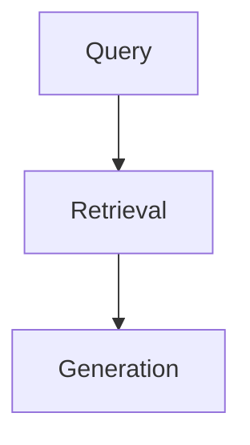
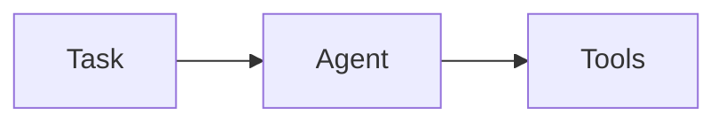

# GenAI Design Patterns

## 📚 What is it?

**GenAI design patterns** are recurring architectural solutions to common problems in LLM-powered systems. Just as the Gang of Four cataloged object-oriented patterns and distributed systems have established patterns (CQRS, event sourcing, circuit breaker), the GenAI domain has converged on a set of proven patterns for building reliable, safe, and cost-effective AI applications.

This catalog provides a reference for system design interviews and production architecture decisions.

## Why do we need it?

**Problem it solves**: Teams building GenAI systems often reinvent solutions to problems that have been solved before:
- "How do I make the LLM use our company data?" → RAG Pattern
- "How do I prevent harmful outputs?" → Guardrail Sandwich Pattern
- "How do I handle multi-step tasks?" → Agent Loop Pattern
- "How do I reduce costs without losing quality?" → Router Pattern

**With a pattern catalog**:
- Engineers pick from proven solutions instead of designing from scratch
- Interview candidates demonstrate architectural fluency by naming and combining patterns
- Teams communicate using shared vocabulary ("Let's add a guardrail sandwich around this endpoint")
- New patterns can be composed from existing ones

## 🏗️ Pattern Catalog

### 1. RAG Pattern (Retrieval-Augmented Generation)

**Problem**: LLM needs access to knowledge that isn't in its training data (private docs, recent information).

**Solution**: Retrieve relevant documents at query time and inject them into the prompt context.

```
  ┌───────┐    ┌───────────┐    ┌──────────┐    ┌─────┐    ┌──────────┐
  │ Query │───►│ Retriever │───►│ Context  │───►│ LLM │───►│ Response │
  │       │    │ (vector   │    │ Assembly │    │     │    │ + Sources│
  │       │    │  search)  │    │          │    │     │    │          │
  └───────┘    └───────────┘    └──────────┘    └─────┘    └──────────┘
```

**Key components**: Embedding model, [vector database](../vector-databases/), chunking pipeline, reranker, prompt template.

**When to use**: Enterprise search, customer support, documentation Q&A — any task requiring factual grounding.

**Detailed reference**: [RAG Architecture](../rag-architecture/)

---

### 2. Agent Loop Pattern (Plan → Act → Observe → Repeat)

**Problem**: Complex tasks require multiple steps, tool usage, and adaptive decision-making that a single LLM call cannot handle.

**Solution**: Wrap the LLM in a loop where it plans the next action, executes it (via tools), observes the result, and decides whether to continue or terminate.

```
  ┌─────────────────────────────────────────┐
  │              Agent Loop                 │
  │                                         │
  │  ┌──────┐    ┌─────┐    ┌─────────┐    │
  │  │ Plan │───►│ Act │───►│ Observe │    │
  │  │      │    │(tool│    │ (parse  │    │
  │  │      │    │call)│    │  result)│    │
  │  └──▲───┘    └─────┘    └────┬────┘    │
  │     │                        │         │
  │     │    ┌──────────┐        │         │
  │     └────│ Continue?│◄───────┘         │
  │          │ (yes/no) │                  │
  │          └────┬─────┘                  │
  │               │ no                     │
  │          ┌────▼─────┐                  │
  │          │  Return  │                  │
  │          │  answer  │                  │
  │          └──────────┘                  │
  └─────────────────────────────────────────┘
```

**Key components**: [Tool registry](../prompting-tools-agents/), action executor, observation parser, termination condition, max-iteration guard.

**Variants**:
- **ReAct** (Reasoning + Acting): Interleave chain-of-thought reasoning with tool calls
- **Plan-and-Execute**: Generate full plan first, then execute steps sequentially
- **Tree of Thoughts**: Explore multiple reasoning branches, prune bad paths

**When to use**: Research tasks, multi-step workflows, data analysis, coding assistants.

**Detailed reference**: [Prompting, Tools & Agents](../prompting-tools-agents/)

---

### 3. Chain-of-Thought Pattern (Decompose Complex Reasoning)

**Problem**: LLMs fail at complex reasoning when asked for direct answers — math, logic, multi-step analysis.

**Solution**: Instruct the model to reason step-by-step before producing a final answer. The intermediate reasoning improves accuracy by forcing the model to show its work.

```
  ┌────────┐    ┌──────────────────────────┐    ┌────────┐
  │ Query  │───►│ "Think step by step..."  │───►│ Answer │
  │        │    │                          │    │        │
  │        │    │ Step 1: Identify ...     │    │        │
  │        │    │ Step 2: Calculate ...    │    │        │
  │        │    │ Step 3: Therefore ...    │    │        │
  └────────┘    └──────────────────────────┘    └────────┘
```

**Variants**:
| Variant | Description | Token Cost |
|---------|-------------|------------|
| **Zero-shot CoT** | Add "Let's think step by step" to prompt | Low |
| **Few-shot CoT** | Provide worked examples with reasoning | Medium |
| **Self-consistency** | Run CoT N times; majority-vote the answer | N× |
| **Tree-of-Thought** | Explore branching reasoning paths | High |

**When to use**: Math problems, logical reasoning, code debugging, complex analysis.

**Caveat**: CoT increases output tokens (and thus [cost](../token-cost-latency/)). Use it selectively for tasks where reasoning quality matters.

---

### 4. Guardrail Sandwich Pattern (Pre-filter → LLM → Post-filter)

**Problem**: LLMs can produce harmful, off-topic, or policy-violating outputs. User inputs may contain jailbreak attempts or toxic content.

**Solution**: Wrap the LLM in a "sandwich" of safety checks — filter the input before it reaches the model and filter the output before it reaches the user.

```
  ┌───────┐    ┌────────────┐    ┌─────┐    ┌─────────────┐    ┌──────────┐
  │ User  │───►│ Pre-filter │───►│ LLM │───►│ Post-filter │───►│ Response │
  │ Input │    │            │    │     │    │             │    │          │
  └───────┘    │• Toxicity  │    │     │    │• Toxicity   │    └──────────┘
               │• PII detect│    │     │    │• Hallucinate│
               │• Jailbreak │    │     │    │• PII redact │
               │• Topic gate│    │     │    │• Policy     │
               └─────┬──────┘    └─────┘    └──────┬──────┘
                     │ block                       │ block
                     ▼                             ▼
               ┌───────────┐                ┌───────────┐
               │ Rejection │                │ Fallback  │
               │ message   │                │ response  │
               └───────────┘                └───────────┘
```

**Pre-filter checks**: Input toxicity, PII detection, jailbreak pattern matching, topic/scope validation, [rate limiting](../../../03-hld-concepts/rate-limiting/).

**Post-filter checks**: Output toxicity, factual grounding (RAG citation check), PII redaction, format validation, policy compliance.

**When to use**: Every production LLM system should have at least basic guardrails. Critical for customer-facing applications, regulated industries, and any system handling sensitive data.

**Detailed reference**: [Safety & Governance](../safety-governance/), [Safety Filter & Policy Engine (LLD)](../../01-llm-lld-projects/safety-filter-policy-engine/)

---

### 5. Router Pattern (Classify → Route to Specialist)

**Problem**: A single model handles all requests, wasting money on simple queries and underperforming on complex ones.

**Solution**: Classify incoming requests and route them to the most appropriate model based on complexity, cost, or domain.

```
  ┌───────┐    ┌────────────┐
  │ Query │───►│ Classifier │
  └───────┘    └──────┬─────┘
                      │
            ┌─────────┼─────────┐
            │         │         │
       ┌────▼───┐ ┌───▼───┐ ┌──▼─────┐
       │ Simple │ │ Medium│ │ Complex│
       │ (8B)  │ │ (70B) │ │ (GPT-4)│
       └────┬───┘ └───┬───┘ └──┬─────┘
            │         │         │
            └─────────┼─────────┘
                      │
                 ┌────▼────┐
                 │ Response│
                 └─────────┘
```

**Routing dimensions**: Complexity, intent/task type, cost budget, latency SLA, tenant tier.

**When to use**: High-traffic systems with diverse query types, multi-tenant platforms, cost-sensitive deployments.

**Detailed reference**: [Model Routing & Orchestration](../model-routing-orchestration/)

---

### 6. Human-in-the-Loop Pattern (AI Draft → Human Review)

**Problem**: Fully autonomous LLM outputs are too risky for high-stakes decisions (legal, medical, financial, content publishing).

**Solution**: The LLM generates a draft or recommendation; a human reviews, edits, and approves before the output is finalized.

```
  ┌───────┐    ┌─────┐    ┌────────────┐    ┌────────┐    ┌──────────┐
  │ Input │───►│ LLM │───►│ Draft +    │───►│ Human  │───►│ Approved │
  │       │    │     │    │ Confidence │    │ Review │    │ Output   │
  └───────┘    └─────┘    └────────────┘    └────┬───┘    └──────────┘
                                                 │
                                           ┌─────▼─────┐
                                           │ Feedback  │
                                           │ collected │
                                           │ for       │
                                           │ training  │
                                           └───────────┘
```

**Automation levels**:
| Level | Description | Example |
|-------|-------------|---------|
| **Full automation** | LLM output goes directly to user | Chatbot FAQ answers |
| **Confidence gating** | Auto-approve if confidence > threshold; queue for review otherwise | Email drafts |
| **Mandatory review** | Every output requires human approval | Legal document generation |
| **Human-initiated** | Human requests AI assistance on demand | Code review suggestions |

**When to use**: Regulated industries, content moderation, high-stakes decisions, early deployment (before trust is established).

**Key design consideration**: Track human edits as training signal for future fine-tuning (connects to Feedback Loop Pattern).

---

### 7. Feedback Loop Pattern (Collect → Fine-tune → Deploy)

**Problem**: LLM performance drifts over time, user preferences evolve, and initial prompt engineering has limits.

**Solution**: Continuously collect signals from production usage (thumbs up/down, human edits, task success rates) and use them to improve the system through fine-tuning, prompt updates, or retrieval index improvements.

```
  ┌───────────────────────────────────────────────────┐
  │                Feedback Loop                      │
  │                                                   │
  │  ┌──────────┐    ┌───────────┐    ┌────────────┐ │
  │  │ Collect  │───►│ Curate &  │───►│ Fine-tune  │ │
  │  │ Signals  │    │ Label     │    │ or Update  │ │
  │  └──────────┘    └───────────┘    └─────┬──────┘ │
  │   • thumbs up/dn   • filter noise      │        │
  │   • human edits     • balance classes   │        │
  │   • task completion • quality review    │        │
  │   • dwell time                          │        │
  │                                         │        │
  │  ┌──────────┐    ┌───────────┐    ┌─────▼──────┐ │
  │  │ Monitor  │◄───│ A/B Test  │◄───│ Deploy     │ │
  │  │ & Alert  │    │           │    │ New Model  │ │
  │  └──────────┘    └───────────┘    └────────────┘ │
  └───────────────────────────────────────────────────┘
```

**Signal types**:
| Signal | Source | Quality |
|--------|--------|---------|
| Explicit feedback | Thumbs up/down, star ratings | High (direct intent) |
| Implicit feedback | Click-through, dwell time, task completion | Medium (noisy) |
| Human edits | Corrections made in human-in-the-loop | Very high (labeled) |
| Safety incidents | Flagged outputs, user reports | Critical |

**Improvement targets**: Fine-tune the model, update prompts, improve RAG retrieval (add/remove docs, re-chunk), adjust routing thresholds, update guardrail rules.

**When to use**: Any production GenAI system that will run for more than a few weeks. Start collecting signals from day one, even if fine-tuning comes later.

**Detailed reference**: [LLM Evaluation](../llm-evaluation/)

---

## Combining Patterns

Real production systems compose multiple patterns. Here is a common composition for an enterprise assistant:

```
  ┌──────────────────────────────────────────────────────────────┐
  │                  Enterprise AI Assistant                     │
  │                                                              │
  │  ┌────────────┐                                              │
  │  │ User Query │                                              │
  │  └─────┬──────┘                                              │
  │        │                                                     │
  │  ┌─────▼──────┐  Guardrail                                   │
  │  │ Pre-filter │  Sandwich                                    │
  │  └─────┬──────┘  (Pattern 4)                                 │
  │        │                                                     │
  │  ┌─────▼──────┐  Router                                      │
  │  │ Classify & │  Pattern                                     │
  │  │ Route      │  (Pattern 5)                                 │
  │  └──┬────┬────┘                                              │
  │     │    │                                                   │
  │  ┌──▼──┐ ┌▼─────┐                                            │
  │  │ RAG │ │Agent │  RAG (Pattern 1)                           │
  │  │     │ │ Loop │  + Agent (Pattern 2)                       │
  │  └──┬──┘ └──┬───┘                                            │
  │     │       │                                                │
  │  ┌──▼───────▼──┐  Guardrail                                  │
  │  │ Post-filter │  Sandwich                                   │
  │  └──────┬──────┘  (Pattern 4)                                │
  │         │                                                    │
  │  ┌──────▼───────┐  Human-in-the-Loop                         │
  │  │ Confidence   │  (Pattern 6, conditional)                  │
  │  │ Gating       │                                            │
  │  └──────┬───────┘                                            │
  │         │                                                    │
  │  ┌──────▼───────┐  Feedback Loop                              │
  │  │ Log + Collect│  (Pattern 7)                               │
  │  │ Feedback     │                                            │
  │  └──────────────┘                                            │
  └──────────────────────────────────────────────────────────────┘
```

**Common pattern combinations**:

| Combination | Use Case |
|-------------|----------|
| RAG + Guardrail Sandwich | Grounded answers with safety checks |
| Router + RAG + Agent Loop | Cost-effective complex assistant |
| Agent Loop + Chain-of-Thought | Multi-step reasoning with tools |
| Human-in-the-Loop + Feedback Loop | Supervised deployment with continuous improvement |
| All patterns combined | Enterprise-grade production system |

## ⚖️ Trade-offs

| Pattern | Benefit | Cost |
|---------|---------|------|
| **RAG** | Grounded, verifiable answers | Retrieval latency, index maintenance |
| **Agent Loop** | Handles complex, multi-step tasks | Unpredictable latency and cost, hard to debug |
| **Chain-of-Thought** | Better reasoning accuracy | More output tokens = higher cost |
| **Guardrail Sandwich** | Safety and policy compliance | Added latency per filter, false positives block valid queries |
| **Router** | Cost optimization, right-sized responses | Router complexity, misrouting risk |
| **Human-in-the-Loop** | High-stakes quality assurance | Bottleneck on human throughput, not real-time |
| **Feedback Loop** | Continuous improvement | Data pipeline investment, labeling effort |

## 🎯 When to Use

✅ **Use this catalog when:**
- Designing a new GenAI system — identify which patterns apply
- In a system design interview — name patterns to demonstrate architectural knowledge
- Reviewing an existing system — check which patterns are missing
- Estimating complexity — each pattern adds specific infrastructure requirements

**Pattern selection guide**:
| Requirement | Start With |
|-------------|-----------|
| Need factual answers from private data | RAG |
| Multi-step or open-ended tasks | Agent Loop |
| Safety-critical application | Guardrail Sandwich |
| High traffic with diverse query types | Router |
| Complex reasoning tasks | Chain-of-Thought |
| Regulated or high-stakes output | Human-in-the-Loop |
| Long-running production system | Feedback Loop |

## Key Takeaways

1. **Patterns compose**: Production systems use 3–5 patterns together; know how they fit
2. **Guardrails are non-negotiable**: Every customer-facing system needs Pattern 4 at minimum
3. **Start with RAG + Guardrails**: This combination covers 80% of enterprise GenAI use cases
4. **Name the pattern in interviews**: Saying "I'd use a guardrail sandwich with RAG" instantly communicates architecture
5. **Feedback loops close the gap**: The difference between a demo and a production system is continuous improvement

---

## 🔗 See Also
- [RAG Architecture](../rag-architecture/) — deep dive into Pattern 1
- [Prompting, Tools & Agents](../prompting-tools-agents/) — deep dive into Patterns 2 and 3
- [Safety & Governance](../safety-governance/) — deep dive into Pattern 4
- [Model Routing & Orchestration](../model-routing-orchestration/) — deep dive into Pattern 5
- [LLM Evaluation](../llm-evaluation/) — measuring pattern effectiveness (Pattern 7)
- [Vector Databases](../vector-databases/) — core infrastructure for RAG pattern
- [Token Economics](../token-cost-latency/) — cost implications of pattern choices
- [Document Q&A RAG (HLD)](../../02-llm-hld-projects/document-qa-rag/) — RAG pattern in full system design
- [Agentic Workflow Orchestrator (HLD)](../../02-llm-hld-projects/agentic-workflow-orchestrator/) — Agent Loop pattern at scale
- [AI Coding Copilot (HLD)](../../02-llm-hld-projects/ai-coding-copilot/) — multiple patterns combined in practice
- [Multi-Tenant Chat Assistant (HLD)](../../02-llm-hld-projects/multi-tenant-chat-assistant/) — Router + RAG + Guardrails in production
- [Safety Filter & Policy Engine (LLD)](../../01-llm-lld-projects/safety-filter-policy-engine/) — building guardrail components


## Architecture Diagrams


*RAG Pattern*


*Agent Pattern*

