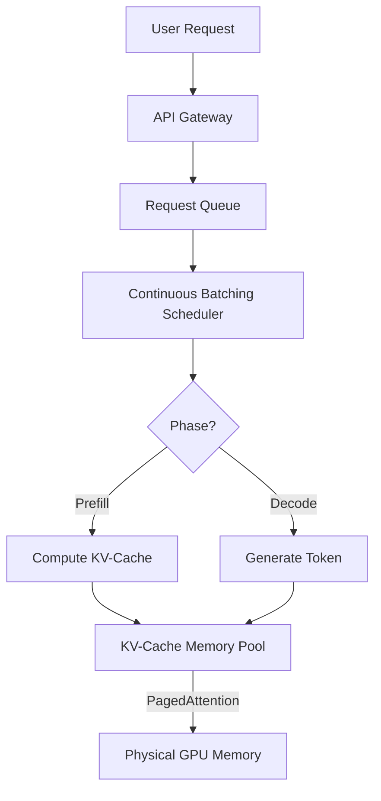
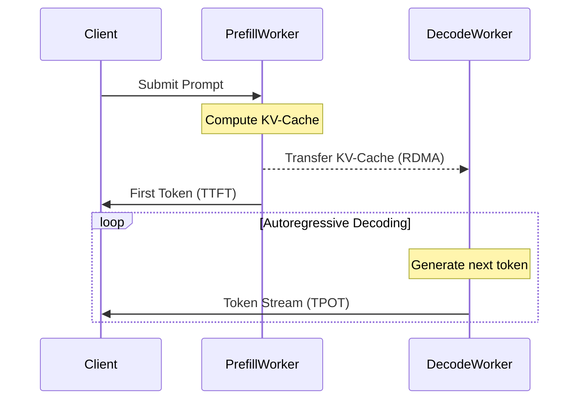
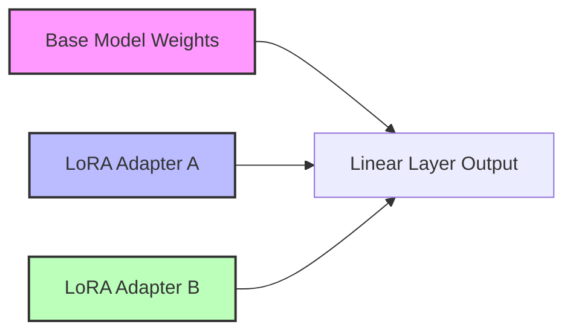

# Concept: LLM Inference Serving

## 1. Introduction to LLM Inference

LLM inference serving is the complex process of efficiently deploying Large Language Models in production to serve user requests. Unlike traditional microservices where requests are processed almost instantaneously, LLM inference is fundamentally limited by memory bandwidth, computation density, and the autoregressive nature of text generation.

Understanding the mechanics of LLM serving is critical for designing GenAI systems that are both performant and cost-effective. The landscape has evolved rapidly from simple standard Hugging Face pipelines to highly optimized engines utilizing advanced batching, caching, and custom attention kernels.

## 2. Prefill vs. Decode Phases

LLM inference operates in two distinct phases:

### Prefill Phase (Time To First Token - TTFT)
When a user submits a prompt, the model must process the entire input sequence simultaneously to generate the first output token.
- **Compute-Bound:** The operation is typically bounded by the GPU's compute capability (FLOPs) rather than memory bandwidth, because the matrix multiplications can be highly parallelized across the input sequence.
- **KV-Cache Generation:** During this phase, the Key (K) and Value (V) tensors for each token in the prompt are computed and stored in the KV-Cache.
- **Metric:** Measured by Time To First Token (TTFT).

### Decode Phase (Time Per Output Token - TPOT)
After the first token, the model generates subsequent tokens autoregressively—one by one.
- **Memory-Bound:** This phase is bounded by memory bandwidth. To generate a single token, the model must read the entire model weights and the KV-Cache from GPU memory into the compute cores.
- **Sequential:** Each token generation depends on the previously generated token.
- **Metric:** Measured by Time Per Output Token (TPOT).

## 3. KV-Cache Memory Math

The KV-Cache is a critical optimization that stores the attention keys and values for past tokens to avoid recomputing them. However, it consumes a massive amount of GPU memory.

### The Memory Equation

For a single token, the KV-cache memory required is:
`Bytes per token = 2 (K and V) × Number of Layers × Number of KV Heads × Head Dimension × Bytes per parameter`

### Worked Example: Llama-2-70B

Let's calculate the KV-cache size for Llama-2-70B (FP16):
- **Layers ($L$):** 80
- **KV Heads ($H_{kv}$):** 8 (using Grouped Query Attention)
- **Head Dimension ($D$):** 128
- **Bytes per param ($b$):** 2 (FP16)

`Bytes per token = 2 × 80 × 8 × 128 × 2 = 327,680 bytes (≈ 327 KB)`

If a batch has 32 requests, and each has a context of 4,096 tokens:
`Total KV-Cache = 32 × 4,096 × 327,680 ≈ 42.9 GB`

This is memory *in addition* to the model weights (~140GB for FP16). This massive memory requirement is why serving large models requires multiple GPUs and advanced memory management.

## 4. Continuous Batching

Traditional static batching waits for a set of requests, processes them together, and waits for all to finish before returning. In LLMs, request lengths vary wildly. Static batching wastes enormous compute resources waiting for the longest request to finish.

**Continuous Batching (In-Flight Batching)** dynamically adds and removes requests from the batch at the token level.
- When request A finishes, request C is immediately swapped into the batch for the very next token iteration.
- This dramatically increases GPU utilization and overall throughput.

## 5. PagedAttention and vLLM

Managing the KV-cache memory dynamically for continuous batching is challenging due to memory fragmentation.

**PagedAttention**, introduced by vLLM, solves this by treating KV-cache memory like an operating system treats virtual memory.
- The KV-cache is divided into fixed-size "blocks" (e.g., storing 16 or 32 tokens).
- Requests are allocated non-contiguous physical blocks on the GPU.
- A page table maps logical token sequences to physical blocks.
- **Benefit:** Eliminates external fragmentation and bounds internal fragmentation, allowing up to 4x higher batch sizes and throughput.

## 6. Chunked Prefill

Mixing prefill and decode phases in the same batch is problematic because prefill is compute-bound (needs high FLOPs) and decode is memory-bound (needs high bandwidth). A long prefill can stall all decoding requests, causing latency spikes.

**Chunked Prefill** breaks a long input prompt into smaller chunks (e.g., 512 tokens).
- Instead of processing a 4K token prompt all at once, it processes it in 8 chunks.
- These chunks are interleaved with decoding steps of other requests.
- **Benefit:** Smooths out TPOT (Time Per Output Token) for ongoing requests, preventing latency spikes caused by new long-context requests.

## 7. Prefix Caching (Prompt Caching)

In many applications (like multi-turn chat or agentic workflows), a large portion of the prompt (the system prompt or previous chat history) is identical across multiple requests.

**Prefix Caching** stores the KV-cache for these shared prefixes in GPU memory.
- When a new request arrives with a known prefix, the system reuses the existing KV-cache blocks.
- **Benefit:** Drastically reduces TTFT for cached prompts and saves compute resources.
- **Implementation:** Often implemented using radix trees to match longest common prefixes.

## 8. Speculative Decoding

Speculative decoding speeds up the memory-bound decode phase by generating multiple tokens per forward pass of the large model.

### How it Works:
1. **Drafting:** A small, fast "draft" model (e.g., 1B params) generates $K$ tokens autoregressively.
2. **Verification:** The large "target" model (e.g., 70B params) evaluates all $K$ tokens in a single forward pass.
3. **Acceptance:** The target model accepts a prefix of the drafted tokens that match its own distribution.

### Speedup Math

Let:
- $T_{target}$: Time for one forward pass of the large model (e.g., 20ms)
- $T_{draft}$: Time for one forward pass of the draft model (e.g., 2ms)
- $\gamma$: Average number of tokens accepted per step (e.g., 2.5)
- $K$: Number of draft tokens (e.g., 4)

Time for a standard step (1 token): $T_{target} = 20ms$
Time for a speculative step (generating $\gamma$ tokens): $K 	imes T_{draft} + T_{target} = 4 	imes 2ms + 20ms = 28ms$

Speedup = $rac{\gamma 	imes 	ext{Standard Step Time}}{	ext{Speculative Step Time}} = rac{2.5 	imes 20}{28} pprox 1.78	imes$

With these numbers, speculative decoding provides a 1.78x speedup in tokens per second.

## 9. Quantization for Serving

Quantization reduces the precision of model weights (and sometimes activations or KV-cache) from FP16 (16-bit) to INT8 (8-bit) or INT4 (4-bit).

- **Weight-Only Quantization (e.g., AWQ, GPTQ):** Compresses weights to save memory bandwidth during decode. Activations remain in FP16.
- **KV-Cache Quantization:** Compresses the KV-cache (e.g., FP8 or INT4) to allow larger batch sizes, directly increasing throughput.
- **Trade-off:** Lower memory usage and higher speed vs. potential slight degradation in model quality/accuracy.

## 10. Model Parallelism: TP, PP, EP

When a model doesn't fit on a single GPU (or to decrease latency), it must be distributed.

### Tensor Parallelism (TP)
- Splits individual tensors (matrix operations) across multiple GPUs.
- **Best for:** Low latency (TPOT reduction).
- **Constraint:** Requires extremely high bandwidth between GPUs (e.g., NVLink) because communication occurs at every layer. Usually limited to a single node (up to 8 GPUs).

### Pipeline Parallelism (PP)
- Splits the model by layers (e.g., layers 1-20 on GPU 1, 21-40 on GPU 2).
- **Best for:** Serving very large models that exceed single-node memory.
- **Constraint:** Introduces "bubble" time where GPUs are idle waiting for previous stages. Does not reduce TPOT significantly compared to TP.

### Expert Parallelism (EP)
- Used in Mixture-of-Experts (MoE) models (like Mixtral).
- Distributes different experts across different GPUs.
- Only the specific expert needed for a token processes it.

## 11. Disaggregated Serving

In traditional serving, a single instance handles both prefill and decode. This causes resource contention.

**Disaggregated Serving** separates these phases:
- **Prefill Workers:** Optimized for compute (high FLOP utilization). Process incoming prompts and generate the initial KV-cache.
- **Decode Workers:** Optimized for memory bandwidth. Autoregressively generate tokens.
- **KV-Cache Transfer:** The KV-cache generated by the prefill worker is transferred over the network (e.g., via RDMA) to the decode worker.
- **Benefit:** Drastically improves cluster utilization and stability.

## 12. Multi-LoRA Serving

Fine-tuning a separate 70B model for every customer is cost-prohibitive. LoRA (Low-Rank Adaptation) trains only a small set of adapter weights (~100MB) on top of the base model.

**Multi-LoRA Serving (e.g., LoRAX, vLLM):**
- A single base model is loaded into GPU memory.
- Thousands of LoRA adapters are stored in CPU RAM and dynamically swapped into GPU memory as requests arrive.
- **Benefit:** Serves hundreds of fine-tuned models from a single GPU cluster, massively reducing costs.

## 13. Autoscaling Strategies

LLM autoscaling is complex because models take time to load (minutes) and KV-cache state is tied to specific workers.

- **Metrics:** Traditional CPU/Memory scaling fails. Scale based on **KV-Cache utilization**, **Active Requests per GPU**, or **Queue Length**.
- **Cold Starts:** Keep warm pools of instances for critical models. Use techniques like weight streaming or sharing to reduce load times.

## 14. Service Level Objectives (SLOs)

LLM systems require specialized SLOs:

1. **TTFT (Time To First Token):** Critical for interactive chat. Typically targeted at < 1-2 seconds.
2. **TPOT (Time Per Output Token):** Dictates reading speed. Targeted at < 50ms per token (approx 20 tokens/sec, faster than human reading).
3. **Throughput:** Tokens generated per second per GPU. Important for cost efficiency.

## 15. Engine Comparison

| Engine | Primary Focus | Key Features | Best Use Case |
|--------|---------------|--------------|---------------|
| **vLLM** | High Throughput | PagedAttention, Continuous Batching, Prefix Caching | General production serving |
| **TGI (HuggingFace)** | Production Features | Rust backend, optimized kernels, native HF integration | Enterprise deployments needing tight HF integration |
| **TensorRT-LLM** | Max Performance (Nvidia) | Extremely optimized kernels for Nvidia hardware, In-flight batching | Maximum possible performance on Nvidia GPUs |
| **SGLang** | Structured Output | RadixAttention, optimized constraint generation | Agentic workflows, JSON generation |

## 16. Cost Per 1M Tokens

Inference costs are typically measured per 1 Million tokens (input or output).
- **Input Tokens:** Cheaper because prefill is highly parallelized.
- **Output Tokens:** More expensive (often 2-4x input cost) because decode is sequential and memory-bound.
- **Cost Reduction Drivers:** Higher batch sizes, quantization, prompt caching, and using smaller/distilled models.

## Architecture Diagrams

*Continuous Batching and PagedAttention*

*Disaggregated Serving Architecture*

*Multi-LoRA Inference*

## Trade-off Tables

### Tensor Parallelism vs Pipeline Parallelism
| Feature | Tensor Parallelism (TP) | Pipeline Parallelism (PP) |
|---------|------------------------|---------------------------|
| **Split By** | Matrix Operations | Network Layers |
| **Latency (TPOT)** | Low (Reduces TPOT) | High (Does not reduce TPOT) |
| **Network Req.** | High (NVLink required) | Moderate |
| **Scale** | Intra-node (up to 8 GPUs) | Inter-node (many servers) |

### Quantization Trade-offs
| Type | Memory Savings | Speedup | Quality Drop |
|------|----------------|---------|--------------|
| **FP16 (Baseline)** | 1x | 1x | None |
| **INT8 Weight-Only** | ~2x | ~1.5x | Minimal |
| **INT4 (e.g. AWQ)** | ~3.5x | ~2-3x | Noticeable on complex tasks |

## Failure Modes

1. **OOM (Out of Memory):** Occurs if KV-cache limits are set too high or sequence lengths exceed expectations. Managed via PagedAttention and strict max-token limits.
2. **Latency Spikes:** Caused by long prefill requests blocking decode requests in the same batch. Mitigated by Chunked Prefill.
3. **KV-Cache Fragmentation:** Traditional serving wastes memory. Fixed by PagedAttention.
4. **Draft Model Divergence:** In speculative decoding, if the draft model is too inaccurate, the acceptance rate ($\gamma$) drops to zero, and the system becomes slower than standard decoding due to the overhead.

---

## Extended Details on Attention Kernels and Serving Topology

To fully grasp inference serving, one must understand how attention kernels have evolved and how hardware topologies constrain them.

### The Evolution of Attention Kernels

#### Standard Attention
The naive implementation of attention requires materializing an $N \times N$ attention matrix (where $N$ is sequence length). This consumes $O(N^2)$ memory and compute, making long contexts impossible. During serving, this directly limits the maximum prompt size a user can submit.

#### FlashAttention
FlashAttention computes exact attention without materializing the $N \times N$ matrix in high-bandwidth memory (HBM). It uses tiling to load blocks of Q, K, and V from HBM to SRAM, computes attention on-chip, and writes the result back.
- **Benefit:** Massive reduction in memory reads/writes, making attention compute-bound rather than memory-bound, and scaling linearly $O(N)$ in memory requirements.
- **Impact on Serving:** FlashAttention dramatically speeds up the prefill phase, reducing TTFT.

#### FlashDecoding
While FlashAttention optimizes prefill, FlashDecoding optimizes the decode phase. In decode, query length is 1, but KV lengths are long. FlashDecoding splits the keys and values into chunks, computes attention for each chunk in parallel across different thread blocks, and then performs a final reduction.
- **Benefit:** Greatly accelerates generation for very long contexts, keeping TPOT stable even as the output grows.

### In-Depth Look at Memory Topologies

Understanding memory topologies is crucial for designing high-performance inference servers.
When working with multiple GPUs, the interconnection between them becomes a significant bottleneck, especially during Tensor Parallelism (TP).

#### NVLink and NVSwitch
Nvidia's proprietary interconnects provide extremely high bandwidth (e.g., up to 900 GB/s on Hopper architectures). This is essential for TP, where activations must be synchronized across GPUs at every layer of the transformer block. Without this, the communication overhead would negate the benefits of parallelizing the matrix multiplications.

#### PCIe Bottlenecks
If GPUs are connected only via PCIe (Peripheral Component Interconnect Express), the bandwidth is significantly lower (e.g., ~64 GB/s for PCIe Gen4 x16). Attempting Tensor Parallelism over PCIe usually results in poor performance because the GPUs spend more time waiting for data transfers than computing. Pipeline Parallelism (PP) is more forgiving of PCIe bottlenecks because communication only happens at the boundaries of the pipeline stages, not at every layer.

#### RDMA (Remote Direct Memory Access)
For cross-node communication (essential for large-scale Pipeline Parallelism or Disaggregated Serving), technologies like InfiniBand or RoCE (RDMA over Converged Ethernet) are used. RDMA allows direct memory access from the memory of one computer into that of another without involving either one's operating system. This is critical for minimizing latency and CPU overhead when transferring massive KV-caches or activations between servers.

## Extended Case Study: Serving Llama-3-70B

Let's walk through a realistic scenario of serving a 70B parameter model in a production environment.

### Constraints and Hardware
- **Model:** Llama-3-70B (FP16 weights) -> Requires ~140GB VRAM just for weights.
- **Context Window:** 8,192 tokens.
- **Hardware:** A single node with 4x A100 (80GB) GPUs. Total VRAM = 320GB.

### Memory Allocation Breakdown
1. **Model Weights:** ~140GB. This is distributed across the 4 GPUs using Tensor Parallelism (TP=4). Each GPU holds ~35GB of weights.
2. **CUDA Context & Engine Overhead:** ~2-4GB per GPU.
3. **Available for KV-Cache:** 320GB - 140GB - (4 * 4GB) = ~164GB total available for KV-Cache across the node.

### Calculating Max Concurrency
Let's assume an average request length of 2,048 tokens.
Using our KV-Cache math (assuming GQA with 8 KV heads like Llama-2):
`KV-Cache per token = 2 * 80 * 8 * 128 * 2 = 327 KB/token`
For a 2,048 token request: `2048 * 327 KB = ~670 MB per request`.
Max Concurrent Requests = `164,000 MB / 670 MB ≈ 244 concurrent requests`.

### Managing Peak Load
If traffic spikes to 500 concurrent requests, the system cannot handle them all simultaneously without OOMing. 
- **Continuous Batching & PagedAttention** will dynamically allocate blocks to active requests.
- The **Scheduler** will maintain a queue. When the active batch reaches the KV-cache limit (near 244 requests), new requests are queued.
- If an active request suddenly generates a very long response, consuming more blocks than anticipated, the scheduler may preempt (evict) a lower-priority request, moving its KV-cache to CPU RAM (swapping) or discarding it (requiring recomputation later), to ensure the active request can complete.

## Security and Isolation in Multi-Tenant Caching

As discussed in the shared prefix cache concepts, when multiple tenants share an inference engine, prefix caching introduces potential vulnerabilities.
If Tenant A and Tenant B happen to submit identical prompts (or crafted prompts that hash to the same value), they could theoretically hit the same KV-cache blocks.
While the output tokens might be generated correctly based on the shared KV-cache, the *system* must guarantee that no side-channel leakage occurs.

**Mitigations:**
- **Strict Tenant Isolation:** The cache key must include the `tenant_id` along with the prompt hash. This prevents Tenant A from ever reusing Tenant B's cache, even if the text is identical.
- **Vetted System Prompts:** Prefix caching is often restricted strictly to predefined, vetted system prompts controlled by the platform, rather than arbitrary user inputs, ensuring that only safe, public states are cached and shared.

## Production Observability

Monitoring an inference engine requires specific metrics:
- **Cache Hit Rate:** For prefix caching, a high hit rate indicates good reuse of system prompts.
- **GPU KV-Cache Utilization:** Should be high but never 100% to avoid OOMs.
- **Pending Request Queue:** Indicates if the system is under-provisioned and cannot keep up with arrival rates.
- **Tokens/Sec/User:** Ensures fair sharing in multi-tenant environments.
- **Time to First Token (P99):** The critical latency metric. P99 spikes usually indicate prefill/decode contention.

## Hardware Considerations

Inference economics are driven by hardware choices:
- **H100/A100:** High memory bandwidth, necessary for large models and high throughput.
- **L40S / L4:** Good for smaller models or batched offline workloads where latency is less critical.
- **Memory Bandwidth vs Compute:** Always remember that inference decode is bound by memory bandwidth (GB/s), not just raw compute (TFLOPs). A GPU with massive FLOPs but slow memory will perform poorly during decode.

## The Future: Continuous Evolution

The field of LLM inference is evolving at an unprecedented pace. Techniques that were state-of-the-art six months ago are being replaced.
- **Long-Context Models:** Models with 1M+ token contexts (like Gemini 1.5 Pro) completely change the calculus. The KV-cache for 1M tokens is immense. Techniques like Ring Attention and Context-Parallelism are being developed to distribute a single sequence's attention calculation across multiple GPUs.
- **Sparsity:** Leveraging sparse activation (MoE) and sparse attention to reduce compute and memory requirements.
- **Hardware Acceleration:** Future hardware (like Nvidia Blackwell or custom silicon like Groq) will introduce specialized architectural features that may render current software-level optimizations obsolete or require entirely new paradigms.

## Advanced Scheduling Policies

Beyond simple FIFO queues, modern inference servers implement sophisticated scheduling algorithms to maximize throughput while respecting latency Service Level Objectives (SLOs).

### Shortest Request First (SRF)
Some engines attempt to predict the length of a generated response based on the input prompt or a fast heuristic. If a request is predicted to be short, it is prioritized.
- **Benefit:** Reduces average latency and prevents head-of-line blocking where a long-running generation delays many short tasks.
- **Risk:** Starvation of long requests. Requires age-based priority boosting to ensure long tasks eventually complete.

### Fair Share Scheduling
In multi-tenant environments, one user flooding the API could consume all KV-cache blocks, starving others.
- **Implementation:** The scheduler tracks the number of active tokens or KV-blocks per tenant. 
- **Mechanism:** If a tenant exceeds their quota, their requests are queued or preempted (swapped out) in favor of tenants who are under quota, guaranteeing fair distribution of the GPU cluster.

### Token-Level Preemption
When the KV-cache is completely full, a request must be paused. The engine has choices on *how* to pause:
1. **Swapping:** Moving the KV-cache to CPU memory. Slower to resume but saves compute.
2. **Recomputation:** Deleting the KV-cache entirely. Faster to pause, but requires re-running the compute-heavy prefill phase to resume.
The scheduler uses a cost model to dynamically choose between swapping and recomputation based on available PCIe bandwidth versus GPU compute availability.

## Serving Engine Integration with Orchestrators

Inference serving engines do not operate in a vacuum. They are typically managed by higher-level orchestrators like Kubernetes.

### The Role of Kubernetes
- **Pod Deployment:** Inference engines are packaged in Docker containers and deployed as Kubernetes Pods, often requesting specific GPU resources (e.g., `nvidia.com/gpu: 8`).
- **Liveness/Readiness Probes:** The engine exposes `/health` endpoints. Since loading weights takes minutes, the pod is not marked "Ready" until the weights are fully loaded into VRAM.

### Challenges with K8s and LLMs
Traditional Kubernetes Horizontal Pod Autoscalers (HPA) rely on CPU/Memory metrics, which are useless for LLMs. 
- **Custom Metrics:** Operators must expose custom metrics from the serving engine (like KV-cache utilization or pending queue length) to Prometheus, and use tools like KEDA (Kubernetes Event-driven Autoscaling) to scale pods based on these LLM-specific signals.
- **Graceful Shutdown:** When scaling down, pods must drain active requests. Terminating a pod instantly destroys the active KV-cache, breaking user generations mid-sentence.

## Optimization of Generation Strategies

The decoding strategy directly impacts the perceived speed and the underlying serving cost.

### Greedy Search vs. Sampling
- **Greedy Search:** Always picks the token with the highest probability. It is deterministic and fast but can lead to repetitive or bland text.
- **Top-K / Top-P (Nucleus) Sampling:** Adds randomness by sampling from the top K most likely tokens or the top P cumulative probability mass. This requires a temperature scaling step and a random number generator, adding slight overhead to the decode phase.

### Beam Search in Serving
Beam search explores multiple generation paths (beams) simultaneously to find the best overall sequence.
- **Memory Cost:** If `beam_size = 4`, the inference engine must maintain 4 independent KV-caches for a single user request. This quadruples the memory requirement and drastically reduces the number of concurrent users the server can handle.
- **Usage:** Beam search is rarely used in real-time chat APIs due to its memory cost and latency. It is reserved for offline translation or summarization tasks where quality outweighs speed.

### Structured Output Generation
When generating JSON or code, the engine must constrain the LLM's output.
- **Logit Biasing:** The engine artificially increases the probability of valid tokens (like `{` or `"`) and sets the probability of invalid tokens to zero.
- **Finite State Machines (FSM):** Advanced engines like SGLang or guidance-integrated vLLM use FSMs or regex parsers compiled directly into the attention kernels. This ensures the output is 100% valid JSON, but the complex state tracking adds overhead to the TPOT.

## Network Implications in LLM APIs

The massive size of LLM responses (sometimes generating 4000+ tokens) puts unique strain on network infrastructure compared to traditional REST APIs.

### Server-Sent Events (SSE) vs WebSockets
- **SSE (Server-Sent Events):** The industry standard for streaming LLM responses. It operates over a single HTTP connection, making it firewall-friendly and easy to load balance. The server pushes token chunks to the client as they are generated.
- **WebSockets:** Bidirectional communication. Useful for interactive voice applications where the user can interrupt the model mid-generation, requiring the client to send a "cancel" signal immediately.

### Time-to-First-Byte (TTFB) vs Time-To-First-Token (TTFT)
While related, they are not identical. 
- **TTFT:** The time it takes the GPU to generate the first token.
- **TTFB:** The time it takes for that token to travel through the serving engine, API gateway, load balancers, and internet routing to reach the end-user's browser.
A highly optimized engine (low TTFT) can still feel slow if the network routing is poor (high TTFB).

