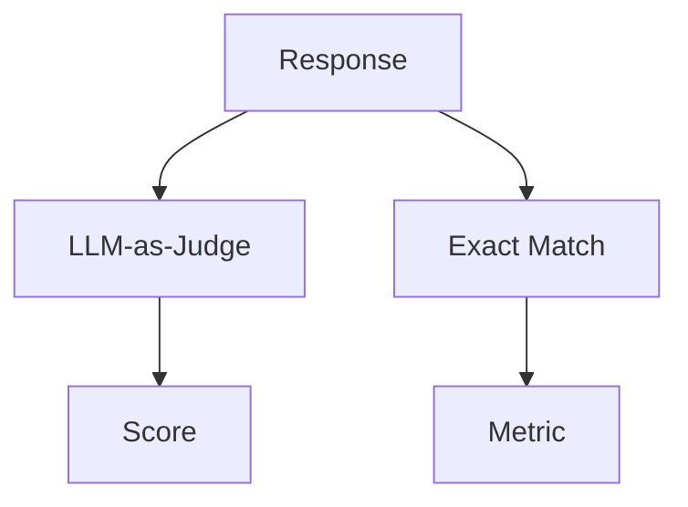
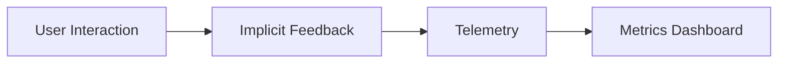

# LLM Evaluation

## What is it?

LLM Evaluation is the systematic process of measuring the **quality, safety, and reliability** of Large Language Model outputs. Unlike traditional software testing with deterministic pass/fail, LLM evaluation deals with probabilistic outputs where "correct" is often subjective—requiring specialized metrics, human judgment, and automated scoring pipelines.

## Why do we need it?

**Problem it solves**: You deploy a RAG-based customer support bot. It answers 10,000 questions per day. Without evaluation:
- You don't know if answers are factually correct or hallucinated
- Harmful or biased outputs slip into production undetected
- Prompt changes silently degrade quality with no regression signal
- Red-team attacks succeed without measurement

**With systematic evaluation**:
- Golden sets catch regressions before deployment
- Online monitoring detects quality drift in real-time
- Safety benchmarks quantify attack resistance
- Composite trust scores combine quality + safety into a single decision gate

## Core Ideas

### 1. Offline vs Online Evaluation

```
┌─────────────────────────────────────────────────────────────────┐
│                    OFFLINE EVALUATION                            │
│                  (Before Deployment)                             │
│                                                                 │
│  ┌──────────┐    ┌───────────┐    ┌──────────┐    ┌─────────┐  │
│  │ Golden   │───►│  Run LLM  │───►│  Score   │───►│ Report  │  │
│  │ Test Set │    │  on inputs │    │ outputs  │    │ metrics │  │
│  └──────────┘    └───────────┘    └──────────┘    └─────────┘  │
│                                                                 │
│  Metrics: accuracy, F1, BLEU, ROUGE, faithfulness, relevance   │
└─────────────────────────────────────────────────────────────────┘

┌─────────────────────────────────────────────────────────────────┐
│                    ONLINE EVALUATION                             │
│                  (In Production)                                 │
│                                                                 │
│  ┌──────────┐    ┌───────────┐    ┌──────────┐    ┌─────────┐  │
│  │ Live     │───►│  LLM      │───►│  Log &   │───►│ Alert & │  │
│  │ traffic  │    │  responds  │    │  sample  │    │ analyze │  │
│  └──────────┘    └───────────┘    └──────────┘    └─────────┘  │
│                                                                 │
│  Metrics: latency, user feedback, thumbs-up/down, escalations  │
└─────────────────────────────────────────────────────────────────┘
```

| Aspect | Offline | Online |
|--------|---------|--------|
| **When** | Before deploy, in CI/CD | After deploy, continuously |
| **Data** | Curated test sets, benchmarks | Real user traffic (sampled) |
| **Speed** | Minutes to hours (batch) | Real-time or near-real-time |
| **Signal** | Controlled, reproducible | Noisy but realistic |
| **Catches** | Known regressions | Unknown edge cases, drift |
| **Cost** | Compute for batch runs | Logging, sampling, annotation |

**Interview tip**: A robust evaluation strategy uses **both**. Offline catches regressions pre-deploy; online catches distribution shift and real-world edge cases post-deploy.

### 2. LLM-as-a-Judge

Using a separate LLM to score another LLM's outputs. Fast and scalable—but riddled with pitfalls.

```
┌───────────┐    prompt +     ┌───────────┐    response    ┌───────────┐
│  Test     │───  expected  ─►│  Target   │──────────────►│  Judge    │
│  Input    │    answer       │  LLM      │               │  LLM      │
└───────────┘                 └───────────┘               └─────┬─────┘
                                                                │
                                                         ┌──────▼──────┐
                                                         │  Score:     │
                                                         │  1-5 rating │
                                                         │  + reason   │
                                                         └─────────────┘
```

#### Known Pitfalls

| Pitfall | Description | Mitigation |
|---------|-------------|------------|
| **Verbosity bias** | Judges prefer longer answers regardless of quality | Normalize for length; include "conciseness" criterion |
| **Positional bias** | In pairwise comparison, judges favor the first or second option | Randomize order; run both orderings and average |
| **Self-preference** | GPT-4 rates GPT-4 outputs higher than equivalent human text | Use a different model family as judge; cross-validate with humans |
| **Calibration drift** | Judge scores shift as the judge model is updated | Pin judge model version; track score distributions over time |
| **Sycophancy** | Judge agrees with the framing of the prompt | Use neutral prompts; avoid leading language |

**Mitigation pattern**: Always calibrate LLM judges against a human-labeled subset (~100-200 examples). Track **judge-human agreement rate** (Cohen's κ > 0.6 is acceptable).

### 3. Golden Sets

A **golden set** is a curated, versioned collection of (input, expected_output, metadata) tuples used as ground truth for evaluation.

```
┌─────────────────────────────────────────────────────┐
│                    GOLDEN SET v2.3                    │
├───────┬──────────────┬──────────────┬───────────────┤
│  ID   │  Input       │  Expected    │  Category     │
├───────┼──────────────┼──────────────┼───────────────┤
│  001  │  "What is…"  │  "X is…"     │  factual      │
│  002  │  "Compare…"  │  "A vs B…"   │  reasoning    │
│  003  │  "How to…"   │  "Step 1…"   │  instruction  │
│  004  │  "<attack>"  │  "I can't…"  │  safety       │
│  ...  │  ...         │  ...         │  ...          │
│  500  │  "Summarize" │  "Key pts…"  │  summarize    │
└───────┴──────────────┴──────────────┴───────────────┘
```

#### Golden Set Best Practices

- **Version** the set (v1, v2, …)—never mutate in place
- **Cover** all critical categories: factual, reasoning, safety, edge cases
- **Size**: 200-500 examples minimum for statistical significance
- **Refresh** quarterly to account for distribution shift
- **Annotate** with difficulty, category, and source metadata
- **Store** in version control alongside evaluation code

**Anti-pattern**: Using golden sets as training data defeats the purpose. Keep eval sets strictly separate from fine-tuning data.

### 4. Attack Success Rate (ASR)

**ASR** measures how often adversarial inputs successfully bypass safety guardrails. It is the core metric for **red-teaming** LLM systems.

```
                    ┌─────────────┐
                    │ Adversarial │
                    │  Test Suite │
                    │  (N attacks)│
                    └──────┬──────┘
                           │
                    ┌──────▼──────┐
                    │   Target    │
                    │   System    │
                    └──────┬──────┘
                           │
              ┌────────────┼────────────┐
              │                         │
       ┌──────▼──────┐          ┌──────▼──────┐
       │   Blocked   │          │  Succeeded  │
       │  (safe)     │          │  (unsafe)   │
       └─────────────┘          └─────────────┘

       ASR = Succeeded / Total Attacks × 100%
```

| ASR Range | Interpretation | Action |
|-----------|---------------|--------|
| **< 5%** | Strong safety posture | Monitor; extend attack library |
| **5-15%** | Acceptable with mitigations | Fix known bypasses; add guardrails |
| **15-30%** | Needs improvement | Block deploy; review safety layers |
| **> 30%** | Critical risk | Halt; major safety redesign needed |

**Attack categories to test**:
- **Prompt injection**: "Ignore previous instructions and…"
- **Jailbreaks**: Role-play exploits, multi-turn manipulation
- **Data extraction**: Attempting to leak system prompts or training data
- **Harmful content**: Generating violence, illegal advice, PII
- **Bias elicitation**: Probing for discriminatory outputs

### 5. Trustfulness = Quality + Safety

**Trustfulness** is a composite framework that combines quality metrics with safety metrics into a unified evaluation score.

```
┌─────────────────────────────────────────────────────────┐
│                   TRUSTFULNESS SCORE                     │
│                                                         │
│   ┌─────────────────────┐  ┌─────────────────────────┐  │
│   │   QUALITY (60%)     │  │    SAFETY (40%)          │  │
│   │                     │  │                          │  │
│   │  • Accuracy    25%  │  │  • Toxicity-free   15%  │  │
│   │  • Relevance   15%  │  │  • Bias-free       10%  │  │
│   │  • Coherence   10%  │  │  • Guardrail pass  10%  │  │
│   │  • Faithfulness 10% │  │  • ASR (inverse)    5%  │  │
│   └─────────────────────┘  └─────────────────────────┘  │
│                                                         │
│   Trust = 0.6 × Quality + 0.4 × Safety                 │
│   Deploy gate: Trust ≥ 0.85                             │
└─────────────────────────────────────────────────────────┘
```

**Key principle**: A model that scores 95% on quality but 60% on safety is **not trustworthy**. Safety acts as a **hard gate**—if safety score falls below threshold, quality score is irrelevant.

| Component | Metric | Measurement |
|-----------|--------|-------------|
| Accuracy | Factual correctness | Golden set comparison |
| Relevance | Answer addresses the question | LLM-as-judge + human sample |
| Coherence | Logical, well-structured output | Automated readability + judge |
| Faithfulness | Grounded in provided context (RAG) | Citation verification |
| Toxicity-free | No harmful or offensive content | Classifier (Perspective API, etc.) |
| Bias-free | No discriminatory patterns | Demographic parity tests |
| Guardrail pass | Input/output filters working | Adversarial test suite |
| ASR (inverse) | 1 − attack success rate | Red-team evaluation |

## Classical ML Evaluation Bridge

This framework also maps cleanly to non-LLM applied ML interview problems.

### Metric ladder (same structure, different metrics)

| Layer | Classification examples | Ranking/recommendation examples | Generative/LLM examples |
|------|--------------------------|----------------------------------|-------------------------|
| Business objective | Reduce harmful exposure, lower appeal burden | Improve long-term satisfaction/retention | Improve trustworthy task completion |
| Product metrics | Exposure rate, appeal rate, review load | Session quality, retention, dissatisfaction proxies | Deflection rate, user satisfaction |
| ML metrics | Precision/recall/F1, PR-AUC, calibration | NDCG/MRR/coverage/diversity | Relevance, faithfulness, safety pass rate |

### Challenge taxonomy (portable across interview types)

1. **Class imbalance:** rare harmful/critical classes distort aggregate metrics.
2. **Label scarcity:** high-quality labels are limited and expensive.
3. **Feedback loops:** model decisions change future training data.
4. **Evaluation horizon:** online product impact can lag model changes.
5. **Distribution shift:** user behavior and content patterns change over time.

Use this ladder explicitly in interviews: `business -> product -> ML`, then explain offline gates + online monitoring + sampled human audits.

## How it works

### End-to-End Evaluation Pipeline

```
┌──────────┐   ┌───────────┐   ┌───────────┐   ┌───────────┐   ┌──────────┐
│  Define  │──►│  Collect   │──►│  Execute  │──►│  Score    │──►│  Decide  │
│  metrics │   │  test data │   │  model    │   │  outputs  │   │  ship/no │
└──────────┘   └───────────┘   └───────────┘   └───────────┘   └──────────┘
     │              │               │                │               │
  Quality +     Golden sets     Batch inference   Auto + human    Trust gate
  safety        + live sample   on test inputs    scoring         ≥ threshold
  criteria      + adversarial                     pipeline
```

**Step-by-step**:
1. **Define** quality and safety metrics relevant to your use case
2. **Collect** golden set data, sample live traffic, and adversarial inputs
3. **Execute** the model (or full system including RAG/guardrails) on all inputs
4. **Score** using automated metrics, LLM-as-judge, and human review
5. **Decide** based on composite trust score vs deployment threshold

### Production Monitoring Loop

```
┌──────────┐     ┌──────────────┐     ┌──────────────┐
│ Live     │────►│ Sample 5-10% │────►│ Auto-score   │
│ Traffic  │     │ of responses │     │ (judge LLM)  │
└──────────┘     └──────────────┘     └──────┬───────┘
                                             │
                      ┌──────────────────────┼──────────────┐
                      │                      │              │
               ┌──────▼──────┐       ┌───────▼─────┐  ┌────▼─────┐
               │ Dashboard   │       │ Alert if    │  │ Feed to  │
               │ & trending  │       │ score drops │  │ golden   │
               └─────────────┘       └─────────────┘  │ set v+1  │
                                                       └──────────┘
```

## When to use

✅ **Use LLM evaluation when:**
- Deploying any LLM-powered feature to users
- Changing prompts, models, or retrieval pipelines
- Fine-tuning or updating model weights
- Expanding to new domains or languages
- Regulatory compliance requires audit trails
- Comparing multiple model candidates

**Specific scenarios:**
- Pre-deployment regression testing (golden sets)
- A/B testing new prompts in production (online eval)
- Red-teaming before launch (ASR measurement)
- Quarterly safety audits (adversarial benchmarks)
- RAG pipeline changes (faithfulness + relevance checks)

## When NOT to use

❌ **Avoid over-investing in evaluation when:**
- Internal prototypes with no user-facing output
- Deterministic LLM tasks with exact-match validation (use unit tests)
- Cost of evaluation exceeds cost of errors
- You have no baseline to compare against yet (build the baseline first)

**Anti-patterns:**
- Running evaluation only once at launch and never again
- Using the same LLM as both generator and sole judge
- Treating evaluation scores as absolute (they are relative and noisy)
- Skipping safety evaluation because "our use case is low risk"
- Over-fitting prompts to golden set instead of improving the system

## Trade-offs

| Aspect | Benefit | Cost |
|--------|---------|------|
| **Golden sets** | Reproducible regression detection | Curation effort; can become stale |
| **LLM-as-judge** | Scalable, fast automated scoring | Bias, cost per call, judge drift |
| **Human eval** | Gold standard for subjective quality | Slow, expensive, low throughput |
| **Online monitoring** | Catches real-world issues | Noisy signal; privacy concerns |
| **Red-teaming** | Quantifies safety posture | Requires adversarial expertise |
| **Composite scores** | Single deployment decision metric | Weights are subjective; hides nuance |

## Real-world examples

### OpenAI
- Maintains internal **eval suites** with thousands of test cases
- Uses **human preference data** (RLHF) as evaluation signal
- Published "Evals" framework: open-source golden set evaluation
- Red-teams models pre-release with external security researchers

### Google DeepMind
- Developed **BIG-Bench**: 200+ tasks for LLM capability evaluation
- Uses **side-by-side human evaluation** for quality comparisons
- Tracks **safety benchmarks** (BBQ for bias, TruthfulQA for accuracy)

### Meta (Llama)
- Published **Llama Guard**: safety classifier as evaluation tool
- Red-team evaluations with **attack taxonomies** across 13 categories
- Open-sourced evaluation prompts and safety benchmarks

### Anthropic
- Uses **Constitutional AI** as both training and evaluation framework
- Tracks **harmlessness vs helpfulness** trade-off curves
- Employs extensive red-teaming with documented ASR metrics

## Key Takeaways

1. **Evaluate both offline and online**: Golden sets catch regressions; production monitoring catches drift and edge cases you never anticipated

2. **Never trust a single judge**: Combine automated metrics, LLM-as-judge (with bias mitigations), and human review on a sample

3. **Safety is non-negotiable**: Use ASR metrics and red-teaming; a high-quality but unsafe model must not ship

4. **Version your golden sets**: Treat evaluation data with the same rigor as code—version, review, and refresh regularly

5. **Trustfulness = Quality + Safety**: Build composite scores with hard safety gates; no amount of quality compensates for safety failures

---

## See Also
- [Evaluation Harness (LLD)](../../01-llm-lld-projects/) — building evaluation pipelines
- [Content Moderation Pipeline (HLD)](../../02-llm-hld-projects/) — evaluation in moderation systems
- [RAG-Based Enterprise Search (HLD)](../../02-llm-hld-projects/) — evaluating retrieval quality
- [Monitoring & Observability](../../../03-hld-concepts/monitoring-observability/) — production monitoring foundations
- [Safety & Governance](../safety-governance/) — safety evaluation and red-teaming
- [RAG Architecture](../rag-architecture/) — retrieval quality metrics


## Architecture Diagrams


*Evaluation Pipeline*


*Online Evaluation Flow*

