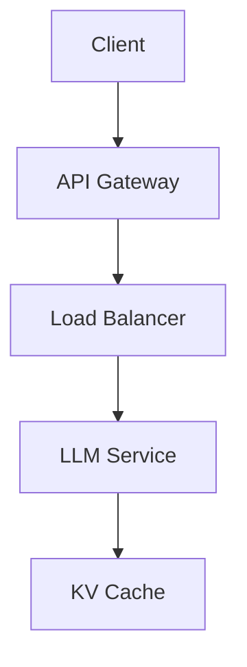
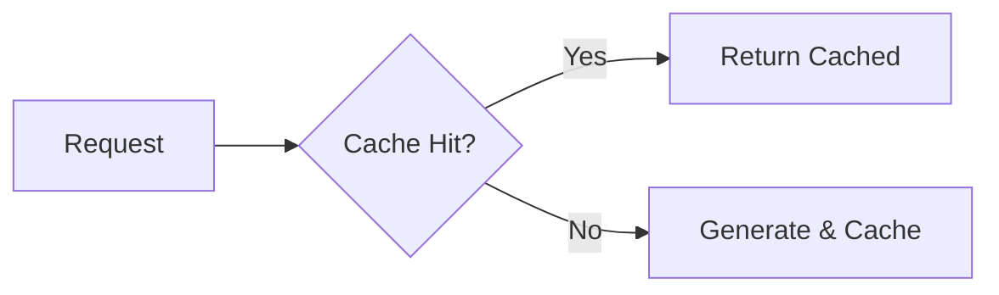

# LLM-Oriented System Design

## What is it?

LLM-Oriented System Design is the practice of applying classical system design principles to applications powered by Large Language Models, while accounting for LLM-specific constraints: **token budgets**, **context windows**, **model latency**, and **inference cost**. It maps each traditional design step—requirements, capacity estimation, architecture, deep dives—to the new primitives of generative AI systems.

## Why do we need it?

**Problem it solves**: Traditional system design assumes compute scales linearly with request volume. LLM systems break this assumption:
- A single GPT-4 request can cost **10,000× more** than a REST API call
- Latency is measured in **seconds**, not milliseconds
- Capacity is bounded by **tokens per minute (TPM)**, not requests per second
- Storage includes **vector embeddings**, not just rows and bytes

**Without LLM-aware design**:
- Token budgets explode, driving monthly costs past $100K
- Context windows overflow, silently dropping critical information
- Cold-start latency causes user-visible timeouts
- Model capacity is wasted on requests a smaller model could handle

**With LLM-aware design**:
- Token budgets are planned per-request with clear cost ceilings
- Context is managed as a scarce resource with priority packing
- Serving architecture routes requests to the cheapest capable model
- KV cache and batching reduce per-token latency and cost by 2–5×

## Core Ideas

### 1. Mapping System Design Steps to LLM Applications

Every classical system design step has an LLM-specific counterpart:

| Classical Step | LLM Equivalent | Key Difference |
|----------------|----------------|----------------|
| **Requirements** | Functional + quality bar (accuracy, hallucination rate) | Must define acceptable error rates |
| **Capacity estimation** | Token throughput, cost/month, GPU hours | Tokens replace bytes as the unit |
| **API design** | Prompt contract (system/user/tool messages) | API is natural language |
| **Data model** | Embedding store + prompt templates + KV cache | Unstructured data is first-class |
| **Architecture** | Model selection, routing, RAG pipeline | Model is the "database" |
| **Deep dive** | Latency breakdown, guardrails, eval pipeline | Must address hallucination and safety |

### 2. Token Budgets and Cost Estimation

Tokens are the fundamental unit of LLM capacity, cost, and latency.

```
┌──────────────────── Context Window (e.g., 128K tokens) ──────────────────┐
│                                                                           │
│  ┌──────────────┐  ┌──────────────┐  ┌───────────┐  ┌────────────────┐  │
│  │ System Prompt │  │ RAG Context  │  │ User Msg  │  │ Output Budget  │  │
│  │  500 tokens   │  │ 2000 tokens  │  │ 200 tokens│  │  1000 tokens   │  │
│  └──────────────┘  └──────────────┘  └───────────┘  └────────────────┘  │
│                                                                           │
│  Total: 3700 tokens per request                                           │
└───────────────────────────────────────────────────────────────────────────┘
```

**Cost estimation formula**:

```
Monthly cost = (requests/day) × 30 × (tokens/request) × (price/token)

Example — customer support chatbot:
  10,000 requests/day × 30 days × 3,700 tokens × $0.01/1K tokens
  = 10,000 × 30 × 3.7 × $0.01
  = $11,100/month (input only — output adds ~$33,300 at 3× output pricing)
```

**Interview tip**: Always estimate input and output tokens separately — output tokens are 2–4× more expensive on most providers.

### 3. Context Windows and Constraints

The context window is the hard memory limit of an LLM. Everything the model "knows" for a given request must fit inside it.

```
┌─────────────────────────────────────────────┐
│            Context Window Budget             │
├─────────────────────────────────────────────┤
│  Priority 1: System prompt (fixed)          │
│  Priority 2: Tool/function schemas          │
│  Priority 3: Retrieved context (RAG)        │
│  Priority 4: Conversation history           │
│  Priority 5: Current user message           │
│  Reserved  : Output generation budget       │
├─────────────────────────────────────────────┤
│  ⚠ Overflow strategy:                       │
│    - Truncate lowest-priority sections      │
│    - Summarize conversation history          │
│    - Reduce RAG chunks returned             │
└─────────────────────────────────────────────┘
```

| Model | Context Window | Practical Limit* | Cost Tier |
|-------|---------------|-------------------|-----------|
| GPT-4o | 128K tokens | ~80K usable | High |
| Claude 3.5 Sonnet | 200K tokens | ~150K usable | High |
| Llama 3 70B | 8K tokens | ~6K usable | Self-host |
| Llama 3.1 70B | 128K tokens | ~100K usable | Self-host |
| Gemini 1.5 Pro | 1M tokens | ~800K usable | High |

*Practical limits account for output budget and quality degradation at window edges.

### 4. KV Cache for Inference Optimization

The **Key-Value (KV) cache** stores intermediate attention computations so repeated prefixes are not recomputed on every token generation.

```
Without KV Cache:                    With KV Cache:
┌─────────────────────┐              ┌─────────────────────┐
│ Token 1 → compute   │              │ Token 1 → compute   │
│ Token 2 → recompute │              │ Token 2 → cache hit │ ◄── saved
│   all previous      │              │ Token 3 → cache hit │ ◄── saved
│ Token 3 → recompute │              │ Token N → compute   │ (only new)
│   all previous      │              └─────────────────────┘
│ ...O(n²) total      │              O(n) total compute
└─────────────────────┘
```

**Why it matters for system design**:
- KV cache consumes **GPU memory** — a 128K context on a 70B model needs ~40 GB of KV cache alone
- Shared prompt prefixes across users can be cached once (**prefix caching**)
- Trade-off: more GPU RAM for KV cache = fewer concurrent requests per GPU
- Frameworks like vLLM use **PagedAttention** to manage KV cache like virtual memory pages

### 5. Serving Architecture Patterns

```
Pattern A: Single Model                Pattern B: Model Cascade
┌────────┐    ┌──────────┐            ┌────────┐    ┌────────────┐
│ Client │───►│ GPT-4o   │            │ Client │───►│ Small Model│
└────────┘    └──────────┘            └────────┘    │ (GPT-4o-   │
                                                     │  mini)     │
                                                     └─────┬──────┘
                                                           │
                                                     confident?
                                                     ┌─────┴──────┐
                                                     │ Yes    No   │
                                                     ▼             ▼
                                               ┌─────────┐  ┌──────────┐
                                               │ Return  │  │ Large    │
                                               │ result  │  │ Model    │
                                               └─────────┘  │ (GPT-4o) │
                                                             └──────────┘

Pattern C: Router
┌────────┐    ┌──────────────┐    ┌──────────────┐
│ Client │───►│   Router /   │───►│ Code Model   │  (coding tasks)
└────────┘    │  Classifier  │───►│ Chat Model   │  (conversation)
              └──────────────┘───►│ Vision Model │  (image tasks)
                                  └──────────────┘
```

| Pattern | Latency | Cost | Accuracy | Best For |
|---------|---------|------|----------|----------|
| **Single model** | Predictable | High | Highest | Simple apps, prototyping |
| **Model cascade** | Variable | Low avg | High | Cost-sensitive production |
| **Router** | Low (parallel) | Optimized | Task-matched | Multi-capability platforms |

### 6. Batch vs Real-Time Inference

| Dimension | Real-Time | Batch |
|-----------|-----------|-------|
| **Latency target** | < 2 seconds | Minutes to hours |
| **Throughput** | 1 request at a time | Hundreds/thousands |
| **Cost per token** | Full price | 50% discount (OpenAI Batch API) |
| **Use case** | Chat, copilot, search | Summarization, classification, eval |
| **GPU utilization** | Low (waiting on user) | High (continuous processing) |
| **Error handling** | Retry immediately | Retry queue, dead-letter |

```
Real-Time Path:                      Batch Path:
┌──────┐  ┌─────────┐  ┌───────┐    ┌───────┐  ┌───────────┐  ┌────────┐
│ User │─►│ Gateway │─►│ Model │    │ Queue │─►│ Batch     │─►│ Output │
└──────┘  └─────────┘  └───────┘    │(S3/SQS)│  │ Processor │  │ Store  │
          Response in seconds        └───────┘  └───────────┘  └────────┘
                                     Results in hours, 50% cheaper
```

## How it works

### End-to-End LLM Request Flow

```
┌────────┐     ┌───────────┐     ┌──────────────┐     ┌──────────────┐
│ Client │────►│ API       │────►│ Prompt       │────►│ Context      │
│        │     │ Gateway   │     │ Builder      │     │ Assembly     │
└────────┘     └───────────┘     └──────────────┘     └──────┬───────┘
                    │                                         │
               Rate limit,                          Fetch RAG chunks,
               auth, logging                        enforce token budget
                                                          │
┌────────┐     ┌───────────┐     ┌──────────────┐     ┌──────▼───────┐
│ Client │◄────│ Guardrail │◄────│ Model        │◄────│ Router /     │
│        │     │ + Post-   │     │ Inference    │     │ Cascade      │
└────────┘     │ process   │     └──────────────┘     └──────────────┘
               └───────────┘
          Safety filter, format
          validation, citations
```

**Key steps**:
1. **Gateway** — authenticate, rate-limit by tokens/min, log request metadata
2. **Prompt Builder** — assemble system prompt, inject variables, count tokens ([see Prompt Builder LLD](../../01-llm-lld-projects/))
3. **Context Assembly** — retrieve relevant docs via vector search, pack within budget
4. **Router/Cascade** — select model based on task type, complexity, or cost policy
5. **Model Inference** — call LLM with KV cache, stream tokens back
6. **Guardrails** — filter harmful content, validate output format, attach citations

## When to use

✅ **Use LLM-oriented system design when:**
- Your system includes one or more LLM calls in the critical path
- Token costs are a significant line item (> $1K/month)
- You need to manage context windows across multi-turn conversations
- Multiple models or model sizes are candidates for different tasks
- You need to estimate GPU capacity or API rate limits

**Specific scenarios:**
- AI coding assistants ([see AI Copilot HLD](../../02-llm-hld-projects/))
- Enterprise search with RAG ([see RAG Search HLD](../../02-llm-hld-projects/))
- Customer support chatbots
- Content generation pipelines
- Document summarization services

## When NOT to use

❌ **Avoid LLM-oriented design when:**
- The task can be solved with a deterministic algorithm or SQL query
- Latency requirements are < 50ms (LLMs are too slow)
- Zero-error tolerance is required (LLMs hallucinate)
- Data privacy rules prohibit sending data to model providers
- The workload is pure classification — a fine-tuned BERT is cheaper and faster

**Anti-patterns:**
- Using GPT-4 for tasks a regex can solve
- Ignoring token costs during prototyping, then getting a $50K bill
- Stuffing the entire context window "just in case" — quality degrades
- Treating the LLM as a database instead of a reasoning engine
- Skipping output validation and guardrails

## Trade-offs

| Aspect | Benefit | Cost |
|--------|---------|------|
| **Flexibility** | Handles open-ended tasks via natural language | Non-deterministic outputs |
| **Latency** | Streaming gives perceived speed | First-token latency is 200ms–2s |
| **Cost** | Pay-per-token scales to zero | Heavy usage costs 10–100× vs traditional APIs |
| **Accuracy** | Near-human on many tasks | Hallucination risk, requires eval pipeline |
| **Scaling** | Managed APIs scale horizontally | GPU scarcity, rate limits, quota management |
| **Caching** | KV cache + response cache cut costs | Cache invalidation on prompt/model changes |
| **Complexity** | Single model replaces many microservices | New failure modes: refusals, format errors, drift |

## Real-world examples

### GitHub Copilot
- **Router**: classifies intent (code completion vs chat vs explanation)
- **Model cascade**: small model for simple completions, large for complex reasoning
- **Token budget**: ~8K context with file snippets ranked by relevance
- **KV cache**: shared prefix for repository-level context

### ChatGPT
- **Serving**: multi-model routing (GPT-4o, GPT-4o-mini) based on subscription tier
- **Context**: 128K window with conversation history management
- **Batch**: background tasks (memory summarization) processed asynchronously
- **Cost**: token-based rate limiting per user tier

### Notion AI
- **RAG pipeline**: retrieves relevant workspace pages before generation
- **Token budget**: strict limits on retrieved context to control cost
- **Cascade**: lightweight model for formatting, powerful model for drafting
- **Guardrails**: output filtered for brand consistency and safety

## Key Takeaways

1. **Estimate in tokens, not bytes**: Every capacity calculation should start with tokens/request, tokens/minute, and $/1K tokens

2. **Context window is your memory budget**: Treat it like RAM — prioritize what goes in, have an overflow strategy, and monitor utilization

3. **KV cache is your performance lever**: Shared prefixes and PagedAttention can cut latency and GPU cost dramatically

4. **Use model cascades in production**: Route 80% of requests to a cheap model; escalate the hard 20% to a powerful one

5. **Separate batch from real-time**: Move non-urgent workloads to batch APIs for 50% cost savings

6. **Always add guardrails**: LLM output is untrusted — validate format, filter safety, and verify citations before returning to users

---

## See Also
- [Prompt Builder (LLD)](../../01-llm-lld-projects/) — managing token budgets in practice
- [AI Coding Copilot (HLD)](../../02-llm-hld-projects/) — full LLM system design example
- [RAG-Based Enterprise Search (HLD)](../../02-llm-hld-projects/) — RAG-centric system design
- [Load Balancing](../../../03-hld-concepts/load-balancing/) — model-aware request routing
- [Caching](../../../03-hld-concepts/caching/) — KV cache and response caching
- [RAG Architecture](../rag-architecture/) — retrieval-augmented generation patterns
- [LLM Evaluation](../llm-evaluation/) — measuring system quality


## Architecture Diagrams


*LLM System Architecture*


*Semantic Caching Flow*

